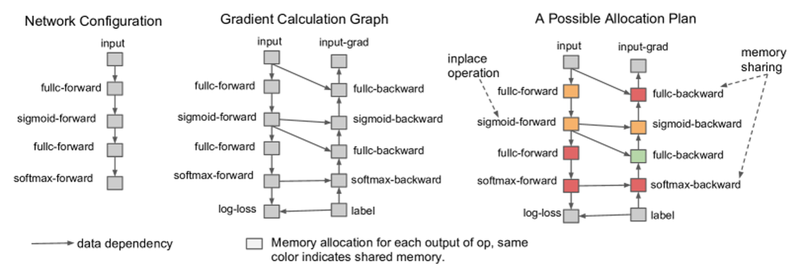

# 读懂公式的最小数学：接口、概率、loss 和梯度

这篇文章只回答一个问题：AI 文章里的公式到底应该怎么读，才不会停在“符号我都见过，但不知道它在说什么”。

公式不是为了显得高级。好的公式通常在声明四件事：输入是什么，输出是什么，哪些变量可见，训练或推理在优化什么。读不懂公式时，最容易犯的错是急着背符号表；更好的办法是把它还原成模型接口和数据流。

## 先把公式读成接口

Transformer 架构图看起来是模块图，但每条箭头背后都有 shape 和可见性约束。

{ width="760" }

<small>图源：[Attention Is All You Need](https://arxiv.org/abs/1706.03762)，Figure 1。原图表达 encoder-decoder Transformer 的输入 embedding、positional encoding、multi-head attention、feed-forward、linear 和 softmax。本站使用这张图说明：公式不是孤立符号，而是在说明每个模块接收什么张量、输出什么张量，以及信息如何流动。</small>

例如文本 hidden state 常写成：

\[
x\in\mathbb{R}^{B\times L\times D}
\]

这里 \(x\) 是一批 token 表示，\(B\) 是 batch size，\(L\) 是序列长度，\(D\) 是每个 token 的 hidden dimension。它不是一个装饰性说明，而是在声明接口：Linear 通常作用在最后一维 \(D\)，attention 会沿 \(L\) 维让 token 互相读取，batch 维 \(B\) 只是并行样本。

如果一个公式只写 \(x\)，你应该追问 \(x\) 的 shape、dtype、device 和轴语义。`[B, L, D]` 和 `[B, D, L]` 数字可能一样多，但后者把 token 轴和特征轴换了位置，接错 Linear 或 mask 时可能不报错，却会把语义弄乱。

## 矩阵乘法是在重组特征

最常见的线性层可以写成：

\[
y=xW+b
\]

如果 \(x\in\mathbb{R}^{B\times D_{\text{in}}}\)，\(W\in\mathbb{R}^{D_{\text{in}}\times D_{\text{out}}}\)，那么 \(y\in\mathbb{R}^{B\times D_{\text{out}}}\)。这里 \(W\) 是被训练的权重矩阵，\(b\) 是偏置，\(y\) 是输出表示。矩阵乘法的核心不是“乘了一堆数”，而是把输入特征按 \(W\) 的列重新组合成新的特征。

在 Transformer 里，同一个公式会批量作用在每个 token 上：

\[
(B,L,D_{\text{in}})
\times
(D_{\text{in}},D_{\text{out}})
\rightarrow
(B,L,D_{\text{out}})
\]

这行式子在说：每个 token 的最后一维都乘同一个 \(W\)，前面的 \(B,L\) 只是并行轴。很多框架把它落成 GEMM，是因为可以把 \(B\times L\) 个 token 展平成一批行向量。

## Softmax 把分数变成概率分布

模型最后常先输出 logits，也就是未归一化分数 \(s_i\)。Softmax 把这些分数变成概率：

\[
p_i=\frac{\exp(s_i)}{\sum_j \exp(s_j)}
\]

这里 \(i\) 是候选类别或候选 token 的索引，\(s_i\) 是第 \(i\) 个候选的 logit，分母对所有候选 \(j\) 求和，保证所有 \(p_i\) 加起来等于 1。Softmax 不会让模型变聪明；它只是把相对分数转成可比较的概率分布。

交叉熵常写成：

\[
\mathcal{L}_{\text{CE}}
=
-\log p_\theta(y\mid x)
\]

这里 \(p_\theta(y\mid x)\) 是模型在输入 \(x\) 下给正确标签或正确 token \(y\) 的概率，\(\theta\) 是模型参数。负号的意思很朴素：正确答案概率越高，loss 越小；正确答案概率越低，loss 越大。

在语言模型里，它通常对一整段 token 求和或求平均：

\[
\mathcal{L}_{\text{LM}}
=
-\sum_{t=1}^{L}\log p_\theta(x_t\mid x_{<t})
\]

这里 \(x_t\) 是第 \(t\) 个 token，\(x_{<t}\) 是它之前的 token。这个条件很关键：自回归模型训练的是“只看过去预测当前”，如果 mask 让模型看到了未来 token，loss 会虚假变好。

## 期望符号说明数据从哪里来

很多论文会写：

\[
\mathbb{E}_{(x,y)\sim\mathcal{D}}
\left[
\ell(f_\theta(x),y)
\right]
\]

这行式子读作：从数据分布 \(\mathcal{D}\) 里取样本 \((x,y)\)，让模型 \(f_\theta\) 对输入 \(x\) 做预测，再用损失函数 \(\ell\) 和标签 \(y\) 比较，最后取平均。训练代码里的 mini-batch 只是对这个期望的近似。

所以看到期望时不要跳过下标。下标告诉你样本来自哪里：预训练网页、机器人示范、偏好比较、在线 rollout、合成数据，还是 benchmark。分布不同，公式同名也可能代表完全不同的训练压力。

## 梯度告诉参数往哪里改

最小的梯度下降更新写成：

\[
\theta
\leftarrow
\theta-\eta\nabla_\theta\mathcal{L}
\]

这里 \(\theta\) 是当前参数，\(\mathcal{L}\) 是 loss，\(\nabla_\theta\mathcal{L}\) 是 loss 对参数的梯度，\(\eta\) 是学习率。梯度方向是“让 loss 增大的方向”，所以更新里有一个负号，表示往相反方向走。

反向传播不是单独的魔法步骤，而是沿计算图把局部导数串起来。

{ width="760" }

<small>图源：[Training Deep Nets with Sublinear Memory Cost](https://arxiv.org/abs/1604.06174)，Figure 1。原图展示网络配置、梯度计算图和一种内存分配计划。本站使用这张图说明：forward 产生的中间张量会形成依赖图，backward 沿这些依赖计算梯度；训练显存高，常常是因为这些中间量要被保留给反传。</small>

以矩阵乘 \(Y=XW\) 为例，若上游给出 \(G=\partial\mathcal{L}/\partial Y\)，主要梯度是：

\[
\frac{\partial\mathcal{L}}{\partial W}=X^\top G,
\qquad
\frac{\partial\mathcal{L}}{\partial X}=GW^\top
\]

这里 \(G\) 是 loss 对输出 \(Y\) 的敏感度。第一行告诉你权重 \(W\) 怎么改，第二行告诉你梯度怎么继续传给上一层输入 \(X\)。这也解释了为什么很多算子 forward 时要保存 \(X\) 或 \(W\)：backward 要用它们算梯度。

## KL 和正则项是在约束分布或行为

很多后训练、蒸馏和生成模型论文会出现 KL：

\[
D_{\mathrm{KL}}(p\|q)
=
\sum_i p_i\log\frac{p_i}{q_i}
\]

这里 \(p\) 和 \(q\) 是两个概率分布，\(i\) 遍历所有离散结果。KL 的直觉是：如果你用 \(q\) 去近似 \(p\)，会多付多少信息代价。它不是对称距离，通常 \(D_{\mathrm{KL}}(p\|q)\neq D_{\mathrm{KL}}(q\|p)\)。

在 RLHF / preference optimization 里，常见写法是：

\[
\mathcal{L}
=
\mathcal{L}_{\text{task}}
+\beta D_{\mathrm{KL}}(\pi_\theta\|\pi_{\text{ref}})
\]

这里 \(\pi_\theta\) 是当前策略，\(\pi_{\text{ref}}\) 是参考模型，\(\beta\) 控制“不偏离参考模型太远”的强度。读这类公式时不要只看有几个 loss 项，要看每一项的量纲、数值尺度和梯度大小。权重 \(\beta\) 不是装饰，它会决定模型是更追任务奖励，还是更保守地贴近参考模型。

## 时间下标说明可见历史

具身智能、世界模型和自回归生成里常见：

\[
\pi_\theta(a_t\mid o_{\le t},l)
\]

这里 \(\pi_\theta\) 是策略，\(a_t\) 是第 \(t\) 步动作，\(o_{\le t}\) 是到当前为止的观测历史，\(l\) 是语言指令。竖线右边是条件，也就是模型允许看的信息。若训练时把未来观测 \(o_{t+1}\) 或未来动作标签泄漏进去，离线指标会很好，闭环执行会崩。

世界模型里也常写：

\[
p_\theta(z_{t+1}\mid z_t,a_t)
\]

这里 \(z_t\) 是当前 latent state，\(a_t\) 是动作，\(z_{t+1}\) 是下一步 latent。这个公式不是在预测“某个固定向量”，而是在建模动作后世界状态如何变化。读这种公式时，重点是问 latent 来自 encoder、posterior、prior 还是 rollout，动作是否真的影响预测。

## 复杂度符号是在讲增长趋势

复杂度不是精确运行时间，而是输入变大时成本怎么增长。Attention 最常见的提醒是：

\[
\text{attention score memory}
\propto
B\cdot H_{\text{heads}}\cdot L^2
\]

这里 \(B\) 是 batch，\(H_{\text{heads}}\) 是 attention head 数，\(L\) 是序列长度。平方项来自 query 和 key 的两两比较：每个 query token 都要给每个 key token 一个分数。长上下文、多相机视频和密集视觉 token 容易在这里爆掉。

再看一个 activation 显存估算：

\[
\text{hidden bytes}
\approx
B\cdot L\cdot D\cdot bytes
\]

这里 \(bytes\) 是每个数的字节数，BF16 通常是 2 bytes，FP32 是 4 bytes。这个公式很粗，但足够让你在模型设计前意识到：相机数、帧数、patch 数、上下文长度和 hidden dimension 都会进入显存账本。

## 读任何公式时先找四个锚点

第一，找输入和输出。公式左边通常是要计算的量，右边是它依赖的量。先把每个变量写成 shape 和语义，不要只写字母。

第二，找条件和可见性。概率里的竖线 \(\mid\)、attention mask、时间下标和 causal 前缀，都会决定模型有没有偷看未来或跨样本泄漏。

第三，找优化对象。Loss 是监督标签、teacher 分布、奖励、KL、重建误差、扩散噪声、动作 MSE，还是系统成本？同样写 \(\mathcal{L}\)，训练含义可能完全不同。

第四，找近似和边界。Mini-batch 近似期望，Taylor 近似剪枝损失，softmax 概率不等于真实置信度，复杂度不等于真实 latency。公式告诉你主关系，边界决定它能不能安全外推。

## 阅读结论

最小数学不是符号表，而是一套读法：shape 声明接口，矩阵乘法重组特征，softmax 把 logits 变成分布，cross entropy 惩罚正确答案低概率，期望说明数据来源，梯度说明参数怎么改，KL 和正则约束行为边界，时间下标说明模型能看见什么，复杂度说明成本怎样随规模增长。

以后读论文公式时，不要问“这个符号叫什么”就停下。要问：它来自哪条数据流，进入哪个模块，改变哪个 loss，保存哪些中间量，最后会影响质量、显存、延迟还是安全边界。

## 外部精读

- [D2L：线性代数](https://zh.d2l.ai/chapter_preliminaries/linear-algebra.html)：补张量、矩阵乘法、范数和轴的基础。
- [D2L：自动微分](https://zh.d2l.ai/chapter_preliminaries/autograd.html)：理解计算图、梯度和框架自动求导。
- [CS231n: Optimization and Backpropagation](https://cs231n.github.io/optimization-2/)：用计算图讲链式法则和 backward，是公式读法的经典教程。
- [colah: Calculus on Computational Graphs](https://colah.github.io/posts/2015-08-Backprop/)：高质量图文解释，适合建立反向传播直觉。
- [The Matrix Calculus You Need For Deep Learning](https://explained.ai/matrix-calculus/)：系统补矩阵微积分，不建议一开始死背，适合遇到梯度公式时查。
- [PyTorch Autograd Mechanics](https://docs.pytorch.org/docs/stable/notes/autograd.html)：理解 saved tensors、动态计算图和 backward 细节。
- [NumPy Broadcasting](https://numpy.org/doc/stable/user/basics.broadcasting.html)：理解 shape 自动扩展为什么经常让错误静默发生。
