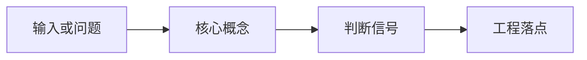

# 符号与最小数学地图

这页是基础知识模块的随手查表。第一次读 AI 教程时，真正卡人的往往不是公式本身，而是符号没有说明：\(x\) 是输入还是图像，\(W\) 是权重还是宽度，\(H\) 是图像高度还是预测 horizon。


<!-- [待补图：建议在此插入“张量 shape 从样本到模型接口”的真实来源图，推荐来源：论文《Attention Is All You Need》Figure 1 或官方教程中的 Transformer embedding / tensor shape 图] -->
<!-- [建议删除：下面 Mermaid 图是旧自动补图，不满足本轮“图解只能引用论文或博客真实图片来源”的约束；保留原文并建议后续用上方真实来源图替换。] -->


## Shape 字母：先知道张量有多大

<!-- [融合：算法基础] 来源：llm-algo-leetcode《02. PyTorch Tensor Fundamentals | PyTorch 张量基础操作》-->
> **算法视角**：张量 shape、stride、view / reshape 和 device placement 是后续 attention、GEMM、KV cache 与训练循环的共同底座；看似只是 API 差异，实际会影响是否发生拷贝和是否能走高效 kernel。
>
> 延伸阅读：[02. PyTorch Tensor Fundamentals | PyTorch 张量基础操作](https://datawhalechina.github.io/llm-algo-leetcode/00_Prerequisites/02_PyTorch_Tensor_Fundamentals.html)

<!-- [融合：复杂度分析] 来源：llm-algo-leetcode《02. PyTorch Tensor Fundamentals | PyTorch 张量基础操作》-->
| 操作 | 时间复杂度 | 空间复杂度 | 说明 |
|------|-----------|-----------|------|
| view / reshape / permute | metadata 变换常为 $O(1)$；触发 contiguous copy 时为 $O(N)$ | 取决于是否复制底层 storage | 先确认 stride 与 contiguous，再判断性能问题；参考：[对应章节](https://datawhalechina.github.io/llm-algo-leetcode/00_Prerequisites/02_PyTorch_Tensor_Fundamentals.html) |

Shape 是模型模块之间的接口契约。本站会尽量沿用下面的写法。

| 符号 | 读法 | 常见含义 | 取值范围 / 小例子 |
| --- | --- | --- | --- |
| \(B\) | batch size | 一次处理多少样本 | `B=8` 表示 8 条样本一起算 |
| \(L\) | sequence length | token 数或序列长度 | 文本长度、视觉 token 数 |
| \(D\) | hidden dimension | 每个 token 的向量维度 | `D=4096` |
| \(C\) | channel | 图像通道或特征通道 | RGB 图像里 `C=3` |
| \(H_{\text{img}}\) | image height | 图像高度 | 224 像素 |
| \(W_{\text{img}}\) | image width | 图像宽度 | 224 像素 |
| \(P\) | patch size | 图像 patch 边长 | ViT 常见 `P=16` |
| \(N\) | token 或样本数量 | 具体含义看上下文 | \(N\) 个 patch、\(N\) 条数据 |
| \(T\) | time length | 时间步或总序列长度 | 16 帧视频、64 步轨迹 |

一个文本 batch 常写成：

\[
x \in \mathbb{R}^{B \times L \times D}
\]


读作：\(x\) 是一个三维张量，有 \(B\) 条样本，每条样本有 \(L\) 个 token，每个 token 是 \(D\) 维向量。

!!! warning "同一个字母在不同页面可能换意思"
    \(H\) 在图像里常是 height，在世界模型里常是 horizon，在 attention 里也可能是 head 数。教程会尽量写成 \(H_{\text{img}}\)、\(H_{\text{hor}}\)、\(H_{\text{heads}}\) 来避免混淆。

## 模型和参数：谁在被训练

最常见的线性层公式是：

\[
y = xW + b
\]


逐项读：

| 部分 | 含义 |
| --- | --- |
| \(x\) | 输入向量或输入张量 |
| \(W\) | 可训练权重，决定怎么重新组合输入特征 |
| \(b\) | 偏置，让输出可以整体平移 |
| \(y\) | 输出表示 |

如果写成 \(\hat y=f_\theta(x)\)，意思就是“模型用参数 \(\theta\) 处理输入 \(x\)，得到预测 \(\hat y\)”。

## 概率符号：模型在给可能性打分

注意两种常见写法的区别：\(\mathcal{N}(x;\mu,\Sigma)\) 把“变量、均值、协方差”三个位置都写出来；\(z\sim\mathcal{N}(0,I)\) 是采样简写，左边的 \(z\) 已经说明变量，所以括号里只剩“均值 0、协方差 \(I\)”。

条件概率里的竖线 \(\mid\) 读作“given”。例如：

\[
p_\theta(y \mid x)
\]


读作：给定输入 \(x\)，模型输出 \(y\) 的概率。它不保证 \(y\) 一定正确，只表示模型认为哪个输出更可能。

在 VLA 或世界模型里常见：

\[
p_\theta(z_{t+1}\mid z_t,a_t)
\]


读作：给定当前 latent state \(z_t\) 和动作 \(a_t\)，模型预测下一步 latent state \(z_{t+1}\) 的分布。

## Loss、梯度和优化：模型怎么变好

最小训练更新可以写成：

\[
\theta \leftarrow \theta - \eta \nabla_\theta \mathcal{L}
\]


逐项读：

| 部分 | 含义 |
| --- | --- |
| \(\theta\) | 当前模型参数 |
| \(\nabla_\theta \mathcal{L}\) | 哪个方向会让 loss 变大 |
| \(-\nabla_\theta \mathcal{L}\) | 往相反方向走，通常能让 loss 变小 |
| \(\eta\) | 步长，太大可能发散，太小会很慢 |

代码里它大致对应：

```text
loss.backward()
optimizer.step()
```

## 求和、期望和范数：把很多样本合起来

例如行为克隆损失：

\[
\mathcal{L}_{\text{BC}}
=-\sum_{(o,l,a)\in\mathcal{D}}\log \pi_\theta(a\mid o,l)
\]


这行式子在说：训练集 \(\mathcal{D}\) 里每条样本都有观测 \(o\)、语言 \(l\)、专家动作 \(a\)；我们让策略 \(\pi_\theta\) 更倾向于在同样输入下输出专家动作。

## 时间下标：模型在第几步看见什么

例如：

\[
\pi_\theta(a_t\mid o_{\le t}, l)
\]


读作：策略根据到目前为止的观测 \(o_{\le t}\) 和语言指令 \(l\)，输出当前动作 \(a_t\) 的概率或动作值。

## 复杂度符号：为什么有的模型跑不动

| 写法 | 直觉 |
| --- | --- |
| \(O(L)\) | 序列长度翻倍，成本大约翻倍 |
| \(O(L^2)\) | 序列长度翻倍，成本大约变四倍 |
| \(O(BLD)\) | batch、长度、维度都会线性增加成本 |
| \(B\times L\times D\times bytes\) | 一个 hidden tensor 的大致显存 |

Attention 最常见的成本提醒是：

\[
\text{score matrix size} \propto L^2
\]


也就是说，token 数 \(L\) 一多，注意力分数矩阵会平方放大。多相机视频、长上下文和多轮对话都容易在这里变贵。

## 读公式的固定四问

以后在基础页或论文页看到公式，可以按下面四问走：

1. 输入是什么：\(x\)、\(o_t\)、\(z_t\)、\(a_t\) 分别来自哪里？
2. 输出是什么：预测 token、动作、latent、reward，还是概率？
3. 条件是什么：竖线 \(\mid\) 后面的变量是不是都在模型可见范围内？
4. 优化什么：loss 是让输出更像标签，还是让分布、风险、奖励或成本更好？

如果这四问答不清，先回到本页查符号，再继续读具体模型。
