# 张量、Shape 与计算图

张量是深度学习里最基本的数据结构。模型看到的文本、图像、音频、动作轨迹，最终都会被组织成不同形状的张量，然后交给算子处理。

{ .atlas-figure-compact width="340" }

<small>图源：[TensorFlow: Large-Scale Machine Learning on Heterogeneous Distributed Systems](https://arxiv.org/abs/1603.04467)，Figure 2。原论文图意：一个简单计算图由输入、常量和算子节点组成，边表示张量在节点之间流动。</small>

!!! note "图解：计算图先看节点和边"
    图中的圆点/方块可以理解成算子或数据节点，箭头表示张量从一个节点流到下一个节点。很多模型问题不是公式错，而是 shape、dtype、device 或计算图接口错：例如上一层输出 `[B, L, D]`，下一层却以为输入是 `[B, D, L]`。读复杂模型前先把这条数据流画通，再看 attention、MLP、loss 或 backward，理解成本会低很多。

!!! note "初学者先抓住"
    读任何模型结构时，先不要急着看公式。先问三件事：输入张量是什么 shape，中间每一步 shape 怎么变，最后输出要交给谁。只要 shape 链条通了，大多数结构图都会突然变清楚；遇到报错时，也能先区分是 shape、dtype、device 还是计算图断开。

!!! tip "为什么现在要学这个：shape 就是成本账入口"
    世界模型里的很多“显存突然爆了”都能先写成 shape。多相机视频常从 `[B, camera, frame, patch, D]` 变成 `[B, L, D]`，其中 \(L = camera \times frame \times patch\)。一旦 `camera=4`、`frame=16`、`patch=256`，单样本视觉长度就是 `16,384`；再乘 batch、层数、KV heads 和 dtype，就变成真实显存账。计算图也同样重要：一个看似无害的 `permute + contiguous` 可能 materialize 大张量，一个没 checkpoint 的分支可能把长视频激活全留到 backward。

!!! tip "遇到这些症状，回看本页"
    `CUDA OOM` 只发生在多相机/长视频 bucket、同样 batch 下某个 resize 版本突然爆显存、profile 里出现异常大的 `contiguous` / `clone` / `view_as_real`，或者模型接口总在 `[B, L, D]` 和 `[B, D, L]` 之间错位时，先把每一步 shape、dtype、device 和是否 materialize 写出来。本页能帮你判断问题是在输入展开、patch/token 计数、计算图保存，还是张量布局转换。

## 1. Tensor 到底是什么

可以把 tensor 理解成带维度的数字容器：

- 标量：一个数，例如 loss。
- 向量：一串数，例如一个 token embedding。
- 矩阵：二维表，例如线性层权重。
- 高维张量：图像 batch、视频 batch、KV cache 等。

常见符号：

| 符号 | 含义 | 例子 |
| --- | --- | --- |
| `B` | batch size | 一次训练多少样本 |
| `C` | channel | 图像通道或特征通道 |
| `H, W` | height, width | 图像高宽 |
| `L` | sequence length | token 数或时间步数 |
| `D` | hidden dimension | embedding 维度 |

例如一批图像常写成：

\[
x \in \mathbb{R}^{B \times C \times H \times W}
\]

一批文本 token embedding 常写成：

\[
x \in \mathbb{R}^{B \times L \times D}
\]

## 2. Shape 是接口契约

Shape 决定张量能不能进入某个模块。比如矩阵乘：

\[
(B, L, D) \times (D, D_{\text{out}}) \rightarrow (B, L, D_{\text{out}})
\]

如果最后一维不是 \(D\)，矩阵乘就无法进行。很多训练报错其实都来自这里。

一个实用习惯是：读任何模型结构时，都在纸上写出每一步 shape：

```text
image:      [B, 3, H, W]
patchify:   [B, N, P*P*3]
project:    [B, N, D]
attention:  [B, N, D]
head:       [B, num_classes]
```

这比直接看代码更容易发现接口问题。

## 3. 计算图是什么

计算图记录了张量如何从输入变成输出。训练时通常有两条路径：

1. **Forward**：输入经过模型，得到预测和 loss。
2. **Backward**：从 loss 开始，用链式法则把梯度传回每个参数。

伪代码如下：

```text
for batch in dataloader:
    y_pred = model(batch.x)          # forward
    loss = criterion(y_pred, batch.y)
    loss.backward()                  # backward
    optimizer.step()                 # update parameters
    optimizer.zero_grad()
```

## 4. 为什么显存会被计算图吃掉

训练时，反向传播需要用到前向中的中间激活。因此模型不只要存权重，还要存：

- layer input：反传时常要用输入计算权重梯度，不能只保存输出。
- attention 中间结果：Q/K/V、attention 权重或等价状态会占用大量显存。
- activation：非线性层和 MLP 的中间输出，反向传播要用它们算局部梯度。
- normalization 统计或中间量：均值、方差、RMS 或归一化后的值会影响梯度计算。
- optimizer state：Adam 一类优化器还要保存动量和二阶矩，训练显存远大于推理。

这解释了为什么推理能跑的模型，训练时可能显存不够。推理通常不需要保存完整计算图，而训练需要。

## 5. Shape 追踪例子：多相机视频如何变成长序列

```mermaid
flowchart LR
    A["[B, Cams, Frames, 3, H, W]"] --> B["Patchify"]
    B --> C["[B, Cams, Frames, Patches, patch_dim]"]
    C --> D["Project / visual encoder"]
    D --> E["[B, Cams, Frames, Patches, D]"]
    E --> F["Flatten camera/time/patch"]
    F --> G["[B, L_vision, D]"]
    G --> H["concat language / proprioception / action / memory"]
    H --> I["[B, L_total, D]"]
    I --> J["Transformer / World Model"]
    J --> K["future latent / action / risk"]
```



这张图要读成一张成本账，而不只是“把视频塞进 Transformer”。一条机器人轨迹片段通常先是 `[B, Cams, Frames, 3, H, W]`：`B` 是 batch，`Cams` 是相机数，`Frames` 是历史帧数，`3` 是 RGB 通道，`H, W` 是每帧分辨率。Patchify 会把每张图切成 patch；如果 patch 边长是 \(p\)，那么每帧 patch 数是：

\[
Patches = \frac{H}{p}\times\frac{W}{p}
\]

例如 `H=W=224`、`p=14`，就是 \(16\times16=256\) 个 patch。每个 patch 原本可以看成长度为 \(p\times p\times3\) 的小向量，经过线性投影或视觉 encoder 后变成 `D` 维 token，于是 shape 从 `[B, Cams, Frames, Patches, patch_dim]` 变成 `[B, Cams, Frames, Patches, D]`。

接着 flatten 的不是一个无关紧要的 reshape。它把相机、时间和空间 patch 三个轴合成一条 token 序列：

\[
L_{\text{vision}} = Cams \times Frames \times Patches
\]

假设 `Cams=4`、`Frames=16`、每帧 `Patches=256`，那么单样本视觉 token 数就是：

\[
L_{\text{vision}} = 4\times16\times256 = 16,384
\]

这还没有加语言、proprioception、action token 和 memory token。完整输入长度应该写成：

\[
L_{\text{total}} = L_{\text{vision}} + L_{\text{text}} + L_{\text{prop}} + L_{\text{action}} + L_{\text{memory}}
\]

语言 token 可能只有几十到几百个，proprioception 也可能很短；但 action token 如果按未来 horizon、关节维度或 action chunk 展开，memory token 如果保留长时历史，也会明显增加上下文。更重要的是，flatten 后必须保留位置信息：模型需要知道某个 token 来自哪个相机、哪一帧、图像哪个 patch。常见做法是加 spatial position、temporal position、camera/view embedding，或者在 attention mask 里显式限制哪些 token 能互相读取。

!!! example "把 16,384 个视觉 token 换成显存和计算"
    下面不是精确 profiler，而是读模型设计时的数量级估算。假设 `B=1`、`D=1024`、`BF16=2 bytes`、标准 MHA、`Heads=16`、`Layers=24`：

    | 项目 | 粗略公式 | 这组 shape 的数量级 | 说明 |
    | --- | --- | --- | --- |
    | 一个 hidden tensor | \(B\times L\times D\times bytes\) | \(1\times16,384\times1,024\times2\approx32\) MiB | 只是一个 `[B, L, D]` 激活，不含梯度和其它中间量 |
    | Q/K/V 激活 | \(3\times B\times L\times D\times bytes\) | 约 `96` MiB / layer | 训练时还要考虑 backward 保存与重算策略 |
    | 若显式存 attention score | \(B\times Heads\times L^2\times bytes\) | 约 `8` GiB / layer | 这就是为什么长序列必须用 FlashAttention、block attention、window attention 或其它稀疏/压缩策略 |
    | 推理 KV cache | \(Layers\times2\times B\times L\times D_{\text{kv}}\times bytes\) | 若 \(D_{\text{kv}}=D\)，约 `1.5` GiB / sample | `2` 来自 K 和 V；GQA/MQA/MLA 会降低 \(D_{\text{kv}}\)，但不会减少原始视觉 token 数 |
    | Attention matmul FLOPs | 约 \(4\times B\times L^2\times D\) / layer | 约 `1.1` TFLOPs / layer | FlashAttention 能省 score 显存和 HBM 往返，但 full attention 的 \(L^2\) 计算关系仍在 |

    这就是“shape 账”有用的地方：`16,384` 看起来只是一个长度，但它进入 attention 后会平方放大；进入 KV cache、activation 和通信时则大多线性放大。

同一个例子里，设计旋钮的影响也能直接从 shape 看出来：

| 设计改动 | Shape 怎么变 | 成本直觉 |
| --- | --- | --- |
| `Frames` 从 `16` 到 `32` | \(L_{\text{vision}}\) 变成 `2x` | hidden/KV 约 `2x`，full attention 约 `4x` |
| `Cams` 从 `4` 到 `8` | \(L_{\text{vision}}\) 变成 `2x` | 多视角信息更全，但长序列成本同样翻倍/平方放大 |
| 分辨率从 `224` 到 `448`，patch 仍是 `14` | 每帧 patch 从 `256` 到 `1,024`，\(L\) 变成 `4x` | hidden/KV 约 `4x`，full attention 约 `16x`；这是很多视频模型突然 OOM 的来源 |
| patch 从 `14` 改成 `28` | 每帧 patch 约变成 `1/4` | 成本大降，但小物体、接触点、末端执行器细节可能丢失 |
| 视觉 resampler 把每帧 `256` token 压到 `64` | `Patches` 等效变成 `64` | Transformer 主干便宜很多，但瓶颈会转移到 resampler 是否保留任务相关细节 |
| 只让局部时间窗做 full attention | \(L^2\) 变成多个小窗口的平方和 | 长历史可用 memory token 或压缩状态承载，不能默认所有帧两两互看 |
| 用 GQA/MQA/MLA 或 KV 量化 | \(D_{\text{kv}}\) 或 `bytes` 下降 | 主要救 KV cache 和 decode 带宽，不等于视觉 tokenization 已经便宜 |

读 VLA、视频世界模型或长上下文系统时，先把 \(L_{\text{total}}\) 算出来，再判断 attention、activation、KV cache 和通信是否可承受。很多“模型设计问题”其实先是 shape 账没算清：到底是相机太多、帧太长、分辨率太高、patch 太密，还是 memory/action token 没有分层压缩。

## 6. Shape 调试表

| 症状 | 常见 shape 根因 | 快速检查 |
| --- | --- | --- |
| OOM 只发生在多图样本 | `L` 被相机、帧数、patch 数相乘放大 | 打印每个 batch 的 token breakdown |
| 性能偶发抖动 | 长尾 shape 触发慢 kernel 或重新编译 | 按 shape bucket 记录 latency |
| 输出坐标错位 | `[B, L, D]` 和 `[B, D, L]` 混用 | 在模块边界写 shape assert |
| 训练 loss 异常低 | packed segment 或 label mask 错 | 可视化 attention mask 和 label mask |
| 量化后局部退化 | 某些通道/模态尺度不同 | 按模态统计 activation range |

## 7. 和后续专题的关系

- [大模型训练路线图](../training/index.md)：理解 loss、反向传播、checkpoint 和显存。
- [算子与编译器](../operators/index.md)：理解 kernel 为什么要关心 shape bucket。
- [推理系统](../inference/index.md)：理解 batch、sequence length 和 KV cache 如何影响延迟。
- [量化](../quantization/index.md)：理解 dtype、scale 和张量误差如何传播。

## 小结

张量是数据，shape 是接口，计算图是训练链路。只要这三件事清楚，很多看起来很复杂的模型结构都会变成“张量经过一组模块变形和计算”的过程。
