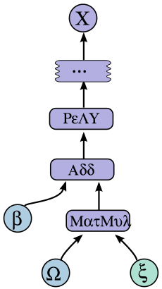

# 张量、Shape 与计算图：为什么很多模型问题先是接口问题

这篇文章只回答一个问题：为什么模型里的很多 bug、OOM、速度异常和多模态错位，最后都能追到 shape。

张量不是“多维数组”这么简单。对深度学习系统来说，一个 tensor 至少同时携带五件事：底层 storage、shape、axis semantics、stride/layout、dtype/device。Shape 决定模块接口能不能接上；axis semantics 决定接上以后有没有接错；stride/layout 决定这次 reshape 是零拷贝视图还是隐式复制；计算图决定 forward 里哪些中间量要被 backward 留住。

## 先把 tensor 拆开

一个框架里的张量可以先拆成这张表：

| 字段 | 它回答什么 | 常见故障 |
| --- | --- | --- |
| storage | 数字真正存在哪里 | view 共享底层数据，原地修改影响其它视图 |
| shape | 每个轴多长 | Linear、attention、loss 接口对不上 |
| axis semantics | 每个轴代表 batch、token、channel、time、camera 还是 action | `[B, L, D]` 和 `[B, D, L]` 混用，结果不报错但语义错 |
| stride / layout | 沿某个轴走一步，底层 storage 跳多少格 | `transpose` 后非连续，后续 kernel 变慢或触发 copy |
| dtype / device | 数值格式和所在设备 | BF16/FP8/INT8 路径、CPU/GPU 迁移、跨设备 copy |

PyTorch 文档把普通 tensor 描述成 storage 加 metadata：storage 是连续的一维字节容器，shape、stride、offset、dtype 等 metadata 决定怎么解释它。这个视角很重要，因为很多操作没有移动数据，只是改了“怎么读这块 storage”。

张量中某个元素的底层位置可以粗略写成：

\[
\text{storage index}
=
\text{storage offset}
+
\sum_{k=0}^{r-1} i_k \cdot \text{stride}_k
\]

这行式子在说：一个 \(r\) 维 tensor 的索引 \((i_0,\dots,i_{r-1})\) 不会天然对应一个二维或三维盒子；框架会用每个轴的 stride，把多维索引换成 storage 里的一维位置。连续的 `[B, L, D]` 通常最后一维 stride 为 1；一旦 `transpose(1, 2)`，shape 变成 `[B, D, L]`，但 storage 顺序没有跟着重排，stride 就会变。

## Shape 要读轴语义

读 shape 时，不要只读数字，要读出每一轴代表什么。

| 写法 | 轴语义 | 常见场景 |
| --- | --- | --- |
| `[B, L, D]` | batch、token length、hidden dim | 文本 token、Transformer hidden states |
| `[B, C, H, W]` | batch、channel、height、width | PyTorch 常见图像布局 |
| `[B, H, W, C]` | batch、height、width、channel | TensorFlow / NumPy 图像处理常见布局 |
| `[B, Heads, Q, K]` | batch、attention head、query length、key length | attention score 或 mask |
| `[B, T, Cams, Patches, D]` | batch、time、camera、spatial patches、hidden dim | 多相机视频或 VLA 输入 |

例如文本 hidden state 常写成：

\[
x \in \mathbb{R}^{B \times L \times D}
\]

这里 \(B\) 是 batch size，\(L\) 是序列长度，\(D\) 是每个 token 的向量维度。这不是装饰性公式，而是在声明模块接口：后面的 Linear 通常只吃最后一维 \(D\)，attention 通常会把 \(L\) 当成可互相读取的 token 轴。

一个 Linear 层的 shape 关系可以写成：

\[
(B,L,D_{\text{in}})
\times
(D_{\text{in}},D_{\text{out}})
\rightarrow
(B,L,D_{\text{out}})
\]

这行式子在说：每个 token 的 \(D_{\text{in}}\) 维向量都乘同一个权重矩阵；前面的 \(B,L\) 只是并行批量轴。最后一维对不上，Linear 接不上；最后一维对得上但 \(L\) 的语义被错当成 \(D\)，模型可能不报错但学到错的关系。

## Broadcasting 是右对齐规则

Broadcasting 最容易让代码短，也最容易让 shape 错误变得安静。NumPy 的核心规则是：从最右侧轴开始比较，两个轴要么相等，要么其中一个是 1；缺失的左侧轴按 1 处理。

例如给 hidden state 加 bias：

```text
x:    [B, L, D]
bias: [D]
out:  [B, L, D]
```

这里 `[D]` 会按右侧轴对齐到 `[B, L, D]` 的最后一维，所以它表示“每个 hidden channel 一个 bias”。如果你想给每个 token 位置加一个 bias，就不应该写 `[L]` 直接相加，因为它会尝试对齐最后一维；你应该显式写成 `[1, L, 1]`。

Attention mask 也是同一个道理：

```text
score: [B, Heads, Q, K]
mask:  [B, 1, 1, K]
out:   [B, Heads, Q, K]
```

这组 shape 的意思是：每个 batch 有自己的 key mask，但所有 head 和所有 query 位置共享这份 key 可见性。如果 mask 写成 `[B, K]`，某些框架或操作仍可能广播成功，但读代码的人很难确认它到底对齐到哪两个轴。

## View、reshape、permute 不是同一种事

很多代码把 `view`、`reshape`、`flatten`、`transpose`、`permute` 当成“改 shape”，但它们真正影响的是 storage 的读法。

| 操作 | 数据是否一定复制 | 该问的问题 |
| --- | --- | --- |
| `view` | 不复制，但要求新 shape 与原 stride 兼容 | 这个 tensor 是否 contiguous，stride 是否满足 view 条件 |
| `reshape` | 可能返回 view，也可能复制 | 不能依赖它一定零拷贝，profile 时要看有没有 copy |
| `transpose / permute` | 通常返回非连续 view | 后续 kernel 是否接受这个 layout |
| `contiguous` | 非连续时复制 | 这次复制是不是被藏在热路径里 |
| `flatten` | 可能是 view，也可能复制 | flatten 的轴语义是否还保留得住 |
| `rearrange` | 取决于具体模式和后端 | einops 能把轴语义写清楚，但不自动免除 copy 风险 |

PyTorch 的 `view()` 要求新视图能用原来的 size/stride 表达；如果不满足，就必须复制成 contiguous 再解释。一个常见例子是：

```text
x:                  [B, L, D], contiguous
x_t = x.transpose:  [B, D, L], non-contiguous view
y = x_t.reshape:    [B, D*L], may copy
```

这里真正危险的不是 shape 变了，而是语义和性能都可能变了。`[B, D, L]` 里的最后一维已经不是 hidden channel，而是 token length；如果直接接一个期望最后一维是 feature 的 Linear，代码可能能跑，但含义已经错了。

## 计算图把张量连接成可求导程序

{ .atlas-figure-compact width="380" }

<small>图源：[TensorFlow: Large-Scale Machine Learning on Heterogeneous Distributed Systems](https://arxiv.org/abs/1603.04467)，Figure 2。原图把输入、常量和算子节点连接成 dataflow graph。本站用这张图说明：计算图的边不是抽象箭头，而是张量在算子之间流动；训练时反向传播会沿这张依赖关系把梯度传回去。</small>

计算图记录的是“哪些张量由哪些算子产生”。Forward 负责算出输出和 loss；backward 不是重新猜梯度，而是沿计算图用链式法则把 loss 对每个中间量的影响传回去。

以矩阵乘为例，先把 `[B, L, D_in]` 展平成 \(N = B \times L\) 个 token：

\[
Y = XW,\quad
X\in\mathbb{R}^{N\times D_{\text{in}}},\quad
W\in\mathbb{R}^{D_{\text{in}}\times D_{\text{out}}}
\]

这里 \(X\) 是所有 token 的输入特征，\(W\) 是 Linear 权重，\(Y\) 是输出特征。反向传播如果拿到上游梯度 \(G=\partial \mathcal{L}/\partial Y\)，两个主要梯度是：

\[
\frac{\partial \mathcal{L}}{\partial W}=X^\top G,\qquad
\frac{\partial \mathcal{L}}{\partial X}=GW^\top
\]

这两行式子解释了为什么 forward 里的 \(X\) 和 \(W\) 常常要被保存：没有 \(X\)，就算不出权重梯度；没有 \(W\)，就算不出输入梯度。PyTorch autograd 文档也强调，某些算子会在 forward 保存 backward 需要的 tensors。训练显存被 activation 吃掉，本质上就是这件事的系统后果。

PyTorch 和 TensorFlow 图模式有一个关键差异：PyTorch 的 autograd graph 通常在每次 forward 中按实际 Python 控制流重新创建；TensorFlow 论文强调的是 dataflow graph 可以被系统跨设备放置和优化。读源码时不必把两者混成同一种实现，但都要记住同一件事：forward 的 tensor 依赖关系决定 backward 的梯度路径，也决定哪些中间量会占显存。

## 多模态长序列：shape 会把成本放大

现在把这些规则放进一个 VLA 或视频世界模型例子。原始输入可能是：

```text
video: [B, Cams, Frames, 3, H, W]
```

如果每帧被切成 patch，patch 边长是 \(p\)，每帧 patch 数是：

\[
P=\frac{H}{p}\times\frac{W}{p}
\]

这里 \(P\) 是每帧图像 token 数。`H=W=224`、`p=14` 时，\(P=16\times16=256\)。如果有 `Cams=4`、`Frames=16`，视觉 token 长度就是：

\[
L_{\text{vision}}=Cams\times Frames\times P
=4\times16\times256
=16{,}384
\]

这行式子揭示了多模态 shape 的核心风险：相机数、历史帧数和空间 patch 数是相乘的。语言 token 可能只有几十到几百个，但视觉 token 很容易一上来就是上万。

完整输入长度还要加语言、状态、动作和记忆：

\[
L_{\text{total}}
=
L_{\text{vision}}
+L_{\text{text}}
+L_{\text{proprio}}
+L_{\text{action}}
+L_{\text{memory}}
\]

这里每个 \(L\) 都是一类 token 轴的长度。把它们 concat 到 `[B, L_total, D]` 后，模型必须还能知道某个 token 来自哪个相机、哪一帧、哪个 patch、哪种模态；这通常要靠 spatial/temporal/camera embedding，或者靠 attention mask 限制读取关系。

成本也会跟着 shape 放大。假设 `B=1`、`L=16,384`、`D=1024`、BF16 为 2 bytes：

| 项目 | 粗略公式 | 数量级 | 读法 |
| --- | --- | ---: | --- |
| 一个 hidden tensor | \(B L D \times bytes\) | 约 `32 MiB` | 只是一层里的一个 `[B,L,D]` 激活 |
| Q/K/V 激活 | \(3 B L D \times bytes\) | 约 `96 MiB / layer` | 训练时还要保存 backward 需要的中间量 |
| 显式 attention score | \(B \cdot Heads \cdot L^2 \times bytes\) | `Heads=16` 时约 `8 GiB / layer` | full attention 的平方项会立刻压垮显存 |
| 推理 KV cache | \(Layers \cdot 2 \cdot B L D_{\text{kv}}\times bytes\) | 若 24 层且 \(D_{\text{kv}}=D\)，约 `1.5 GiB / sample` | GQA/MQA/MLA 或 KV 量化主要救这部分 |

所以 `L=16,384` 不是一个中性的长度。FlashAttention 能减少 attention score 的 HBM 写回，block/window attention 能改变可见性结构，resampler 能降低 token 数，GQA/MQA 能降低 KV 宽度；它们本质上都在改某个 shape 账本。

## 排查时先问四件事

| 现象 | 先问什么 | 常见原因 |
| --- | --- | --- |
| OOM 只在多图或长视频样本出现 | `L_total` 是怎么由相机、帧、patch、文本和动作相加/相乘出来的 | token 长度进入 attention 后平方放大 |
| loss 正常但输出坐标错位 | 每个模块入口的 axis semantics 是否一致 | `[B,L,D]`、`[B,D,L]`、相机轴、时间轴混用 |
| 同样 batch 偶发变慢 | 是否有非 contiguous tensor 或长尾 shape | `permute` 后隐式 copy，shape bucket 不稳定 |
| mask 看似生效但结果怪 | mask shape 是否显式写出 singleton axes | broadcasting 对齐错轴 |
| backward 显存远高于推理 | 哪些 forward tensors 被保存给 backward | activation、attention 中间量、normalization 中间量、optimizer state |

最实用的习惯不是在注释里写“shape ok”，而是在模块边界写清楚轴语义。比如：

```text
vision_tokens: [B, Cams, Frames, Patches, D]
flattened:     [B, L_vision, D], L_vision = Cams * Frames * Patches
attn_mask:     [B, 1, L_total, L_total]
actions:       [B, Horizon, ActionDim]
```

这几行比单纯打印 `torch.Size([...])` 更有用，因为它说明了每个数字在模型里扮演什么角色。

## 读完以后怎么判断

张量是 storage 加 metadata，shape 是模块接口，axis semantics 是接口含义，stride/layout 是性能和复制风险，计算图是 forward 与 backward 的依赖记录。读模型时先把这些账写清楚，很多看起来像训练技巧、显存技巧或多模态建模技巧的问题，都会还原成“哪些轴被合并了、哪些值被保存了、哪些 layout 被 kernel 读了”。

## 外部精读

- [PyTorch Tensor Views](https://docs.pytorch.org/docs/main/tensor_view.html)：理解 view、reshape、transpose、contiguous 和共享 storage。
- [PyTorch Storage](https://docs.pytorch.org/docs/stable/storage.html)：理解 tensor 的 storage、shape、stride、offset、dtype 这组 metadata。
- [NumPy Broadcasting](https://numpy.org/doc/stable/user/basics.broadcasting.html)：理解右对齐广播规则，以及为什么 singleton axes 要显式写出来。
- [Einops basics](https://einops.rocks/1-einops-basics/)：学习用轴名表达 rearrange，减少“数字对了但语义错”的 reshape。
- [PyTorch Autograd Mechanics](https://docs.pytorch.org/docs/stable/notes/autograd.html)：理解动态计算图、saved tensors 和 backward。
- [TensorFlow systems paper](https://arxiv.org/abs/1603.04467)：理解 dataflow graph 如何把张量、算子和设备执行连接起来。
- [动手学深度学习：数据操作](https://zh.d2l.ai/chapter_preliminaries/ndarray.html)：中文讲法很清楚，适合补 shape、广播和基本张量操作直觉。

## 相关阅读与下一步

- 外部材料：[The Illustrated Transformer](https://jalammar.github.io/illustrated-transformer/)。
- 外部材料：[Dive into Deep Learning](https://d2l.ai/)。
- 外部材料：[Distill Circuits](https://distill.pub/2020/circuits/visualizing-weights/)。
- 站内下一步：[基础概念专题](index.md)。
- 站内下一步：[Transformer 输入与注意力](transformer-attention-and-tokenization.md)。
- 站内下一步：[数值、内存与运行时基础](numerics-memory-and-runtime-basics.md)。
