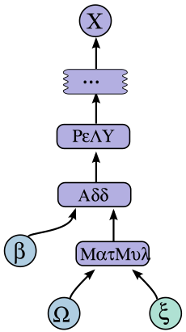

# 张量、Shape 与计算图

把两条文本送进模型以后，模型看到的是一组数字。假设每条文本有三个 token，每个 token 用四个数表示，那么输入的 shape 就是 `[2, 3, 4]`。第一个轴区分样本，第二个轴区分位置，第三个轴存放特征。理解这三个轴，比先记住某个网络结构更有用，因为线性层、注意力和损失函数都会依赖它们的含义。

张量可以先理解成带有 shape 的数值数组。一个数是零维张量，一列数是一维张量，行列排列的数是二维张量。深度学习中的张量通常还带着数据类型、设备位置，以及访问底层存储的规则。这些信息决定它能与谁计算、占用多少空间、是否需要复制。

这里的计算只用到[向量与矩阵](../prerequisite-math/linear-algebra-and-geometry.md)。先看数字如何排列，再看运算如何改变排列，最后就能读懂计算图中的大部分接口。

## Shape 只写长度，轴的含义需要另说

对于文本表示，常见的记法是

\[
X\in\mathbb{R}^{B\times L\times D}.
\]

\(B\) 是一批样本的数量，\(L\) 是序列长度，\(D\) 是每个位置的特征数。`X[b, l, d]` 取出第 `b` 个样本、第 `l` 个位置的第 `d` 个特征。固定前两个索引，`X[b, l]` 就是一个长度为 \(D\) 的向量。

同一个 `[2, 3, 4]` 也可能表示两张高为 3、宽为 4 的灰度图。框架通常只知道轴的长度，不会自动判断其中哪个轴是时间、通道或者相机。因此，shape 相同仅能说明某些运算在尺寸上合法。

| 常见 shape | 每个轴表示什么 | 一个具体操作 |
| --- | --- | --- |
| `[B, L, D]` | 样本、token、特征 | 线性层改写最后一维 |
| `[B, C, H, W]` | 样本、通道、高、宽 | 二维卷积在空间位置上滑动 |
| `[B, Heads, Q, K]` | 样本、注意力头、查询位置、被读取位置 | softmax 沿最后一维归一化 |
| `[B, T, Cameras, Patches, D]` | 样本、时间、相机、图像块、特征 | 合并中间三轴得到视觉序列 |

例如，把 `[B, L, D]` 送入一个从 \(D\) 维映射到 \(H\) 维的线性层，输出是 `[B, L, H]`。相同权重分别作用于每个 token，样本轴和位置轴都保留。把 `L` 和 `D` 交换后再调用同一个模块，最后一维可能对不上；如果两个轴恰好一样长，程序甚至可能正常运行，但它已经开始沿错误的轴计算。

## 广播如何省掉重复的数据

给矩阵的每一行加上相同偏置，是模型里很常见的操作。考虑

\[
X=\begin{bmatrix}1&2&3\\4&5&6\end{bmatrix},\qquad
b=\begin{bmatrix}10&20&30\end{bmatrix}.
\]

结果为

\[
X+b=\begin{bmatrix}11&22&33\\14&25&36\end{bmatrix}.
\]

偏置只有三个数，却作用于两行。这种尺寸扩展称为广播。NumPy 和 PyTorch 的常见逐元素运算从最右侧开始比较 shape，每个轴要么长度相同，要么其中一个长度为 1；缺少的左侧轴按长度 1 处理。规则不满足时，运算会报错。

```text
X       [B, L, D]
bias          [D]
result  [B, L, D]
```

因此 `[D]` 会对齐到特征轴。若需要每个 token 位置一个偏置，应该写成 `[1, L, 1]`，让两个长度为 1 的轴清楚表达哪些位置共享同一个值。

下面用 NumPy 同时展示两种加法。这里的数组只有位置和特征两个轴。

```python
import numpy as np

x = np.array([[1, 2, 3], [4, 5, 6]])
feature_bias = np.array([10, 20, 30])
position_bias = np.array([100, 200])[:, None]
print(x + feature_bias)
print(x + position_bias)
```

第一组输出是 `[[11, 22, 33], [14, 25, 36]]`，第二组是 `[[101, 102, 103], [204, 205, 206]]`。`[:, None]` 给位置偏置补上了一个长度为 1 的轴，使它的 shape 从 `[2]` 变成 `[2, 1]`。

广播最隐蔽的错误出现在两个轴恰好等长时。对于 `[2, 2]` 的矩阵，直接加 `[10, 20]` 会给第一列加 10、第二列加 20。即使编写者原本希望给第一行加 10、第二行加 20，程序也不会报错。检查一两个具体元素，往往比只打印输出 shape 更能发现问题。

## 广播在反向时要把共享贡献加回来

前向中同一份偏置服务两行，反向就要收集两行的贡献。若上游梯度为 \(G=[[1,2,3],[4,5,6]]\)，偏置 `[3]` 的梯度为 `[5,7,9]`，沿样本轴求和；如果参数是每行一个偏置 `[2,1]`，梯度则为 `[[6],[15]]`，沿特征轴求和。

两个版本都能生成 `[2,3]` 输出，但共享方式不同，可训练参数和梯度也不同。框架只能按你写出的广播规则求导，无法发现你本来想共享另一条轴。这个数值对照比“shape合法”多检查了一层语义。

## 求和与矩阵乘法怎样改变轴

逐元素加法保留了广播后的各轴。归约运算则会消去某个轴。例如 `X.sum(axis=-1)` 把 `[B, L, D]` 中每个位置的 \(D\) 个特征求和，结果是 `[B, L]`。若使用 `keepdims=True`，结果是 `[B, L, 1]`，适合再广播回原来的位置。

归约轴需要与数学问题对应。求每个样本的平均损失时，要先确认 token 轴中是否包含 padding；把补齐位置一起平均，会改变实际优化目标。对注意力分数做 softmax 时，要沿被读取的位置轴归一化，这样每个查询才得到一组和为 1 的权重。

矩阵乘法则沿两个输入共有的内维求和。对于

\[
A\in\mathbb R^{M\times K},\qquad W\in\mathbb R^{K\times N},
\]

输出 \(Y=AW\) 的 shape 为 `[M, N]`，每个元素为

\[
Y_{ij}=\sum_{k=1}^{K}A_{ik}W_{kj}.
\]

\(K\) 被求和消去，\(M\) 和 \(N\) 保留下来。把 `[B, L, D]` 与 `[D, H]` 相乘时，可以把前两轴看成 \(B L\) 个独立行向量，得到 `[B, L, H]`。这也解释了为什么矩阵乘法的尺寸检查只检查内维，却无法判断某个维度是否选对。

## Shape 改变时，数据可能留在原处

普通稠密张量通常以一块底层存储加上一组元数据表示。元数据包含 shape、stride、存储偏移和 dtype。stride 表示沿某个轴前进一步，底层存储应移动多少单位。

考虑按行存放的矩阵

\[
\begin{bmatrix}0&1&2\\3&4&5\end{bmatrix}.
\]

它的 shape 是 `[2, 3]`，以元素为单位的 stride 是 `[3, 1]`。向下走一行跳过三个元素，向右走一列跳过一个元素。元素 `(1, 2)` 的偏移为 \(1\times3+2\times1=5\)。一般情况下，元素偏移可以写为

\[
\operatorname{offset}(i_0,\ldots,i_{r-1})
=\operatorname{storage\_offset}+\sum_{k=0}^{r-1}i_k s_k.
\]

这里的 \(s_k\) 和 offset 都以元素计数。换成字节地址时，还需要乘以每个元素的字节数。PyTorch 的 `stride()` 使用元素单位，NumPy 的 `strides` 使用字节单位，读输出时需要区分。

转置后，矩阵变成三行两列，shape 是 `[3, 2]`，以元素为单位的 stride 变成 `[1, 3]`。底层六个数可以保持原来的顺序，只改变访问规则。

```python
import numpy as np

x = np.arange(6).reshape(2, 3)
y = x.T
print(y.tolist())
print(tuple(s // x.itemsize for s in x.strides))
print(tuple(s // y.itemsize for s in y.strides))
print(np.shares_memory(x, y))
```

输出依次为 `[[0, 3], [1, 4], [2, 5]]`、`(3, 1)`、`(1, 3)` 和 `True`。最后一个结果说明转置得到的视图与原数组共享数据，修改其中一方可能影响另一方。

PyTorch 中的 `view` 要求新 shape 能由已有的 size 和 stride 表达，不会替你复制数据。连续张量通常能满足常见的重排，但连续性并非唯一判断条件。`reshape` 可以返回视图，也可以在需要时复制；`transpose` 和 `permute` 对普通稠密张量通常只改变视图；`contiguous` 在原布局不满足要求时生成连续副本。因而，相同的数学结果可能对应不同的内存分配和耗时。

还要区分转置与单纯 reshape。把 `[2, 3]` reshape 成 `[3, 2]`，得到的行是 `[0, 1]`、`[2, 3]`、`[4, 5]`。它与上面的转置结果不同。reshape 改变分组方式，transpose 交换轴的含义。

## 张量占用多少空间

一个普通稠密张量的逻辑数据量为

\[
\operatorname{bytes}=\left(\prod_k d_k\right)\times\operatorname{itemsize}.
\]

例如 `[2, 1024, 768]` 的张量共有 1,572,864 个元素。使用每个元素 2 字节的 BF16 时，数据量为 3,145,728 字节，即 3 MiB。这里使用 \(1\ \mathrm{MiB}=2^{20}\) 字节。实际进程显存还包含参数、梯度、临时缓冲区和内存分配器保留的空间；共享存储的视图也不能各算一份物理副本。

shape 的乘法关系会直接改变这个数字。例如一段视频包含 4 个相机、16 帧，每帧切成 256 个图像块，那么视觉序列有 \(4\times16\times256=16{,}384\) 个 token。合并这些轴以后，还需要保留相机、时间和空间位置的信息，否则序列长度虽然正确，模型无法仅凭展平后的位置恢复全部原有关系。

若再显式构造 `[B, Heads, L, L]` 的注意力分数，长度 \(L\) 就出现两次。这是长序列注意力开销增长很快的原因。具体的内存格式与量化可继续看[数值、显存与运行时](numerics-memory-and-runtime-basics.md)，减少注意力中间矩阵的方法见[长上下文与 FlashAttention](../operators/long-context-and-flashattention-evolution.md)。

## 计算图记录数字怎样得到

{ .atlas-figure-compact width="380" }

<small>图源为 [TensorFlow 系统论文](https://arxiv.org/abs/1603.04467) Figure 2。节点表示运算，连接表示数据依赖。图中的结构可以帮助区分输入值、可训练参数和运算结果。</small>

假设前向计算为 \(Y=XW+b\)，随后用 \(Y\) 计算标量损失 \(\mathcal L\)。计算图记录 `X` 和 `W` 参与矩阵乘，结果与 `b` 相加，再进入损失函数。反向传播沿这些依赖使用链式法则，把损失对输出的梯度传回参数。

令 \(G=\partial\mathcal L/\partial Y\)，并把输入整理为 `[M, D_in]`，则

\[
\frac{\partial\mathcal L}{\partial W}=X^\top G,\qquad
\frac{\partial\mathcal L}{\partial X}=GW^\top,\qquad
\frac{\partial\mathcal L}{\partial b}=\sum_{i=1}^{M}G_i.
\]

这里 \(G_i\) 是梯度矩阵的第 \(i\) 行。偏置梯度需要求和，因为前向时同一份偏置被广播到所有行。权重梯度需要输入 \(X\)，输入梯度需要权重 \(W\)。因此，自动微分系统会按具体算子的需要保存部分前向数据，训练显存也由此增加。完整数值推导和重计算方法在[自动微分与激活显存](autograd-activation-checkpointing-and-memory.md)中展开。

PyTorch 的常见 eager 执行会在每次前向时按实际执行的运算建立自动微分图。它与论文中的结构图、编译器优化后的执行图用途不同。阅读代码时，可以先追踪一个张量从哪里来、每个轴怎样变化、最后进入哪个损失，再决定是否需要看底层执行方式。

## 参考资料

- [NumPy broadcasting](https://numpy.org/doc/stable/user/basics.broadcasting.html) 给出逐元素广播的尺寸规则。
- [PyTorch Tensor Views](https://docs.pytorch.org/docs/stable/tensor_view.html) 说明视图共享存储，以及 `reshape`、`transpose` 和连续性之间的关系。
- [PyTorch Storage](https://docs.pytorch.org/docs/stable/storage.html) 说明存储、shape、stride 和数据类型的职责。
- [PyTorch Autograd Mechanics](https://docs.pytorch.org/docs/stable/notes/autograd.html) 解释计算图和反向传播所需的已保存张量。

- [D2L 的张量与线性计算](https://github.com/d2l-ai/d2l-zh/blob/e6b18ccea71451a55fcd861d7b96fddf2587b09a/chapter_linear-networks/linear-regression.md)，用于把正文的数学对象对应到具体数据布局和执行顺序。
