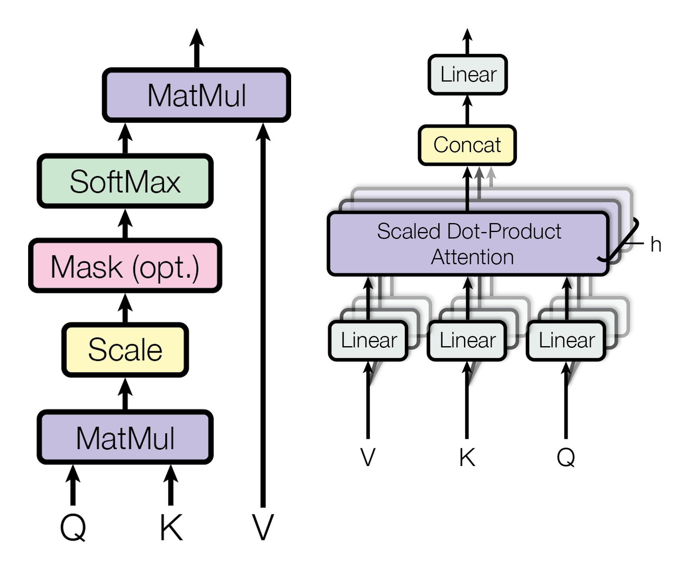

# Transformer、Tokenization 与注意力

一段文本进入 Transformer 时，会先被切成 token，再转换成整数编号。模型根据编号取出向量，用注意力读取其他位置的信息，用前馈网络改写每个位置的表示，最后把向量投影成下一 token 的分数。

这些操作各有明确的输入和输出。Tokenization 决定序列由哪些单元组成，embedding 决定编号怎样变成可学习向量，attention 决定当前位置从哪些位置取信息。把这几个过程分开，再连接起来，结构图就容易读得多。

这里会用到[张量与 Shape](tensors-shapes-and-computation-graphs.md)、[线性层与 MLP](linear-layers-mlp-and-gemm.md)，以及把一组分数归一化为概率的 softmax。下面先用小词表和二维向量演算，不要求先记住完整模型结构。

## 文字怎样变成向量

假设我们自己定义一个小词表，给“我”“喜欢”“猫”“。”分配编号 0、1、2、3，并把“我喜欢猫”切成 `[我, 喜欢, 猫]`。得到的编号序列就是 `[0, 1, 2]`。这只是说明流程的人工词表，真实 tokenizer 的切分取决于它自己的词表、规则和特殊 token。

编号是离散标识。编号 2 不代表比编号 1 多一份语义，直接把整数大小当成特征会引入没有依据的顺序。Embedding 层维护一个矩阵

\[
E\in\mathbb R^{V\times D},
\]

其中 \(V\) 是词表大小，\(D\) 是向量维度。编号为 \(i\) 的 token 取矩阵第 \(i\) 行。若小词表的矩阵为

\[
E=\begin{bmatrix}1&0\\0&1\\1&1\\-1&0\end{bmatrix},
\]

那么 `[0, 1, 2]` 就变成三行二维向量 \([[1,0],[0,1],[1,1]]\)。真实的 embedding 参数通常通过训练学习，矩阵中的单个维度并不预先指定为某个人类概念。

常见文本 tokenizer 会使用字符、字节或子词等单元。以 BPE 为例，它从较小的单元开始，根据训练语料逐步合并相邻单元，形成词表和合并规则；实际编码时按已经学到的规则切分。WordPiece、Unigram 也可构造子词词表，但训练与切分算法不同，不能统一描述为 BPE 的频次合并过程。

切分方式会影响序列长度、罕见词处理和计算量。同一句话在不同 tokenizer 中可能得到不同 token 数。训练和推理必须使用匹配的词表、特殊 token 与格式约定，否则相同编号会被解释成错误的输入。

## 位置怎样进入表示

只提供 token 向量时，模型还需要知道它们的位置。原始 Transformer 使用的一种办法是把位置向量加到 token embedding 上

\[
h_i=E[\operatorname{id}_i]+p_i.
\]

这里 \(p_i\) 是第 \(i\) 个位置的向量，可以按固定函数构造，也可以学习。没有位置机制和位置相关掩码约束的 self-attention，会随着输入置换产生相应置换的输出，仅靠内容匹配无法区分所有序列顺序。

位置机制并不都采用相加。RoPE 对 query 和 key 按位置施加旋转，让两者的点积包含相对位置信息。学习绝对位置向量、旋转位置编码和相对位置偏置的实现不同，阅读代码时要确认位置究竟在哪一步参与计算。更详细的推导见[序列位置与掩码](../prerequisite-math/sequence-position-and-masking.md)。

## Query、Key、Value 是三组可学习投影

取一个样本的输入表示 \(X\in\mathbb R^{L\times D}\)。单个注意力头先计算

\[
Q=XW_Q,\qquad K=XW_K,\qquad V=XW_V.
\]

若 \(W_Q,W_K\) 为 `[D, d_k]`，\(W_V\) 为 `[D, d_v]`，那么 \(Q,K,V\) 分别为 `[L, d_k]`、`[L, d_k]`、`[L, d_v]`。这些矩阵的各行都对应一个位置。

对第 \(i\) 个位置，query 向量 \(q_i\) 与每个 key 向量 \(k_j\) 计算点积。点积经过缩放后成为匹配分数，再经 softmax 得到一组权重。最后用这些权重对 value 向量加权求和。

Query 和 key 决定从哪里取多少，value 决定被取出的内容。它们来自训练得到的投影，不保证每个头都对应一个容易命名的语言关系。某个注意力权重很高，也不能单独证明该位置对模型最终决定有同等强度的因果影响。

{ width="820" }

<small>图源为 [Attention Is All You Need](https://arxiv.org/abs/1706.03762) Figure 2。左侧依次执行点积、缩放、可选掩码、softmax 和加权求和。右侧并行执行多组投影，再拼接各头输出。</small>

## 完整计算一个两位置的注意力

直接给定两行投影结果

\[
Q=K=V=\begin{bmatrix}1&0\\0&1\end{bmatrix}.
\]

这是为了手算选取的中间值，\(d_k=2\)。先计算分数

\[
S=\frac{QK^\top}{\sqrt{2}}
=\begin{bmatrix}0.707107&0\\0&0.707107\end{bmatrix}.
\]

缩放因子 \(\sqrt{d_k}\) 的动机是控制点积随维度增大的尺度。在分量独立、均值为零、方差为 1 的简化假设下，点积方差为 \(d_k\)，除以 \(\sqrt{d_k}\) 后方差回到 1。真实网络不必严格满足这些假设，但这个推导解释了缩放的由来。

不加掩码时，对分数矩阵的每一行分别做 softmax，得到

\[
A\approx\begin{bmatrix}0.669762&0.330238\\0.330238&0.669762\end{bmatrix}.
\]

以第二行为例，两个未归一化权重是 \(e^0=1\) 和 \(e^{0.707107}\approx2.028115\)，除以它们的和，就得到 0.330238 和 0.669762。每一行的权重之和为 1。

现在加入因果约束，让第一个位置只能读自己，第二个位置可以读前两个位置。加性掩码为

\[
M=\begin{bmatrix}0&-\infty\\0&0\end{bmatrix}.
\]

完整公式是

\[
O=\operatorname{softmax}\!\left(\frac{QK^\top}{\sqrt{d_k}}+M\right)V.
\]

掩码在分数缩放之后相加。被禁止的位置得到 \(-\infty\)，指数变成零。这里 softmax 沿 key 轴执行，得到

\[
A_{\mathrm{causal}}
\approx\begin{bmatrix}1&0\\0.330238&0.669762\end{bmatrix},
\qquad
O\approx\begin{bmatrix}1&0\\0.330238&0.669762\end{bmatrix}.
\]

这次输出恰好与权重矩阵相同，是因为我们特意把 \(V\) 设成单位矩阵。一般的输出是 value 的加权和，两个矩阵不会相同。

下面只用 Python 展开相同的计算。代码通过只枚举可见位置实现掩码，避免直接处理无穷大。

```python
import math

q = k = v = [[1.0, 0.0], [0.0, 1.0]]
for i, query in enumerate(q):
    scores = [sum(a * b for a, b in zip(query, key)) / math.sqrt(2)
              for key in k[:i + 1]]
    exp_scores = [math.exp(s - max(scores)) for s in scores]
    weights = [e / sum(exp_scores) for e in exp_scores]
    output = [sum(weights[j] * v[j][d] for j in range(i + 1))
              for d in range(2)]
    print([round(x, 6) for x in output])
```

输出为 `[1.0, 0.0]` 和 `[0.330238, 0.669762]`。[数值示例文件](../assets/examples/foundations/mechanisms.py)提供可处理更多行的 `attention` 函数。

实际实现还需要处理 padding。因果掩码控制能否读未来位置，padding 掩码控制能否读补齐位置。若某一行把所有 key 都屏蔽，普通 softmax 无法形成有效概率分布，需要由具体实现或输入规则妥善处理。布尔掩码的真值含义也可能因 API 而异，不能仅凭变量名照搬。

## 同一计算在源码里怎样排列

在 LLMs from scratch 的 `MultiHeadAttention` 中，三个 Linear 先生成 `[B,L,D]`，随后 `view` 拆成 `[B,L,H,d]`，再 `transpose` 成 `[B,H,L,d]`。此时 `queries @ keys.transpose(2,3)` 才会在每个样本、每个头内生成 `[L,L]` 的分数。

如果把头轴和长度轴交换错，即使两个尺寸碰巧相等，矩阵乘法也可能照常运行，却变成不同头之间互相匹配。对照本文两位置例子时，可以先用一个头，核对每行和为1、未来权重为0、输出等于value加权和，再恢复多头布局。该教程在合并头前调用 `contiguous()`，也是因为转置后的访问布局未必能直接按目标方式view。

## 多个头与不同来源的上下文

多头注意力让多组投影分别计算信息读取。常见配置把宽度 \(D\) 分成 \(H\) 个头，每个头的宽度为 \(d=D/H\)。带 batch 时，query 可以表示为 `[B, H, L, d]`，每个头产生 `[B, L, d]` 的结果。把各头的最后一维拼起来，得到 `[B, L, D]`，再乘输出矩阵 \(W_O\)。

多头是在不同投影空间里进行匹配，不等于把整段文本切成几个互不相通的片段。普通全注意力的每个头仍然可以访问掩码允许的全部位置。头的数量、query 宽度与 value 宽度还可以有其他设计，上面的尺寸是便于理解的常见配置。

Self-attention 的 query、key、value 来自同一序列。Cross-attention 则让 query 来自需要更新的序列，key 和 value 来自另一个序列。例如文本 query 读取图像表示时，查询长度可能为 \(L_q\)，图像长度为 \(L_k\)，单头权重矩阵为 `[L_q, L_k]`，输出仍有 \(L_q\) 行。

把图像 token 与文本 token 拼接后做 self-attention，是另一种组织方式。它要求为拼接后的序列定义位置、模态信息和可见关系，不能仅凭最终都使用矩阵乘，就把它与 cross-attention 当作完全相同的结构。

## 一个 Transformer block 怎样接起来

注意力负责跨位置读取，前馈网络则分别改写每个位置的特征。残差连接让子层输出与输入相加，归一化调整送入子层或从子层输出的表示尺度。一个常见的 Pre-Norm block 可以示意为

\[
U=X+\operatorname{Attention}(\operatorname{Norm}(X)),
\]

\[
Y=U+\operatorname{FFN}(\operatorname{Norm}(U)).
\]

两次相加要求对应张量具有相同 shape。这里省略了 dropout 等细节，Norm 可以采用不同形式，FFN 也可使用门控结构。原始 Transformer 使用的归一化顺序与许多现代模型不同，读图时应以对应论文和代码为准。各子层的推导见[归一化、残差与激活](normalization-residual-and-activation.md)。

{ width="500" .atlas-figure-tall }

<small>图源为 [Attention Is All You Need](https://arxiv.org/abs/1706.03762) Figure 1。左侧编码器处理输入序列，右侧解码器包含有因果约束的 self-attention，还通过 cross-attention 读取编码器输出。常见的纯文本生成模型采用 decoder-only 结构，通过因果 self-attention 读取上下文，省去独立编码器及对应的 cross-attention。这张图展示的是原始架构。</small>

多层 block 之后，语言模型把每个位置的最终表示从 \(D\) 维投影到词表大小 \(V\)，产生 `[B, L, V]` 的 logits。此时模型才给出每个位置对各候选 token 的分数，如何把分数变成生成结果见[生成与解码](generation-and-decoding-basics.md)。

## 因果训练为什么能并行，生成却逐步进行

训练自回归语言模型时，输入位置 \(i\) 可以看到位置不超过 \(i\) 的 token，并预测下一个 token。以带起始标记的“我喜欢猫”为例，可以把输入与标签写成

| 位置 | 输入 token | 该位置预测的标签 |
| --- | --- | --- |
| 0 | BOS | 我 |
| 1 | 我 | 喜欢 |
| 2 | 喜欢 | 猫 |
| 3 | 猫 | EOS |

输入和标签错开一个位置。模型在“喜欢”的位置能读 BOS、我、喜欢，目标是预测“猫”。训练时整个正确序列已经存在，因此这些位置可以放在一次前向中并行计算；因果掩码保证每个预测没有偷看自己的目标和更远的未来。

生成时，下一个 token 尚未选出，必须先得到当前位置的分布、选择一个 token、把它接到上下文后面，再继续。对标准因果 Transformer，固定前缀在追加后续 token 时不会读取新增位置，所以此前各层的 key 和 value 可以缓存。新位置只计算自己的 query、key、value，再读取已有缓存。这就是 KV cache 的基本依据。

缓存节省了重复处理旧位置的工作，但长上下文的缓存仍占空间，新 query 读取历史也仍有代价。GQA、MQA 等方法改变 query 头与 KV 头的共享关系，FlashAttention 改变注意力中间结果的计算和存储方式。相关系统细节分别见[推理中的 GPU 与显存](../inference/gpu-kernels-batching-and-memory-systems.md)和[长上下文与 FlashAttention](../operators/long-context-and-flashattention-evolution.md)。

## 参考资料

- [Attention Is All You Need](https://arxiv.org/abs/1706.03762) 是缩放点积注意力、多头结构和原始编码器解码器设计的来源。
- [The Annotated Transformer](https://nlp.seas.harvard.edu/annotated-transformer/) 将公式与实现逐段对应。
- [The Illustrated Transformer](https://jalammar.github.io/illustrated-transformer/) 用图示展示投影和注意力计算。
- [Hugging Face BPE 说明](https://huggingface.co/docs/course/chapter6/5) 解释子词合并与编码流程。

- [LLMs from scratch 的 GPT 实现](https://github.com/rasbt/LLMs-from-scratch/blob/cdbd33e6d57a71e20ea31434841095fac50cecd8/ch04/01_main-chapter-code/gpt.py)，用于把正文的数学对象对应到具体数据布局和执行顺序。
