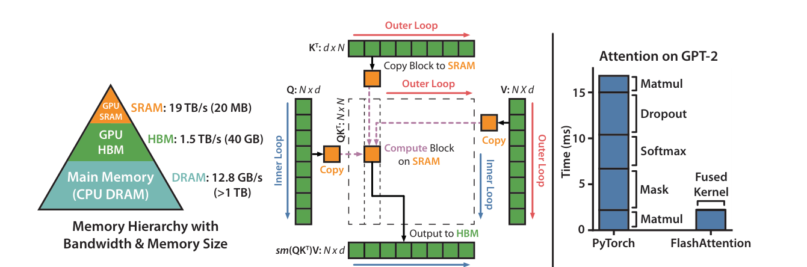

# Transformer 输入与注意力

Transformer 先把输入切成 token，再让每个 token 按相关性读取其他 token。理解这句话，比背完整架构图更重要：LLM 读文本、VLM 读图文、DiT 读图像 patch、世界模型读视频和动作，最终都要回到 token 如何互相交换信息。

## 核心问题

如果一句话有 100 个 token，或者一个机器人 episode 有几万枚视觉、语言、状态和动作 token，模型如何决定“当前 token 应该看谁”？Transformer 的答案是 attention：每个位置产生一个 query，去匹配所有 key，再按权重读取 value。

这也是为什么 Transformer 又强又贵。它能把远距离依赖、跨模态对齐、动作条件和长上下文放在统一序列里；代价是 token 数一多，attention、KV cache、显存和延迟都会一起变成系统问题。

## 先从 token 说起

Token 是模型处理信息的最小计算单位。文本模型把字符串切成 subword token；视觉模型把图片切成 patch token；视频模型可能按时间和空间切成 tubelet；VLA 或世界模型还会加入动作、状态、语言指令和 latent token。


tokenizer 或 processor 输出序列后，每个 token id 会被映射成向量：

\[
h_i = E(x_i)
\]

这里 \(x_i\) 是第 \(i\) 个 token，\(E\) 是 embedding 表，\(h_i\) 是模型真正计算的向量。向量本身还不知道顺序，所以 Transformer 需要 positional encoding 或 RoPE 这类位置机制告诉模型“谁在前、谁在后、相对距离是多少”。

{ width="500" .atlas-figure-tall }

<small>图源：[Attention Is All You Need](https://arxiv.org/abs/1706.03762)，Figure 1。原图表达 Transformer encoder-decoder 的基本结构：embedding 加位置编码后进入多层 attention、feed-forward、残差和归一化模块。本站用这张图定位三个读法：token 进入模型，attention 跨 token 读信息，feed-forward 逐 token 变换表示。</small>

第一次看这张图，先别急着记所有箭头。左边 encoder 更像“把输入序列读懂并编码”；右边 decoder 更像“在已经生成的前缀上继续生成下一个 token”。Decoder 多了 masked self-attention，是为了防止当前位置偷看未来 token；encoder-decoder attention 则让 decoder 读取 encoder 的结果。

## Q/K/V 的最小直觉

Attention 可以按三个问题理解：

| 符号 | 白话 | 在每个 token 上做什么 |
| --- | --- | --- |
| Query, \(Q\) | 我现在想找什么 | 当前位置发出的查询 |
| Key, \(K\) | 我有什么可被匹配 | 其他位置暴露的索引 |
| Value, \(V\) | 真正能被读走的内容 | 被加权汇总的信息 |

Scaled dot-product attention 写成：

\[
\operatorname{Attention}(Q,K,V)=\operatorname{softmax}\left(\frac{QK^\top}{\sqrt{d_k}}\right)V
\]

\(QK^\top\) 是 query 和 key 的匹配分数矩阵；\(\sqrt{d_k}\) 用来缩放点积，避免维度大时分数过尖；softmax 把分数变成权重；最后乘 \(V\)，表示按权重把 value 读回来。最短读法就是：**先匹配，再归一化，再读取**。

{ width="280" }

{ width="360" }

<small>图源：[Attention Is All You Need](https://arxiv.org/abs/1706.03762)，Figure 2。原图表达 scaled dot-product attention 和 multi-head attention 的组成。本站用它说明：单个 head 是一次“匹配和读取”，multi-head 是并行使用多套匹配规则后再合并。</small>

Multi-head attention 不是玄学增强，而是让模型同时从多个角度读同一段序列。有的 head 可以学局部语法，有的 head 可以学长距离引用，有的 head 可以学图文对齐。最后的线性层把这些视角合并成下一层表示。

## Self-attention 和 cross-attention

Self-attention 指 Q、K、V 都来自同一段序列。LLM 读上下文、ViT 读 patch、视频模型读一组时空 token，大多是 self-attention。

Cross-attention 指 Q 来自当前主干序列，K/V 来自外部条件。扩散模型里，图像 latent 可以用 query 去读取文本 prompt 的 key/value；VLA 里，动作或状态 token 也可以读取视觉和语言 token。

```text
# self-attention
Q = x @ Wq
K = x @ Wk
V = x @ Wv
y = softmax(Q @ K.T / sqrt(d)) @ V

# cross-attention
Q = image_latent @ Wq
K = text_embedding @ Wk
V = text_embedding @ Wv
y = softmax(Q @ K.T / sqrt(d)) @ V
```

## 为什么 attention 一强就贵

Self-attention 的核心 score matrix 是 \(L \times L\)，\(L\) 是序列长度。文本 4k token 时还容易理解；到了多相机视频、长上下文检索或世界模型 rollout，token 数会迅速膨胀。

举个机器人世界模型例子：4 路相机、16 帧、每帧 224x224，按 14x14 patch 切图，每帧每路是 256 个视觉 token，总数是：

\[
4 \times 16 \times 256 = 16{,}384
\]

单个 attention head 的 score matrix 有：

\[
16{,}384^2 \approx 268\text{M elements}
\]

如果用 BF16 物化，单 head 只存 score 就约 512 MiB；16 个 heads 就接近 8 GiB，还没算 Q/K/V、MLP 激活、反向保存和多层堆叠。这就是为什么工程里要关心 patch size、视觉 resampler、local attention、GQA/MQA、KV cache 和 FlashAttention。

{ width="920" }

<small>图源：[FlashAttention: Fast and Memory-Efficient Exact Attention with IO-Awareness](https://arxiv.org/abs/2205.14135)，Figure 1。原图表达朴素 attention 会把中间矩阵反复读写 HBM，而 FlashAttention 用 tiling 和 online softmax 避免物化完整 attention matrix。本站用它说明：同一个数学公式，在不同 kernel 和内存访问路径下会有完全不同的吞吐。</small>

FlashAttention 没有把 attention 的数学复杂度变成线性，它优化的是内存访问和中间结果物化。读长上下文或多模态模型时要分清两件事：token 太多带来的 \(L^2\) 计算仍在；朴素实现额外制造的 HBM 往返可以被更好的 kernel 大幅减少。

## KV cache 为什么进入推理系统

自回归模型一次生成一个 token。生成第 \(t\) 个 token 时，历史 token 的 K/V 已经算过，如果每步都重算完整上下文就很浪费。KV cache 把历史 K/V 存下来，新 token 只需要和缓存匹配。

这让 decode 快很多，但也带来显存账：每层、每个历史 token、每个 KV head 都要存 K/V。上下文越长、batch 越大、层数越多，KV cache 越容易成为服务瓶颈。GQA、MQA、MLA、KV quantization、paged attention、prefix cache，本质上都在回答“历史信息怎么存得下、读得快、还别明显掉质量”。

## 现代 Transformer 不只是一张课堂图

技术报告里的 Transformer 常常已经塞进了长上下文、MoE、低比特和通信设计。比如 DeepSeek-V3 的 block 里有 MLA 和 DeepSeekMoE。

{ width="920" }

<small>图源：[DeepSeek-V3 Technical Report](https://arxiv.org/abs/2412.19437)，Figure 2。原图表达 DeepSeek-V3 block 使用 MLA 压缩 KV cache，并用 shared experts 与 routed experts 构成 MoE。本站用它说明：现代 Transformer 的创新常发生在 attention 的历史存储和 FFN 的稀疏激活上。</small>

读这类图时，先问四个问题：历史 K/V 怎么存？每个 token 实际激活多少参数？router 是否会制造负载不均？通信是否吃掉了稀疏计算省下来的时间？这比只看 total params 更可靠。

## 容易误解的地方

| 误解 | 更准确的说法 |
| --- | --- |
| Attention 会“理解一切” | Attention 只是信息路由机制，理解来自数据、目标函数、结构和训练。 |
| Multi-head 越多越好 | head 数会影响表达和 KV cache 成本，服务时还要看 GQA/MQA 等折中。 |
| FlashAttention 解决了长上下文 | 它减少 IO 和中间矩阵成本，但 token 数膨胀仍会推高计算和调度压力。 |
| Transformer 图学完就够了 | 工程里还要看 tokenizer、position、mask、KV cache、kernel、routing 和 batch。 |

## 外部精读

- [The Illustrated Transformer](https://jalammar.github.io/illustrated-transformer/)：最适合第一次建立 Transformer 图像直觉。
- [The Annotated Transformer](https://nlp.seas.harvard.edu/annotated-transformer/)：适合把公式和 PyTorch 实现对上。
- [Attention Is All You Need](https://arxiv.org/abs/1706.03762)：原论文仍然值得看 Figure 1 和 Figure 2。
- [FlashAttention](https://arxiv.org/abs/2205.14135)：理解 attention 为什么也是内存系统问题。
- [vLLM PagedAttention blog](https://vllm.ai/blog/2023-06-20-vllm)：把 KV cache 接到真实 serving 系统。
