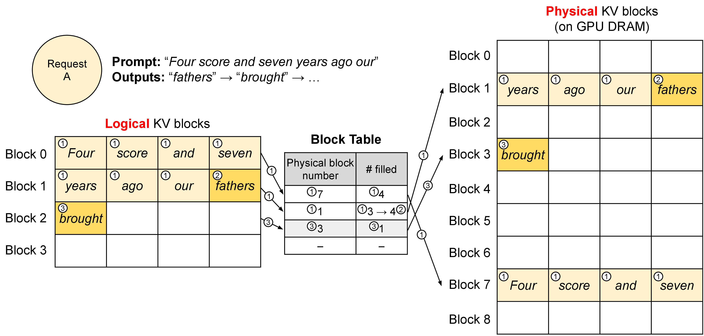
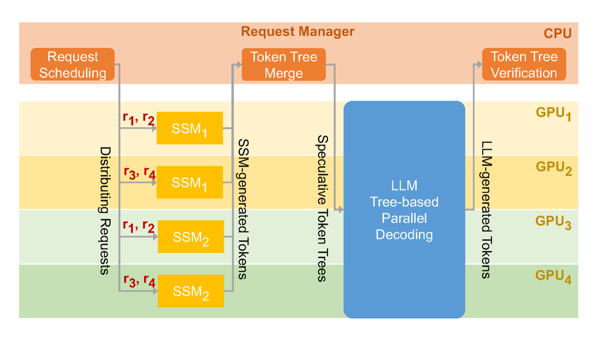
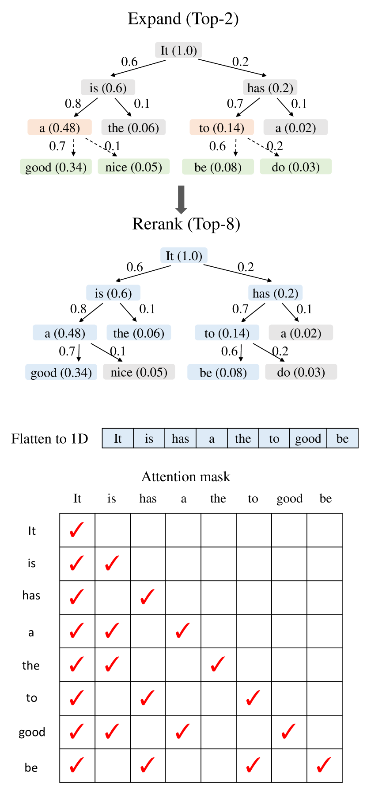

# 缓存与投机解码怎样复用已经完成的计算

两个请求共享4096个前缀token，可以尝试复用对应KV；生成时便宜模型提出几个候选，可以尝试一次让目标模型核验。两种优化都避免部分重复工作，但可复用状态和提交条件不同。

## 文本相同还需要计算身份相同

KV由模型参数、token序列、位置编码、attention规则以及可能的adapter或多模态输入共同决定。只比较可见文本，不足以确认两条请求的历史状态相同。跨不同模型的KV通常也不能直接互用。

Prefix cache命中后，可减少前缀对应的prefill计算。后续decode query仍可能读取这段历史KV，所以命中不会让后续attention成本消失。命中请求比例、命中token比例和实际节省时间应分别统计。

{ width="760" }

<small>图源：[Efficient Memory Management for Large Language Model Serving with PagedAttention](https://arxiv.org/abs/2309.06180)，Figure 5。原图表达 logical KV blocks 如何映射到 physical KV blocks。这里用它说明：PagedAttention 主要解决的是动态请求长度导致的 KV 分配、碎片和共享问题，不是改变 attention 数学。</small>

## 活跃请求状态和闲置缓存生命周期不同

正在生成的请求还需要其历史KV，释放它会影响执行或迫使重算。已结束请求留下的前缀缓存可用于未来复用，回收它通常只影响未来命中与重算成本。

共享页需按引用关系管理，不能在一个请求结束时立即释放所有共享前缀。调度器的页分配、引用与回收决定状态是否仍有效，attention kernel只负责按给定映射计算。

## 投机核验产生临时状态

Draft先给出 `[a,b,c]`，目标模型核验各位置条件概率。若a接受、b拒绝，后续c所依赖的前缀就不成立，只能提交a与正确生成的修正token，不能继续提交c。

核验可能已经为整段候选分配或计算KV，拒绝后要回退未提交部分的状态。vLLM V1输出处理会调整相关computed-token计数；异步执行还要防止已取消请求的旧结果被错误提交。

精确概率规则与二类分布例子见[MTP与投机解码](../training/mtp-and-speculative-decoding.md)。不同树状或近似策略需要分别看其保证。

{ width="780" }

<small>图源：[SpecInfer](https://arxiv.org/abs/2305.09781)，Figure 1。原图展示 draft 模型生成 token tree，target LLM 用 tree verification 并行验证候选。这里用它说明：投机解码真正省时间的是被 target 连续接受的前缀，不是 draft 生成越多越好。</small>

## 路由改变由谁支付后续成本

请求可先交给小模型，失败后再升级大模型。若小模型成本为1，大模型为10，升级率30%，不共享计算时平均成本为 $1+0.3\times10=4$。

如果两次调用串行，升级请求的等待包含前一次尝试。质量估计器本身也有误判，不能只用平均模型成本选阈值。把可接受的错误率、长尾等待和重复计算一起评估。

{ width="760" }

<small>图源：[EAGLE-2](https://arxiv.org/abs/2406.16858)，Figure 7。原图表达根据 confidence 和节点 value 动态扩展 draft tree，再用 tree attention mask 验证候选。这里用它说明：投机预算应该给更可能被接受的位置，而不是平均撒给所有分支。</small>

## 三者组合时要保持同一个请求语义

路由到另一模型可能导致prefix cache失效；投机策略可能增加临时KV需求；缓存命中会改变prefill与decode在总时间里的占比。单项加速倍数不能直接相乘。

固定请求分布，记录实际命中、每轮提交token、升级比例和端到端时间，再按长度与任务分桶。这样才能知道省下的是前缀计算、目标模型轮数还是昂贵模型调用。


## 对照源码与延伸阅读

- [前缀状态、投机输出与请求生命周期](https://github.com/vllm-project/vllm/blob/fa3b9d1377219247060d3c8b49eae199c9e7e154/vllm/v1/core/sched/scheduler.py)

## Prefix cache 的 key 是一份协议

一个可复用的前缀至少由以下身份共同决定：

```text
model_commit + tokenizer + adapter + modality_encoder
+ token_ids + position/mask rule + cache dtype/layout
```

任何一项变化都可能使已有 KV 失效。跨租户共享时还要把权限、数据敏感性和租约加入 key；只按文本 hash 做全局缓存可能把不应共享的状态暴露给另一个请求。

缓存命中应同时记录：

- 请求命中与未命中的数量。
- 命中的 prefix token 数和总输入 token 数。
- 节省的 prefill 时间与新增的查找/管理时间。
- 缓存占用、淘汰原因、重算次数和质量/一致性检查。

“命中率 80%”如果每次只命中 10 个 token，意义不同于命中率 40% 但每次命中 4000 个 token。

## 淘汰策略改变的是成本分布

LRU、按 token 数、按租户配额或按预估复用价值淘汰，会产生不同的长尾。长前缀占用多但可能复用高，短前缀占用少但可能频繁命中。容量实验应扫描 cache budget，并同时报告命中 token、prefill p95、decode p95 和 eviction 次数。

活跃请求的 KV 与已结束请求的前缀缓存不能使用同一释放逻辑。一个共享页有多个引用时，任何单请求结束都不应直接回收它；取消和超时还需要清理尚未提交的临时状态。

## 投机解码要验证“提交”而非“预测”

设 draft 给出 (m) 个候选，target 逐位置核验。可用的系统指标包括：

\[
r_{\text{accept}}=\frac{\text{被提交的 draft token}}{\text{draft token 总数}},
\qquad
g=\frac{\text{每轮平均提交 token}}{\text{target 调用轮数}}.
\]

高接受率仍可能没有收益：draft 生成成本、tree 组织、临时 KV、核验 kernel 或调度开销可能抵消 target 调用减少。正确性测试要逐 token 对比不使用投机的 target 输出，在相同随机种子、采样规则和停止条件下确认提交序列一致或满足明确概率规则。

## 路由、缓存和投机不能直接相乘

一个请求先命中小模型 prefix cache，再升级大模型时，模型身份变化可能迫使重新 prefill；投机树又会增加临时 KV。应把端到端时间拆成：

```text
cache lookup + queue + draft + target verify
+ rollback/commit + remaining decode + retry/upgrade
```

按输入长度、输出长度、命中 token 数、升级率和接受率分桶，才能知道优化省下的是哪一段。

## 来源与改编说明

- [Hugging Face KV cache 文档](https://huggingface.co/docs/transformers/en/kv_cache)用于核对缓存对象、增长和实现接口。
- [PagedAttention](https://arxiv.org/abs/2309.06180)用于理解逻辑 block 与物理 block 的映射；它不等于 prefix cache 或 speculative decoding 的全部机制。
- [SpecInfer](https://arxiv.org/abs/2305.09781)与[EAGLE-2](https://arxiv.org/abs/2406.16858)用于对照 tree verification 和动态 draft tree；各自的接受规则和实验条件不能混用。

## 自测

1. 为什么同一段可见文本仍可能因为 adapter、tokenizer 或位置规则不同而不能复用 KV？
2. 如何区别“请求命中率”和“命中 token 比例”？
3. draft 接受率很高但 p95 变差时，应检查哪些开销？
4. 设计一个逐 token 正确性回放，验证投机解码没有提交被拒绝的候选。

如果要把这些局部规则放回请求生命周期，可以继续看[推理服务系统](serving-systems.md)的排队、prefill、decode 与取消；草稿模型的训练接口见[EAGLE-3](../paper-deep-dives/inference/eagle-3.md)。
