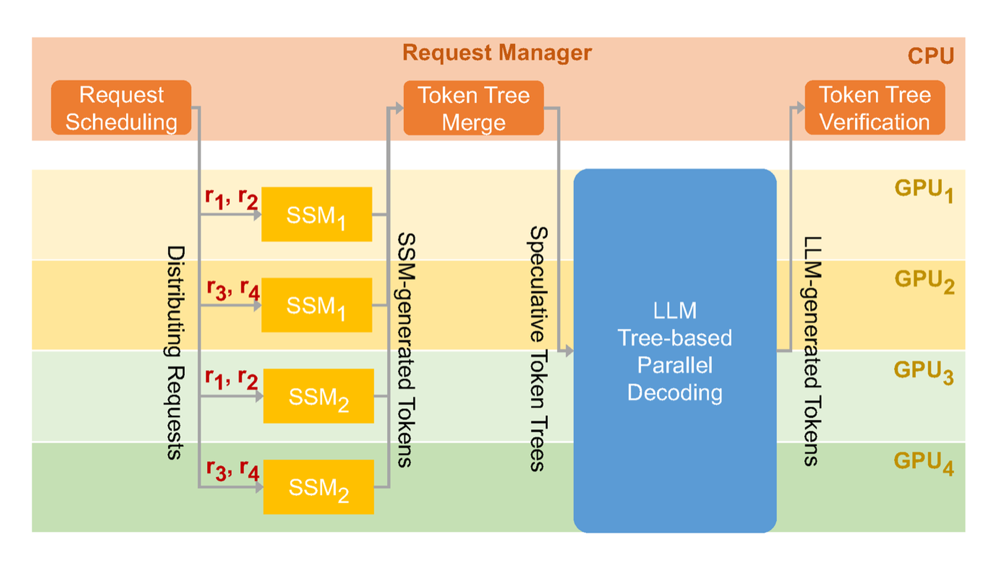

# 缓存、路由与投机解码

缓存、路由和投机解码看起来是三类技术，其实都在回答同一个问题：有限 GPU 时间和显存应该花在哪里。缓存减少重复计算，路由让不同请求走不同路径，投机解码用便宜草稿先猜、昂贵目标模型再验证。

<!-- [补充] -->
| 读者 | 建议读法 | 工程落点 |
| --- | --- | --- |
| 初学者 | 先抓“缓存、路由与投机解码”要解决的问题、关键术语和最小例子；公式只看变量方向。 | 能说清输入、输出和常见失败信号。 |
| 工程师 | 直接对照结构、指标、成本和边界条件，必要时回到前置页补概念。 | 落到数据、算力、延迟、显存、评测和回滚检查。 |


!!! note "合并提示"
    **note · 读法定位**

    这页先回答“缓存、路由与投机解码”在「推理」里的位置：它解决什么局部问题，依赖哪些前置，最后会影响哪类工程或研究判断。
    **前置**：先知道 transformer 解码、GPU kernel、显存和吞吐/延迟的区别。 必要时先回 [推理入口](index.md)、[基础知识](../foundations/index.md) 或 [术语表](../glossary/index.md)。
    **主线关系**：把请求生命周期、KV Cache、batching、runtime、SLO 和成本连接起来，看模型上线后每一毫秒花在哪里。

    **note · 初学者先抓住**

    缓存不是“存一下结果”这么简单，路由不是“简单问题走小模型”这么简单，投机解码也不是“接一个小模型”这么简单。它们都会改变 queue、prefill、decode、KV 生命周期和 P99。

    **example · 有趣例子：机场安检**

    常旅客通道像 prefix cache，提前复用稳定信息；不同旅客去不同通道像 routing；快速扫描后人工复核像 speculative decoding：先用便宜路径筛一遍，再让更可靠路径确认。

<!-- [补充] -->
> **踩坑原因**：这类工程问题通常不是单点公式错，而是 shape、资源预算、并发路径和观测指标之间有一个假设没对齐；先把触发条件、监控信号和回滚边界拆开查。

## 三者在请求生命周期里的位置

```text
request
  -> routing: 选模型、工具、上下文长度和服务池
  -> cache: 复用 prefix、检索、工具或 KV
  -> prefill: 写入新的 KV
  -> speculative draft: 便宜路径猜多个 token
  -> target verify: 目标模型并行验证
  -> decode / fallback
```

| 机制 | 主要节省什么 | 主要风险 |
| --- | --- | --- |
| prefix cache | 重复系统 prompt、工具 schema、共享文档前缀的 prefill | 权限隔离、prompt 版本、cache miss 放大 |
| KV cache | 历史 token 重算 | 显存增长、碎片、eviction 伤质量 |
| 检索/工具缓存 | 外部服务延迟和费用 | 过期数据、权限、错误复用 |
| routing | 把贵模型留给值得的请求 | 错路由、升级重试、策略漂移 |
| speculative decoding | 减少目标模型逐步 decode 次数 | acceptance 低时 P99 变差 |

## KV Cache：缓存里最特殊的一类

KV cache 不是普通业务缓存，它是自回归 decode 的执行状态。大小仍可估算为：

\[
M_{\text{KV}}
\approx
2 \cdot L \cdot B \cdot T \cdot H_{\text{kv}} \cdot D_{\text{head}} \cdot b
\]

<!-- [补充] -->
| 符号 | 含义 | 取值范围 |
| --- | --- | --- |
| \(M_{}\) | 公式中的变量或中间量 | 按上下文定义 |
| \(L\) | 损失或目标函数 | 实数标量，训练时按 batch 聚合 |
| \(B\) | 公式中的变量或中间量 | 按上下文定义 |
| \(T\) | 时间步、索引或计数 | 整数索引或归一化时间区间，见正文 |
| \(H_{}\) | 公式中的变量或中间量 | 按上下文定义 |
| \(D_{}\) | 公式中的变量或中间量 | 按上下文定义 |


这里 \(B\) 是活跃请求数，\(T\) 是上下文长度。它们会随着在线流量动态变化，所以 KV cache 是服务系统容量的一部分，而不是模型文件的一部分。

KV 管理要同时看：

1. page/block 分配和回收；
2. prefix 复用是否命中；
3. long request 是否挤压 short request；
4. speculative 分支是否增加临时 KV；
5. eviction 是否破坏质量；
6. fallback 时是否能保持状态一致。

## Prefix Cache：最容易有收益，也最容易被高估

Prefix cache 复用的是请求开头相同的 token，例如系统 prompt、工具 schema、固定模板、同一知识库前缀。若公共前缀长度为 \(L_{\text{prefix}}\)，命中率为 \(h\)，粗略节省可以写成：

\[
\text{saved prefill tokens}
\approx
h \cdot L_{\text{prefix}} \cdot N_{\text{req}}
\]

<!-- [补充] -->
| 符号 | 含义 | 取值范围 |
| --- | --- | --- |
| \(h\) | 公式中的变量或中间量 | 按上下文定义 |
| \(L_{}\) | 损失或目标函数 | 实数标量，训练时按 batch 聚合 |
| \(N_{}\) | 公式中的变量或中间量 | 按上下文定义 |


高命中率不一定高收益。命中的如果只是几十个 token，意义有限；命中的是数千 token 工具 schema 或共享文档前缀，才可能显著降低 TTFT。

!!! warning "常见误解"
    Prefix cache 需要 prompt 稳定。模板里多一个时间戳、随机 ID、用户私有字段，都可能让公共前缀断开。企业场景还要处理租户隔离，不能为了复用把私有上下文混到共享 cache 里。

## 路由：把请求送到合适路径

路由可以用一个抽象目标表达：

\[
m^\star
=
\arg\min_{m\in\mathcal{M}}
\left(
\lambda_1 \text{cost}(m)
+ \lambda_2 \text{latency}(m)
- \lambda_3 \text{quality}(m,x)
+ \lambda_4 \text{risk}(m,x)
\right)
\]

<!-- [补充] -->
| 符号 | 含义 | 取值范围 |
| --- | --- | --- |
| \(\lambda_1\) | 损失或目标函数 | 实数标量，训练时按 batch 聚合 |
| \(\lambda_2\) | 损失或目标函数 | 实数标量，训练时按 batch 聚合 |
| \(\lambda_3\) | 损失或目标函数 | 实数标量，训练时按 batch 聚合 |
| \(\lambda_4\) | 损失或目标函数 | 实数标量，训练时按 batch 聚合 |
| \(m\) | 公式中的变量或中间量 | 按上下文定义 |
| \(x\) | 样本、状态或 latent 变量 | 张量空间，形状由数据表示决定 |


这行式子表示在候选路径集合 \(\mathcal{M}\) 里选择综合代价最小的路径 \(m^\star\)。\(\lambda_1\) 到 \(\lambda_4\) 是业务权重，分别控制成本、延迟、质量和风险在路由决策里的重要性。

常见路由维度：

| 维度 | 例子 | 失败模式 |
| --- | --- | --- |
| 长度 | 短问答、32k 文档、128k 文档分池 | 长请求堵住短请求 |
| 任务 | 闲聊、代码、法律、表格、agent | 规则膨胀，策略难维护 |
| 置信度 | 小模型先答，低置信升级 | 低置信识别不准，重试更贵 |
| 风险 | 高风险走强模型和工具校验 | 风险漏检带来质量事故 |
| 租户/SLA | 高价值客户优先 | 多租户公平性和成本争议 |

路由成功的验收不是“小模型用得更多”，而是每个请求桶的质量、延迟和成本一起变好。

## 投机解码的基本思想

普通 decode 是目标模型一步一步生成。投机解码则多加一条便宜 draft 路径：

1. draft model 先猜一段候选 token；
2. target model 并行验证这些 token；
3. 接受前面连续通过验证的 token；
4. 第一个不通过的位置由 target model 修正；
5. 继续下一轮。

一个粗略速度模型是：

\[
\text{Speedup}
\approx
\frac{\mathbb{E}[A]\cdot C_{\text{target-step}}}
{C_{\text{draft}} + C_{\text{verify}} + C_{\text{overhead}}}
\]

<!-- [补充] -->
| 符号 | 含义 | 取值范围 |
| --- | --- | --- |
| \(A\) | 动作、优势或系数 | 动作空间/实数标量，依上下文而定 |
| \(C_{}\) | 公式中的变量或中间量 | 按上下文定义 |


这条公式的直觉是：接受得越多，越划算；draft 越贵、verify 越慢、overhead 越高，越不划算。

{ width="780" }

<small>图源：[SpecInfer: Accelerating Generative Large Language Model Serving with Speculative Inference and Token Tree Verification](https://arxiv.org/abs/2305.09781)，Figure 1。原论文图意：draft 模型生成 token tree，target LLM 通过 tree verification 并行验证多个候选 token。</small>

!!! note "这张图怎么看"
    先看左侧 draft：它不是只猜一条链，而是可以形成候选树。再看 target verification：目标模型一次验证多条候选路径。最后看 accepted tokens：真正节省时间的是连续被接受的前缀，而不是 draft 生成了多少 token。

## 从 EAGLE 系列读懂投机解码

EAGLE 系列适合按三层理解：

| 论文 | 它回答什么 | 对系统的启发 |
| --- | --- | --- |
| [EAGLE](../paper-deep-dives/inference/eagle.md) | draft 不一定是独立小 LLM，也可以预测 target feature | draft interface、tree attention、feature uncertainty 会影响 acceptance |
| [EAGLE-2](../paper-deep-dives/inference/eagle-2.md) | draft tree 不应固定，应该按 confidence 动态分配候选 | 线上要看 acceptance by bucket，而不是只看全局速度 |
| [EAGLE-3](../paper-deep-dives/inference/eagle-3.md) | 训练时要模拟测试时递归 draft 分布 | draft 训练分布错了，多步接受率会掉 |

{ width="760" }

<small>图源：`EAGLE`，Figure 6。原论文图意：绿色块是 token embedding，橙色块是 feature，红框是 draft model prediction，蓝色雪花模块复用 frozen target LLM 参数。</small>

!!! note "这张图怎么看"
    EAGLE 的 draft 不只是生成 token，而是围绕 target LLM 的 feature 做预测，并复用 target 的部分模块。读这张图时要抓住两点：draft 路径必须便宜，且它猜出来的候选要能被 target 高概率接受。

{ width="760" }

<small>图源：`EAGLE-2`，Figure 7。原论文图意：边上的数字是 draft model confidence，方块中的括号数字是节点 value；expansion phase 选择当前层 value 最高的节点扩展，rerank phase 从所有节点里选 top nodes，最后根据树结构构造 attention mask。</small>

!!! note "这张图怎么看"
    不同位置、不同请求的接受率不同，所以候选预算不该平均撒。EAGLE-2 用 confidence 和 value 决定哪些节点继续扩展。对工程系统来说，这对应“哪些请求桶值得开 speculative，开多深”。

{ width="760" }

<small>图源：`EAGLE-3`，Figure 7。原论文图意：在 LLaMA-Instruct 3.1 8B + MT-bench 上，EAGLE-3 的 draft 接受率随递归步数增加仍保持稳定，支撑 training-time test 对分布偏移的缓解作用。</small>

!!! note "这张图怎么看"
    横向看不同 draft 深度，纵向看接受率。若接受率随深度快速下降，越往后越猜不准，投机收益会被回滚和验证开销吃掉。EAGLE-3 的重点是训练时就模拟测试时的递归输入，减少 train-inference mismatch。

## 三者如何互相影响

| 组合 | 可能收益 | 可能代价 |
| --- | --- | --- |
| prefix cache + routing | 相似请求进同池，复用前缀 | 路由太碎导致资源碎片 |
| KV cache + speculative | 长输出接受率高时 TPOT 降低 | draft 分支增加 KV 生命周期 |
| routing + speculative | 只给高接受率请求开 speculative | acceptance 预测错会放大 P99 |
| cache + RAG | 重复检索和共享文档前缀更便宜 | 过期证据或权限污染 |
| KV eviction + routing | 长任务降级到专门池 | 淘汰错误导致多轮任务失忆 |

所以缓存、路由、投机解码不要分别上线、分别报平均收益。它们要按请求桶一起看：短问答、长文档、长输出、agent、多模态的收益和风险完全不同。

## 观测指标

建议至少分桶记录：

| 机制 | 关键指标 |
| --- | --- |
| prefix cache | hit rate、saved prefill tokens、miss penalty、tenant boundary |
| KV cache | KV GiB、page usage、fragmentation、eviction、branch count |
| routing | route distribution、upgrade rate、fallback rate、per-route quality |
| speculative | acceptance length、rejected tokens、verify time、fallback rate |
| 端到端 | TTFT、TPOT、P95/P99、cost per request、quality regression |

只看平均延迟会掩盖问题。投机解码尤其要看低 acceptance 桶：创意写作、高温采样、多工具 agent、短输出请求，可能比普通问答更容易出现 P99 变差。

## 真实排查案例：平均更快，P99 更差

**症状**：接入 speculative decoding 后，平均 TPOT 下降 18%，但 P99 请求延迟上升，创意写作和多工具 agent 更明显。

**关键指标**：普通问答 acceptance 72%，创意写作 38%，工具 agent 31%；低 acceptance 桶里 verify 失败和回滚次数上升，KV 占用时间变长。

**判断**：投机解码不是全流量收益。高 acceptance 桶拉低平均值，低 acceptance 桶放大尾延迟。

**修复**：按任务、温度、输出长度和工具状态预测 acceptance；低 acceptance 桶关闭 speculative 或缩短 draft；SLO 报表拆出 accepted tokens、rejected tokens、verify time 和 fallback。

## 本页结论

缓存、路由和投机解码的共同目标，是把重复计算、昂贵模型和 decode 步数用在最值得的地方。上线前不要只问“有没有更快”，而要问：快在哪个请求桶、节省了哪段成本、是否伤害质量、P99 是否变差、KV 生命周期是否更难管理，以及失败时能否回退。

!!! tip "下一站"
    - 回到本专题入口：[推理](index.md)，确认这页在整条路线中的位置。
    - 按导航顺序继续：[解耦 Prefill 与 KV 服务](disaggregated-prefill-kv-services-and-capacity-ops.md)。
    - 概念或符号卡住时，先查 [术语表](../glossary/index.md)，再回到当前页。
