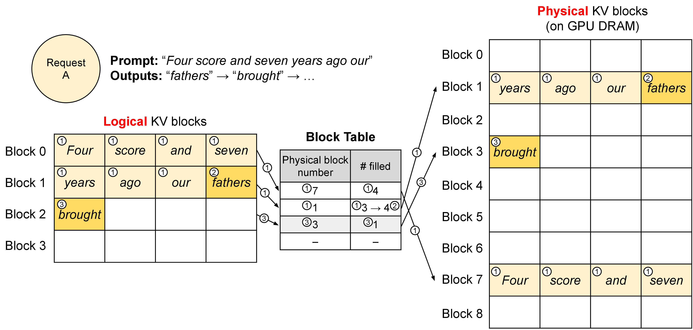
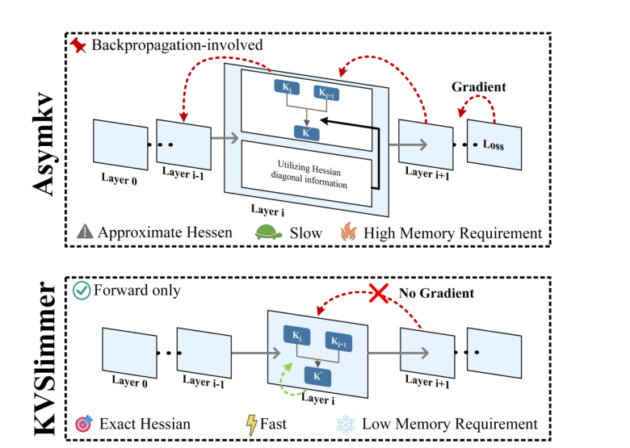
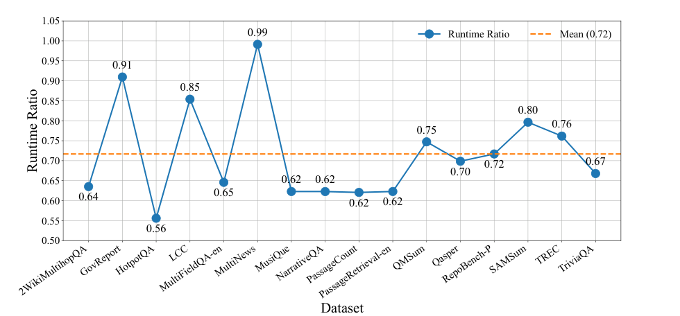
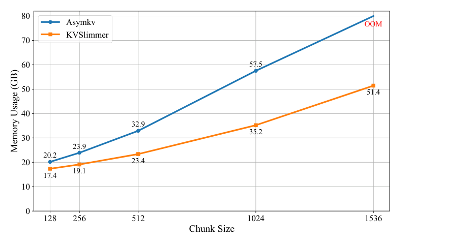

# 一条历史事实换种保存方式以后还剩下什么

设对话早先明确给出“订单A的截止日期是周五”，后面又来了很长的新内容。系统可以保留原文、保留KV、搬到CPU、量化，或把它摘要成一句话。这些方案改变的信息和计算成本不同，必须先分清。

## 原文和KV分别保存什么

原文token可以重新送入模型计算；KV是特定模型和上下文下已经计算出的注意力状态。保留原文但释放KV，会节省驻留显存，下一次需要付出重算。只保留摘要，则原文中未进入摘要的细节可能永久丢失。

把“周五”摘要成“本周内”改变了任务信息。之后模型答错，可能来自摘要，而不是KV存储本身。

## 两种eviction影响不同

回收已结束请求留下的闲置prefix cache，通常不改变当前请求看到的上下文，只影响未来缓存命中。删掉活跃请求仍需关注的历史K/V，则改变attention可见信息；除非按定义重算或恢复，否则是近似方法。

Paged KV首先解决物理存放与分配，逻辑位置仍可连续。分页本身不等于删除历史，也不自动压缩数值精度。

{ width="760" }

<small>图源：[Efficient Memory Management for Large Language Model Serving with PagedAttention](https://arxiv.org/abs/2309.06180)，Figure 5。原论文图意：vLLM 用 block table 把 logical KV blocks 翻译到 physical KV blocks，使请求的 KV cache 不必连续存放。</small>

## 存储层级迁移可以保持数值不变

将KV无损搬到CPU或其他存储，再按原位置恢复，可以保留数值，但增加传输与等待。若4GiB状态经有效25GB/s链路传输，单向理想下界约0.172秒，还没计调度与格式开销。

预取可隐藏部分传输，前提是知道何时需要这些页且有独立资源。若每个decode步都要反复搬同一大段历史，链路可能成为新的瓶颈。

## 数值量化与内容删减要分开评估

KV量化近似每个数，仍保留对应位置；token选择或窗口截断改变保留的位置；摘要改写内容表达。它们可能组合，但需要分层对照，不能都统称“压缩率相同”。

同样节省一半显存，可能分别来自半精度字节、删除一半位置或把文本摘要为一半token，模型函数变化完全不同。

{ width="760" }

<small>图源：[KVSlimmer](https://arxiv.org/abs/2603.00907)，Figure 1。原论文图意：AsymKV 依赖反向传播和近似 Hessian；KVSlimmer 使用 forward-only 变量构造 exact Hessian 相关合并权重，避免 gradient 路径。</small>

{ width="760" }

<small>图源：[KVSlimmer](https://arxiv.org/abs/2603.00907)，Figure 4。原论文图意：KVSlimmer 相对 AsymKV 的 runtime ratio，均值约 0.72。</small>

{ width="620" }

<small>图源：[KVSlimmer](https://arxiv.org/abs/2603.00907)，Figure 6。原论文图意：不同 chunk size 下，KVSlimmer 的峰值 GPU memory 明显低于 AsymKV；chunk size 越大差距越明显。</small>

## 用可检查的问题检验信息保留

针对上面的订单，检查截止日期、订单身份和引用位置；再改变事实所在距离、加入相似订单、遮盖无关段落，观察错误何时出现。长上下文平均分可能掩盖少数关键事实丢失。

若压缩由模型生成，还要独立检查摘要是否引入新事实。对话系统可保留原文引用以便重取，但重取逻辑和成本也要进入评估。

## 容量决策从状态是否可重建开始

活跃且马上会用到的状态优先保持可用；可低成本重算的闲置状态可以回收；高重算成本的状态可考虑缓存或分层迁移。具体策略需要结合到达率、访问局部性与质量要求，不存在只靠“越旧越不重要”就普遍正确的规则。

## 对照源码与延伸阅读

- [活跃请求与缓存分配的执行背景](https://github.com/vllm-project/vllm/blob/fa3b9d1377219247060d3c8b49eae199c9e7e154/vllm/v1/core/sched/scheduler.py)
