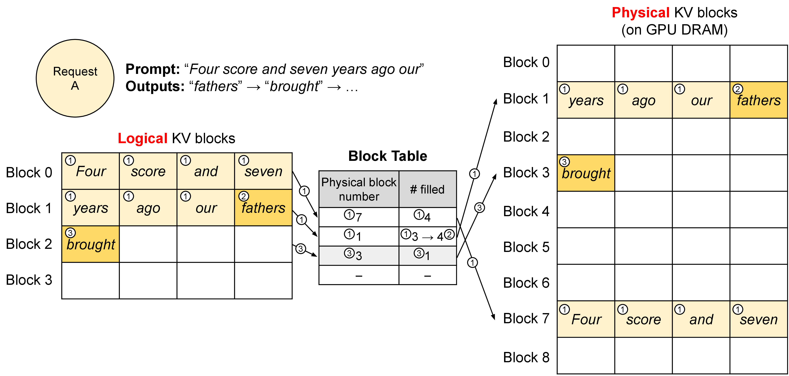

# 上下文压缩与 KV 内存管理

长上下文系统的难点，不是把窗口从 `4k` 扩到 `128k` 后就结束了。窗口越长，prefill 越贵，KV cache 越大，历史噪声越多，模型越可能把旧信息、无关信息和关键约束混在一起。真正可靠的长上下文系统，本质上是一套记忆管理系统。

## 长上下文为什么贵

长上下文会同时放大两类成本：

| 成本 | 发生在哪里 | 为什么随上下文变长 |
| --- | --- | --- |
| prefill 成本 | 首 token 前 | 输入 token 越多，模型一次性处理越久 |
| KV cache 成本 | decode 全程 | 历史 token 的 K/V 要常驻并被反复读取 |

KV cache 数量级：

\[
M_{\text{KV}}
\approx
2 \cdot L \cdot B \cdot T \cdot H_{\text{kv}} \cdot D_{\text{head}} \cdot b
\]

权重量化只能减少参数显存，不会自动减少 \(T\) 带来的 KV 增长。长上下文并发服务经常先卡在 KV，而不是权重。

## Paged KV：先解决“放在哪里”

vLLM 的 logical/physical block 图适合建立第一层直觉：请求逻辑上是一段连续上下文，但显存里可以拆成许多物理 block。

{ width="760" }

<small>图源：[Efficient Memory Management for Large Language Model Serving with PagedAttention](https://arxiv.org/abs/2309.06180)，Figure 5。原论文图意：vLLM 用 block table 把 logical KV blocks 翻译到 physical KV blocks，使请求的 KV cache 不必连续存放。</small>

**这张图怎么看。**
左边的 logical block 保持 token 顺序，右边的 physical block 表示实际显存位置。block table 是翻译表。这样长短请求可以更灵活地加入、退出、复用和回收，但也引入 page size、碎片、局部性和 metadata 管理问题。

Paged KV 解决的是内存布局，不直接解决“哪些记忆应该保留”。后者需要压缩、淘汰和分层记忆。

## 上下文不是越长越有用

真实请求里，许多历史 token 对当前决策价值很低：

1. 寒暄和重复确认；
2. 已经被修正的错误中间结论；
3. 旧工具日志；
4. 与当前问题无关的召回片段；
5. 过期约束或已完成待办；
6. 太长但没有结构的历史对话。

因此上下文管理要问五个问题：

| 问题 | 例子 |
| --- | --- |
| 必须高保真保留什么 | 系统约束、用户最终目标、关键证据、工具状态 |
| 什么可以摘要 | 多轮讨论过程、背景材料、旧计划 |
| 什么应该结构化 | 待办、权限、文件路径、API 返回状态 |
| 什么应该外置检索 | 长期知识库、历史会话、文档全集 |
| 什么可以丢弃 | 寒暄、重复内容、低置信召回、过期草稿 |

好的长上下文系统不是“什么都记”，而是“按价值和风险分层记”。

## 五类压缩方式

| 方法 | 做法 | 优点 | 风险 |
| --- | --- | --- | --- |
| 摘要压缩 | 把历史自然语言总结成短文本 | 简单、可读 | 丢细节、摘要幻觉、约束模糊 |
| 结构压缩 | 把目标、事实、工具状态写入 schema | 可控、适合 agent | 需要状态更新逻辑 |
| 检索外置 | 不常驻 prompt，需要时召回 | 可扩展 | 漏召回、错召回、版本冲突 |
| Token 级压缩 | 直接筛 token 或合并 KV | 节省更直接 | 可解释性和质量回归更难 |
| Learned memory | 训练模型学习保留状态 | 可能更自动 | 难调试、难审计 |

Agent 系统通常不能只靠自然语言摘要，因为很多记忆是程序状态：工具调用过没有、表单填到哪一步、文件是否允许覆盖、API 返回哪个版本。结构化状态往往比“看起来流畅的摘要”更可靠。

## KV 淘汰：缓存问题会变成质量问题

如果显存预算有限，就要淘汰或降级一部分记忆。可以用一个简化优化问题理解：

\[
\max_{S}\sum_{i\in S}u_i
\quad
\text{s.t.}
\quad
\sum_{i\in S}c_i\le B_{\text{mem}}
\]

常见策略：

| 策略 | 直觉 | 失败模式 |
| --- | --- | --- |
| FIFO | 最早的先丢 | 丢掉开头关键约束 |
| 最近窗口 | 保留最近内容 | 远期目标或安全规则丢失 |
| Attention-aware | 保留注意力高的片段 | 注意力不等于任务价值 |
| Role-aware | 系统、用户目标、工具状态优先 | 规则需要人工设计 |
| Segment-aware | 按文档、回合、工具块淘汰 | segment 边界错误会伤上下文 |
| Risk-aware | 高风险约束强保留 | 需要风险识别器和回归集 |

KV eviction 不是纯性能优化。它会改变模型还能看到什么历史，因此必须跑任务级回归。

## Memory Hierarchy：把记忆放到合适层级

| 层级 | 保存什么 | 成本 | 风险 |
| --- | --- | --- | --- |
| 当前 prompt | 当前任务必需 token | 最高 | 过长会拖慢 prefill |
| KV cache | 已 prefill 的 token 表示 | 高 | 显存压力、eviction 伤质量 |
| 结构化状态 | 目标、约束、工具状态、事实表 | 低 | schema 维护成本 |
| 向量库/检索 | 长期历史和外部知识 | 中 | 召回质量决定效果 |
| 冷日志 | 全量历史、审计、复盘 | 低 | 不参与实时推理 |

设计目标是：高价值、高风险、当前决策相关的信息留在高保真层；低频、低风险、长期材料放到低成本层。

## KVSlimmer：从论文图看 KV 压缩证据

KVSlimmer 这类工作提醒我们：长上下文优化不能只报告“KV 少了多少”，还要看 decoder 时间、峰值显存和质量保持。

{ width="760" }

<small>图源：[KVSlimmer](https://arxiv.org/abs/2603.00907)，Figure 1。原论文图意：AsymKV 依赖反向传播和近似 Hessian；KVSlimmer 使用 forward-only 变量构造 exact Hessian 相关合并权重，避免 gradient 路径。</small>

**这张图怎么看。**
左右对比的是两种 KV 合并路径。重点不是公式细节，而是工程含义：如果压缩过程需要反向传播，在线长上下文服务很难承受；forward-only 路径更像能放进推理热路径的候选。

{ width="760" }

<small>图源：[KVSlimmer](https://arxiv.org/abs/2603.00907)，Figure 4。原论文图意：KVSlimmer 相对 AsymKV 的 runtime ratio，均值约 0.72。</small>

**这张图怎么看。**
纵轴是相对运行时间，低于 1 表示更快。它说明压缩方法不能只看最终任务分数，还要看压缩本身的 runtime overhead。若压缩省下的 KV 不足以抵消压缩开销，线上 TPOT 可能不会改善。

{ width="620" }

<small>图源：[KVSlimmer](https://arxiv.org/abs/2603.00907)，Figure 6。原论文图意：不同 chunk size 下，KVSlimmer 的峰值 GPU memory 明显低于 AsymKV；chunk size 越大差距越明显。</small>

**这张图怎么看。**
这张图对应容量问题：chunk 越大，KV 合并过程越容易放大峰值显存。长上下文服务不仅要看稳态 KV，还要看压缩、合并、验证过程中的峰值 memory。

## 长上下文质量风险

常见失败包括：

1. 摘要丢掉关键约束；
2. 旧错误被摘要成“已确认事实”；
3. 检索漏召回导致模型忘记背景；
4. KV eviction 丢掉跨轮引用；
5. 工具状态和自然语言上下文不一致；
6. 压缩策略在短任务有效，长任务累计漂移；
7. 省显存后，风险判断或引用质量下降。

因此长上下文验收要同时看系统指标和任务指标：

| 指标类型 | 最小指标 |
| --- | --- |
| 系统 | prefill time、KV GiB、eviction 次数、压缩耗时、P95/P99 |
| 召回 | recall、错召回、漏召回、证据版本 |
| 任务 | 多轮成功率、约束保持率、引用正确率、工具状态一致性 |
| 成本 | 每请求成本、每成功任务成本、cache hit/miss penalty |
| 回放 | 能否复现哪些内容被保留、摘要、淘汰或召回 |

## 真实排查案例：KV 省了，任务忘了约束

**症状**：长会话 agent 接入激进 KV eviction 后，单机并发提升 35%，但第 8 轮以后的“不能覆盖原文件”“必须使用指定工具”等约束遵守率下降。

**关键指标**：KV 显存下降，eviction 次数上升；平均延迟改善，但长任务成功率下降；错误集中在跨轮约束和工具状态。

**判断**：这是记忆分层问题，不是模型突然变弱。高保真 KV 被删，摘要层又没有结构化承接约束。

**修复**：把目标、权限、文件路径、工具状态拆成结构化 memory；KV eviction 按决策相关性而不是纯时间淘汰；回归集加入旧事实更正、约束保持和工具状态一致性。

## 读完以后怎么判断

长上下文优化的目标不是“能塞更多 token”，而是在固定显存和延迟预算下，保留对当前任务真正有用的信息。KV、prompt、摘要、结构化状态、检索库和冷日志要分层协作；任何压缩或淘汰策略，都必须用系统指标和任务质量一起验收。

## 外部材料

- [vLLM PagedAttention 博客](https://vllm.ai/blog/vllm)。
- [TensorRT-LLM KV Cache System](https://nvidia.github.io/TensorRT-LLM/features/kvcache.html)。
- [SGLang 文档](https://docs.sglang.ai/)。
