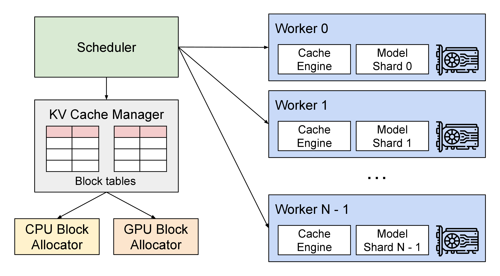

# 成本建模与 SLO 设计

推理系统上线后，所有优化最后都会落到两个问题：这次请求到底花多少钱，用户体验底线有没有守住。成本模型回答“值不值”，SLO 回答“能不能接受”。没有这两者，tokens/s、显存节省和 benchmark 分数都很容易误导决策。

{ width="860" }

<small>图源：[vLLM 官方博客：Easy, Fast, and Cheap LLM Serving with PagedAttention](https://vllm.ai/blog/2023-06-20-vllm)。原图表达 scheduler、KV cache manager、allocator 和 GPU worker 的关系；本站读法是把成本拆到 queue、prefill、decode、KV 与调度层，而不是只算单 token 价格。它不能证明 vLLM 在所有 workload 下成本最低。</small>

## 先把 SLO 当成约束

SLO 是 Service Level Objective，即服务目标。它不是“越快越好”，而是明确什么体验必须守住。

| 业务 | 典型 SLO | 为什么 |
| --- | --- | --- |
| 聊天助手 | P95 TTFT < 2s，TPOT < 80ms/token | 用户要尽快看到反馈 |
| 长文档问答 | P95 TTFT 可稍高，但引用正确率要高 | 质量和证据比首 token 更重要 |
| 代码补全 | 低 TTFT、低 TPOT、低失败率 | 卡顿会打断编辑流 |
| Agent 工具链 | 端到端任务完成时间和成功率 | 单次模型调用快不代表任务快 |
| 高风险任务 | 强质量门禁和 fallback | 错误成本高于延迟成本 |

SLO 写清楚后，优化才有判断标准：一个改动若让平均 TPOT 下降，但 P99、错误率或引用质量变差，就不一定成功。

## 单请求成本公式

从请求生命周期看，单请求成本可以写成：

\[
C_{\text{req}}
\approx
C_{\text{queue}}
+ C_{\text{prefill}}(L_{\text{in}}, q_w, q_a)
+ C_{\text{KV}}(L_{\text{ctx}}, B, q_{\text{kv}})
+ L_{\text{out}}\cdot C_{\text{decode-step}}(B, q_w, q_{\text{kv}})
+ C_{\text{tool}}
+ C_{\text{retry}}
+ C_{\text{ops}}
\]

这个公式不是为了精确到小数点，而是让你知道成本来自哪里。短聊天、长文档、长输出、多工具 agent、多模态请求不能共用一个平均成本。

## 单位 token 成本为什么容易误导

常见粗公式是：

\[
\text{Cost/token}
=
\frac{C_h}{3600\cdot \Theta}
\]

它适合做第一眼估算，但有三个问题：

1. 没区分 prefill token 和 decode token；
2. 没算 KV cache、工具、重试和失败；
3. 平均吞吐会掩盖 P99 和低效请求桶。

更稳的口径是：每个请求桶分别算 cost/request、cost/output token、cost/successful task，再和 SLO、质量指标一起看。

## Prefill、Decode 和 KV 的经济学

| 请求桶 | 主要成本项 | 常见误判 | 更合适的优化 |
| --- | --- | --- | --- |
| 短问答 | queue、launch、模型常驻 | 用大模型统一服务 | 小模型路由、短请求池、低等待 batch |
| 长文档 | prefill、KV、检索噪声 | 只看输出 token 成本 | RAG 裁剪、prefix cache、分离 prefill |
| 长输出 | decode、KV 生命周期 | 只优化 prefill | speculative decoding、输出长度控制 |
| Agent | 多轮模型调用、工具等待、状态膨胀 | 单次调用快就够了 | 工具缓存、状态压缩、端到端 trace |
| 多模态 | 视觉编码、跨模态 token、后处理 | 只算语言模型 token | 图像裁剪、视觉缓存、模态分池 |

KV cache 也可以直接进入成本账：

\[
M_{\text{KV}}
\approx
2 \cdot L \cdot B \cdot T \cdot H_{\text{kv}} \cdot D_{\text{head}} \cdot b
\]

这行式子在说：KV cache 显存随层数 \(L\)、并发 batch \(B\)、上下文长度 \(T\)、KV head 数、head 维度和每元素字节数线性增长；前面的 2 分别对应 K 和 V 两份缓存。

如果显存被 KV 占满，系统要么降低并发，要么增加机器，要么做 KV 量化/压缩/eviction。任何一种都会影响成本或质量。

## 一个可复算例子：32k 文档问答

假设请求形态如下：

| 项 | 数值 |
| --- | --- |
| 输入上下文 | 32k token |
| 输出 | 512 token |
| 模型 | 32 层，GQA 8 个 KV heads，head dim 128 |
| batch | 4 |
| KV dtype | BF16，2 bytes |
| SLO | P95 TTFT < 2s，TPOT < 60ms/token |

KV 数量级：

\[
2\times32\times4\times32768\times8\times128\times2
\approx 16\text{GiB}
\]

这还只是 KV 本体，不包括权重、workspace、page metadata、碎片、speculative 分支、临时 buffer。若 context 变成 128k，KV 会约变 4 倍；若 batch 从 4 到 8，也再约变 2 倍。

因此这个请求的成本判断应拆成：

| 问题 | 需要记录 |
| --- | --- |
| TTFT 为什么高 | queue time、prefill time、prefix hit、输入长度 |
| TPOT 为什么高 | decode batch、KV read、page miss、sampling |
| 显存为什么紧 | KV GiB、fragmentation、eviction、dtype |
| 质量是否保持 | 引用正确率、长文档问答分桶、压缩前后回归 |
| 是否值得优化 | cost/request、cost/success、SLO breach rate |

## 质量、成本、延迟的三角

很多推理决策都可以看成一个效用函数：

\[
\max \text{Utility}
=
\alpha Q
- \beta C
- \gamma L
- \delta R
\]

这行式子表示：效用由质量 \(Q\) 提升，被成本 \(C\)、延迟 \(L\) 和风险 \(R\) 抵消。\(\alpha,\beta,\gamma,\delta\) 是业务权重，用来表达“质量、钱、速度、安全”谁更重要。

不同业务的权重完全不同。客服闲聊可能更重成本和延迟；法律合同问答更重质量和风险；代码补全更重低延迟；批量离线生成更重吞吐和成本。

**常见误解。**
低成本模型不一定更省钱。如果它错误率高，导致升级、重试、用户重复提问或人工介入，端到端 cost/success 可能更高。

## 分层 SLO

成熟系统通常至少有四层 SLO：

| 层级 | 指标 |
| --- | --- |
| 平台层 | 可用性、错误率、queue time、admission reject |
| 模型层 | TTFT、TPOT、上下文上限、fallback |
| 产品层 | 任务完成率、引用正确率、用户中断率 |
| 业务层 | 工单关闭时间、人工接管率、预算消耗 |

只设平台 SLO 会把“快速但错误”的系统误判为健康；只设质量指标又可能让成本不可控。推理验收必须把体验、质量和成本放在同一张表里。

## 降级和预算控制

资源紧张时，系统不应所有请求一起变慢。更好的做法是有预案地降级：

| 降级动作 | 适合场景 | 风险 |
| --- | --- | --- |
| 免费用户走小模型 | 峰值流量、低价值请求 | 质量下降，需要提示或回退 |
| 限制上下文长度 | 长文档过多 | 可能漏证据 |
| 关闭 speculative | low acceptance 请求桶 | 长输出 TPOT 变差 |
| 关闭高成本工具 | 工具 API 限流 | agent 成功率下降 |
| 后台任务延后 | 高峰期保护在线 SLO | 批处理完成时间变长 |
| 高风险任务强制校验 | 医疗、法律、金融、安全 | 延迟和成本上升 |

降级策略要提前进入成本模型。高峰期临时拍脑袋，很容易让系统变成“看似在线，实际体验不可控”。

## 成本复盘表

每次推理优化发布后，建议用同一张表复盘：

| 问题 | 发布前估算 | 发布后真实 | 是否达标 |
| --- | --- | --- | --- |
| 哪个请求桶受益 | 短问答/长文档/长输出/agent | trace 分桶结果 | 是否命中目标 |
| 降低哪段成本 | prefill/KV/decode/tool | 阶段耗时和账单 | 是否真实下降 |
| SLO 是否守住 | TTFT/TPOT/P99 | P50/P95/P99 | 是否有尾部回归 |
| 质量是否保持 | 离线集/online eval | 质量分桶 | 是否掉点 |
| 回退是否可靠 | fallback 预案 | 灰度/演练结果 | 是否可回滚 |

最重要的不是一次估算很准，而是每次发布后校准模型。GPU 价格、请求长度、缓存命中、模型版本、外部工具价格都会变，成本模型也必须更新。

## 世界模型和 VLA 场景的额外成本

如果推理服务的是世界模型 rollout 或 VLA 闭环控制，还要把成本写成任务闭环：

\[
T_{\text{loop}}
=
T_{\text{observe}}
+ T_{\text{encode}}
+ T_{\text{rollout}}
+ T_{\text{policy}}
+ T_{\text{control}}
\]

这时“推理更快”只有在降低 deadline miss、collision、takeover，或提高 success/cost 时才有意义。kernel speedup 不能自动证明闭环收益。

## 读完以后怎么判断

成本建模和 SLO 设计的核心，是把优化从“看起来更快”变成“在指定请求桶里，守住质量和尾延迟，并降低单位成功任务成本”。先拆 queue、prefill、KV、decode、tool 和 retry，再按短问答、长文档、长输出、agent、多模态分桶验收，推理系统才不会被平均值带偏。

## 相关阅读与下一步

- 外部材料：[vLLM PagedAttention 博客](https://vllm.ai/blog/vllm)。
- 外部材料：[TensorRT-LLM KV Cache System](https://nvidia.github.io/TensorRT-LLM/features/kvcache.html)。
- 外部材料：[SGLang 文档](https://docs.sglang.ai/)。
- 站内下一步：[推理系统专题](index.md)。
- 站内下一步：[推理运行时](serving-runtimes-vllm-sglang-and-tensorrt-llm.md)。
- 站内下一步：[缓存、路由与投机解码](caching-routing-and-speculative.md)。
