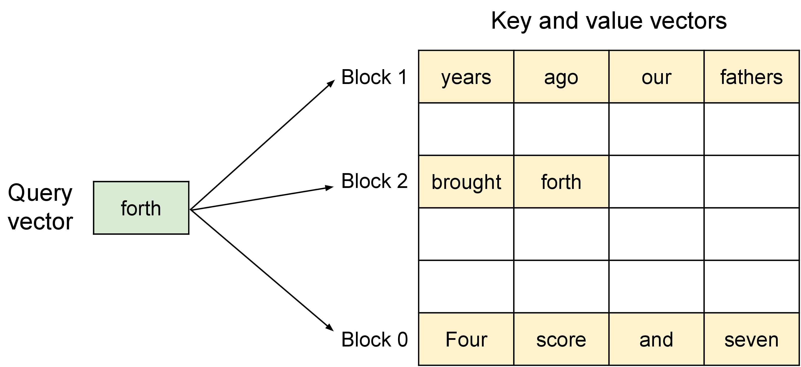

# Prefill完成以后，KV怎样交给另一组GPU

Prefill一次处理许多输入token，decode每轮生成少量token。分开部署可以减少两类工作互相干扰，但下一阶段必须拿到正确KV。是否划算，要比较减少的等待与新增传输。


## 拆分主要解决尾延迟，不会凭空增加吞吐

vLLM 当前的[Disaggregated Prefilling 文档](https://docs.vllm.ai/en/stable/features/disagg_prefill/)把这项功能标为 experimental，并把目标写得很具体：让 prefill 和 decode 使用不同的并行策略，分别调 TTFT 和 inter-token latency。文档同时明确写出 disaggregated prefill **does not improve throughput**。如果问题是总 token/s 不够，先优化 batch、kernel、并发和模型并行；如果问题是长 prompt 插入后让已有请求的 token 间隔突然变长，拆分才有明确的切入点。

不开拆分时，服务可能在一批 decode 中插入新的 prefill。新请求的长 prompt 占住计算预算，旧请求的 ITL 出现长尾。chunked prefill 也能通过限制每次 prompt 的块大小缓解这个问题，但块大小会同时影响 prefill 效率、排队和尾延迟。vLLM 文档把拆分部署描述成更容易独立控制 tail ITL 的方式，代价是要维护 KV connector 和跨实例生命周期。

vLLM 的实现把 KV producer、KV consumer、scheduler connector 和 worker connector 分开。scheduler 决定何时安排传输，worker 执行实际的 store/load；connector 负责让 decode 侧按条件取回对应请求的 KV。当前文档列出 NIXL、LMCache、Mooncake、Offloading 等不同 connector，它们的传输介质、缓存层级和版本兼容性并不相同。把“支持 disaggregation”写成一个单独的服务开关，会掩盖真正决定结果的 connector 与网络路径。

## 先算一条请求要交接多少状态

设32层、8个KV头、头维128、BF16、32768个prompt token，主体KV为

$$
2\times32\times8\times128\times32768\times2
=4\ \text{GiB}.
$$

若有效传输带宽假设为25GB/s，单向传输下界约0.172秒。这里GiB按 $2^{30}$ 字节，GB/s按十进制，单位不同已显式换算。还需加队列、布局转换、元数据与协议开销。

## 交接的不只是一个字节数组

接收端需要模型与adapter身份、token/位置约定、已计算长度、层与KV头布局、dtype/scale以及页映射。两侧张量并行方式不同，还可能要重新分片或排列。

错误的模型身份可能产生数值合法但语义错误的KV；错误的长度会让未初始化槽位进入attention。传输完成与状态可提交需要同一个明确边界。

## 哪段计算可以和传输重叠

按层或按块流式传输可能隐藏部分时间，但decode能开始哪部分计算，取决于数据依赖和实现。不能把全部4GiB传输时间直接从prefill时间里减掉，除非实际时间线证明它被覆盖。

若网络与其他通信共享资源，独立传输基准也可能高估实际带宽。应在目标并行与负载下测完整交接。

## 两个池分别按哪种需求扩容

Prefill池主要承受每秒输入token及其长度分布，decode池承受输出token、活跃请求KV和逐步调度。两个池的服务率并不由同一个tokens/s数字决定。

教学设定中，每秒2个请求、平均输入8000、输出200，对应每秒16000输入token和400输出token。实际需要多少GPU，必须用各池在该长度和batch分布下的实测能力，再考虑尾延迟与冗余。

## 一次传输慢不能解释所有后续token都慢

KV交接通常主要影响进入decode前的等待。若每个后续token持续变慢，应继续检查decode池负载、KV layout、远程读取或并行配置，而不能只归因到一次初始传输。

比较合并与拆分部署时固定硬件总预算和请求分布，同时报告TTFT、TPOT、网络流量、KV驻留和质量。只有减少的干扰与排队超过新增交接成本，拆分才在这个配置下有价值。

{ width="820" }

<small>图源：[Efficient Memory Management for Large Language Model Serving with PagedAttention](https://arxiv.org/abs/2309.06180)。原图展示 logical KV blocks 到 physical KV blocks 的映射；读图重点是：当 prefill、decode 和 KV 被拆开后，KV 不再只是模型内部状态，而是要被命名、转移、复用和回收的系统资源。这张图不能证明解耦 prefill 一定有收益，收益仍取决于长短请求分布和 KV 转移成本。</small>

## 继续读

交接协议之后，继续看[服务系统中的调度与生命周期](serving-systems.md)和[成本模型与 SLO 设计](cost-modeling-and-slo-design.md)，再用[上下文压缩与 KV 淘汰](context-compression-kv-eviction-and-memory-hierarchies.md)核对缓存容量。

## 对照源码与延伸阅读

- [KV身份、容量与调度边界的参考实现](https://github.com/vllm-project/vllm/blob/fa3b9d1377219247060d3c8b49eae199c9e7e154/vllm/v1/core/sched/scheduler.py)

## KV 交接协议需要版本和生命周期

一次 prefill 到 decode 的交接至少应携带：

```text
request_id + model/adapter identity
tokenizer and position convention
computed token range and sequence length
layer/KV-head layout + dtype/scale
tensor-parallel shard map
page table / block ownership
checksum + expiry + cancellation state
```

接收端在 checksum 和身份校验通过前不能把 KV 标记为可提交。请求取消、超时或升级模型时，发送端和接收端都要处理 in-flight transfer；只关闭请求对象而不回收传输中的页，会让容量统计失真。

## 以容量模型决定池大小

Prefill 池的主要输入是每秒到达的输入 token 和长度分布，decode 池的主要状态是活动序列数、输出 token 率和 KV 驻留。用平均值粗估只能作为初筛，实际扩容要按桶建模：

| 桶 | Prefill 关注 | Decode 关注 |
| --- | --- | --- |
| 短输入/短输出 | 批量利用率 | 调度开销与并发 |
| 长输入/短输出 | prefill 峰值和 KV 交接 | 活动序列占用 |
| 短输入/长输出 | 排队与持续 decode | TPOT 和 KV 增长 |
| 长输入/长输出 | 交接带宽、显存和尾延迟 | 远程 KV 与淘汰 |

比较合并部署与解耦部署时固定 GPU 总预算、模型版本、请求 trace 和质量阈值，分别记录 TTFT、TPOT、交接 bytes、网络带宽、KV 峰值、排队时间和错误率。

## 交接 benchmark 的三步

1. **微基准**：固定 KV 字节数，测本机/跨机传输、布局转换和 checksum 开销。
2. **服务基准**：用真实长度分布，测 prefill 与 decode 两池的队列和交接等待。
3. **回归基准**：在缓存命中、取消、重试、扩容和网络拥塞下确认状态不会串请求。

如果只有微基准，没有服务级 p95，不能宣称解耦改善 SLO；如果只看服务级吞吐，没有请求级 checksum 和身份验证，也不能证明交接正确。

## 来源与改编说明

- [PagedAttention](https://arxiv.org/abs/2309.06180)用于理解 KV block 的逻辑/物理映射和动态请求内存。
- [vLLM 官方博客](https://vllm.ai/blog/2023-06-20-vllm)用于理解 scheduler、KV cache manager、allocator 与 GPU worker 的关系。
- [Hugging Face KV cache 文档](https://huggingface.co/docs/transformers/en/kv_cache)用于核对 KV 形状和增长；具体解耦协议需由目标 serving runtime 定义。
- [vLLM Disaggregated Prefilling 文档](https://docs.vllm.ai/en/stable/features/disagg_prefill/)用于核对 TTFT、ITL、connector 和吞吐边界；页面标注为 experimental，不能把其当前接口当成稳定公共协议。

## 自测

1. 为什么交接需要 model identity、已计算长度和页映射，而不只是一个 tensor？
2. 长输入短输出与短输入长输出对 prefill/decode 池的压力有什么不同？
3. 设计一个三步 benchmark，区分传输带宽、队列等待和远程 KV 读取。
