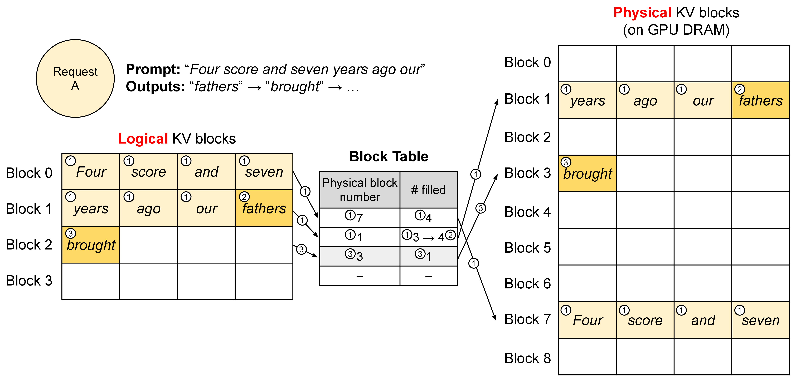
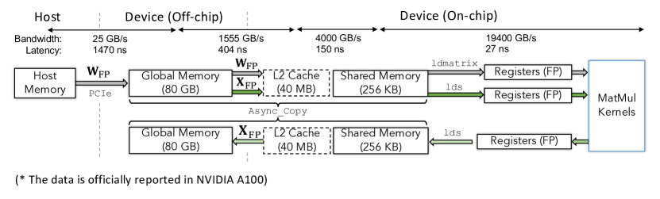
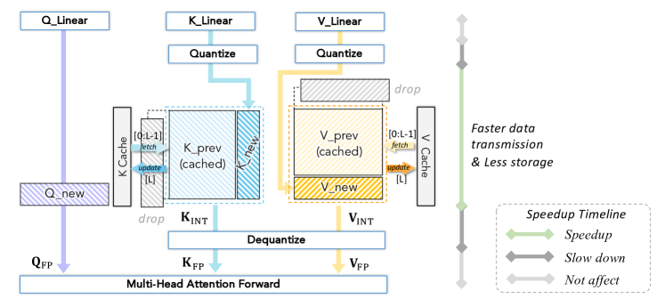

# 同一层在prefill和decode里为何有不同成本

一个4096×4096的BF16线性层，权重主体32MiB。Prefill可一次处理许多输入token，低batch decode可能每次只处理一行。权重没变，每次读入后能复用的次数却变了。

## 从矩阵shape算出量级

对 $Y=XW$，X为M×4096，主计算约 $2M\times4096^2$ FLOPs。M=1时约3355万FLOPs，至少读取32MiB权重，理想强度约1FLOP/byte；M=128时计算增加128倍，而权重仍有机会只读一次，复用潜力大得多。

真实执行还涉及输入输出、缓存、tile与指令选择。这个算账解释瓶颈可能不同，不保证某个GPU达到理想下界。

## Batch把权重读取分给更多请求

持续批处理可把多条正在decode的请求合成一轮，让同一权重用于更多行。吞吐可能提高，但新请求还要等待调度；长短请求混合又会改变KV读取与尾延迟。

静态batch等最长请求全部完成再一起结束，会让短请求占着槽位。Continuous batching可以在迭代间移除完成请求、补入新请求，但每轮工作量与状态也更动态。

## KV给并发设另一条上限

32层、8个KV头、头维128、BF16时，每token KV主体128KiB。32k历史的单请求约4GiB，四条约16GiB。即使权重能放下，并发也可能被KV挤满。

按页分配减少连续大块预留需求。页大小为4、长度分别5和7的两请求，各需2页，总分配16个槽位、有效12个，仍有4个尾部空槽。分页改善分配，不会消除所有碎片。

{ width="760" }

<small>图源：[Efficient Memory Management for Large Language Model Serving with PagedAttention](https://arxiv.org/abs/2309.06180)，Figure 5。原论文图意：vLLM 用 block table 把 logical KV blocks 翻译到 physical KV blocks，使请求的 KV cache 不必连续存放。</small>

## 量化和融合分别改哪段数据流

权重量化减少常驻和读取字节，但增加解包、scale或转换。KV量化作用于历史状态，精度与页面布局另有约定。融合减少中间写回与launch，但可能增加寄存器占用。

先用trace确认时间花在权重GEMM、attention扫描KV、转换还是调度。只看峰值算力或显存剩余，无法决定该优化哪一项。

{ width="690" }

<small>图源：`A Survey of Low-bit Large Language Models`，Figure 4。原论文图意：以 NVIDIA A100 为例展示 weight 和 activation 在 host、global memory、L2、shared memory、registers 与 MatMul kernel 之间的数据传输。</small>

{ width="620" }

<small>图源：`A Survey of Low-bit Large Language Models`，Figure 6。原论文图意：展示 quantized KV cache 如何减少缓存存储和数据传输，并在 attention forward 前 dequantize。</small>

## 同一个实验同时保留两种边界

Microbenchmark固定shape、dtype与layout，验证kernel本身；完整请求测试加入队列、continuous batch和真实长度分布，验证系统收益。若单kernel更快但端到端无改善，检查其占比以及新引入的转换、padding或等待。

## 对照源码与延伸阅读

- [GEMM的形状、tile与复用](https://github.com/triton-lang/triton/blob/cd2e01c6686d6503802e6cdfac56d5a5dfdb27a1/python/tutorials/03-matrix-multiplication.py)
- [动态请求与KV预算共同调度](https://github.com/vllm-project/vllm/blob/fa3b9d1377219247060d3c8b49eae199c9e7e154/vllm/v1/core/sched/scheduler.py)
