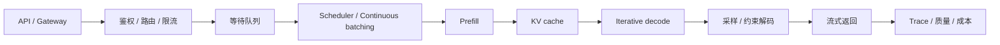

# 推理系统：让模型在动态请求下稳定交付

推理系统面对长度、到达时间、优先级和生成步数不断变化的请求，不能沿用静态 batch 的处理方式。模型权重只是其中一部分；runtime、scheduler、KV cache、kernel、路由、容量与观测共同决定用户最终看到的延迟、质量和成本。

## 推理系统的统一接口

分析一个推理服务，先固定四类输入和四类输出。

| 类别 | 需要记录什么 |
| --- | --- |
| 请求画像 | prompt tokens、output tokens、模态、并发、到达间隔、优先级 |
| 模型产物 | 权重与量化格式、tokenizer、chat template、最大上下文、并行配置 |
| 硬件与拓扑 | GPU 型号、显存、互联、节点数、CPU 与网络 |
| 服务策略 | batching、调度、cache、路由、投机解码、降级规则 |
| 延迟输出 | queue time、TTFT、TPOT、端到端 P50/P95/P99 |
| 容量输出 | request/s、output tokens/s、并发上限、KV 占用 |
| 成本输出 | GPU 时间、单位请求成本、单位有效结果成本 |
| 质量输出 | 任务指标、格式正确率、工具成功率、拒答与安全桶 |

没有请求画像，吞吐数字无法迁移；没有质量输出，加速结论不完整；没有尾延迟，平均值可能掩盖排队和长请求饥饿。

## 一条请求的生命周期

prefill 一次处理输入 token，通常有更高并行度，更接近大矩阵计算；decode 每轮只为活跃请求生成下一个 token，需要反复读取权重和 KV，常受显存带宽、调度与请求分叉限制。TTFT 主要受排队和 prefill 影响，TPOT 更接近 decode 的逐步成本，端到端延迟还取决于输出长度。

先读[推理服务系统](serving-systems.md)建立生命周期，再用[推理运行时](serving-runtimes-vllm-sglang-and-tensorrt-llm.md)理解 vLLM、SGLang 和 TensorRT-LLM 怎样实现这些接口。

## 执行引擎与显存

一次推理会消耗四类资源：权重常驻显存、KV cache、临时激活与 workspace、运行时管理开销。不同阶段的瓶颈并不相同。

| 问题 | 页面 |
| --- | --- |
| prefill、decode、batching 和 KV 为什么呈现不同瓶颈 | [GPU Kernel、Batching 与显存](gpu-kernels-batching-and-memory-systems.md) |
| runtime 如何管理 KV、调度和生成程序 | [vLLM、SGLang 与 TensorRT-LLM](serving-runtimes-vllm-sglang-and-tensorrt-llm.md) |
| 长上下文怎样改变 KV 容量和注意力成本 | [上下文压缩、KV 驱逐与内存层级](context-compression-kv-eviction-and-memory-hierarchies.md) |

模型 FLOPs 下降不等于端到端延迟下降。量化如果没有匹配 kernel，可能只缩小文件；融合如果触发大量 shape fallback，可能让运行时更慢；显存能容纳更多请求，也可能因为排队和调度策略让 P99 恶化。

## 调度、缓存与扩展

服务扩展的核心是管理动态状态。scheduler 决定哪些请求进入下一轮计算，prefix cache 复用相同前缀，KV block manager 管理增长中的序列，router 决定请求去哪个模型或副本，投机解码用额外计算换更少的 target steps。

| 问题 | 页面 |
| --- | --- |
| prefix cache、路由与投机解码怎样减少重复计算 | [缓存、路由与投机解码](caching-routing-and-speculative.md) |
| 为什么把 prefill 和 decode 拆到不同资源池 | [解耦 Prefill 与 KV 服务](disaggregated-prefill-kv-services-and-capacity-ops.md) |
| MoE expert 与多模型副本怎样路由 | [MoE 路由与多模型服务](moe-routing-and-multi-model-serving.md) |
| RAG、Agent 和工具调用怎样扩大状态与故障面 | [RAG、Agent 与长上下文系统](rag-agents-and-long-context-systems.md) |

这些技术会互相影响。prefix cache 提高命中率后，prefill 负载下降，原有 prefill/decode 配比可能失衡；投机解码改变每轮 batch 的 shape；多模型路由提高资源利用率，也会增加冷启动、权重驻留和质量归因难度。

## SLO、评测与反馈

SLO 把系统目标写成可验证约束，例如“指定请求桶下，TTFT P95 小于某阈值、TPOT P99 小于某阈值、超时率低于某阈值，同时质量回归不超过门槛”。容量规划、降级和扩容都应从这个约束反推。

| 问题 | 页面 |
| --- | --- |
| 怎样把延迟、吞吐、质量和成本写进同一份 SLO | [成本建模与 SLO 设计](cost-modeling-and-slo-design.md) |
| 怎样估算副本、并发、KV 和突发流量 | [容量规划与推理优化](optimization-checklist-and-capacity-planning.md) |
| 怎样通过 trace、分桶和在线评测定位退化 | [可观测性与在线评测](observability-and-online-evaluation.md) |

线上反馈进入训练前必须完成归因。输出差可能来自 checkpoint、量化、prompt 模板、检索、工具、缓存污染或服务超时。只有把 trace、模型版本、运行时配置和输入输出保存在同一证据链里，失败样本才适合进入后训练数据引擎。

## 按问题进入

| 当前现象 | 建议路径 |
| --- | --- |
| 首 token 很慢 | [推理服务系统](serving-systems.md) → [容量规划](optimization-checklist-and-capacity-planning.md) |
| 逐 token 生成慢，GPU 利用率却不低 | [GPU Kernel、Batching 与显存](gpu-kernels-batching-and-memory-systems.md) → [算子专题](../operators/index.md) |
| 长上下文很快耗尽显存 | [上下文压缩与 KV 管理](context-compression-kv-eviction-and-memory-hierarchies.md) → [解耦 Prefill](disaggregated-prefill-kv-services-and-capacity-ops.md) |
| 吞吐提高但 P99 和超时率变差 | [成本与 SLO](cost-modeling-and-slo-design.md) → [可观测性](observability-and-online-evaluation.md) |
| Agent 平均模型延迟正常，任务仍然很慢 | [RAG、Agent 与长上下文](rag-agents-and-long-context-systems.md) → [可观测性](observability-and-online-evaluation.md) |
| 量化后显存下降但没有端到端加速 | [量化专题](../quantization/index.md) → [量化运行时](../quantization/quantization-runtimes-and-frameworks.md) |

训练产物、量化、编译和线上反馈之间的完整关系见[训练与推理系统总览](../training-and-inference-systems/index.md)。
