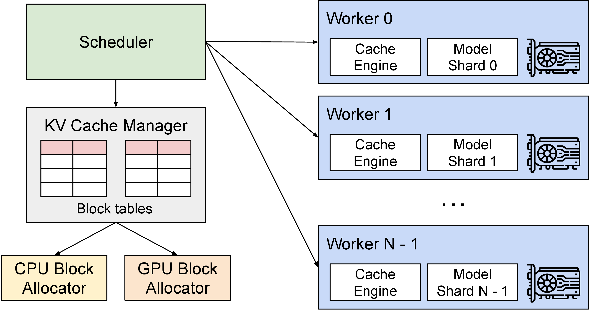

# 推理系统路线图

<div class="atlas-hero">
  <div class="atlas-kicker">Inference Systems</div>
  <p class="atlas-lead">这一专题围绕在线推理系统展开，重点讨论推理服务系统、运行时、KV cache、长上下文、MoE、多模型路由、在线评测与容量治理。</p>
  <div class="atlas-chip-row">
    <span class="atlas-chip">推理服务系统</span>
    <span class="atlas-chip">运行时</span>
    <span class="atlas-chip">KV Cache</span>
    <span class="atlas-chip">容量运维</span>
  </div>
</div>

## 专题定位

<div class="atlas-meta-grid">
  <div>
    <strong>核心问题</strong>
    <p>如何把训练好的模型变成一条可运营的在线系统，在质量、时延、吞吐、成本和稳定性之间做持续平衡。</p>
  </div>
  <div>
    <strong>适合读者</strong>
    <p>适合做在线服务、RAG、Agent、模型路由、多租户平台和推理基础设施的人。</p>
  </div>
  <div>
    <strong>阅读方式</strong>
    <p>建议先看推理服务系统和运行时，再进入缓存、长上下文、MoE、多模型和在线评测。</p>
  </div>
</div>

!!! note "在全站主线里的位置"
    推理专题是工程支撑，解决“训练好的模型如何稳定、低延迟、低成本地被调用”。对世界模型和 VLA 来说，它尤其重要在实时闭环：rollout、动作预测、视频生成和安全检查都可能反复调用模型。如果只是建立概念主线，可以先跳过大部分推理细节；一旦进入交互式世界模型或机器人部署，再回来读缓存、调度、量化和在线评测。

!!! tip "证据与全站矩阵"
    前沿 claim 先查 [全站证据标准](../references/evidence-and-reproducibility-standard.md) 和 [全站效率矩阵](../references/site-efficiency-coverage-matrix.md)。推理页里的 P95/P99、tokens/s、KV GiB 和系统吞吐只能证明运行成本，不能自动证明世界模型规划收益。

!!! tip "本专题的读法"
    先跟踪一条请求，而不是先背 runtime 名字：请求进入队列，长输入做 prefill，逐 token decode 读取 KV cache，路由和缓存决定成本，观测指标决定能否长期运营。vLLM、SGLang、TensorRT-LLM 等工具都可以放回这条请求路径里理解。

!!! note "从新加论文反推推理主线"
    EAGLE 系列说明 decode 加速不能只看 tokens/s：draft model 的训练分布、draft tree 的候选预算、target verification 的并行效率、KV 分支管理和 runtime batching 会一起决定真实 TPOT 与 P99。Low-bit LLM Survey 则提醒量化不能只看 checkpoint bitwidth：number format、scale granularity、Q/DQ、packing、kernel、KV cache 和硬件指令必须在同一条请求热路径里验收。Fast-FoundationStereo 把同一原则扩展到实时视觉感知：feature extraction、cost filtering、refinement、伪标签数据和 TensorRT path 要一起进入成本账。读推理章节时，建议固定一条请求，分开估 `prefill`、`decode`、`KV memory`、`vision latency`、`verification overhead` 和 `fallback`，再判断某个优化是否真的省钱。

<div class="atlas-meta-grid">
  <div>
    <strong>读前先知道</strong>
    <p>Transformer attention、KV cache、latency、throughput、batch 和 GPU 显存。</p>
  </div>
  <div>
    <strong>读中抓主线</strong>
    <p>队列、prefill、decode、缓存、路由、容量、观测。</p>
  </div>
  <div>
    <strong>读完能判断</strong>
    <p>一次“慢”到底是模型慢、排队慢、上下文太长、KV 爆了还是工具链拖住了。</p>
  </div>
</div>

## 阅读分层与小地图

| 分层 | 推荐内容 | 读到什么程度 |
| --- | --- | --- |
| 主线必读 | [推理运行时](serving-runtimes-vllm-sglang-and-tensorrt-llm.md)、[缓存、路由与投机解码](caching-routing-and-speculative.md)、[成本建模与 SLO](cost-modeling-and-slo-design.md) | 能把一次 rollout 请求拆成 prefill、decode、KV、verification 和 fallback |
| 工程查阅 | 解耦 prefill、MoE serving、在线观测、容量规划 | 有真实服务压力或 P99 问题时逐页查 |
| 论文扩展 | [EAGLE](../paper-deep-dives/inference/eagle.md)、[EAGLE-2](../paper-deep-dives/inference/eagle-2.md)、[EAGLE-3](../paper-deep-dives/inference/eagle-3.md)、[Fast-FoundationStereo](../paper-deep-dives/inference/fast-foundation-stereo.md)、[KVSlimmer](../paper-deep-dives/inference/kvslimmer.md) | 区分 decode 加速、draft 成本、视觉感知延迟、KV 成本和 runtime 成本 |
| 基础补课 | Transformer、KV cache、显存带宽、队列系统 | 不熟请求热路径时先补 |
| 暂时可跳过 | 多租户平台治理和复杂路由策略 | 还没有线上流量时先略读 |

本专题服务世界模型高效训练里的**rollout 成本和在线验证成本**。先固定一个请求画像，再算 TTFT、TPOT、显存水位、接受率、KV 分支和失败回退；读完后接到 [量化](../quantization/index.md)、[算子](../operators/index.md) 和 [世界模型评测](../world-models/evaluation-and-failure-modes.md)。

## 先按三组读

<div class="atlas-route-list">
  <a class="atlas-route atlas-route--compact" href="serving-systems/">
    <span>服务入口与运行时</span>
    <strong>先看请求怎么进系统</strong>
    <p>理解 serving、runtime、batch、kernel、结构化输出和基础内存路径。</p>
  </a>
  <a class="atlas-route atlas-route--compact" href="disaggregated-prefill-kv-services-and-capacity-ops/">
    <span>KV 与请求编排</span>
    <strong>再看长上下文怎么被调度</strong>
    <p>把 prefill/decode、cache、路由、投机解码和上下文压缩放在一起看。</p>
  </a>
  <a class="atlas-route atlas-route--compact" href="optimization-checklist-and-capacity-planning/">
    <span>容量与观测</span>
    <strong>最后看系统怎么长期运营</strong>
    <p>围绕成本、SLO、P99、在线评测和容量规划建立闭环。</p>
  </a>
</div>

## 推荐入口

<div class="atlas-card-grid">
  <a class="atlas-card" href="serving-systems/">
    <strong>推理服务系统</strong>
    <p>先建立 prefill、decode、排队、批处理和尾延迟的总体系统图。</p>
  </a>
  <a class="atlas-card" href="serving-runtimes-vllm-sglang-and-tensorrt-llm/">
    <strong>推理运行时：vLLM、SGLang、TensorRT-LLM</strong>
    <p>理解运行时选型如何影响 cache、量化、结构化生成和多模型集成。</p>
  </a>
  <a class="atlas-card" href="context-compression-kv-eviction-and-memory-hierarchies/">
    <strong>上下文压缩与 KV 内存管理</strong>
    <p>快速切入长上下文系统最现实的内存与缓存管理问题。</p>
  </a>
</div>

## 从论文专题回填的推理知识点

技术报告里的推理结论不要只看 tokens/s。更稳的读法是把它们拆回请求形态、缓存状态、输出长度和系统热路径。

| 专题来源 | 推理层面的补充 | 应接到本章哪里 |
| --- | --- | --- |
| [Low-bit LLM Survey](../paper-deep-dives/inference/low-bit-llm-survey.md) | 低比特推理不能只看 checkpoint bitwidth，要把 number format、scale granularity、dynamic/static calibration、packing、Q/DQ、低比特 MatMul、KV cache 和硬件指令放回同一条请求热路径 | [推理运行时](serving-runtimes-vllm-sglang-and-tensorrt-llm.md)、[GPU Kernel 与 Batching](gpu-kernels-batching-and-memory-systems.md)、[成本建模与 SLO 设计](cost-modeling-and-slo-design.md) |
| [EAGLE](../paper-deep-dives/inference/eagle.md) | 投机解码的 draft 不一定是独立小 LLM，也可以是复用 target embedding/LM head 的 feature-level Autoregression Head。EAGLE 说明 hidden-state interface、shifted-token 输入、tree attention 和标准 verification 如何共同决定 lossless decode speedup | [缓存、路由与投机解码](caching-routing-and-speculative.md)、[推理运行时](serving-runtimes-vllm-sglang-and-tensorrt-llm.md)、[GPU Kernel 与 Batching](gpu-kernels-batching-and-memory-systems.md) |
| [EAGLE-2](../paper-deep-dives/inference/eagle-2.md) | 投机解码不只是 draft model 准不准，还要看 draft tree 如何把候选预算分给高接受概率路径。EAGLE-2 用 confidence calibration、路径 value、reranking 和 ancestor-only mask，在不额外训练 tree policy 的情况下提升 average acceptance length | [缓存、路由与投机解码](caching-routing-and-speculative.md)、[推理运行时](serving-runtimes-vllm-sglang-and-tensorrt-llm.md)、[GPU Kernel 与 Batching](gpu-kernels-batching-and-memory-systems.md) |
| [EAGLE-3](../paper-deep-dives/inference/eagle-3.md) | 投机解码的收益不只取决于 draft model 小不小，还取决于训练时是否模拟测试时的递归 draft 分布、接受率是否随深度保持稳定，以及 SGLang/vLLM 里的 verification、KV 分支和 batching 是否把 acceptance 转成真实吞吐 | [缓存、路由与投机解码](caching-routing-and-speculative.md)、[推理运行时](serving-runtimes-vllm-sglang-and-tensorrt-llm.md)、[成本建模与 SLO 设计](cost-modeling-and-slo-design.md) |
| [KVSlimmer](../paper-deep-dives/inference/kvslimmer.md) | 长上下文成本不能只看 prefill；KV cache 会随 context、layers、KV heads 和 batch 线性膨胀。KVSlimmer 用 Q/K/V 谱非对称和 exact Hessian coupling 做 forward-only Key merging，给 KV 压缩提供了比简单 eviction 更可解释的质量-成本取舍 | [上下文压缩与 KV 管理](context-compression-kv-eviction-and-memory-hierarchies.md)、[成本建模与 SLO 设计](cost-modeling-and-slo-design.md) |
| [Nemotron 3 Super](../paper-deep-dives/technical-reports/nemotron-3-super.md) | Mamba-heavy backbone、LatentMoE 和 shared-weight MTP 的核心收益在长上下文、长输出和 speculative decoding 接受率，不只是 benchmark accuracy | [缓存、路由与投机解码](caching-routing-and-speculative.md)、[上下文压缩与 KV 管理](context-compression-kv-eviction-and-memory-hierarchies.md) |
| [DeepSeek-V3](../paper-deep-dives/technical-reports/deepseek-v3.md)、[DeepSeek-V4](../paper-deep-dives/technical-reports/deepseek-v4-pro.md) | MLA、混合注意力、异构 KV cache 和 OPD 基础设施说明长上下文推理要同时处理 KV 规模、prefill/decode 拆分和服务容量 | [解耦式 Prefill 与 KV 服务](disaggregated-prefill-kv-services-and-capacity-ops.md)、[长上下文系统](rag-agents-and-long-context-systems.md) |
| [Kimi K2](../paper-deep-dives/technical-reports/kimi-k2.md)、[Qwen3](../paper-deep-dives/technical-reports/qwen3.md) | agentic tool use 和 thinking budget 让推理从单次回答变成多步链路，瓶颈常在路由、上下文膨胀和工具 I/O | [RAG、Agent 与长上下文系统](rag-agents-and-long-context-systems.md)、[在线评测与观测](observability-and-online-evaluation.md) |
| [GPT-4o System Card](../paper-deep-dives/technical-reports/gpt-4o-system-card.md)、[Qwen3.5-Omni](../paper-deep-dives/technical-reports/qwen35-omni.md) | 实时语音/全模态服务需要 first-packet latency、streaming output classifier、音频转写 moderation 和多模态请求分流 | [推理服务系统](serving-systems.md)、[运行时选型](serving-runtimes-vllm-sglang-and-tensorrt-llm.md) |

推理系统的目标，不只是“模型能跑”，而是“在成本、延迟、吞吐和稳定性之间做平衡”。

对自回归模型，单请求时延可粗略写成：

\[
T \approx T_{\text{queue}} + T_{\text{prefill}} + T_{\text{decode}} + T_{\text{post}}
\]

若输出长度为 \(n\)，则常可进一步近似为：

\[
T_{\text{decode}} \approx n \cdot T_{\text{step}}
\]

!!! tip "成本账入口"
    推理成本不能只用平均 tokens/s 估。建议把同一个请求放到不同 context、KV cache、batch 和量化策略下算一遍：短上下文可能被排队和 launch 主导，长文档可能被 prefill 和 KV 主导，长输出可能被 decode 主导。具体模板见 [成本建模与 SLO 设计](cost-modeling-and-slo-design.md)。

!!! tip "基础知识入口"
    推理系统里的 `KV Cache`、latency、throughput、runtime、kernel 和低精度路径，都依赖基础执行模型。建议先看 [Transformer 与 Attention](../foundations/transformer-attention-and-tokenization.md)、[位置编码与上下文 Mask](../foundations/positional-encoding-masks-and-context.md) 和 [数值、显存与运行时](../foundations/numerics-memory-and-runtime-basics.md)。

vLLM 原论文图可以作为推理专题的第一张系统图：在线推理不只是模型前向，还包括 scheduler、KV cache manager、GPU/CPU block allocator 和 worker 之间的协同。

{ width="700" }

<small>图源：[Efficient Memory Management for Large Language Model Serving with PagedAttention](https://arxiv.org/abs/2309.06180)，Figure 3。原论文图意：vLLM 使用 centralized scheduler 协调 GPU workers，并由 KV cache manager 通过 paged block 方式管理 GPU/CPU KV cache。</small>

!!! note "图解：推理 runtime 是执行系统，不是一个 generate 函数"
    图里的 scheduler 负责把请求编队，KV cache manager 负责把逻辑 token block 映射到物理 cache block，worker 才负责真正执行模型。TTFT、TPOT、吞吐和 P99 往往由这些系统组件共同决定。理解推理时，先把“请求如何进入 GPU”和“KV 如何分配回收”画清楚，再谈 kernel 或量化会更稳。

## 1. 推理系统为什么和训练系统完全不同

训练主要关心 loss 是否下降、参数更新是否稳定、未见数据上的泛化是否可靠。推理关心的是另一套指标：用户多久看到首 token，流式输出是否顺，单位时间能服务多少请求，P95/P99 是否稳定，以及每次调用实际消耗多少 GPU、显存和工程资源。

因此同一个模型，训练做得很好，不代表在线服务就自然高效。

### 1.1 为什么很多团队会误判推理问题

因为训练视角很容易把问题看成“模型是否强”。但推理视角会继续追问：请求有没有被正确分流，上下文有没有合理装配，KV cache 有没有被有效管理，prefill 和 decode 是否分开优化，尾延迟是否被持续控制。

所以推理更多是系统设计问题，而不是单模型问题。

## 2. 一个直观例子：短问题 + 长 PDF

用户问一句很短的话，但带了 20 页 PDF。真正贵的往往不是解码，而是前面的 prefill，因为要先把整段上下文编码进 KV cache。

这说明推理至少要区分两类负载：`prefill` 一次性处理输入上下文并写入 KV cache，长输入时成本高；`decode` 逐 token 生成输出，常受 KV cache 读写和调度影响。

它们的瓶颈和优化手段并不一样。

### 2.1 再看一个反例：短轮次 agent

如果系统是屏幕 agent 或工具 agent，请求上下文可能不长，但每次都需要快速多轮调用。此时瓶颈可能转移到小 batch 下的 kernel 利用率、高频工具链切换、路由和缓存污染，以及多轮状态膨胀。

这说明“推理慢”并不是一个统一问题。

## 3. 推理要解决的四个核心问题

### 延迟

用户多久能看到第一段输出。

更细一点说，延迟至少要拆成**排队、网络、prefill、decode 和后处理**几个阶段。不同业务对延迟的敏感点并不一样。聊天产品往往首先在意首 token 时间，agent 系统更在意整条多步链路的总完成时间，而批量离线生成则可能根本不在乎 TTFT，却非常在意整体吞吐和资源利用率。

### 吞吐

同样资源下一秒能服务多少 token 或多少请求。

吞吐不只是“卡打满没有”。它还涉及请求混部后的有效吞吐、短长请求混合时的吞吐退化、连续批处理对不同阶段的影响，以及高峰流量下系统是否还能稳定维持接近设计值的服务能力。很多线上系统平均吞吐看上去不错，但一旦混入长上下文、工具调用或图像输入，请求画像一变，吞吐就会迅速塌掉。

### 成本

每次请求到底花多少钱。

成本既包括直接的 GPU 成本，也包括显存占用、缓存驻留、工程维护复杂度、失败重试和容量冗余。一个表面上更快的方案，若需要更高的显存水位、更复杂的旁路服务或更脆弱的缓存策略，最终未必更便宜。推理优化里，真正需要关注的是**单位可接受质量对应的单位成本**，而不是抽象意义上的“越省越好”。

### 稳定性

P95/P99 会不会突然拉高。

稳定性回答的是系统能否长期经营，而不是能否偶尔跑出漂亮 benchmark。线上常见的问题包括长请求挤占短请求、某一类 prompt 触发显存峰值、prefix cache 失效导致瞬时流量放大，以及多模型路由切换后某条慢路径被放大。只看平均值，很容易把这些风险藏起来。

### 3.1 还有一个经常被漏掉的问题：可观测性

一个推理系统若无法回答“为什么今天比昨天慢”“为什么某类请求集中失败”“为什么某些用户突然都掉到了慢模型上”，那它即使暂时跑得起来，也很难长期维护。

可观测性的价值在于，它把推理系统从“黑箱服务”变成“可诊断系统”。至少要能分阶段看排队时间、prefill 时间、decode 时间、cache 命中率、路由分布、显存水位和异常请求桶。否则团队即使知道系统出了问题，也很难知道该先改调度、改路由、改缓存还是改模型。

## 4. 一个统一理解

可以把在线推理看成一个队列系统：

\[
\text{requests} \rightarrow \text{scheduling} \rightarrow \text{GPU compute} \rightarrow \text{responses}
\]

因此很多问题其实不是“模型慢”，而是请求进入系统后的路径不清楚：长短请求、在线和后台任务没有被正确排队，KV、prefix 或检索缓存没有被有效复用和回收，长文档、短聊天、agent 和多模态请求互相拖慢，简单任务和高价值复杂任务又走了同一条昂贵路径。

### 4.1 推理为什么天然是多目标优化

很多优化只能改善一部分目标。更激进的 batching 会提升吞吐，但可能拉高 TTFT；更强检索会提升质量，但也会拉长关键路径；量化能降低成本，却可能损伤长尾能力；小模型响应更快，但复杂任务又常常需要升级回大模型。

所以推理决策本质上是多目标权衡，而不是“尽量更快”这么单一。

## 5. 推理优化的主要抓手

### 推理服务系统设计

如 continuous batching、并行策略、资源池化。

推理服务系统设计决定请求怎样进入 GPU、怎样被合批、怎样和其他请求共享资源。它不仅影响平均吞吐，还影响尾延迟、租户隔离和故障放大方式。一个好的推理服务系统，会明确区分热路径与慢路径、长请求与短请求、在线用户流量与后台批量任务，而不是把所有东西都塞进同一个资源池里。

### 缓存

如 KV cache、prefix cache、检索缓存。

缓存是推理系统最像“放大器”的组件。命中时能显著降低重复计算和首 token 延迟，失效时却可能造成显存膨胀、冷热不均和回收抖动。更重要的是，缓存从来不是只靠技术实现就能成功，它还依赖 prompt 结构是否稳定、会话边界是否清楚、上下文拼装是否一致以及淘汰策略是否贴近真实流量。

### 路由

如不同请求走不同模型或链路。

路由负责把“不同难度、不同价值、不同形态”的请求送往不同路径。它既可以是显式规则，例如高价值用户走更强模型，也可以是隐式分类器，例如根据上下文长度、工具需求和历史失败率选择不同链路。一个成熟的推理系统，几乎不可能只靠单模型单路径覆盖所有请求。

### 加速推理方法

如 speculative decoding、量化、kernel 优化。

这类方法解决的是单位时间内如何多做一点有效计算，但它们的价值必须回到系统里判断。比如 speculative decoding 要看 draft 模型命中率和额外调度成本，量化要看长尾质量与 kernel 支持，kernel 优化要看是否真的命中热路径。脱离真实流量分布去谈加速，往往只能得到局部最优。

### 上下文管理

如压缩、裁剪、淘汰和外部记忆分层。

上下文管理本质上是在回答两个问题：**哪些内容必须保留，哪些内容应该外置**。随着 RAG、agent 和记忆系统接入，推理的瓶颈越来越不只是生成，而是上下文如何组织。一个设计合理的系统，不会默认把所有历史都塞进 prompt，而会根据任务目标、召回质量、缓存状态和时延预算来动态决定保留什么。

### 5.1 为什么这些抓手必须一起看

因为单点优化常常会转移瓶颈：量化后显存省了，cache 可能成为新瓶颈；检索做强了，上下文拼接可能变得过长；speculative 解码变快了，排队和路由可能开始拖后腿；continuous batching 提升了吞吐，也可能把尾延迟拉高。

**推理系统的难点就在这里**：你很少能只动一个旋钮而不影响其他部分。

## 6. 推理文档在本知识库里的位置

这里的推理章节不是只讲某个 kernel 或某个 serving 框架，而是把完整在线系统拆成几层来看：先看服务系统与调度，再看 `vLLM`、`SGLang`、`TensorRT-LLM` 等运行时如何承接 cache、batching 与 kernel；随后进入解耦式 prefill、KV 服务、缓存、路由、投机解码、RAG、agent、长上下文和上下文压缩；最后回到 GPU kernel、多模型路由、成本建模、SLO 与线上评测。

这样阅读时会更容易建立系统图，而不是只记一些零散优化技巧。

## 7. 推荐阅读顺序

建议先读 [推理服务系统](serving-systems.md) 和 [推理运行时：vLLM、SGLang、TensorRT-LLM](serving-runtimes-vllm-sglang-and-tensorrt-llm.md)，建立请求、batch、runtime 和 KV cache 的系统图；再接 [解耦 Prefill 与 KV 服务](disaggregated-prefill-kv-services-and-capacity-ops.md)、[缓存、路由与投机解码](caching-routing-and-speculative.md)、[RAG、Agent 与长上下文系统](rag-agents-and-long-context-systems.md)，理解长上下文和多步链路为什么会改变瓶颈；最后读 [GPU Kernel、Batching 与显存](gpu-kernels-batching-and-memory-systems.md) 与 [可观测性与在线评测](observability-and-online-evaluation.md)，把优化落回可诊断的线上系统。

如果你更关心成本与容量规划，再补 [MoE 路由与多模型服务](moe-routing-and-multi-model-serving.md)、[成本建模与 SLO 设计](cost-modeling-and-slo-design.md) 和 [上下文压缩与 KV 内存管理](context-compression-kv-eviction-and-memory-hierarchies.md)。

## 阶段检查与下一站

推理专题不要按“优化技巧清单”来读，而要按线上请求的生命周期来读。

| 阶段 | 关键问题 | 相关页面 | 下一站 |
| --- | --- | --- | --- |
| 1. 请求进入系统 | 如何排队、合批、分流，TTFT 和 TPOT 谁是主瓶颈 | [推理服务系统](serving-systems.md)、[成本建模与 SLO 设计](cost-modeling-and-slo-design.md) | [大模型训练路线图](../training/index.md) 中的评测与成本 |
| 2. 模型在 GPU 上跑 | runtime、kernel、batching 和 KV cache 如何决定吞吐 | [推理运行时：vLLM、SGLang、TensorRT-LLM](serving-runtimes-vllm-sglang-and-tensorrt-llm.md)、[GPU Kernel、Batching 与显存](gpu-kernels-batching-and-memory-systems.md) | [算子与编译器](../operators/index.md) |
| 3. 上下文被管理 | 长上下文、RAG、agent 和记忆系统如何控制成本与错误传播 | [RAG、Agent 与长上下文系统](rag-agents-and-long-context-systems.md)、[上下文压缩与 KV 内存管理](context-compression-kv-eviction-and-memory-hierarchies.md) | [VLM/VLA](../vlm/index.md) 或 [世界模型](../world-models/index.md) |
| 4. 系统可运营 | 线上分桶、异常回放、容量规划和多模型路由如何闭环 | [可观测性与在线评测](observability-and-online-evaluation.md)、[MoE 路由与多模型服务](moe-routing-and-multi-model-serving.md) | [量化](../quantization/index.md) |

读完推理模块后，应该能把“慢、贵、不稳、掉点”拆成请求画像、调度、缓存、runtime、kernel、模型质量和评测口径中的具体责任层。

## 快速代码示例

```python
from vllm import LLM, SamplingParams

llm = LLM(
    model="Qwen/Qwen2.5-7B-Instruct",
    tensor_parallel_size=2,
    max_model_len=8192,
)
params = SamplingParams(temperature=0.2, max_tokens=256)
outputs = llm.generate(
    ["请总结下面错误日志并给出修复建议：..."],
    params,
)
print(outputs[0].outputs[0].text)
```

这段代码给出一个最小 `vLLM` 推理入口：初始化模型时设置并行与上下文长度，采样参数独立管理，再统一走 `generate`。在生产中可继续扩展成批处理、流式输出和多路路由。

## 8. 一个总判断

推理系统不是“把训练好的模型部署一下”，而是把调度、缓存、路由、上下文管理、加速策略和业务目标放到同一个运行框架里。真正成熟的推理团队，不只是知道某个模型多快，而是知道什么请求该走什么路径、什么成本是值得的、哪些尾部风险正在积累，以及一旦流量和任务形态改变，系统会先从哪里出问题。 

换句话说，推理的难点不是“做一次优化”，而是**持续地和流量分布一起演化**。业务会变，模型会变，请求长度会变，缓存命中模式会变，硬件和 runtime 也会变。只有把系统拆成可观察、可调度、可回退的几层结构，推理优化才不会沦为一次次救火。
## 深度标杆页

推理专题的标杆页要围绕同一条请求生命周期展开：进入系统、prefill、decode、KV、路由、观测、成本。其它页面应避免只讲工具名。

| 标杆页 | 对齐标准 |
| --- | --- |
| [推理服务系统](serving-systems.md) | 建立 queue、prefill、decode、batch 和 tail latency 的总体图 |
| [成本建模与 SLO 设计](cost-modeling-and-slo-design.md) | 用同一个请求算 context、KV、batch、量化和质量成本 |
| [上下文压缩与 KV 内存管理](context-compression-kv-eviction-and-memory-hierarchies.md) | 把长上下文成本、记忆层级和质量风险连起来 |
| [GPU Kernel、Batching 与显存](gpu-kernels-batching-and-memory-systems.md) | 把 kernel、batching、KV 生命周期和真实流量一起看 |
| [可观测性与在线评测](observability-and-online-evaluation.md) | 让线上问题能被分阶段、分请求桶复盘 |
