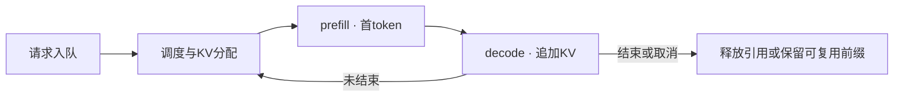

# 推理与效率

推理用已有参数处理输入，并维护生成过程中的状态。一段prompt先变成token，进入队列，模型计算历史KV与下一词分布，再逐步生成输出。参数通常不更新，但KV、请求长度与缓存引用持续变化。

## 从一条请求看懂执行

[一条生成请求怎样被执行](serving-systems.md)沿prompt `[8,2,5]`生成7和1，追踪schedule、KV分配、forward、采样与回收。它也解释首token常从prefill最后位置的logits产生，已输出长度与已计算KV长度为何可能相差一步。

接着读[GPU、batch与显存](gpu-kernels-batching-and-memory-systems.md)，看同一权重在prefill与decode的复用差别；[运行时比较](serving-runtimes-vllm-sglang-and-tensorrt-llm.md)用共享前缀理解vLLM、SGLang与TensorRT-LLM的机制。

<!-- systems-workflow-visual -->

图中的循环改变请求与KV状态，通常不改变模型参数。

## 复用、压缩与分配计算

| 当前问题 | 正文 |
| --- | --- |
| 相同前缀或候选计算能否复用 | [缓存、路由与投机](caching-routing-and-speculative.md) |
| 长历史要搬走、量化还是删减 | [上下文与KV管理](context-compression-kv-eviction-and-memory-hierarchies.md) |
| Prefill和decode是否值得拆开 | [KV交接与解耦部署](disaggregated-prefill-kv-services-and-capacity-ops.md) |
| 专家和请求分别怎样选计算路径 | [MoE与多模型服务](moe-routing-and-multi-model-serving.md) |
| 检索和工具怎样接回生成 | [RAG与Agent](rag-agents-and-long-context-systems.md) |
| 动作生成怎样做投机验证 | [VLA投机推理](vla-speculative-decoding-0928-1144.md) |

## 判断系统改动有没有用

[容量规划](optimization-checklist-and-capacity-planning.md)用到达率、长度和KV计算量级；[成本与SLO](cost-modeling-and-slo-design.md)统一token、请求和成功任务分母；[在线观测](observability-and-online-evaluation.md)区分模型变化与流量变化。

各页分别保留数学推导、固定版本源码行为和需要目标环境测量的性能边界。想继续进入设备执行，可转到[算子与编译器](../operators/index.md)。

## 对照源码与延伸阅读

- [请求生命周期的源码入口](https://github.com/vllm-project/vllm/blob/fa3b9d1377219247060d3c8b49eae199c9e7e154/vllm/v1/engine/core.py)
