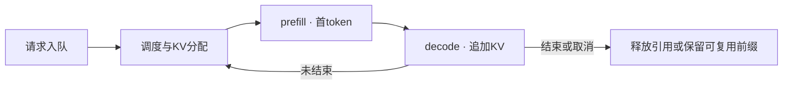

# 推理与效率

同一个模型，单机脚本里跑得很快，放进服务以后却可能被队列、KV cache 和长尾请求拖住。推理页从一条请求的生命周期开始，跟踪它怎样进队列、做 prefill、逐 token 解码，最后释放或复用状态。

推理阶段通常不更新参数，状态却一直在变。输入长度、已生成 token、缓存块、请求优先级和取消信号都会影响下一次 forward。把这些状态省略掉，很多“模型速度”其实只是某个局部 kernel 的速度。

## 先跟一条请求走完

[一条生成请求怎样被执行](serving-systems.md)沿prompt `[8,2,5]`生成7和1，追踪schedule、KV分配、forward、采样与回收。它也解释首token常从prefill最后位置的logits产生，已输出长度与已计算KV长度为何可能相差一步。

接着读[GPU、batch与显存](gpu-kernels-batching-and-memory-systems.md)，看同一权重在prefill与decode的复用差别；[运行时比较](serving-runtimes-vllm-sglang-and-tensorrt-llm.md)用共享前缀理解vLLM、SGLang与TensorRT-LLM的机制。

<!-- systems-workflow-visual -->

图中的循环改变请求与KV状态，通常不改变模型参数。

### token 已经输出，为什么缓存还少一个位置

用一条 128-token prompt 走一遍。假设每块容纳 32 个位置，按需分配、不共享前缀、不提前预留块，模型普通自回归生成 4 个 token 后结束。表中的缓存长度指已经计算并写入 KV 的 token 数，输出时间指服务端发出 token 的时间，所有数字均为教学构造。

| 事件 | 时间（ms） | 已输出 token 数 | 已写入 KV 的 token 数 | 当前占用块数 |
| --- | ---: | ---: | ---: | ---: |
| 入队 | 0 | 0 | 0 | 0 |
| 开始 prefill | 4 | 0 | 0 | 4，已分配尚未写完 |
| 发出第 1 个 token | 310 | 1 | 128 | 4 |
| 发出第 2 个 token | 328 | 2 | 129 | 5 |
| 发出第 3 个 token | 346 | 3 | 130 | 5 |
| 发出第 4 个 token | 382 | 4 | 131 | 5 |
| 回收完成 | 384 | 4 | 请求 KV 已释放 | 0 |

Prefill 处理的是 prompt，最后位置的 logits 用来采样第 1 个输出。这个新 token 此时尚未作为输入经过模型，所以缓存仍只有 128 个位置。下一次 forward 把它送入模型，写入第 129 个位置的 KV，并采样第 2 个输出。第 129 个位置超出原有四块的容量，需要第五块。最后一个输出发出后请求结束，无须再为它运行一次 forward。

按这里的服务端计时，TTFT 为 310 ms。三个 inter-token latency 分别为 18、18、36 ms；若 TPOT 定义为首 token 之后的平均输出间隔，则为 \((382-310)/(4-1)=24\) ms。回收的 2 ms 另记，不混进 token 间隔。若网络把多个 token 合并发出，客户端只看见一组时间戳，就无法恢复服务端的逐 token 间隔。

真实运行时可能预留空间、共享前缀或一次接受多个投机 token，要按它的分配和解码规则重新解释 trace。客户端取消时，也应分开记录停止生成与释放资源的时间。

## 然后再问哪些状态值得保留

| 当前问题 | 正文 |
| --- | --- |
| 相同前缀或候选计算能否复用 | [缓存、路由与投机](caching-routing-and-speculative.md) |
| 长历史要搬走、量化还是删减 | [上下文与KV管理](context-compression-kv-eviction-and-memory-hierarchies.md) |
| Prefill和decode是否值得拆开 | [KV交接与解耦部署](disaggregated-prefill-kv-services-and-capacity-ops.md) |
| 专家和请求分别怎样选计算路径 | [MoE与多模型服务](moe-routing-and-multi-model-serving.md) |
| 检索和工具怎样接回生成 | [RAG与Agent](rag-agents-and-long-context-systems.md) |
| 动作生成怎样做投机验证 | [VLA投机推理](vla-speculative-decoding-0928-1144.md) |

## 判断系统改动有没有用

[容量规划](optimization-checklist-and-capacity-planning.md)用到达率、长度和KV计算量级；[成本与SLO](cost-modeling-and-slo-design.md)统一token、请求和成功任务分母；[在线观测](observability-and-online-evaluation.md)区分模型变化与流量变化。

各页分别保留数学推导、固定版本源码行为和需要目标环境测量的性能边界。想继续进入设备执行，可转到[算子与编译器](../operators/index.md)。

需要把延迟、显存或量化假设落到真实任务时，使用[从假设到证据的研究闭环](../training/research-loop-from-hypothesis-to-evidence-1123-2351.md)：固定模型、输入、硬件和运行时，用 `server_monitor` 关联任务与 W&B Run，再在 PaperPilot 中保存论文条件、逐请求结果和解释。

## 对照源码与延伸阅读

- [请求生命周期的源码入口](https://github.com/vllm-project/vllm/blob/fa3b9d1377219247060d3c8b49eae199c9e7e154/vllm/v1/engine/core.py)
## 来源驱动的入门顺序

先读[BRRRR](https://horace.io/brrr_intro.html)建立 compute、memory、overhead 的量纲，再用[Transformer inference arithmetic](https://kipp.ly/p/transformer-inference-arithmetic)把 KV cache、序列长度、batch 和带宽算出来。之后分别阅读[vLLM PagedAttention](https://vllm.ai/blog/2023-06-20-vllm)、[Triton matmul 教程](https://triton-lang.org/main/getting-started/tutorials/03-matrix-multiplication.html)和量化专题。

每个性能结论都要记录模型、硬件、batch、长度、版本和测量指标。官方博客适合说明机制和案例，不能脱离设置外推成普遍 benchmark。
