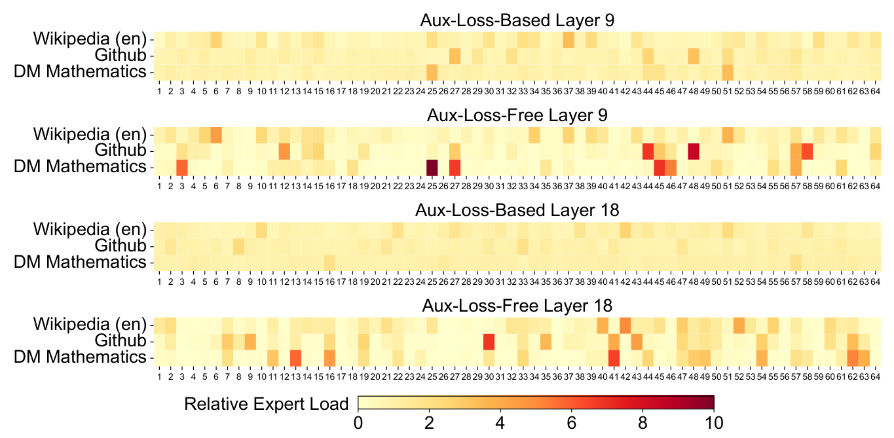

# 专家路由与请求路由分别选择什么

MoE根据token隐藏向量选专家，服务路由根据整个请求选择模型或实例。两者都分配计算，但输入、状态与质量保证不同。先分别算一次，就能看清“只激活部分参数”不等于所有成本按比例下降。

## 一个token选中两个专家

设四个专家的router概率为 `[0.5,0.3,0.15,0.05]`，选择前两个。若模型规定在选中集合重新归一化，权重变成0.625和0.375；若不归一化，则保留0.5和0.3。两种模型定义会得到不同输出。

假设选中专家标量输出为2和6，归一化结果为3.5。实际专家输出是向量，按同样权重逐元素合并。具体门控与共享专家规则需读模型实现。

## 一批token决定专家计算的shape

T个token、top-k为k时，约有Tk条token-expert记录。它们按专家重排后，各专家的token数就是其GEMM的M维。平均负载小，不代表最热门专家也小。

若8个token、top-2产生16条记录，其中某专家收到10条，另外几个总共6条，计算与通信会不均。是否丢弃超额token、动态分配或padding，取决于capacity策略；dropless实现也可能承担尾部延迟。

未激活专家参数通常仍需在某处驻留或加载，所以激活参数量更小不自动等于整模型显存同样小。专家并行还增加dispatch与combine通信。

{ width="760" }

<small>图源：[DeepSeek-V3 Technical Report](https://arxiv.org/abs/2412.19437)。原图表达 MoE expert load 在训练中的均衡状态；读图重点是把路由看成质量、成本、延迟和负载之间的动态分配问题。它不能推出任意 MoE 或多模型路由都会自然均衡，线上仍要按 expert、设备和请求桶观测热点。</small>

## 请求级路由先看整项任务

小模型可先处理简单请求，复杂或不确定的请求升级大模型。假设小模型成本1、大模型10、升级率30%，不复用计算时平均成本4。若小模型耗时0.2秒、大模型1秒，串行升级请求至少增加到1.2秒，再加队列和路由判断。

若路由器错把困难题交给小模型且未升级，质量会受损。若过于保守，大量重复尝试又增加成本。因此需要在固定任务集上测路由误判、最终成功率与完整等待。

## 服务状态可能不能跨模型复用

不同权重、tokenizer或结构的KV通常不能直接共享。切换模型可能重新prefill，adapter和缓存身份也需核对。将升级成本只记为大模型decode，会漏掉重新构建上下文的费用。

## 两种路由怎样一起测

MoE层记录每专家token、重排、通信和GEMM时间；请求路由记录每模型调用、升级、重试与任务结果。前者解释一条模型路径内部的不均衡，后者解释请求选择和重复计算。两套指标可以关联，但不应合成一个笼统“路由命中率”。

## 对照源码与延伸阅读

- [专家矩阵的grouped调度](https://github.com/triton-lang/triton/blob/cd2e01c6686d6503802e6cdfac56d5a5dfdb27a1/python/tutorials/08-grouped-gemm.py)
- [请求状态、缓存身份与调度接口](https://github.com/vllm-project/vllm/blob/fa3b9d1377219247060d3c8b49eae199c9e7e154/vllm/v1/core/sched/scheduler.py)
