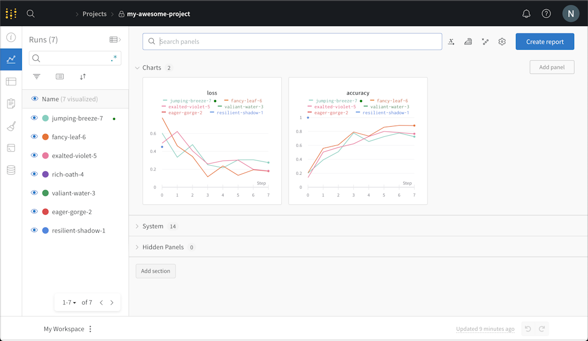

# 总分下降时，先看请求是不是变了

线上总成功率从 86% 掉到 56% 时，直觉很容易指向“新模型退化”。把请求按难度拆开，故事可能完全不同。简单请求从 90% 升到 92%，困难请求从 50% 升到 52%，只是困难流量从 10% 变成了 90%。观测系统首先要回答的，是流量和执行路径发生了什么。

同样，TTFT 变长并不自动等于 prefill 变慢。请求可能在进入 GPU 前排了更久，也可能路由、缓存或工具调用改变了起点。每个时间字段都要带上起止点和请求条件，后面才有机会分辨这些原因。

## 每个子集都改善，总体仍可能下降

教学设定中，旧系统处理900条简单请求，成功率90%；100条困难请求，成功率50%，总成功率86%。新系统简单请求只有100条，成功率92%；困难请求900条，成功率52%，总体56%。

两个子集都提高2个百分点，总体却下降30个百分点，原因是流量构成变化。用固定90%简单、10%困难的权重计算，新系统为88%，才与旧系统在相同组成上可比。

这只是两类可观察分桶。如果难度还有未记录差异，重新加权也未必足以消除混杂。

## 一条请求的时间字段怎样解释

记录接收、入队、首次调度、首token、末token与结束时刻，同时关联模型、runtime、cache和路由路径。TTFT由接收至首token计算，队列与prefill分段用于解释它。

工具、检索和模型调用可能并行。不能把所有子span耗时相加当成端到端时间，应沿依赖关系看关键路径。取消与超时也需要明确结束状态，避免只统计完成请求造成偏差。

## 监控能发现变化，对照才能接近因果

监控发现指标变化和异常输入，不能自动证明某次发布导致变化。随机分配同类流量到两个版本，有助于比较因果影响；离线回放固定输入，适合定位差异，但可能无法复现在线工具状态或用户反应。

A/B还需注意共享资源干扰。两个版本共用GPU队列时，一个版本改变负载可能影响另一个，不能假定每条请求独立。

## RAG 与 Agent 要记录错误发生在哪一层

检索缺少证据、模型忽略证据、工具参数错误、工具返回失败和最终回答错误，应有可区分的结果。只记录一个总分，会把修复方向混在一起。

记录足够诊断的标识与必要输入，避免把所有原始内容无差别复制进日志。数据采集范围由任务和使用约束决定，不需要为每个观测目标保存全部敏感文本。

## 失败回流以后，评测仍要独立

可将失败聚类用于训练或规则修复，同时保留新的同类输入检查泛化。Judge评分与可执行任务成功分开，避免优化评分器喜欢的格式，却没有修复工具行为。

报告时同时给自然流量结果、固定分布结果和关键分桶，注明样本量与随机性。这样总分变化才有可以检查的解释。

{ width="820" }

<small>图源：[Weights & Biases 官方文档](https://docs.wandb.ai/)。原图表达实验运行、指标和版本记录如何被组织到 dashboard；读图重点是：线上可观测性也要把请求、模型版本、路由、质量、成本和回放样本接到同一条证据链。它不能替代生产 trace，也不能单独证明模型质量变好。</small>

## 对照源码与延伸阅读

- [执行、采样与结果更新的阶段边界](https://github.com/vllm-project/vllm/blob/fa3b9d1377219247060d3c8b49eae199c9e7e154/vllm/v1/engine/core.py)

## 先把一条请求串起来，再挑指标

一次在线请求至少要能从 request ID 追到模型版本、路由、队列、prefill/decode、工具或检索、输出状态和最终任务结果。指标应沿这条链回答问题：等待发生在哪里，质量在哪一层下降，成本由什么工作量驱动，失败是否集中在某个输入分布。

可以把在线观测分成三层。基础设施层记录队列、GPU、显存和错误；模型执行层记录 token、cache、解码和 runtime；任务层记录证据是否被使用、工具是否成功和任务谓词。三层各自回答不同问题，一个总分放在一起会把线索抹平。

## 最小指标集合

| 层级 | 例子 | 解释边界 |
| --- | --- | --- |
| 时间 | queue time、TTFT、inter-token、E2E | 必须说明起止点和是否包含工具 |
| 工作量 | input/output tokens、prefill/decode tokens、KV bytes | 不等于任务难度或质量 |
| 质量 | 固定回放、在线成功谓词、分桶错误 | 需要独立输入和版本对照 |
| 资源 | GPU 利用率、显存峰值、抢占、重算 | 利用率高不保证用户体验好 |
| 稳定性 | timeout、cancel、retry、OOM、fallback | 分母要包含未完成请求 |

线上曲线出现变化时，可以先按模型版本、长度、工具路径和难度分桶。每个分桶都不变而总体变化，优先检查流量构成；只有某个分桶变化，才进入它对应的执行链。

## 一条 trace 至少要能被重放

建议把一次请求压缩成一张结果卡片，保留可定位的标识，不把整段用户内容无差别写入日志

```text
request_id: ...
model_revision: ...
runtime_revision: ...
route: ...
input_tokens: ...
output_tokens: ...
queue_ms: ...
ttft_ms: ...
e2e_ms: ...
cache_hit: ...
tool_status: ...
task_outcome: ...
failure_stage: queue|prefill|decode|tool|evaluator
```

`failure_stage` 不是模型自己填写的解释，而应由 trace 中的状态和独立评测规则计算出来。请求失败但没有输出时，输出 token 数应有明确的空值约定，不能用零把“没有生成”和“生成了零长度结果”混在一起。

比较两个版本时，先固定回放集合和流量权重，再报告均值、分位数和分桶样本量。一个版本只在很小的困难桶上变好，可能对总体均值影响很小；一个版本只在长请求上变慢，平均值也可能看不出来。若需要在线随机对照，应同时保存实验分配、共享资源和版本切换时间，避免把部署过程中的排队波动写成模型差异。

## 质量分数要带着分母走

同一个“成功率”至少有三种分母：收到的请求、进入模型执行的请求、完成并且拿到标签的请求。超时请求若被排除，模型可以通过更早放弃来让完成请求的准确率上升。报告时把三者都写出来，并保留 `censored` 或 `label_pending` 状态。

离线回放还要固定目标流量的权重。设输入被分成长度、任务和工具路径等桶 (b)，每个桶的质量为 (q_b)，目标流量权重为 (w_b)，则要比较的是

\[
Q_{\mathrm{target}}=\sum_b w_bq_b,\qquad \sum_b w_b=1,
\]

线上自然流量的权重可以另列为 (v_b)。如果 (v_b) 发生变化，至少同时报告 (Q_v) 和固定 (Q_w)，不能把流量重加权后的分数写成模型本身的提升。

一个质量结果卡片可以这样保存：

```json
{
  "eval_id": "chat-v4-replay-2026-11-10",
  "denominator": {"arrived": 12000, "admitted": 11840, "labeled": 11206},
  "buckets": {
    "short_no_tool": {"n": 6000, "success": 0.91, "target_weight": 0.50},
    "long_rag": {"n": 3200, "success": 0.72, "target_weight": 0.30},
    "tool_call": {"n": 2006, "success": 0.64, "target_weight": 0.20}
  },
  "pending_labels": 634,
  "replay_set_version": "replay-v4"
}
```

`success` 的定义要与任务谓词绑定。答案匹配、工具执行成功、引用支持和人工偏好可以同时存在，但不能在一个未经说明的平均分里互相抵消。标签延迟较长时，先报告当前可见结果，再在固定观察窗口结束后更新同一 `eval_id` 的版本。

## 线上评测要把延迟标签和流量切换分开

新版本刚上线时，任务结果可能还没有标签，质量曲线会滞后；同时灰度比例、缓存命中和请求长度也可能正在变化。建议把一次发布拆成三段记录：

| 阶段 | 主要用途 | 需要固定或记录的字段 |
| --- | --- | --- |
| shadow | 只运行新版本，不影响用户结果 | 输入快照、模型版本、额外 GPU 成本 |
| canary | 小比例真实流量 | 分配随机种子、流量比例、共享队列 |
| ramp | 逐步扩大比例 | 每个时间窗的请求分布、回滚点、标签延迟 |

shadow 可以发现输出差异和资源问题，却不能证明用户任务成功；canary 可以观测真实工具和用户行为，却容易受流量切换影响。两者的证据应分开写。

## 告警应该对应一个可执行判断

“p95 上升”不是完整的告警规则。一个可执行规则至少包含窗口、最小样本、比较基线和处理动作。例如：连续三个 5 分钟窗口内，固定回放分桶的 TTFT p95 比基线高 20%，且每个窗口有至少 500 个已完成请求，触发黄色告警；若错误率超过 1% 或 OOM 次数大于 0，直接阻止继续放量。

告警动作也应写入配置：冻结灰度比例、保留 trace 样本、切回上一版本，或只对长上下文路由限流。没有动作的指标面板只能帮助事后解释，不能作为上线门槛。

## 回放集必须有一个不参与修复的保留分支

失败样本适合进入训练和规则修复，但如果所有失败都被加入回归集，系统可能只是记住了它们。给每个 `replay_set` 保存生成日期、来源、去重规则、任务标签和 hash；按时间或用户任务分出一个只读 holdout。修复完成后先在开发回放集运行，再在 holdout 上一次性评估。

对于 RAG 和 Agent，保留检索为空、引用冲突、工具超时、参数类型错误和部分成功等样本。每种样本都应有预期的终止状态，避免评测器只检查最终文字相似度。

## 来源与改编说明

- **执行阶段**对照固定版本的 [vLLM EngineCore](https://github.com/vllm-project/vllm/blob/fa3b9d1377219247060d3c8b49eae199c9e7e154/vllm/v1/engine/core.py)。
- **实验记录**参考 [Weights & Biases 文档](https://docs.wandb.ai/)，但 dashboard 只能组织证据，不能替代生产 trace 或任务评测。
- **trace 语义**可对照 [OpenTelemetry traces](https://opentelemetry.io/docs/concepts/signals/traces/)，本站字段按推理服务阶段重新命名，不能把示例 JSON 当作完整的 OTel schema。
- **自测**：TTFT 上升但 prefill 时间不变，列出至少三个应先检查的非模型原因；总成功率下降但每个已知难度分桶上升，解释需要什么重新加权或随机对照。

相关阅读见[成本模型与 SLO](cost-modeling-and-slo-design.md)、[推理服务系统](serving-systems.md)和[RAG、Agent 与长上下文](rag-agents-and-long-context-systems.md)。它们分别补充成本分母、请求生命周期和证据链；只保存一个 dashboard 截图无法替代这三类记录。
