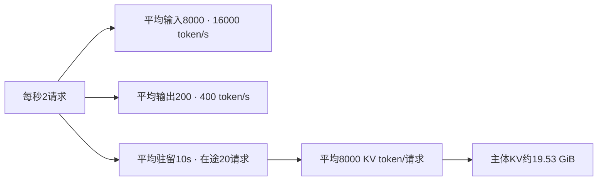

# 用到达率、token与KV估算服务容量

4 张 GPU 能承载多少请求，不能只拿单请求速度乘以 4。容量规划要先把请求换成 token、KV 和队列工作量，再用压测找出满足延迟与质量要求的最大到达率。

## 从每秒请求数算输入输出需求

教学设定中，每秒2个请求，平均输入8000token、输出200token，系统每秒需处理16000输入token并生成400输出token。输入输出的计算模式不同，不能直接相加成一个可比较的吞吐需求。

若平均请求驻留时间10秒，稳态Little定律给出平均在途请求数 $L=\lambda W=20$。它要求系统稳定，并且L、到达率与时间使用相同边界。过载队列持续增长时，这个稳态关系不能拿来证明容量足够。

<!-- systems-workflow-visual -->


吞吐需求与在途显存从同一到达过程推导，但需要分别满足。平均预算还不能覆盖突发峰值。

## 在途请求还要占显存

若平均每请求驻留8000个KV token，20条共160000token。按每token128KiB计，主体KV约19.53GiB，还未计权重、临时缓冲、页表和尾部碎片。

这个128 KiB可以从模型配置算出来。设模型有 \(L\) 层，每层有 \(n_{kv}\) 个 KV 头、每个头宽度 \(d_h\)，K 和 V 都要保存；若元素使用 \(b\) 字节，单 token 的主体 KV 字节数近似为

\[
\text{bytes/token}=2\times L\times n_{kv}\times d_h\times b.
\]

例如 32 层、8 个 KV 头、每头 128 维、BF16 取 \(b=2\)，得到 \(2\times32\times8\times128\times2=131072\) 字节，也就是 128 KiB。这个数只覆盖 K/V 张量，不含 block table、allocator 碎片、请求状态和临时 workspace。换成 MQA、GQA、FP8 或不同层数时，应重新计算，不能沿用某个 runtime 的宣传数字。

把平均长度换成分位数后再估峰值。若 20 条在途请求的 p95 长度是 16000 token，直接用平均 8000 计算会低估长尾；若 prefix 共享比例为 \(s\)，共享部分的物理占用还要按缓存树的实际复用计算，不能简单把总 token 乘以 \(1-s\)。

这个计算使用平均值，只能给量级。长请求和突发可能显著提高峰值驻留，prefix共享则可能减少物理占用。需要从真实请求分布或回放中测峰值。

## 压测到达过程决定你能看到什么

闭环客户端等一次请求完成才发下一次。系统变慢时，它会自动减少到达率，可能掩盖过载。开放式负载按预先定义的时间发请求，能更直接观察队列随到达率增长。

两种测试都可用，但要说明目标。容量测试逐步提高到达率，同时记录完成率、超时、TTFT/TPOT分布和队列。只给稳定完成请求的均值，会漏掉最重要的失败部分。

开放负载的速率阶梯应留出 warmup 和 drain。一个最小矩阵可以用每个速率 5 分钟 warmup、10 分钟稳态、5 分钟 drain，速率逐级翻倍，直到质量或 SLO 首次失效；实际时长要按模型冷启动和标签延迟调整。客户端必须保留每个请求的计划到达时间，即使服务已经过载也继续发送，否则闭环反馈会把过载隐藏起来。

## 先找到哪项约束最早触顶

| 先出现的现象 | 优先核对 |
| --- | --- |
| 队列增长而GPU工作未饱和 | CPU处理、输入、调度、锁与同步 |
| KV频繁耗尽或抢占 | 长度分布、在途数、缓存与页配置 |
| Prefill拖慢decode | 混合调度、chunk大小或池隔离 |
| 少数shape尾延迟陡增 | fallback、JIT、padding和通信 |

这些分支只是定位入口，需用trace验证。增加GPU前先确认系统瓶颈可由新增资源分担。

## 配置是否可用由SLO约束

在固定质量和延迟目标下比较可完成到达率，再计算费用。若靠截短回答、删除上下文或降低质量提升吞吐，应作为不同服务行为报告。

扩容还需要预热、权重加载和流量迁移时间。给系统留出应对突发的容量，具体余量应由真实波动和恢复目标决定，不能用一个固定百分比覆盖所有服务。

{ width="860" }

<small>图源：[vLLM 官方博客](https://vllm.ai/blog/2023-06-20-vllm)。原图表达 serving runtime 中 scheduler、KV cache manager、allocator 与 GPU worker 的协作；读图重点是把容量规划落到请求队列、prefill/decode、KV 和 worker 饱和度，而不是只看 GPU 利用率。它不能证明某个优化动作一定优先，优先级仍由 workload 分桶决定。</small>

## 对照源码与延伸阅读

- [token预算、请求状态与KV分配的联合调度](https://github.com/vllm-project/vllm/blob/fa3b9d1377219247060d3c8b49eae199c9e7e154/vllm/v1/core/sched/scheduler.py)

## 先写服务契约，再做容量估计

容量实验前固定以下字段：模型版本、tokenizer、输入输出长度分布、采样参数、最大并发、质量阈值、TTFT/TPOT p95 或 p99、错误率和超时策略。否则“可承载多少请求”没有明确分母。

一个简单的实验契约可以写成：

```yaml
workload: chat-long-context-v1
arrival: open_loop
rate_rps: [0.5, 1, 2, 4, 8]
prompt_tokens: {p50: 2000, p95: 12000}
output_tokens: {p50: 128, p95: 512}
slo: {ttft_p95_ms: 800, tpot_p95_ms: 120, error_rate: 0.01}
quality_gate: "固定回归集通过率 >= 0.95"
```

把 p50 和 p95 长度分开，避免长尾被均值掩盖。开放负载与闭环负载都可以使用，但必须明确客户端行为和过载时是否继续发请求。

## 用 Little 定律检查是否进入稳态

在稳定区间内，$L=\lambda W$ 可以把到达率、在途数量和驻留时间互相校验。压测开始和结束的 warmup、drain 期不应混入稳态统计；队列持续增长时，系统并未达到稳态，不能用一段短窗口的平均延迟声称容量。

把每个请求记录为 `arrival_time`、`admit_time`、`prefill_start`、`first_token`、`last_token`、`finish_reason`。这样可以把端到端延迟拆成排队、prefill、decode 和后处理，避免用 GPU 利用率猜测瓶颈。

## 容量曲线要包含错误和回退

逐步增加到达率时绘制：完成请求数、超时率、队列长度、KV 使用率、TTFT p95、TPOT p95、GPU/CPU/NIC 利用率。找到第一个 SLO 失效点，再把可承载率定义为“质量和 SLO 都满足的最大稳态到达率”。如果超过该点仍能完成请求，只能说明系统在消化 backlog，不说明它可持续。

扩容或换量化方案后，重新跑同一曲线。若质量阈值变化、输出长度被截短或失败请求被过滤，必须单独命名新的服务策略。

## 准入控制要保护已经接收的请求

当预计的在途 KV 已接近上限时，系统可以拒绝新请求、排队等待、缩短最大输出或把请求转到另一池。四种动作改变的服务契约不同，应在结果中单独报告。尤其不能把被快速拒绝的请求从错误率分母里删掉。

一个简单的准入条件可以写成

```text
estimated_kv_after_admit <= kv_budget
and queue_depth < queue_limit
and predicted_ttft_p95 <= ttft_slo
```

`estimated_kv_after_admit` 使用请求的最大或分位数长度估计，并在请求实际生成后更新。估计过于乐观会导致抢占和重算；估计过于保守会降低利用率。两者都需要在 trace 中保留原因码，方便解释容量曲线上的断点。

## 自测：把一个容量结论写完整

不要写“4 张 GPU 可以支持 8 RPS”，而应写成：模型和版本、输入输出长度分布、并发和到达方式、质量门槛、TTFT/TPOT 分位数、错误率、warmup、测试时长和峰值 KV。缺一项，就无法复核这个结论是否适用于下一次部署。

**来源与改编说明**：Little 定律是容量估算的基础，调度与 KV 分配入口参考 vLLM 官方博客和固定版本 scheduler 源码。YAML 中的速率与 SLO 是教学契约，不是本站实测容量承诺。

继续阅读：[可观测性与在线评测](observability-and-online-evaluation.md)查看如何把容量曲线和逐请求 trace 对齐；[推理 GPU、批处理与显存系统](gpu-kernels-batching-and-memory-systems.md)补充 prefill、decode 与 kernel 的时间分解。
