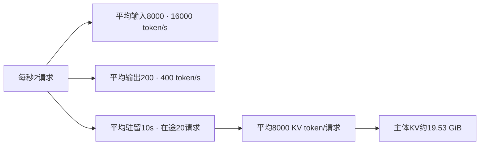

# 用到达率、token与KV估算服务容量

容量规划先把请求换成实际工作量，再用压测找出满足延迟要求的最大到达率。单请求速度乘GPU数，无法包含排队、持续批处理和在途KV。

## 从每秒请求数算输入输出需求

教学设定中，每秒2个请求，平均输入8000token、输出200token，系统每秒需处理16000输入token并生成400输出token。输入输出的计算模式不同，不能直接相加成一个可比较的吞吐需求。

若平均请求驻留时间10秒，稳态Little定律给出平均在途请求数 $L=\lambda W=20$。它要求系统稳定，并且L、到达率与时间使用相同边界。过载队列持续增长时，这个稳态关系不能拿来证明容量足够。

<!-- systems-workflow-visual -->

吞吐需求与在途显存从同一到达过程推导，但需要分别满足。平均预算还不能覆盖突发峰值。

## 在途请求还要占显存

若平均每请求驻留8000个KV token，20条共160000token。按每token128KiB计，主体KV约19.53GiB，还未计权重、临时缓冲、页表和尾部碎片。

这个计算使用平均值，只能给量级。长请求和突发可能显著提高峰值驻留，prefix共享则可能减少物理占用。需要从真实请求分布或回放中测峰值。

## 压测到达过程决定你能看到什么

闭环客户端等一次请求完成才发下一次。系统变慢时，它会自动减少到达率，可能掩盖过载。开放式负载按预先定义的时间发请求，能更直接观察队列随到达率增长。

两种测试都可用，但要说明目标。容量测试逐步提高到达率，同时记录完成率、超时、TTFT/TPOT分布和队列。只给稳定完成请求的均值，会漏掉最重要的失败部分。

## 先找到哪项约束最早触顶

| 先出现的现象 | 优先核对 |
| --- | --- |
| 队列增长而GPU工作未饱和 | CPU处理、输入、调度、锁与同步 |
| KV频繁耗尽或抢占 | 长度分布、在途数、缓存与页配置 |
| Prefill拖慢decode | 混合调度、chunk大小或池隔离 |
| 少数shape尾延迟陡增 | fallback、JIT、padding和通信 |

这些分支只是定位入口，需用trace验证。增加GPU前先确认系统瓶颈可由新增资源分担。

## 配置是否可用由SLO约束

在固定质量和延迟目标下比较可完成到达率，再计算费用。若靠截短回答、删除上下文或降低质量提升吞吐，应作为不同服务行为报告。

扩容还需要预热、权重加载和流量迁移时间。给系统留出应对突发的容量，具体余量应由真实波动和恢复目标决定，不能用一个固定百分比覆盖所有服务。

{ width="860" }

<small>图源：[vLLM 官方博客](https://vllm.ai/blog/2023-06-20-vllm)。原图表达 serving runtime 中 scheduler、KV cache manager、allocator 与 GPU worker 的协作；读图重点是把容量规划落到请求队列、prefill/decode、KV 和 worker 饱和度，而不是只看 GPU 利用率。它不能证明某个优化动作一定优先，优先级仍由 workload 分桶决定。</small>

## 对照源码与延伸阅读

- [token预算、请求状态与KV分配的联合调度](https://github.com/vllm-project/vllm/blob/fa3b9d1377219247060d3c8b49eae199c9e7e154/vllm/v1/core/sched/scheduler.py)
