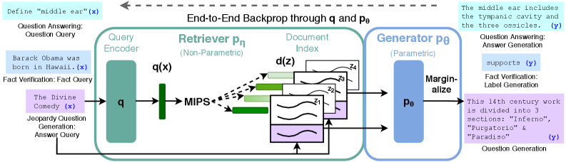

# 一条报销问题怎样经过检索、回答与工具执行

用户问某项支出能否报销。系统需要找到当前适用条款，确认金额和日期等条件，再作答。如果还要提交申请，就需要把生成文本接到真实工具状态。RAG、长上下文与Agent可以同时参与，但每一步的输入和错误来源不同。

## 检索先决定模型能看到哪些证据

文档经过切分、索引和召回，系统取出候选片段，再做排序或去重。若关键例外条款与主规则分在两块，召回主规则却遗漏例外，模型可能在现有上下文上给出合理但错误的回答。

因此先检查目标证据是否进入候选，再看是否进入最终prompt。检索召回、重排与上下文裁剪是三个不同失效位置。

{ width="760" }

<small>图源：[Retrieval-Augmented Generation for Knowledge-Intensive NLP Tasks](https://arxiv.org/abs/2005.11401)，Figure 1。原图表达 retriever 把文档作为 latent evidence 提供给 generator；读图重点是把 RAG 放进线上系统后继续追问 evidence 如何排序、裁剪、引用、缓存和回放。它不能证明“加检索器就会减少幻觉”，因为检索质量、上下文装配和引用校验都会改变结果。</small>

## 用一张token账控制上下文

教学预算为8192token，其中系统与工具说明1200、对话1000、问题200、输出预留1000，剩余可用于检索内容4792。若五个片段各1200token，总计6000，就需要删减、压缩或调整预算。

按相关性截断可能删掉边界条件；只按位置保留又可能让无关历史占满预算。将引用来源、版本与片段对应关系保留，才有办法检查回答依据。

长上下文增加可见容量，并不保证模型正确利用每条证据。相似规则、旧版本和相互冲突的内容会改变任务难度。

## 用替换实验定位回答错误

固定问题，把检索结果替换成已确认完整的参考证据。若回答恢复，优先调查检索与上下文组装；若仍错，再检查指令、证据理解或生成。反过来，固定生成器比较不同检索结果，能评估召回改动。

这类对照需要确保参考证据确实完整。不能把人工选的一小段理想文本当作真实线上分布，而忽略实际长文与版本冲突。

## 工具调用让系统进入可变状态

查询订单是读操作，提交报销会改变外部状态。模型提出调用后，编排层需要检查参数、权限和当前状态，再执行并记录结果。超时不一定表示未执行，盲目重试可能重复提交。

因此具有副作用的操作需要明确幂等键或状态查询策略，把“计划调用”“已经发出”“已确认完成”分开。语言模型的下一段文本不能替代工具的提交凭证。

## 并行只节省没有依赖的部分

若查询规则耗时300毫秒、查订单500毫秒，二者独立时可并行，理想完成时间由800降到500毫秒。若查询订单需要先从规则中得到某个分类结果，就不能直接并行。还要考虑共享服务限流与失败重试。

完整Agent时间由依赖图决定，不能把各工具独立最快耗时相加或取平均。缓存也必须与数据版本和权限范围对应。

## 最终评测覆盖整项任务

分别记录证据召回、回答正确、引用有效、工具参数正确与最终状态。一个文本回答很流畅，却提交错金额，整项任务仍失败。用固定案例回放定位机制，再用独立新任务比较实际完成率和延迟。

底层推理runtime负责token与KV调度，应用编排负责证据和外部状态，两者的缓存、超时与取消要有明确衔接。

## 对照源码与延伸阅读

- [模型执行引擎的职责边界](https://github.com/vllm-project/vllm/blob/fa3b9d1377219247060d3c8b49eae199c9e7e154/vllm/v1/engine/core.py)
