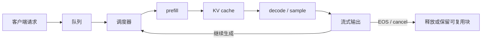

# 从三条共享前缀请求比较推理运行时

运行时把模型forward放进持续调度的请求系统，维护队列、已计算token、输出与KV。比较vLLM、SGLang和TensorRT-LLM时，可以先追踪相同请求如何复用状态，再检查目标版本的kernel与部署条件。



图中的箭头代表一次请求可能反复经过的状态，不代表所有 runtime 使用相同的内部函数。比较时要把队列、KV 管理和输出传输也放进时间线，不能只测一轮模型 forward。

## 三条请求能共享哪些计算

设token序列分别为 `[A,B,C,D]`、`[A,B,C,E]`、`[A,B,F]`。三条共享 `[A,B]`，前两条还共享C。Prefix cache可为相同计算身份保留共享前缀KV，从分叉处继续执行。

若第三条变为 `[X,A,B,F]`，虽然中间仍出现A/B，它们的前文已不同，不能直接复用前两条A/B的因果KV。文本片段相同与前缀计算相同有明确区别。

把命中关系写成块表会更清楚。假设 block size 为 2，三条请求的 token 如下：

| 请求 | 逻辑块 0 | 逻辑块 1 | 可以共享的物理块 |
| --- | --- | --- | --- |
| A | `[A,B]` | `[C,D]` | 0、1 |
| B | `[A,B]` | `[C,E]` | 0 |
| C | `[A,B]` | `[F]` | 0 |

A 和 B 共享前两个 block 中的第一个，A 与 B 的 `[C]` 也相同，却未必能直接共享第二个物理 block，因为 block 的填充、引用计数和后续写入边界要按具体实现处理。若 C 继续生成，它只能在自己的尾块写入；当共享尾块需要修改时，系统可能复制一份再写。测试 prefix cache 时，至少记录命中的 token 数、共享 block 数和发生 copy-on-write 的次数，单看一个 `cache_hit=true` 不够。

## vLLM把调度与块管理连起来

在锁定的vLLM V1源码中，EngineCore先调用scheduler生成本轮工作，再执行模型、采样并用输出更新状态。Scheduler依据token预算和KV分配决定哪些请求推进。

PagedAttention用块表把逻辑位置映射到物理KV块，减少连续大块预留压力；continuous batching在迭代间替换已结束请求。投机与异步执行使已知、已计算、已分配长度可能不同，详见[请求生命周期](serving-systems.md)。

## SGLang的论文机制利用程序与前缀结构

[SGLang论文](https://arxiv.org/abs/2312.07104)将结构化生成程序与runtime结合，RadixAttention用前缀树组织可复用KV。上面三条请求可把共同前缀合并，分叉后的状态分别保存。

程序化多轮与并行分支让共享关系更明确，约束解码则限制可生成的token集合。这些机制并非当前某一产品永久独占的能力；其他runtime也在演进相似功能，应核对所选版本而非依据品牌推断。

## TensorRT-LLM需要同时核对图与缓存路径

[TensorRT-LLM KV文档](https://nvidia.github.io/TensorRT-LLM/features/kvcache.html)把缓存组织、复用与内存策略放进执行系统。针对NVIDIA路径的模型执行、量化kernel和并行配置，需要与具体模型、设备和版本对应。

前缀能命中、模型能加载，不代表每个shape都会选择预期kernel。输入转置、scale布局、图捕获与fallback都可能改变完整请求时间。不要把某个engine或kernel的单点结果直接当作在线服务排名。

## 同一请求集合才是公平比较起点

固定权重、tokenizer、模板、采样、最大输出、量化和adapter。先检查输出行为与任务质量，再分别测无缓存和明确缓存命中条件。若一个配置提前截短输出，延迟会变小，但完成的任务已经不同。

冷启动与稳态分别报告。开放负载下逐步提高到达率，比较相同SLO内的完成量，同时记录输入/输出长度、队列、KV占用和取消。固定并发的闭环测试可能随系统变慢自动降低到达率，应说明这一边界。

## 选型表只记录需要验证的能力

| 工作负载 | 重点验证 |
| --- | --- |
| 大量共享系统提示和分支 | cache身份、token命中、分叉和回收 |
| 长输入短输出 | prefill调度、TTFT与干扰 |
| 长输出和高并发 | KV容量、decode间隔和持续批处理 |
| 结构化工具输出 | 约束开销、正确性与重试 |
| 固定低精度硬件路径 | 实际kernel、转换、模型支持和版本 |

先用目标工作负载回答这些问题，再决定运行时。本文提供机制对照，没有在当前硬件上给出三者速度排名。

## 一条 trace 怎样变成可比较的时间账本

设请求在 0 ms 进入客户端，18 ms 到达 runtime，队列等待 12 ms，prefill 用时 70 ms，首 token 在 100 ms 发出，之后每个 token 间隔 25、30、20、25 ms，最后一个 token 在 200 ms 发出。此时

```text
queue = 12 ms
TTFT  = 100 - 0 = 100 ms        # 从客户端发出开始计
TPOT  = (200 - 100) / 4 = 25 ms  # 首 token 后还有 4 个间隔
E2E   = 200 ms
```

如果另一个 runtime 从请求到达服务端才开始计时，它的 TTFT 可能写成 82 ms。两个数字都可以正确，却不能直接横向比较。每条 trace 应同时保存客户端时间、服务端入队时间、prefill 完成时间、首 token 时间、每个 chunk 时间和结束原因，再在报告里声明起点。

P95 也要从逐请求记录重新计算。不能把 queue p95、prefill p95 和 decode p95 相加，因为三个最慢分位数可能来自不同请求。可以先按请求算出 E2E，再对 E2E 列取分位数；若要定位瓶颈，另外报告各阶段的分布。

## 把“支持”拆成四个可验证状态

运行时文档中的“支持 prefix cache”只表示某个实现存在。对自己的模型和请求集，还要分别验证：

| 状态 | 证据 | 仍不能推出什么 |
| --- | --- | --- |
| 文档声明 | 官方文档或 release note | 目标模型一定能用 |
| 本地启动 | 模型加载、服务可接请求 | 质量和性能正确 |
| 工作负载正确 | 输出、停止、工具协议和缓存命中正确 | 规模化后仍满足 SLO |
| 工作负载有收益 | 同请求 trace 下延迟、成本或容量改善 | 其他 shape 也改善 |

把四种状态写进能力矩阵，能避免“服务启动了”被误报成“迁移完成”。如果某项依赖特定 GPU、量化格式或并行配置，也要把条件写在矩阵里。

{ width="860" }

<small>图源：[vLLM: Easy, Fast, and Cheap LLM Serving with PagedAttention](https://vllm.ai/blog/vllm)。图中把请求调度、KV block 管理和模型执行放在同一个系统里。这张图说明 runtime 的核心是请求、缓存和调度的组合。</small>

## 继续读

部署 runtime 后，继续看[GPU kernel、batch 与显存](gpu-kernels-batching-and-memory-systems.md)、[prefill/decode 解耦](disaggregated-prefill-kv-services-and-capacity-ops.md)和[线上观测](observability-and-online-evaluation.md)。

## 对照源码与延伸阅读

- [vLLM V1执行循环](https://github.com/vllm-project/vllm/blob/fa3b9d1377219247060d3c8b49eae199c9e7e154/vllm/v1/engine/core.py)
- [vLLM V1调度与KV状态](https://github.com/vllm-project/vllm/blob/fa3b9d1377219247060d3c8b49eae199c9e7e154/vllm/v1/core/sched/scheduler.py)

## 先做版本和能力矩阵

运行时比较必须绑定版本、硬件和模型，而不是只比较品牌。建议在 benchmark 目录保存：

```yaml
runtime: vllm
version: "..."
model_revision: "..."
hardware: ["GPU model", "driver", "cuda"]
features:
  prefix_cache: true
  speculative_decoding: false
  tensor_parallel: 4
  quantization: "bf16"
```

对 SGLang、TensorRT-LLM 复制同一 schema。能力矩阵中应区分“文档声明支持”“本地能启动”“目标 workload 正确”“目标 workload 有收益”四种状态。启动成功只证明第一层或第二层，不证明性能。

## 用相同请求回放比较调度行为

准备包含短输入、长输入、共享前缀、长输出、取消和超时的请求 trace。分别进行冷启动、稳态和逐步升高到达率三种回放，保存每个请求的 prompt/output token、队列时间、TTFT、TPOT、端到端延迟、KV 命中和 finish reason。

vLLM 官方指标页列出了 `time_to_first_token_seconds`、`inter_token_latency_seconds`、`request_time_per_output_token_seconds`、队列状态和 KV 使用率等指标。页面同时提醒 inter-token latency 与 request-level TPOT 的统计分母不同，因此报告时要固定定义，不能只复制一个“平均 latency”。

建议把每条请求统一成一个跨 runtime 的记录：

```text
request_id, runtime, model_revision, input_tokens, output_tokens,
prefix_cache_status, queue_ms, ttft_ms, tpot_ms, e2e_ms,
kv_peak_blocks, finish_reason, tool_success, quality_pass
```

runtime 自带指标可以保留，但不要直接把不同系统的同名字段拼在一起。先把字段映射到统一定义，再计算分位数。尤其要区分“首个 token 到达间隔”“首 token 后的平均间隔”和“总请求时间除以输出 token 数”，三者回答不同问题。

质量门槛也要和 trace 关联。某个运行时在输出提前停止、工具调用失败或 JSON 不合法时，即使延迟很低，也不能进入“满足 SLO”的分母。成功任务成本应按任务链合并重试和 fallback。

## 把功能开关变成可归因实验

以 prefix cache 为例，至少比较“关闭”“开启但无命中”“开启且命中”三组。开启但无命中可以测出管理开销，命中组才测到复用收益。投机解码、量化和图捕获也应采用同样思路，区分功能本身、命中条件和冷启动成本。

每次实验只改变一个主要开关，并固定输出长度和质量检查。若某运行时通过截短输出获得更低延迟，应把它作为不同服务策略，不与完整输出基线放在同一排名里。

## 容量比较先算 KV，再测吞吐

对一个普通全注意力模型，单 token 的逻辑 KV 大小可近似写成

\[
m_{\mathrm{KV}}=2L H_{kv}d b,
\]

其中 $L$ 是层数，$H_{kv}$ 是 K/V 头数，$d$ 是 head dimension，$b$ 是元素字节数。实际 runtime 还会有 block 对齐、元数据、分片和临时空间。用这个式子先估算每个请求能占多少显存，再用运行时的 KV 使用指标验证。

容量测试至少包含短输入长输出、长输入短输出、共享前缀和大量取消四类请求。它们会触发不同的 prefill、decode、prefix block 和回收路径。只用平均长度生成一条压测序列，无法代表线上混合流量。

当一个 runtime 的可用并发更高时，可能表现为更低的排队时间，而不是更高的单 kernel tokens/s。报告中应同时给出活动序列数、KV 峰值、队列 p95、TTFT p95 和任务成功率。

## 迁移前先做一份最小回归集

迁移 runtime 时，先固定一组能触发关键路径的请求：

1. 空 cache 的短 prompt，检查基础输出和停止条件
2. 两个共享前缀的请求，检查 cache 身份和分叉
3. 长 prompt 的 chunked prefill，检查首 token 与队列干扰
4. 长输出和最大长度，检查 KV 增长和释放
5. 流式取消、超时、工具调用和非法 JSON，检查状态回收
6. 不支持的 dtype、stride 或量化配置，检查明确 fallback

每一项都保存参考输出、finish reason、质量判定和资源峰值。先让回归集通过，再进行大规模容量压测。否则出现性能差异时，很难分辨是 runtime 调度变化还是功能语义已经改变。

迁移结果不要只写“vLLM 更快”或“TensorRT-LLM 更省显存”。更有用的记录是“在模型 revision X、GPU Y、请求集 Z、质量门槛 Q 下，prefix 命中流量的 TTFT p95 降低多少，未命中流量是否增加了管理开销”。这个结论的适用范围清楚，也能指导下一次实验。

## 三个 runtime 的差异要落到接口上

| 观察对象 | vLLM | SGLang | TensorRT-LLM | 对比时要锁定 |
| --- | --- | --- | --- | --- |
| 请求调度 | V1 scheduler、continuous batching | runtime 与程序化生成结合 | engine 与 executor 的具体配置 | 版本、调度策略、chunked prefill |
| 前缀复用 | block table、prefix cache | RadixAttention / radix tree 路径 | KV cache manager 与 engine 支持 | token 化结果、cache identity、分叉写入 |
| kernel 选择 | 模型实现与量化 backend | backend 与编译路径 | TensorRT engine、plugin、图优化 | shape、dtype、编译时间、fallback |
| 指标出口 | Prometheus 与请求统计 | 版本化 metrics 接口 | engine/runtime 日志与自定义 trace | 分母、时间起点、取消和重试 |

表格只列接口位置，不宣称某个 runtime 在所有工作负载上更优。一个系统可能在共享前缀多的请求上节省 prefill，却在无命中的短请求上增加 cache 管理；另一个系统可能通过编译优化降低 steady-state kernel 时间，却把冷启动成本放到服务启动阶段。公平实验应把这些成本分别记账。

如果迁移中只改变 runtime，却同时换了 tokenizer、chat template、量化格式和最大输出长度，结果已经无法归因。最小回归集应先保证五条行为一致，再开始压测：相同 prompt 的 token 数、停止条件、工具调用 JSON、共享前缀命中以及取消后的资源回收。

## 一个不依赖特定框架的回放清单

```yaml
trace: serving-regression-v1
model_revision: <same-for-all-runtimes>
tokenizer_revision: <same-for-all-runtimes>
requests:
  - id: short_no_cache
    prompt_tokens: 32
    output_tokens: 16
    prefix_group: none
  - id: shared_prefix_a
    prompt_tokens: 2048
    output_tokens: 32
    prefix_group: support_article_7
  - id: shared_prefix_b
    prompt_tokens: 2048
    output_tokens: 32
    prefix_group: support_article_7
  - id: long_prefill
    prompt_tokens: 16384
    output_tokens: 8
    prefix_group: none
checks:
  - output_tokens_and_finish_reason
  - cache_hit_and_shared_tokens
  - queue_ms_ttft_tpot_e2e_ms
  - kv_peak_and_fallback_reason
```

这份清单只规定输入和观测字段，不能代替目标机器上的性能结果。先让三种 runtime 产生可对齐的 trace，再决定是否增加并发和到达率。否则一张“吞吐对比表”很可能只是不同输出长度和不同缓存命中率的对比。

## 什么时候应该停止横向比较

如果一个 runtime 已满足任务质量和 SLO，剩余差异只来自少数不常见 shape，继续横向换框架的收益可能低于优化请求分桶或数据路径。反过来，如果队列或 KV 管理已经成为瓶颈，单独替换 GEMM kernel 也不会改变服务 p95。先从指标时间线判断瓶颈，再决定是否值得迁移。

**来源与改编说明**：vLLM V1 源码、SGLang 论文和 TensorRT-LLM KV 文档用于机制对照。本文不提供三个 runtime 的速度排名；所有结论都应绑定版本、硬件、模型、请求 trace 和质量门槛。
