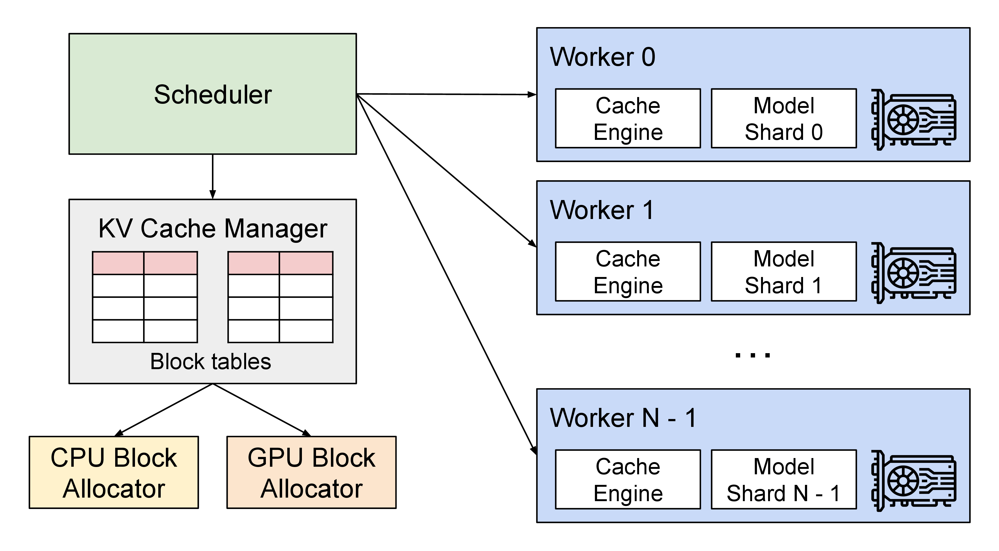

# 一条生成请求怎样被推理引擎执行

用户提交三个 prompt token，服务返回两个新 token。模型的数学任务是两次条件预测，推理引擎还要决定何时计算、KV 放在哪里、结果何时可以发出，以及请求结束后怎样释放状态。下面沿着这条短请求读 vLLM 的一次执行循环，再把并发和长上下文接进来。

本页对照 vLLM commit `fa3b9d13` 的 V1 引擎。源码版本持续变化，文中的函数与字段描述限定在这一版本；示意数字只用于理解状态，没有进行 GPU 性能测试。

## 入队时，模型还没有计算 prompt

设请求 A 的 prompt token 为 `[8,2,5]`，要求最多生成两个 token。刚入队时，已知 token 数为 3，已经计算的 token 数为 0，输出为空。它还需要模型权重、采样设置、位置编号、KV 分配以及停止条件。

引擎的 [EngineCore.step](https://github.com/vllm-project/vllm/blob/fa3b9d1377219247060d3c8b49eae199c9e7e154/vllm/v1/engine/core.py#L674)把一次推进拆成 `scheduler.schedule`、`model_executor.execute_model`、必要的 `sample_tokens`，以及 `scheduler.update_from_output`。这些是内部函数，不是建议应用直接调用的稳定公共 API。

请求排队时，用户已经在等待，但 GPU 可能还没处理它。鉴权、路由、tokenization 与网络也发生在模型计算之外。测慢请求应保留这些阶段的起止点，避免把所有时间都记为模型耗时。

## 调度器决定这一轮处理哪些 token

在 [Scheduler.schedule](https://github.com/vllm-project/vllm/blob/fa3b9d1377219247060d3c8b49eae199c9e7e154/vllm/v1/core/sched/scheduler.py#L699) 的注释中，调度逻辑以 `num_computed_tokens` 与需要处理的 token 数描述请求，而非为 prefill 与 decode 各写一套完全独立状态机。它给请求分配本轮 token 预算，让已经计算的位置追上待处理位置。

先忽略投机、多模态和异步 lookahead。对 A 来说，需要新算 $3-0=3$ 个 token。如果本轮预算足够，便安排完整 prompt；若只剩 2 个，可先计算前两个，下一轮继续。长 prompt 的 chunked prefill 就可以用这种“尚有位置未处理”的状态理解。

安排计算还必须获得 KV 空间。源码先调用 `kv_cache_manager.allocate_slots`，分配失败时会进入等待或抢占等分支。不能先完成 prefill、到最后才想起初始 KV 无处存放。被抢占的请求可能以后重算，这也是仅看输出吞吐会漏掉的额外工作。

## Prefill 处理三个位置，首个输出来自最后位置

Worker 对 `[8,2,5]` 做前向。每个位置产生各层 K/V，因果 attention 让位置 0 只关注自身、位置 1 关注前两个、位置 2 关注三个。最后位置的 logits 给出下一个 token 分布，假设采样得到 7。

这时可以向用户发出首个输出 7。无需为了“首个 token”再对完整 prompt 做一次额外 decode。Prompt 的 3 个位置已经写入 KV；刚采样的 7 还没有作为输入经过模型，所以它通常尚无自己的完整 K/V。

```text
已知 token        [8, 2, 5, 7]
已计算的前缀      [8, 2, 5]
已提交输出        [7]
下一轮需处理      [7]
```

已知序列长度、已计算长度和已分配容量是三个不同量。分页可能提前分配一整块，投机可能计算未被接受的候选，异步调度可能存在尚未回收的结果，因此生产实现还需要更多状态。

## Decode 读取历史，再把 7 写入 KV

下一轮只把新 token 7 送入模型，使用其正确位置编号。每层生成当前 query、key、value；query 读取历史 `[8,2,5]` 的 K/V，同时按实现处理当前 token，再得到新的隐藏表示和 logits。假设这次采样得到 1。

输出已是 `[7,1]`，达到两个 token 的上限，请求结束。一般无需为了给最后采样的 1 建 KV 再运行一轮，因为没有后续预测需要它。若要继续会话，具体复用边界由下一请求的前缀匹配与缓存策略决定。

[update_from_output](https://github.com/vllm-project/vllm/blob/fa3b9d1377219247060d3c8b49eae199c9e7e154/vllm/v1/core/sched/scheduler.py#L2260)负责把 worker 结果映射回请求并更新状态。该版本还处理已取消请求、异步旧结果、KV 接收失败以及投机拒绝后的已计算长度回退。一次 forward 返回张量，只是请求推进过程的一部分。

## 首 token 和后续间隔应怎样量

设请求在 $t_0$ 发出，首 token 到达为 $t_1$，最后 token 到达为 $t_N$，输出 N 个 token。

$$
\mathrm{TTFT}=t_1-t_0,\qquad
\mathrm{TPOT}=\frac{t_N-t_1}{N-1}\quad(N>1).
$$

若首 token 等待 300 ms，之后 100 个 token 平均间隔 40 ms，最后 token 约在 4.3 秒到达。单 token 输出的 TPOT 不适用。网络若一次发送多个 token，客户端测到的是 chunk 时间，不能据此声称知道每个 token 的精确时间戳。

服务端还应单独记录排队、prefill、采样与发送。两段工作的 P95 不能简单相加得到总 P95，因为最慢的请求可能不是同一批；总时延分位数应由逐请求时间计算。

## 三条请求怎样共享一次迭代

设 A、B、C 分别还需生成 2、5、3 个 token。第一轮三条都参与；第二轮 A 完成；第三轮可以安排新请求 D 的工作，同时继续 B、C。它们无需等最长的 B 完成后再一起换批。

新请求 D 仍有 prefill 工作，调度器要在 token 预算与 KV 空间内安排它。如果一段长 prefill 连续占据设备 200 ms，已在流式输出的 B 可能出现明显停顿。切块为调度器提供插入其他工作的机会，代价是更多调度和可能较低的单块效率。

{ width="900" }

<small>图源：[vLLM PagedAttention blog](https://vllm.ai/blog/2023-06-20-vllm)。这张图说明 scheduler、KV cache manager、CPU/GPU block allocator 和 worker 的关系。</small>

图中的 scheduler、KV manager 与 worker 对应这三种职责。持续批处理提高资源利用的同时，也可能改变单轮耗时和请求等待。大 batch 的总 token/s 提高，不代表每条请求的 token 间隔都缩短。

## KV 从几个 token 变成显存上限

对普通全注意力 Transformer，L 层、$H_{kv}$ 个 K/V heads、每 head 维度 d、每元素 b 字节，一个缓存 token 占

$$
m_{token}=2L H_{kv} d b.
$$

取 L=32、$H_{kv}=8$、d=128、BF16 的 b=2，结果为 128 KiB/token。32,768-token 单请求占 4 GiB，四条并发约占 16 GiB；若每条再生成 4,096 token，还会增加合计 2 GiB。权重、workspace、块表和临时状态需要另算。

这个公式描述逻辑总量。TP 下各卡可能分片或复制 K/V，滑动窗口、MLA 与混合模型也有不同布局，应按实际实现重新计算，不能把总量机械除以卡数。

PagedAttention 将逻辑连续的 K/V 放进固定大小的物理块。每块容纳 16 token 时，34-token 请求需要三块，末块暂时空出 14 个位置。分页减少连续预留与外部碎片，但仍有尾块浪费和索引成本。

## 请求结束与取消都要回收状态

A 完成后，块的活动引用可以释放；如果 prefix cache 选择保留公共前缀，块仍可能作为可复用状态驻留。另一条请求还引用的块不能提前释放，因此“请求结束”与“物理块立即全部回收”不总是一回事。

取消也需要进入引擎状态机。仅关闭 HTTP 流，worker 仍可能继续生成；立即释放正在使用的 GPU 块，又可能让执行中的 kernel 读到被重用的内存。对照版本的调度器会忽略已结束请求的过期输出，并有延迟释放相关处理，具体时机依异步与传输配置而变。

验证服务生命周期时，至少应覆盖正常 EOS、最大输出长度、排队时取消、执行中取消和缓存失效。它们直接影响资源是否能持续被新请求使用。

## 优化应落在这条执行路径的具体位置

共享前缀缓存减少重复 prefill，仍需后续 decode 读取历史 KV；投机解码用草稿和并行验证减少目标模型的串行轮次，还要回滚拒绝分支；量化减少某些张量载荷，收益取决于 kernel 与质量；拆分 prefill/decode 增加独立排程能力，也增加 KV 传输。

如果一个 Agent 任务总共 6 秒，其中工具占 4 秒、模型占 2 秒，把模型加速两倍后总耗时仍是 5 秒。先从 trace 找关键路径，再沿 [缓存与投机解码](caching-routing-and-speculative.md)、[GPU 执行](gpu-kernels-batching-and-memory-systems.md)或 [RAG 与工具系统](rag-agents-and-long-context-systems.md)继续分析。

## 对照源码与原始机制

- [vLLM EngineCore](https://github.com/vllm-project/vllm/blob/fa3b9d1377219247060d3c8b49eae199c9e7e154/vllm/v1/engine/core.py)，固定 commit `fa3b9d13`，从 `step` 追调度、执行、采样与状态更新。
- [vLLM V1 Scheduler](https://github.com/vllm-project/vllm/blob/fa3b9d1377219247060d3c8b49eae199c9e7e154/vllm/v1/core/sched/scheduler.py)，同一 commit，查看 token 预算、KV 分配、输出处理与拒绝回退。
- [PagedAttention 论文](https://arxiv.org/abs/2309.06180)解释分页管理，论文结果限定于其硬件和请求设置。
- [Orca](https://www.usenix.org/conference/osdi22/presentation/yu)解释 iteration-level scheduling 的系统背景。
