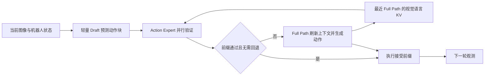

# VLA 投机推理：从动作 Token 到连续动作块与闭环验证

机器人已经伸手接近杯子，策略还在等待下一轮大模型推理。继续执行旧动作可能错过目标，缩短动作块又会增加大模型调用次数。VLA 投机推理想解决这个矛盾：把便宜的预测先做出来，再用较贵但更可靠的计算决定哪些动作可以执行、何时需要重新规划。

这条路线连接了[通用投机解码](caching-routing-and-speculative.md)与[VLA 动作分块](../vla/action-chunking-hierarchical-policies-and-latent-skills.md)。理解它需要先分清三件事：候选是离散 token 还是连续动作块，验证发生在生成阶段还是执行阶段，速度收益是否伴随成功率变化。不同论文都使用 speculative 这个词，但省掉的计算并不相同。

## 从语言 Token 到机器人动作，接受条件变了

经典 LLM speculative decoding 让 draft model 提出多个候选 token，target model 一次前向并行验证。在正确的接受与校正机制下，可以保持 target 的输出分布。VLA 常用的 relaxed acceptance 则允许动作 token 存在一定偏差，其依据是相邻动作量化区间可能对应相近的连续控制量。[Spec-VLA](https://aclanthology.org/2025.emnlp-main.1367/)由此提高接受长度，但质量判断也从 token 一致转到了闭环任务结果。

对具有明确动作距离定义的 token 表示，可以把放宽接受写成

\[
\operatorname{Accept}(\hat a_i)
=\mathbf{1}\!\left[d(\hat a_i,a_i^{\mathrm{target}})\leq\rho\right].
\]

这里的 \(d\) 必须与动作表示相容。不能对任意 tokenizer 都直接把 token ID 的数值差当作物理距离，也不能把平移、旋转和夹爪状态混成一个没有单位约定的阈值。动作归一化、量化分桶和控制频率会改变同一个 \(\rho\) 对应的执行误差。

即使距离定义合理，也不意味着误差在每个状态下代价相同。自由空间里的一点位置偏差可能在下一轮观测后被修正；接近杯沿、抽屉把手或夹爪闭合时，相同偏差可能改变接触关系。因此，接受率必须与任务成功、接触失败和重新规划成本一起看。这里不能沿用“验证过就严格无损”的结论。

## 先确定投机发生在哪一层

| 路线 | 候选是什么 | 验证或纠偏方式 | 主要节省什么 | 代表工作 |
| --- | --- | --- | --- | --- |
| 离散 action-token decoding | draft action tokens | target 并行验证，允许受限动作偏差 | target 自回归解码轮数 | Spec-VLA、KERV、HeiSD |
| World-aware conditioning | 物理场景表征条件下的 draft tokens | 保留 relaxed acceptance，改变双方共享的 prefill 状态 | 在可比成功率下减少验证轮数 | WA-SpecDec |
| Continuous action-chunk inference | 一次提出完整连续动作块 | Action Expert 在多个 flow timestep 检查端点一致性 | VLM prefill 与串行去噪调用 | Realtime-VLA FLASH |
| Self-speculative pruning | 依据历史与当前信号预测可裁剪视觉 token | 分层重要性判断与动作粒度控制 | 视觉 token 带来的计算 | SpecPrune-VLA |
| Execution-time verification | 大 VLA 低频提出长计划 | 小 verifier 随新观测监测动作偏差，触发重规划 | 完整策略调用频率 | SV-VLA |
| Algorithm–architecture co-design | 按环境状态安排长动作预测 | 小 sVLA 选择性验证，配合异构硬件 | 算法调用、验证模型与硬件执行成本 | 2026 年 SpecVLA co-design |

这张表适合在读论文前使用。先问“当前系统最贵的是什么”：如果瓶颈是 action token 的逐步解码，就看前三篇离散路线；如果是 π0 的 prefill 和多步 flow，就看 FLASH；如果动作块生成已经很快，但长时间开环执行容易失效，就需要研究执行阶段的验证。各行机制与来源见下方论文对照。

## 离散路线如何发展

[Spec-VLA](https://aclanthology.org/2025.emnlp-main.1367/)说明精确 token 匹配对动作生成可能过于苛刻。它利用动作 token 对应的相对距离放宽接受，使一次 target 验证能够保留更长前缀。作者报告相对 OpenVLA 约 1.42× 加速，接受长度提高 44%；这是论文评测设置下的结果，不能直接外推到不同动作编码。

[KERV](https://arxiv.org/abs/2603.01581)把机器人运动学引入这条链。它使用基于运动学的 Kalman Filter 预测和修正动作，并动态调整接受阈值，希望减少 token 错误引发的昂贵重新推理。读这篇时，要把“模型预测的动作”“运动学修正后的动作”和“最终执行的动作”分开；修正引入了额外的运动假设。

[HeiSD](https://arxiv.org/abs/2603.17573)进一步利用历史动作复用。它在 retrieval-based draft 与模型 drafter 之间选择，通过运动学指标决定切换，配合 verify-skip 与 sequence-wise relaxed acceptance。它关注的是何时可以便宜地复用历史，以及历史误差如何避免持续传播，不能简单归为更大的接受阈值。

[WA-SpecDec 精读](../paper-deep-dives/inference/wa-specdec-0928-1144.md)接着追问，draft 与 target 共同依赖的场景表示是否保留了足够的物理细节。它从当前图像计算 World-Aware Bias，在 prefill 前加到视觉 patch embeddings 上，训练时用下一帧 latent prediction 辅助监督，推理时移除预测头。原有 relaxed acceptance 规则不变，改变的是双方看到的条件和 target 参考动作。

因此，WA-SpecDec 的“world-aware”不能解释成运行时用世界模型模拟每个候选的未来，或直接根据接触阶段收紧阈值。论文把场景敏感性主要放进表示学习。其效果仍需通过成功率与接受长度曲线证明，不能仅凭模块名称认为验证更安全。

## 连续动作块为什么需要另一种验证

π0 一类 flow-matching VLA 通过多步积分生成连续动作块，没有可直接照搬的 action-token 概率校验接口。如果为了验证候选又完整跑一遍去噪，投机的收益就可能消失。

[Realtime-VLA FLASH 精读](../paper-deep-dives/inference/realtime-vla-flash-0928-1144.md)利用 flow-matching 的插值结构。轻量 draft 一次预测动作终点，把这个终点与高斯噪声插值到几个中间时刻，再让原 Action Expert 并行预测局部速度、重建终点。如果不同检查点重建的动作都与 draft 足够接近，就执行连续通过验证的前缀。

这张图概括 FLASH 的缓存与回退关系，具体状态机见原论文 Section 3 与 Algorithm 1。新图像仍然经过 image encoder；被复用的是上一次 full path 的视觉语言 KV，机器人 state 则在验证时更新。只写“缓存观测”会把不同信息的新鲜度混在一起。

局部 flow 一致性无法保证整个未来轨迹等同于 full path。FLASH 还在夹爪状态切换时回退，并在 LIBERO-10 配置中结合周期性 full-path refresh。这个设计揭示了投机控制的另一个成本：拒绝率之外，还要计算上下文陈旧和长期误差累积带来的纠偏需求。

## 八篇工作的核验对照

以下整理截至 **2026-09-28**。两篇重点论文核对全文；其余工作以官方摘要、出版页及可访问作者仓库确认定位。机构信息不参与机制分类，未核实的实现细节不从题名推断。表中数字均为作者报告，尚未进行独立复现。

| 论文 / 首发时间 | 发表状态与来源 | 代码入口 | 机制与结果边界 |
| --- | --- | --- | --- |
| **Spec-VLA: Speculative Decoding for Vision-Language-Action Models with Relaxed Acceptance** / 2025 | [EMNLP 2025，ACL Anthology](https://aclanthology.org/2025.emnlp-main.1367/) | [PineTreeWss/SpecVLA](https://github.com/PineTreeWss/SpecVLA) | 离散动作 draft–verify 与 relaxed acceptance；摘要报告相对 OpenVLA 1.42× 加速、接受长度提高 44%。 |
| **SpecPrune-VLA: Accelerating Vision-Language-Action Models via Action-Aware Self-Speculative Pruning** / 2025-09 | [arXiv，v3 标注 Accepted to ICML 2026](https://arxiv.org/abs/2509.05614) | [alexwhz-sjtu/SpecPrune-VLA](https://github.com/alexwhz-sjtu/SpecPrune-VLA) | training-free 的 action-level static 与 layer-level dynamic 视觉 token 剪枝，按末端运动速度调整粗细粒度；当前摘要报告仿真最高 1.57×、真机最高 1.70×，不等同于经典动作 token draft–verify。 |
| **KERV: Kinematic-Rectified Speculative Decoding for Embodied VLA Models** / 2026-03 | [arXiv，v2 标注 DAC 2026 accepted](https://arxiv.org/abs/2603.01581) | [zhengzihaoPKU/KERV](https://github.com/zhengzihaoPKU/KERV) | Kalman Filter 动作修正与运动学阈值调整；摘要报告 27%–37% acceleration，不能在未核对计算口径前直接换算成统一倍数。 |
| **HeiSD: Hybrid Speculative Decoding for Embodied Vision-Language-Action Models with Kinematic Awareness** / 2026-03 | [arXiv preprint，v2](https://arxiv.org/abs/2603.17573) | 本次未确认官方代码入口 | retrieval/model draft 混合、verify-skip、序列级放宽接受；摘要报告仿真最高 2.45×、真机 2.06×–2.41×，基准和硬件条件需分别比较。 |
| **Open-Loop Planning, Closed-Loop Verification: Speculative Verification for VLA** / 2026-04 | [arXiv preprint，v1，Under Review](https://arxiv.org/abs/2604.02965) | [edsad122/SV-VLA](https://github.com/edsad122/SV-VLA) | 执行阶段监测长计划；README 的三套 LIBERO 平均结果为 2.17×、90.9% 成功率，短 chunk 对照为 96.0%。这是速度与质量权衡，不能写成完全保持成功率。 |
| **Realtime-VLA FLASH: Speculative Inference Framework for Diffusion-based VLAs** / 2026-05 | [arXiv preprint，v1](https://arxiv.org/abs/2605.13778)；[本站精读](../paper-deep-dives/inference/realtime-vla-flash-0928-1144.md) | [dexmal/realtime-vla-flash](https://github.com/dexmal/realtime-vla-flash) | 连续动作块 draft、flow 多时刻验证和 full-path fallback；与 Triton 结合后相对 Torch-π0 的任务平均推理延迟加速 3.04×，平均成功率 94.1% → 93.8%。单独 FLASH 为 1.66×。 |
| **WA-SpecDec: World-Aware Speculative Decoding for Vision-Language-Action Models** / 2026-08 | [arXiv preprint，v1](https://arxiv.org/abs/2608.08725)；[本站精读](../paper-deep-dives/inference/wa-specdec-0928-1144.md) | 论文称接收后发布，本文未确认公开实现 | World-Aware Bias 改善 draft/target 的共享条件，保留 relaxed acceptance；摘要报告相对已有投机基线的 matched-success 1.5×，需与表中相对 AR 的固定配置加速区分。 |
| **Algorithm–Architecture Co-Design for Efficient VLA Inference via Speculative Inference and Verification** / 2026-08 | [arXiv preprint，v1](https://arxiv.org/abs/2608.15636) | 本次未确认官方代码入口 | 也称 **SpecVLA**，需与 EMNLP 2025 的 **Spec-VLA** 区分。按 active/inactive 环境状态调度，结合差分残差、分块混合精度 sVLA 及 GPU/专用硬件；硬件协同收益不能视作通用 GPU 软件收益。 |

## 加速数字怎样比较才有意义

FLASH 把每次推理所生成的连续动作块作为基本单位，WA-SpecDec 关注每次验证接受多少离散动作 token。两者都可以报告 speedup，但一次 token 不一定是一条完整机器人命令，一次动作块推理也不等于整个任务执行完成。

以 FLASH 的 Table 1 / Table 6 为例，同一篇论文里就有三层不同数字：最快 flash-path round 为 7.8 ms；沿任务轨迹统计的平均 replanning latency 为 19.1 ms；相对 58.0 ms Torch 基线得到约 3.04×。不能用 58.0 / 7.8 代替任务平均加速，也不能把 1 / 7.8 ms 解释成真实机器人始终以相同频率完成完整闭环。

WA-SpecDec 还需要区分固定阈值与 matched-success。固定 \(\rho\) 回答“接受规则相同时是否更好”，匹配成功率回答“达到相近可靠性时能快多少”。后者需要扫描阈值或其他配置，再在相同成功率附近比较，不能直接用一行固定配置的两个 speedup 相除代替。

| 评测层 | 至少记录的指标 | 避免的误读 |
| --- | --- | --- |
| 模型推理 | encode / prefill / draft / verify / fallback 时间，硬件、精度、kernel | 把验证时间当总延迟，把 kernel 收益全归给算法 |
| 动作提交 | accepted prefix、拒绝率、执行长度、KV 年龄 | 把“生成了多少候选”当作“执行了多少有效动作” |
| 真实闭环 | observation-to-action latency、P95/P99、重规划次数、控制频率 | 用平均 forward latency 代替反馈新鲜度 |
| 任务质量 | 完整 episode 成功率、接触阶段失败、碰撞与恢复 | 用 token 距离或 action MSE 代替任务完成 |
| 比较设置 | 相同权重起点、任务、试验次数、阈值扫描与训练预算 | 把更强 target 的收益全归给 speculative decoding |

上表是工程评测建议，不是八篇论文都已覆盖的实验清单。尤其是 relaxed acceptance 和 flow 一致性校验，最终都需要在机器人自己的动作后果下运行，才能看见误差积累。

## 怎样接回现有学习路线

先读[动作表示与控制接口](../vla/action-representation-and-interfaces.md)，确认输出单位和 token 含义；再读[缓存、路由与投机解码](caching-routing-and-speculative.md)与[EAGLE-3](../paper-deep-dives/inference/eagle-3.md)，理解 draft 成本、接受长度和 target 验证之间的关系。随后用[FLASH](../paper-deep-dives/inference/realtime-vla-flash-0928-1144.md)学习连续动作块怎样被验证，用[WA-SpecDec](../paper-deep-dives/inference/wa-specdec-0928-1144.md)学习场景表征怎样影响动作接受的可靠性。

部署层面继续看[VLA 部署与安全](../vla/deployment-and-safety.md)与[闭环恢复与失败分析](../vla/closed-loop-recovery-and-failure-analysis.md)。投机方法能减少平均推理成本，但可执行前缀多长、何时刷新上下文、失败后怎样恢复，仍然属于整个控制系统的责任。
