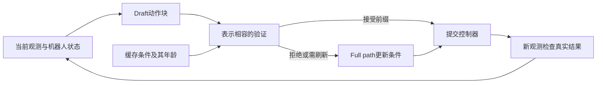

# VLA投机推理验证的是token、动作还是执行结果

机器人策略可以先用便宜路径提出动作，再决定哪些动作值得交给昂贵模型验证。离散动作 token、连续动作块与执行时反馈使用不同接受条件。论文都写“speculative”，并不表示验证的对象相同；先把候选、验证对象和提交时刻分开，才能判断加速是否保持了原任务行为。

## 离散动作的距离必须先换成物理单位

经典随机语言投机采样可用接受与残差校正保持目标分布。部分VLA方法改用relaxed acceptance，允许动作token与目标有一定距离。这已经需要新的质量证据，不能沿用严格分布保持保证。

教学设定把平移增量均匀分成覆盖[-0.1,0.1]米的256个区间，每区间宽0.78125毫米。只有当token ID按区间顺序编码时，相差两个区间才约等于1.5625毫米。任意tokenizer的ID差没有这种物理含义。

旋转、夹爪与平移使用不同单位；绝对位姿和逐步增量也不同。若是连续十步同向增量误差，简单和约15.625毫米；绝对目标位姿不能按同样方式累加。接触阶段与自由空间对相同偏差的响应还可能不同。

## 接受前缀与执行前缀是两个边界

Draft提出多个候选，验证从前向后判断。某位置失败后，后续候选依赖的状态可能不再成立，应按算法回退或重算。提交给控制器以后，系统又进入真实环境，必须等待新观测判断动作是否按预期发生。

Spec-VLA等离散路线主要减少目标模型自回归验证轮数；执行时verifier则监测长计划并触发重规划。两者都叫验证，却发生在不同状态转换上。

## 连续flow动作没有现成的token概率接口

连续动作块由flow或扩散过程生成时，不能直接套用离散 $p/q$ 接受比。FLASH通过draft终点构造中间状态，再用Action Expert检查局部速度对应的终点一致性，配合缓存与full-path回退。详细状态机见[FLASH精读](../paper-deep-dives/inference/realtime-vla-flash-0928-1144.md)。

用从噪声到动作的教学时间约定，$x_t=(1-t)\epsilon+t\hat a$。设噪声0、候选终点2、t=0.5，则中间点为1。若预测速度1.8，外推终点为

$$
\tilde a=x_t+(1-t)v_\theta=1+0.5\times1.8=1.9.
$$

与候选相差0.1。论文可能使用不同时间方向，迁移公式时先核对定义。这个局部检查没有证明完整积分等价，更没有证明真实闭环轨迹相同。

<!-- systems-workflow-visual -->

生成阶段通过验证后，仍需执行阶段的新观测；缓存新鲜度和模型一致性不能互相替代。

## 缓存新鲜度会影响验证共同使用的条件

若多个检查点都使用陈旧场景条件，它们可能在同一个错误条件下保持一致。因此新观测、机器人状态更新、周期刷新与触发回退各有独立作用。

[WA-SpecDec](../paper-deep-dives/inference/wa-specdec-0928-1144.md)主要通过World-Aware Bias改善draft与target的共享条件，保留relaxed acceptance。不能把它理解为推理时对每个候选都运行世界模型模拟，或自动按接触阶段收紧阈值。

## 回退率怎样进入平均延迟

教学设定中，快速路径8毫秒，失败后再付出50毫秒完整路径，回退率20%，且两者串行，则平均为 $8+0.2\times50=18$ 毫秒。不能只报告8毫秒，也不能把这种平均推理频率直接当作真实控制闭环频率。

评测同时记录候选长度、接受长度、实际执行长度、上下文年龄、回退与完整episode结果。比较算法时固定硬件与kernel；比较系统时可包含kernel优化，但要拆出贡献。下面保留已有论文核验索引，日期和作者报告边界不作隐性更新。

## 八篇工作的核验对照

以下整理截至 **2026-09-28**。两篇重点论文核对全文；其余工作以官方摘要、出版页及可访问作者仓库确认定位。机构信息不参与机制分类，未核实的实现细节不从题名推断。表中数字均为作者报告，尚未进行独立复现。

| 论文 / 首发时间 | 发表状态与来源 | 代码入口 | 机制与结果边界 |
| --- | --- | --- | --- |
| **Spec-VLA: Speculative Decoding for Vision-Language-Action Models with Relaxed Acceptance** / 2025 | [EMNLP 2025，ACL Anthology](https://aclanthology.org/2025.emnlp-main.1367/) | [PineTreeWss/SpecVLA](https://github.com/PineTreeWss/SpecVLA) | 离散动作 draft–verify 与 relaxed acceptance；摘要报告相对 OpenVLA 1.42× 加速、接受长度提高 44%。 |
| **SpecPrune-VLA: Accelerating Vision-Language-Action Models via Action-Aware Self-Speculative Pruning** / 2025-09 | [arXiv，v3 标注 Accepted to ICML 2026](https://arxiv.org/abs/2509.05614) | [alexwhz-sjtu/SpecPrune-VLA](https://github.com/alexwhz-sjtu/SpecPrune-VLA) | training-free 的 action-level static 与 layer-level dynamic 视觉 token 剪枝，按末端运动速度调整粗细粒度；当前摘要报告仿真最高 1.57×、真机最高 1.70×，不等同于经典动作 token draft–verify。 |
| **KERV: Kinematic-Rectified Speculative Decoding for Embodied VLA Models** / 2026-03 | [arXiv，v2 标注 DAC 2026 accepted](https://arxiv.org/abs/2603.01581) | [zhengzihaoPKU/KERV](https://github.com/zhengzihaoPKU/KERV) | Kalman Filter 动作修正与运动学阈值调整；摘要报告 27%–37% acceleration，不能在未核对计算口径前直接换算成统一倍数。 |
| **HeiSD: Hybrid Speculative Decoding for Embodied Vision-Language-Action Models with Kinematic Awareness** / 2026-03 | [arXiv preprint，v2](https://arxiv.org/abs/2603.17573) | 本次未确认官方代码入口 | retrieval/model draft 混合、verify-skip、序列级放宽接受；摘要报告仿真最高 2.45×、真机 2.06×–2.41×，基准和硬件条件需分别比较。 |
| **Open-Loop Planning, Closed-Loop Verification: Speculative Verification for VLA** / 2026-04 | [arXiv preprint，v1，Under Review](https://arxiv.org/abs/2604.02965) | [edsad122/SV-VLA](https://github.com/edsad122/SV-VLA) | 执行阶段监测长计划；README 的三套 LIBERO 平均结果为 2.17×、90.9% 成功率，短 chunk 对照为 96.0%。这是速度与质量权衡，不能写成完全保持成功率。 |
| **Realtime-VLA FLASH: Speculative Inference Framework for Diffusion-based VLAs** / 2026-05 | [arXiv preprint，v1](https://arxiv.org/abs/2605.13778)；[本站精读](../paper-deep-dives/inference/realtime-vla-flash-0928-1144.md) | [dexmal/realtime-vla-flash](https://github.com/dexmal/realtime-vla-flash) | 连续动作块 draft、flow 多时刻验证和 full-path fallback；与 Triton 结合后相对 Torch-π0 的任务平均推理延迟加速 3.04×，平均成功率 94.1% → 93.8%。单独 FLASH 为 1.66×。 |
| **WA-SpecDec: World-Aware Speculative Decoding for Vision-Language-Action Models** / 2026-08 | [arXiv preprint，v1](https://arxiv.org/abs/2608.08725)；[本站精读](../paper-deep-dives/inference/wa-specdec-0928-1144.md) | 论文称接收后发布，本文未确认公开实现 | World-Aware Bias 改善 draft/target 的共享条件，保留 relaxed acceptance；摘要报告相对已有投机基线的 matched-success 1.5×，需与表中相对 AR 的固定配置加速区分。 |
| **Algorithm–Architecture Co-Design for Efficient VLA Inference via Speculative Inference and Verification** / 2026-08 | [arXiv preprint，v1](https://arxiv.org/abs/2608.15636) | 本次未确认官方代码入口 | 也称 **SpecVLA**，需与 EMNLP 2025 的 **Spec-VLA** 区分。按 active/inactive 环境状态调度，结合差分残差、分块混合精度 sVLA 及 GPU/专用硬件；硬件协同收益不能视作通用 GPU 软件收益。 |

## 读论文时沿同一条问题链核对

先确认昂贵步骤是视觉prefill、动作自回归、flow积分还是完整策略调用。再检查draft拿到哪些信息、验证是否使用新观测、拒绝后如何恢复状态。最后比较相同成功率附近的延迟，而不把不同硬件、任务和接受阈值的最高倍数直接排序。

离散概率验证可先看[通用投机推理](caching-routing-and-speculative.md)，动作执行后的恢复继续看[VLA闭环失败分析](../vla/closed-loop-recovery-and-failure-analysis.md)。本文手算用于解释单位与状态边界，没有独立复现表中的机器人实验。

## 源码版本和指标口径

表格按论文摘要、出版页和作者仓库逐项核对，重点阅读 [Spec-VLA](https://aclanthology.org/2025.emnlp-main.1367/)、[FLASH](https://arxiv.org/abs/2605.13778) 与 [WA-SpecDec](https://arxiv.org/abs/2608.08725) 对候选、接受和回退的定义。表中速度与成功率保留作者报告的硬件、任务和口径，未做跨论文排序；缺少公开代码或仍在审稿中的条目也保留相应状态。256 个动作区间、8/50 ms 回退和单位换算是本站教学算例。

阅读新论文时，先把“模型验证”和“执行验证”画成两张状态图，再将接受长度、实际执行长度、回退率、任务成功和安全事件放到同一份日志。这样能避免把 token 层的接受率直接写成机器人层的成功率。
