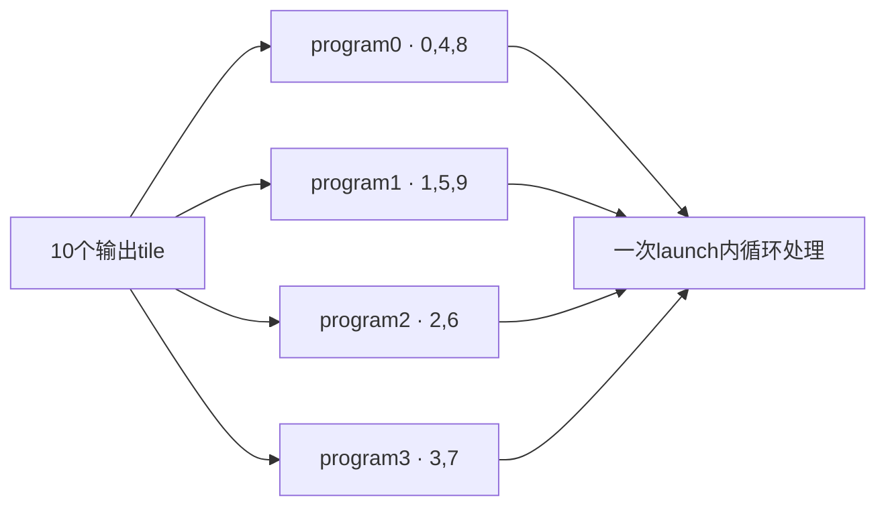

# 一个输出tile怎样进入流水与persistent调度

基础GEMM沿K读取tile、计算、再读下一块。高级调度仍在完成这件事，只是尝试让数据更早到达、让工作更均匀分配。讨论双缓冲或persistent之前，先固定一个输出tile的生命周期。

## 串行读取为什么留下空隙

教学设定中，读取一块需要3个时间单位，计算需要5个，处理4块完全串行为32。若读取下一块能与当前计算重叠，理想时间为首次读取3，加4次计算20，共23。最后一块之后没有下一次读取，不能再额外加一个3。

要实现这个重叠，至少需要区分当前与下一块缓冲，以及“数据写完”“计算读完”的同步条件。若过早覆盖旧缓冲，结果可能偶发错误；若每次都等待全部工作结束，流水又退回串行。

## 更多stage也会吃掉片上资源

增加缓冲stage可以提前发起更多搬运，但占用shared memory；大输出tile增加累加器寄存器。资源过多可能减少同时驻留的block，甚至触发spill。因而stage数需要与tile和设备一起测量，不能从“重叠更多”直接推出“更快”。

## Persistent GEMM在一次launch内调度多个tile

普通实现常让每个program负责一个输出tile，persistent实现可让较少program循环领取多个tile。设共有10个tile、4个program，简单静态分配可为program0处理0、4、8，program1处理1、5、9，其余分别处理2、6和3、7。

Triton官方persistent matmul用类似 `tile_id=start_pid; tile_id+=NUM_SMS` 的循环。普通GEMM本来也可能只有一次launch，因此这里不能泛称它一定减少了kernel launch次数。它改变的是CTA数量、设备端工作分配和可能的局部性；跨算子持续执行的persistent设计才可能同时减少多次launch。

<!-- systems-workflow-visual -->

静态persistent示例改变一个launch内的工作分配；普通GEMM本来也可能只有一次launch。

## 不规则尾块需要保留完整语义

若M=130、tile高128，第二块仅2行有效。大tile可能让绝大部分位置成为mask或padding。选择小tile或独立尾块路径有机会减少浪费，但也新增配置、分支和维护成本。

Triton grouped-GEMM将多个问题的tile串进工作序列，可以平衡一些大小不同的问题；动态负载或高度不均匀时，静态轮转也未必最优。应检查每个program的有效工作量和最后完成时间。

## Shape特化需要明确适用条件

一个快路径可要求dtype、K对齐、连续stride和特定M区间。条件不满足时回到通用实现，保持数学与输入契约一致。Autotune只在这个有效集合内比较参数，无法替代正确性判断。

新路径的收益要按真实shape分布加权，还要计算JIT与预热成本。官方persistent教程也标明部分变体的架构和shared memory限制，不能把高级样例直接当作所有GPU的通用替代。

{ width="820" }

<small>图源：[FlashAttention](https://arxiv.org/abs/2205.14135)。原图表达通过 tiling 避免 materialize 巨大 attention 矩阵、减少 HBM 往返；读图重点是把 tiling、流水、fusion 和 shape specialization 看成同一类“让数据在正确层级复用”的设计。它不能证明所有高级 kernel 都应照搬 FlashAttention 的 tile 结构。</small>

## 对照源码与延伸阅读

- [Persistent matmul的tile循环与硬件限制](https://github.com/triton-lang/triton/blob/cd2e01c6686d6503802e6cdfac56d5a5dfdb27a1/python/tutorials/09-persistent-matmul.py)
- [Grouped GEMM的固定CTA调度](https://github.com/triton-lang/triton/blob/cd2e01c6686d6503802e6cdfac56d5a5dfdb27a1/python/tutorials/08-grouped-gemm.py)
