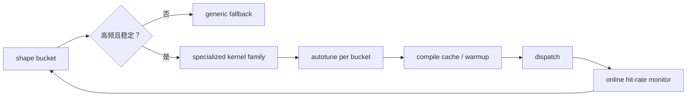

# 高级 Kernel 模式与形状特化

真正高性能的 AI kernel，往往并不只靠一个技巧，而是若干模式叠加的结果：tiling、双缓冲、流水线、persistent kernel、epilogue fusion、threadblock swizzle、shape specialization、autotune。理解这些模式，能帮助你把很多看似不同的实现放到同一张设计图里。

!!! note "初学者先抓住"

    高级 kernel 模式的共同目标，是让数据在正确时间到达正确位置，并让计算单元尽量少等。Tiling 管复用，双缓冲管等待，fusion 管少搬中间结果，shape specialization 管高频形状的专门优化。

!!! example "有趣例子：流水厨房"

    好厨师不是等所有菜洗完才开火，而是一边切、一边炒、一边准备下一盘。高性能 kernel 也是把数据搬运、计算和写回组织成流水线。

## 1. 为什么“高级模式”不是炫技

当算子真正接近硬件上限时，性能差异往往不再来自“会不会做矩阵乘”，而来自数据是否在正确时间到达正确层级内存、计算和访存是否能流水化、不同 shape 是否走了最适合的路径，以及 kernel 是否减少了长期驻留和调度开销。

这也是高级 kernel 模式之所以重要的原因。

## 2. Tiling 是所有高级模式的起点

无论 GEMM、attention、softmax 还是 norm，绝大多数高性能实现都从 tiling 开始：把问题切成适合 cache / shared memory / register 的块，让块内数据尽量复用，并降低 HBM 往返。

高级模式并没有脱离 tiling，而是在 tiling 之上进一步设计流水、重叠和调度。

## 3. Double Buffering 与多阶段流水

双缓冲的直觉是：当前 tile 在计算时，下一 tile 同时被预取，让计算和搬运尽量重叠。

### 3.1 为什么这很重要

因为很多 kernel 的瓶颈在“搬下一块数据时大家都在等”。  
双缓冲本质上是在减少这种等待。

### 3.2 代价是什么

代价是 shared memory 需求更高、寄存器使用可能增加、同步点更复杂，调试难度也会上升。

## 4. Persistent Kernel

persistent kernel 的核心思路是：  
让少量常驻线程块长期处理一系列工作，而不是不断 launch 新 kernel。

### 4.1 为什么它越来越重要

它适合小而频繁的工作单元、decode 场景、不规则请求流和需要减少 launch overhead 的路径。因为现代服务里很多热点并不是大块计算，而是无数小步操作，persistent kernel 能把“不断启动新工人”变成“固定工人持续接活”。

## 5. Threadblock Swizzle 与调度布局

有些高性能实现会改变 threadblock 处理 tile 的顺序，而不是简单按行列自然遍历。  
这样做通常是为了改善 L2 重用、减少 cache 冲突、让邻近 block 访问更有局部性，并平衡不同维度上的工作量。

这类技巧从表面看像“遍历顺序的小变化”，但对大矩阵和长序列 kernel 可能有明显影响。

## 6. Epilogue Fusion 与 Tail 处理

很多高性能 kernel 的关键，不在主计算，而在最后的写回阶段。  
如果能在 epilogue 阶段顺手完成 bias、scale、activation、clamp、quantize，就能减少额外 kernel 与中间张量。

### 6.1 为什么 tail 处理常被低估

所谓 tail，指那些不整齐 shape 的边界区域。  
很多 kernel 在主块上很快，但在尾块上会因为 mask、对齐不足、访存碎裂和向量化失效而明显退化。
shape specialization 很大一部分就是在处理这些现实 shape。

## 7. Shape Specialization

不是所有 shape 都值得走同一套 kernel。  
实际系统里，常常会针对常见 hidden size、head dim、sequence bucket 和 batch family 做专门优化路径。

### 7.1 为什么这很有价值

因为生产系统中的 shape 往往不是无限连续，而是聚集在一小批热点附近。  
只要把这些高频热点吃下来，就能显著提升整体收益。

### 7.2 它的代价是什么

代价是 dispatch 逻辑变复杂、编译和缓存版本增多、维护成本上升，极端边界仍然需要 fallback。

## 8. Autotune 与 Shape Specialization 的关系

Autotune 解决的是在一组候选参数中找最优配置，为不同硬件、不同 shape 选择 tile 和流水线；shape specialization 解决的是不同 shape 本来就该走不同 kernel 路径。二者结合后，系统通常会先按 shape family 分流，再在每类 shape 内用 autotune 找最优配置。

这个流程能防止 specialization 失控。不是所有 shape 都应该专门优化；只有高频、稳定、端到端占比高的 bucket 才值得进入 specialized kernel family。否则模板、编译缓存、warmup 和维护成本会吞掉收益。

## 9. Dispatch 逻辑为什么是性能系统的一部分

很多人把 dispatch 当成“小胶水逻辑”，但它实际决定哪种 shape 走哪条路径、是否命中编译缓存、是否误把小 shape 送进大 shape 专用 kernel，以及 fallback 路径触发频率。

一个糟糕的 dispatch 系统，会让再好的 kernel 也发挥不出来。

## 10. Compile Cache 与版本爆炸

当 shape specialization 越来越多时，编译缓存管理、内核版本膨胀、warmup 时间增长和在线首次请求抖动都会变成系统问题。

因此高级 kernel 模式不仅是内核问题，也需要和编译缓存和服务部署协同设计。

## 11. 什么时候值得做高级模式

通常要同时满足多项条件才值得做：算子是高频热点、默认实现明显慢、shape 分布相对可预测、业务收益足以覆盖维护成本，并且已经用 profile 明确定位到瓶颈。

如果这几条都不满足，高级特化可能只是增加复杂度。

## 12. 一个务实的优化清单

面对一个热点 kernel，通常先看是否已有成熟库，再看是否可通过图融合解决，之后才评估 Triton 级 block 特化、persistent / shape-specialized 路径，最后再考虑更重的底层定制。

这种顺序能避免过早进入昂贵实现。

## 13. 一个形象比喻

高级 kernel 模式就像把普通工厂升级成柔性自动化产线。Tiling 相当于把原材料按工位大小切好，double buffering 像前一道工序还在加工时下一批料已经在旁边待命，persistent kernel 像固定班组持续接单而不是每单重新招工，shape specialization 则像给高频规格产品配专用模具。真正的高吞吐并不是某个环节特别神，而是这些组织方式叠加起来，让整条产线更加贴近真实订单分布。

## 14. 小结

高级 kernel 模式的核心，不是追求“更复杂”，而是让计算、访存、调度和形状分布更好地匹配。理解 tiling 之后，再理解双缓冲、persistent kernel、shape specialization 和 dispatch，你会发现很多高性能实现其实共享一套非常一致的思想：  
**让热点 shape 走最适合的路径，让数据总是在被需要之前就处于最合适的位置。**

## 工程收束

高级 kernel 模式要按 persistent、grouped、split-k、warp specialization 和 shape specialization 定位。最容易误判的是热 shape 优化伤害冷 shape、模板爆炸、过度依赖单机假设；上线前要限定 specialization 边界，记录适用 shape family，准备 generic fallback，并把代码生成和维护成本一起算。
