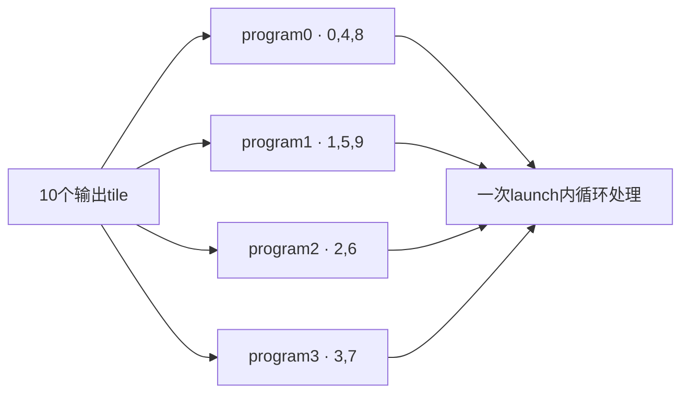
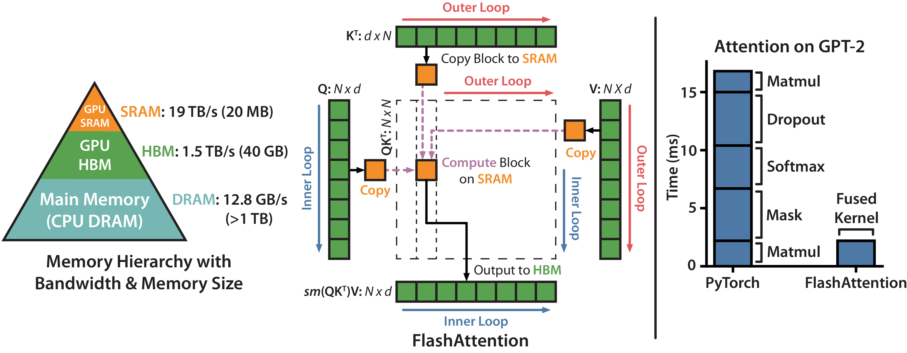

# 一个输出tile怎样进入流水与persistent调度

一个输出 tile 的计算还没结束，下一块数据已经在路上了。高级 GEMM 调度做的事情，基本都围绕这段重叠展开。先固定一个 tile 的生命周期，再讨论双缓冲、persistent 和 shape specialization，比较不容易把不同层面的优化混在一起。

## 串行读取为什么留下空隙

教学设定中，读取一块需要3个时间单位，计算需要5个，处理4块完全串行为32。若读取下一块能与当前计算重叠，理想时间为首次读取3，加4次计算20，共23。最后一块之后没有下一次读取，不能再额外加一个3。

要实现这个重叠，至少需要区分当前与下一块缓冲，以及“数据写完”“计算读完”的同步条件。若过早覆盖旧缓冲，结果可能偶发错误；若每次都等待全部工作结束，流水又退回串行。

## 更多stage也会吃掉片上资源

增加缓冲stage可以提前发起更多搬运，但占用shared memory；大输出tile增加累加器寄存器。资源过多可能减少同时驻留的block，甚至触发spill。因而stage数需要与tile和设备一起测量，不能从“重叠更多”直接推出“更快”。

## Persistent GEMM在一次launch内调度多个tile

普通实现常让每个program负责一个输出tile，persistent实现可让较少program循环领取多个tile。设共有10个tile、4个program，简单静态分配可为program0处理0、4、8，program1处理1、5、9，其余分别处理2、6和3、7。

Triton官方persistent matmul用类似 `tile_id=start_pid; tile_id+=NUM_SMS` 的循环。普通GEMM本来也可能只有一次launch，因此这里不能泛称它一定减少了kernel launch次数。它改变的是CTA数量、设备端工作分配和可能的局部性；跨算子持续执行的persistent设计才可能同时减少多次launch。

<!-- systems-workflow-visual -->

静态persistent示例改变一个launch内的工作分配；普通GEMM本来也可能只有一次launch。

## grouped ordering到底省了哪一类搬运

Triton 的矩阵乘教程给了一个容易复算的对照：把输出看成 9×9 个 tile。按简单的 row-major 顺序计算前 9 个输出块时，需要反复载入更多 A、B 的块；按 `GROUP_SIZE_M` 分组后，前 9 个输出块只需载入更少的块。官方示例给出的计数是 90 对 54，这个数字描述的是前一小段执行过程里的块访问，不是整个 kernel 的总字节数，也不是所有 GPU 都会得到的速度比例。

手算时可以先只看一个分组。若一个 A 块被同一组中的 3 个输出 tile 共享，它在理想 L2 命中下可以少做两次来自更低层级的读取；B 块的复用方向则取决于 tile 在 N 轴上的排列。实际缓存还受到块大小、stride、并发 resident program 和替换策略影响，所以“访问块数减少”只能作为解释入口，最终仍要在固定 shape 矩阵上测量。

这也是为什么调度顺序不能脱离 shape 讨论。若 `M` 只有一个尾块，分组可能带来很少复用，却仍增加索引计算；若 `N` 很大且 `K` 对齐，分组更可能让相邻 program 复用输入块。记录每个 shape 桶的 L2 命中、DRAM 字节和 kernel 时间，比只看一个总 TFLOPS 更能说明收益来自哪里。

## 不规则尾块需要保留完整语义

若M=130、tile高128，第二块仅2行有效。大tile可能让绝大部分位置成为mask或padding。选择小tile或独立尾块路径有机会减少浪费，但也新增配置、分支和维护成本。

Triton grouped-GEMM将多个问题的tile串进工作序列，可以平衡一些大小不同的问题；动态负载或高度不均匀时，静态轮转也未必最优。应检查每个program的有效工作量和最后完成时间。

## Shape特化需要明确适用条件

一个快路径可要求dtype、K对齐、连续stride和特定M区间。条件不满足时回到通用实现，保持数学与输入契约一致。Autotune只在这个有效集合内比较参数，无法替代正确性判断。

新路径的收益要按真实shape分布加权，还要计算JIT与预热成本。官方persistent教程也标明部分变体的架构和shared memory限制，不能把高级样例直接当作所有GPU的通用替代。

还有一个常被忽略的边界是指针语义。Triton 矩阵乘教程把二维元素地址写成 `base + i * stride_i + j * stride_j`。同一个 tile 代码如果只假设连续 row-major，遇到转置视图时可能仍能通过 shape 检查，却会沿错误的 stride 读取。特化路径的验收至少要放入连续、转置、非对齐尾块和空 batch 四类输入，并把结果与参考矩阵逐元素比较。

## 用 shape 矩阵而不是单点 benchmark 做决定

至少把 M、N、K 的大致区间、dtype、stride 和 batch 组成一个小矩阵。每个格子记录通用路径、特化路径和回退路径的正确性、稳态时间、首次调用时间以及资源占用。只在一个整齐的方阵上领先，可能无法抵消真实流量中大量尾块和小 batch 的代价。

一个实用的停止条件是，特化路径在主要流量桶中都有稳定收益，且回退条件能被日志识别。若收益只出现在极少数 shape，却增加了 JIT、维护和测试成本，保留通用路径可能更容易解释。这里的“主要流量桶”需要来自真实 trace 或明确的离线 workload，不能凭感觉指定。

{ width="820" }

<small>图源：[FlashAttention](https://arxiv.org/abs/2205.14135)。原图表达通过 tiling 避免 materialize 巨大 attention 矩阵、减少 HBM 往返；读图重点是把 tiling、流水、fusion 和 shape specialization 看成同一类“让数据在正确层级复用”的设计。它不能证明所有高级 kernel 都应照搬 FlashAttention 的 tile 结构。</small>

## 对照源码与延伸阅读

- [Persistent matmul的tile循环与硬件限制](https://github.com/triton-lang/triton/blob/cd2e01c6686d6503802e6cdfac56d5a5dfdb27a1/python/tutorials/09-persistent-matmul.py)
- [Grouped GEMM的固定CTA调度](https://github.com/triton-lang/triton/blob/cd2e01c6686d6503802e6cdfac56d5a5dfdb27a1/python/tutorials/08-grouped-gemm.py)

**来源与改编说明**：流水、persistent 和 grouped 调度参考 Triton 的 [Persistent Matmul](https://triton-lang.org/main/getting-started/tutorials/09-persistent-matmul.html)、[Grouped GEMM](https://triton-lang.org/main/getting-started/tutorials/08-grouped-gemm.html) 与 [Matrix Multiplication](https://triton-lang.org/main/getting-started/tutorials/03-matrix-multiplication.html) 教程。9×9 tile 的 90 对 54 是官方教程中的访问计数；本文的 10、4、3、5 等数字和 shape 验收矩阵是教学构造。教程展示的是可运行模式和适用条件，不构成对所有设备的性能保证。

接着读[shape、tile 与 workload 建模](workload-modeling-and-shape-buckets.md)，把真实请求分布带进特化决策；需要看完整算子如何定位瓶颈时，再读[性能反模式与失败模式](performance-anti-patterns-and-failure-modes.md)。一个快路径只有在主要 shape 桶和完整调用链上都能复现收益，才值得长期维护。
