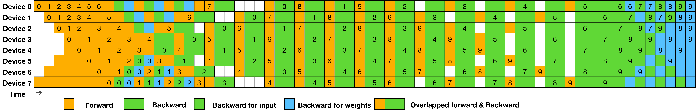

# 四张卡的梯度怎样汇合，通信又何时能隐藏

四张卡各自算完一部分样本以后，模型还不能马上进入下一步。它们必须先把梯度合到同一个值，或者把自己负责的分片交给相应的 rank。训练变慢时，问题可能在网络，也可能在 bucket 太晚就绪、某个 rank 掉队，或者 loss 的全局分母本来就不一致。通信重叠要从这条依赖链看，不能只看一张 timeline 上有多少色块叠在一起。

## 先把四个 rank 的梯度写出来

设四个rank的局部梯度分别为 `[1,2,3,4]`、`[10,20,30,40]`、`[100,200,300,400]`、`[1000,2000,3000,4000]`。求和结果为 `[1111,2222,3333,4444]`。

All-reduce让所有rank都拿到完整和。Reduce-scatter先求和，再把对应分片分别交给rank0到3，此例各得到一个数。随后all-gather这些分片，可以让所有rank重新得到完整向量。

“平均”需要再除以rank数4，不能把NCCL求和原语与框架梯度平均约定混为一谈。若各rank监督token数不同，局部loss还必须使用一致的全局分母，见[分布式训练](../training/distributed-training-and-checkpointing.md)。

## 参数放在哪里，collective 就要怎么选

普通DDP每卡有完整参数，平均梯度后可以各自执行相同更新。优化器状态分片后，每rank只更新自己负责的片段，reduce-scatter的结果恰好落在对应持有者。参数分片时，计算某层前可能需要all-gather重建所需参数，反向后再把梯度归约回分片。

张量并行则在一层内切分计算。若各卡算出输出的部分和，需要归约；若各卡持有不同输出通道，需要按后续算子要求保留分片或拼接。Collective由张量语义决定，不能单看并行策略名字。

## bucket 什么时候发出去

假设反向共有三段，每段耗时4个单位，每段产生一个梯度bucket，通信各耗时3。全部反向结束后再依次通信，总时间为12+9=21。若每个bucket一就绪就发送，通信分别可在4到7、8到11、12到15运行，最后完成时间为15。

这个教学时间线假设计算与通信能够独立重叠，没有争抢资源。实际NCCL可能使用SM、内存带宽或网络资源，与计算同时执行反而降低双方速度，需查看完整时间线。

小bucket更早就绪，但增加collective启动次数；大bucket提高传输效率，却推迟发送。最后一个bucket之后通常没有足够反向计算可隐藏它，暴露通信还与层顺序有关。

## Ring的字节模型能说明什么

对P个rank、每卡S字节数据，理想ring all-reduce每卡发送量约 $2(P-1)S/P$，由reduce-scatter与all-gather两段组成。简单时间模型还需加入每轮启动延迟，不能只用总字节除带宽解释小消息。

实际库可选tree、分层或其他算法，并受拓扑、消息尺寸与协议影响。这个公式用于建立量级，不表示某次运行一定用了ring。

## 重叠有没有省时间，看 step 的尾巴

Trace里通信和计算的色块相互覆盖，只说明时间上并发。真正收益取决于下一步需要的所有状态何时就绪。比较step结束时间、各rank拖尾、bucket就绪与完成时刻，才能判断通信是否被隐藏，还是只是换了一种等待位置。

{ width="900" }

<small>图源：[DeepSeek-V3 Technical Report](https://arxiv.org/abs/2412.19437)，Figure 5。原图表达 DualPipe 如何把双向 pipeline micro-batches 与通信/计算重叠起来；读图重点是通信优化的核心不是“少一次 collective”这么简单，而是把通信放到关键路径之外。它不能证明 DualPipe 适合所有并行度和拓扑。</small>

## 对照源码与延伸阅读

- [nanoGPT DDP反向同步与梯度累积位置](https://github.com/karpathy/nanoGPT/blob/3adf61e154c3fe3fca428ad6bc3818b27a3b8291/train.py)
- [MegaMoE对通信与计算联合调度的具体边界](https://github.com/deepseek-ai/DeepGEMM/blob/5081f8513af57e61696de4f4f04b0e707ffb503e/README.md)

## 从 trace 找到真正的等待点

先画出单个 micro-batch 的依赖图，再看 trace 中的时间段。一个通信事件只有在以下条件同时满足时，才可能隐藏在计算后面：产生它所需的梯度已经 ready、通信流与计算流没有被同一资源严重争抢、下一计算阶段不需要提前拿回结果。可以把每个 bucket 记录为：

```text
bucket_id, ready_time, launch_time, complete_time,
consumer_ready_time, rank, bytes, stream
```

`complete_time - launch_time` 变短，不代表 step 变短；如果 `consumer_ready_time` 没有提前，通信只是从一种等待位置移动到了另一种等待位置。应同时比较 step p50/p95、最后完成的 rank、每个 bucket 的暴露时间，以及通信对 GEMM 的反向影响。

## bucket 大小存在可测的折中

把梯度分成更多小 bucket，可以更早启动 reduce-scatter 或 all-reduce，但每次 collective 都有启动开销，并可能造成网络包碎片和 stream 调度压力。把 bucket 合并得很大，则传输效率可能更好，却要等更多反向计算结束。一个可复现的 sweep 至少包含 3 个 bucket 配置，并固定模型、micro-batch、梯度累积、拓扑和通信后端。

记录结果时不要只报吞吐。建议同时保存：总通信字节、collective 次数、平均/最大 bucket ready 时间、step p95、通信期间的 SM 利用率和网络链路利用率。若小 bucket 只在理想空闲网络上有收益，在线负载下仍可能退化。

## 最小正确性回放

性能实验前先用单卡、双卡和目标 world size 各跑一个短步回放，验证：

1. 全局 loss 的分母与有效 token 数一致；
2. 梯度累积和通信顺序与无重叠基线一致；
3. checkpoint 恢复后的参数、优化器状态和 RNG 仍能重现下一步；
4. rank 之间出现不同长度或空 bucket 时不会死锁。

这组回放不能证明所有拓扑都快，却能排除“通过改变归约语义换来的吞吐”。NCCL Tests 适合做 collective 量级检查，框架 trace 仍是判断真实训练关键路径的必要证据。

## 来源和可复查入口

collective 的语义和进程组接口对照 [PyTorch Distributed 文档](https://docs.pytorch.org/docs/stable/distributed.html)，通信算法和拓扑相关的边界对照 [NCCL 用户指南](https://docs.nvidia.com/deeplearning/nccl/user-guide/docs/overview.html)。梯度 bucket 与计算重叠的讨论还参考了 [DeepSeek-V3 Technical Report](https://arxiv.org/abs/2412.19437) 中 DualPipe 的调度图。文中的四个向量、时间线和 bucket 表是本站构造的算例，用来检查依赖和分母，不代表任何特定网络的 benchmark。

可以把同一组局部梯度分别用 `all_reduce` 和 `reduce_scatter` 表达，再比较每个 rank 在下一次矩阵计算前究竟需要哪一份数据。若两种写法的参数更新不同，先查求和、平均和有效 token 分母，再查通信原语。

这条回放可以接到[分布式训练与 checkpoint](../training/distributed-training-and-checkpointing.md)，看通信状态怎样随恢复一起保存；硬件侧再对照[GPU 互联与拓扑](gpu-interconnects-and-topology-mapping.md)，判断链路位置是否改变了重叠效果。
