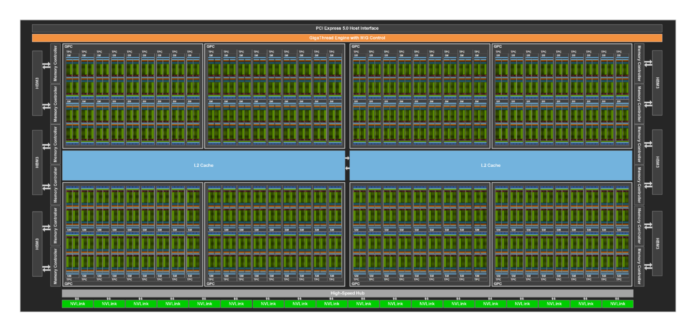
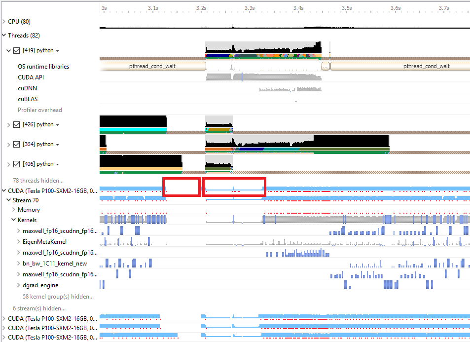

# CUDA 中，一个元素怎样找到负责它的线程

要计算长度1000的向量加法，可以让每个CUDA线程处理一个位置。这个例子足够小，却包含实际kernel最基本的三个问题，谁负责哪个输出、怎样找到输入地址，以及边界位置能否安全访问。

## 从输出位置反推 launch

若每个block有256个线程，需要4个block。线程的全局索引为

```cpp
int i = blockIdx.x * blockDim.x + threadIdx.x;
if (i < n) out[i] = x[i] + y[i];
```

block 0负责0到255，block 3理论上覆盖768到1023，最后24个线程必须跳过访问。这个条件需要保护读取和写入；只给store加判断，越界load仍然可能出错。

CUDA的block被调度到SM，线程按warp执行。在NVIDIA CUDA设备上warp包含32个线程，因此256线程block包含8个warp。Block之间没有天然的全局执行顺序，不能让后一个block假定前一个block已经写完数据。

{ width="920" }

<small>图源：[NVIDIA Hopper Architecture In-Depth](https://developer.nvidia.com/blog/nvidia-hopper-architecture-in-depth/)。原图展示 GH100 的 GPC、TPC、SM、L2、HBM 控制器和互连模块。这里用它说明：kernel 不是跑在一个抽象“GPU”上，而是被分配到许多 SM 和共享内存系统里；SM 利用率高，不代表 HBM、L2、launch、同步和通信都不是瓶颈。</small>

## 连续索引为什么有帮助

若x是连续FP32数组，相邻32个线程访问相邻32个元素，逻辑上覆盖128字节连续数据。硬件能将请求组织成较少的内存事务，实际事务数量还受对齐和架构影响。

如果每个线程改为读取 `x[i*32]`，同一warp访问就跨得很远。数学上仍是32次load，物理上可能需要更多事务。这个差别称为访存合并问题，不能仅由元素数量判断。

二维张量也一样。行优先矩阵的元素地址为 `base + row*stride_row + col*stride_col`。维度相同而stride不同的输入，会让同一索引代码访问完全不同的位置。

## 数据在哪一层被重复使用

向量加中每个输入通常只使用一次，刻意先搬到shared memory不一定有益。矩阵乘不同，一块A会与多列B相乘，一块B会被多行A使用。把这些块放进片上可共享存储，可以避免重复从更远层级取数据。

寄存器主要保存线程的局部值与累加器，shared memory供同一block协作，L2是更大范围共享的缓存，HBM保存主体张量。编译器因寄存器不足而使用的local memory，名字里虽有local，却通常位于设备内存地址空间，经缓存访问，并不等于片上寄存器。

CUTLASS的CuTe入门GEMM依次执行global到shared的copy、等待与block同步、GEMM累加，再同步以防下一轮覆盖尚在读取的数据。数据复用带来收益，也引入生命周期与同步要求。

## 同步必须对应真实依赖

一个线程刚写完shared memory，不代表同一block其他线程已经看到了各自需要的全部值。协作计算需要适当同步。反过来，没有共享依赖时添加同步只会增加等待。

全block屏障不能随意放在部分线程进入的分支里，否则其他线程可能永远不会到达。边界处理常通过mask让所有线程沿相同协作结构执行，再忽略无效元素。

{ width="760" }

<small>图源：[Nsight Systems Exposes New GPU Optimization Opportunities](https://developer.nvidia.com/blog/nsight-systems-exposes-gpu-optimization/)。原图展示 GPU 时间线中的空洞。这里用它说明：如果 GPU 没拿到活，瓶颈可能在 CPU 调度、同步、数据准备或 launch 组织，而不是某个 kernel 算得慢。</small>

## 更多驻留线程为何未必更快

SM可同时驻留多少block，受到线程、寄存器和shared memory资源限制。更大tile提高复用，也可能增加累加器与缓存需求，减少并发block；溢出到local memory后甚至新增访存。

Occupancy描述驻留程度，不直接等于性能目标。若一个kernel已经充分利用矩阵指令和数据复用，强行提高occupancy可能破坏更重要的条件。先用[成本模型](kernel-cost-models-and-selection-heuristics.md)估算需要搬多少数据，再用[profiling](profiling-debugging-and-numerical-stability.md)确认实际瓶颈。


## 对照源码与延伸阅读

- [CuTe sgemm_1 的 copy、同步与累加循环](https://github.com/NVIDIA/cutlass/blob/e13f5cd4142c43efc37c2f6339923eb4a57afb99/examples/cute/tutorial/sgemm_1.cu)
- [相同向量加任务的 Triton 映射](https://github.com/triton-lang/triton/blob/cd2e01c6686d6503802e6cdfac56d5a5dfdb27a1/python/tutorials/01-vector-add.py)
