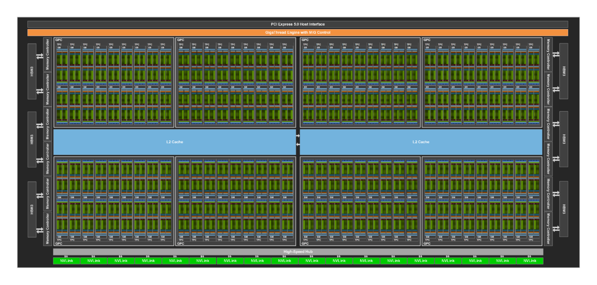
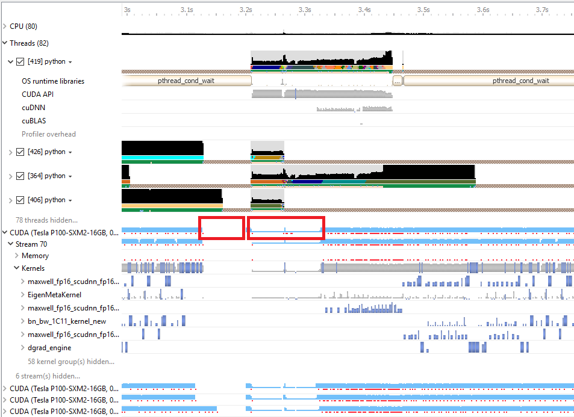

# CUDA 编程模型与内存层次：先画数据怎么走

CUDA 优化不是把一段 for 循环拆成很多线程就结束。真正要判断的是：一个算子里的数据，从 HBM 进来以后，怎样经过 L2、shared memory、register、Tensor Core 或普通 CUDA core，最后再写回 HBM。只要这条数据路径画不清，thread、block、warp、occupancy、coalescing 这些词就会变成散乱术语。

对 AI kernel 来说，性能差距通常不是公式差距，而是数据流差距。PyTorch 默认算子、Triton 原型、CUTLASS kernel 和手写 CUDA 可能都在算同一个数学表达式，但它们搬了多少数据、复用了多少片上缓存、写回了几次中间张量、有没有命中 Tensor Core，都会完全不同。

一个粗略的判断式可以这样读：

\[
T \approx \max\left(\frac{\text{FLOPs}}{\text{compute peak}}, \frac{\text{bytes moved}}{\text{memory bandwidth}}\right) + T_{\text{launch}} + T_{\text{sync}}
\]

这行式子不是用来精确预测延迟，而是提醒你先分清瓶颈：计算量是否接近峰值，搬运字节是否被 HBM 带宽限制，launch 和同步是否把短 kernel 切碎。CUDA 优化的大部分技巧，都在减少搬运、增加复用、隐藏延迟或减少不必要同步。

## 程序员写 thread/block，硬件调度 warp/SM

CUDA kernel 由 CPU 侧 launch，GPU 侧执行。程序员组织的是 grid、block 和 thread；硬件真正执行时，thread 会以 warp 为基本调度单位，block 会被放到 SM 上，SM 再根据 register、shared memory、warp 数和调度资源决定能同时驻留多少工作。

| 层级 | 应该怎么理解 | 影响什么 |
| --- | --- | --- |
| thread | 一小段标量逻辑和私有寄存器 | register pressure、边界分支、局部计算 |
| warp | 通常 32 个 thread 一起调度 | 分支发散、coalescing、warp reduce |
| block | 可以共享 shared memory 的线程组 | tile 大小、同步、片上缓存复用 |
| grid | 一个 launch 覆盖的全部 block | 输出覆盖、长尾 shape、launch 粒度 |
| SM | 执行 block/warp 的硬件单元 | occupancy、Tensor Core、调度和资源驻留 |

初学 CUDA 最容易误会“线程很多就等于 GPU 忙”。GPU 忙不忙要看 warp 是否有足够并发隐藏延迟，block 是否能均匀铺到 SM，访存是否连续，shared memory 是否冲突，Tensor Core 是否拿到合适的 dtype、shape 和 layout。

{ width="920" }

<small>图源：[NVIDIA Hopper Architecture In-Depth](https://developer.nvidia.com/blog/nvidia-hopper-architecture-in-depth/)。原图展示 GH100 的 GPC、TPC、SM、L2、HBM 控制器和互连模块。这里用它说明：kernel 不是跑在一个抽象“GPU”上，而是被分配到许多 SM 和共享内存系统里；SM 利用率高，不代表 HBM、L2、launch、同步和通信都不是瓶颈。</small>

## 内存层次决定大多数 AI kernel 的上限

GPU 内存不是一块统一大数组。register 最快但只属于单个 thread；shared memory 在一个 block 内共享，适合保存 tile 和局部统计；L2 被多个 SM 共享，能缓冲跨 block 或跨请求的访问；HBM 容量大但延迟高，反复读写中间张量会很贵。

| 位置 | 典型用途 | 主要风险 |
| --- | --- | --- |
| register | 累加器、局部标量、fragment | 用太多会降低驻留 warp，严重时 spill |
| shared memory | GEMM tile、softmax 局部统计、producer-consumer buffer | bank conflict、容量限制、同步开销 |
| L2 | KV page、权重/激活缓存、跨 SM 复用 | 访问模式太散时命中率低 |
| HBM/global memory | 权重、激活、KV cache、输出张量 | 带宽和延迟常成为瓶颈 |

LayerNorm 是一个容易理解的例子。若均值、方差、归一化、scale、residual 被拆成多个 kernel，中间结果就会多次写回 HBM。融合后，局部统计可以留在 register 或 shared memory，少走几趟 HBM。GEMM、attention、quant/dequant、MoE routing 也是同一个原则：尽量让数据进片上以后多做几件事，再写回。

## 访存要连续、对齐、可复用

一个 warp 里的线程如果访问连续且对齐的地址，硬件可以把它合并成更少的 memory transaction；如果线程各读各的随机位置，带宽会被许多小事务吃掉。这就是 coalescing 的核心。

GEMM 的 tiling 也是同一个道理：把一小块 \(A\) 和一小块 \(B\) 搬进 shared memory，让它们服务多个输出元素，而不是每个输出都从 HBM 重新读一遍。高性能 attention 则进一步把 online softmax、block 级统计和 KV 读取组织在一起，避免显式写出完整 score 矩阵。

写 kernel 时可以先问四个问题：这个 tile 被复用几次；warp 读写是不是连续；shared memory 是否有 bank conflict；GEMM 或 reduce 后面的 bias、activation、scale、residual 能不能融合到 epilogue。比起“换一种写法”，这些问题更接近性能本质。

## Tensor Core 需要 dtype、shape 和 layout 一起配合

Tensor Core 是现代 LLM 训练和推理的吞吐核心，但不是所有矩阵乘都会自动快。FP16、BF16、FP8、INT8、INT4 各自对应不同 MMA 路径、scale 规则和 kernel 实现。shape 太小、layout 不对、边界太碎、epilogue 太复杂，都会让理论 TFLOP/s 变成纸面数字。

prefill 阶段的 batch 和 token 数通常更大，更容易让大矩阵乘接近高吞吐路径。decode 阶段常见小 batch、短 M 维、KV page 查找、dequant、采样和请求调度，瓶颈可能从 Tensor Core 转到 memory、runtime 或小 kernel launch。

所以不要只问“有没有 Tensor Core”。更可靠的检查是：dtype 是否命中目标 MMA 指令；M/N/K 是否规则；是否额外 transpose 或 contiguous；epilogue 是否融合；热 shape 是否集中；fallback 是否进入了默认 GEMM 或标量路径。

## Occupancy 只是工具，不是目标

Occupancy 表示 SM 上驻留 warp 数相对理论最大值的比例。它能帮助判断有没有足够并发隐藏内存延迟，但它不是最终目标。

有些高性能 kernel 会主动牺牲 occupancy，用更多 register、更大的 tile 或更多 shared memory 换数据复用。反过来，occupancy 很高也可能慢：kernel 可能 bandwidth-bound，可能 shared memory conflict 严重，可能大量线程在处理 mask 和边界，可能 Tensor Core 一直等数据。

正确目标是端到端延迟、吞吐和质量稳定。Profiler 里的任何单项指标都只能解释一部分原因，不能单独代表 kernel 好坏。

## Profiling 先看系统时间线，再看单个 kernel

Nsight Systems 和 Nsight Compute 的分工要分清。Nsight Systems 看系统时间线：CPU launch、CUDA API、GPU stream、memcpy、同步、NCCL、NVTX range 和空洞。Nsight Compute 看单个 kernel：memory transaction、warp stall、occupancy、SM throughput、Tensor Core 利用和 roofline。

{ width="760" }

<small>图源：[Nsight Systems Exposes New GPU Optimization Opportunities](https://developer.nvidia.com/blog/nsight-systems-exposes-gpu-optimization/)。原图展示 GPU 时间线中的空洞。这里用它说明：如果 GPU 没拿到活，瓶颈可能在 CPU 调度、同步、数据准备或 launch 组织，而不是某个 kernel 算得慢。</small>

一个实用排查顺序是：先用 Nsight Systems 看 GPU 是否经常空着，CPU 是否被同步、JIT、数据准备或 Python 调度卡住；再选关键 kernel 用 Nsight Compute 看 memory throughput、warp stall、Tensor Core 和 roofline；最后回到端到端 trace，确认优化没有被前后的 cast、copy、transpose、fallback 或通信等待抵消。

## 常见 AI kernel 应该按主矛盾看

| Kernel 类型 | 主矛盾 | 先看什么 |
| --- | --- | --- |
| GEMM | Tensor Core 与数据复用 | tile、layout、MMA、epilogue fusion |
| Attention | score/KV 访问与 softmax 统计 | block、online softmax、paged KV、GQA/MQA |
| Softmax / Reduce | 归约和数值稳定 | warp reduce、分块统计、中间写回 |
| LayerNorm / RMSNorm | HBM 带宽 | 向量化 load/store、融合 residual/scale |
| Quant / Dequant | scale 读取和类型转换 | scale layout、group size、fused dequant |
| MoE routing | 不规则访存和负载不均 | token grouping、expert batching、permute fusion |

这些 kernel 的形态不同，但底层判断相同：数据是否连续，是否复用，是否少写 HBM，是否能让计算和搬运重叠，是否能用 trace 证明收益真的落到热路径。

## 收束判断

CUDA 入门最该记住的不是 API 名，而是数据路径。先画出 HBM、L2、shared memory、register 和 Tensor Core 之间的数据流，再决定 thread/block 怎么分、tile 多大、是否融合、是否需要 Triton/CUTLASS/手写 CUDA。这样读后续的 FlashAttention、FP8 GEMM、MoE routing、KV cache 和 CUDA Graph，才不会被工具名牵着走。

## 外部精读

- [CUDA C++ Programming Guide](https://docs.nvidia.com/cuda/cuda-c-programming-guide/)：CUDA 编程模型、线程层级、内存空间和同步语义的官方入口。
- [CUDA C++ Best Practices Guide](https://docs.nvidia.com/cuda/cuda-c-best-practices-guide/)：查 coalescing、occupancy、memory throughput、shared memory 和 profiling 方法。
- [NVIDIA Hopper Architecture In-Depth](https://developer.nvidia.com/blog/nvidia-hopper-architecture-in-depth/)：理解 GH100/H100 的 SM、HBM、L2、Tensor Core、TMA 和互连背景。
- [Nsight Systems User Guide](https://docs.nvidia.com/nsight-systems/UserGuide/index.html)：理解系统级 timeline、CUDA trace、NVTX 和 CPU/GPU 关联。
- [Nsight Compute Documentation](https://docs.nvidia.com/nsight-compute/NsightCompute/index.html)：理解单 kernel 指标、roofline、memory 和 scheduler 计数器。
- [CUTLASS GEMM API documentation](https://docs.nvidia.com/cutlass/latest/media/docs/cpp/gemm_api.html)：理解 GEMM tile、threadblock、warp、MMA 和 epilogue 的组织方式。
