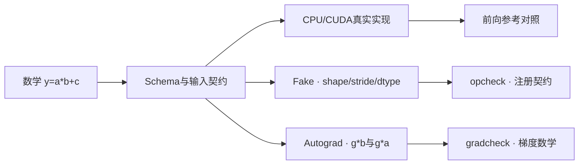

# 自定义乘加算子怎样接入 PyTorch

设要实现逐元素 $y=a\times b+c$，a与b是同shape tensor，c是标量。GPU kernel只负责算出值；PyTorch还需要知道这个操作的参数、返回shape、设备实现和反向公式，才能把它接进训练与编译图。

## Schema定义框架能依赖的事实

官方C++自定义算子教程用 `mymuladd(Tensor a, Tensor b, float c) -> Tensor` 声明接口，再分别注册CPU与CUDA实现。实现需检查shape、dtype、device与支持的layout。

若kernel会修改输入，schema必须准确标记mutation和alias关系，否则编译器可能按纯函数假设重排或消除操作。更快的设备代码无法补救错误的框架契约。

## Fake实现让编译器只看元数据也能推演

图编译时不一定执行真实数值。FakeTensor实现应依据输入shape、stride、dtype和device返回正确的输出元数据。对于本例，检查a/b同shape等条件后，返回相应空输出即可，不应读取tensor数据来决定结果。

`register_fake`不能取代CUDA实现；它只回答“结果会长什么样”。若真实kernel输出连续布局，fake实现却承诺另一种stride，编译器可能在后续推演中作出错误选择。

## 训练需要一个明确的反向公式

若上游梯度为g，则

$$
\partial L/\partial a=g\odot b,\qquad
\partial L/\partial b=g\odot a.
$$

本例c是普通标量参数，不作为可训练tensor返回梯度。若将c改为tensor并允许广播，反向还需要沿广播维求和，接口和公式都要一起变化。

官方教程通过 `register_autograd` 注册backward与保存上下文的方法。Backward使用框架理解的操作组合；若其中再调用自定义CUDA核，它也需要自己的注册边界。

<!-- systems-workflow-visual -->

前向、元数据和反向各有独立验证，opcheck不能替代梯度正确性检查。

## 三种验证回答三个不同问题

先把输出与 `a*b+c` 比较，覆盖尾部长度、非连续输入和极值，验证前向数学。再用手算或 `torch.autograd.gradcheck` 检验梯度，通常在适合数值差分的高精度小输入上进行。最后用 `torch.library.opcheck` 检查注册与框架协作。

`opcheck`不验证梯度公式是否数学正确，这是官方教程明确写出的边界。Eager能跑也不代表compile、autograd或图捕获都能跑，需要检查实际支持的调用环境。

## 接入后才有完整性能账

若wrapper为了兼容输入先调用 `contiguous()`，或返回前额外同步，这些成本属于完整算子。分别比较kernel耗时与算子端到端耗时，再测它在真实层里的占比。

一个只能处理连续输入的快路径可以保留，但必须明确拒绝或分流其他输入。比起让所有输入悄悄复制，显式适用条件更容易解释实际收益。

{ width="820" }

<small>图源：[NVIDIA Nsight Systems / NVTX 文档](https://docs.nvidia.com/nsight-systems/)。原图表达用 NVTX 标记把 kernel、CPU 调用和时间线串起来；读图重点是：自定义 op 是否真的进了热路径，需要 profiler、dispatch、fallback 和端到端 trace 一起验证。它不能证明某个 custom op 正确或更快，只说明验证入口应该在哪里。</small>

## 代码入口和下一步阅读

- [PyTorch mymuladd 的schema、fake、autograd和测试教程](https://github.com/pytorch/tutorials/blob/5672cd98a7671eda4d9122b10f8eec580f74d03e/advanced_source/cpp_custom_ops.rst)

## 把 custom op 当成一个版本化接口

发布前保存 schema、支持的 dtype/layout/device、是否可变、fake 输出约定、autograd 行为和 fallback 策略。输入契约发生变化时，应增加版本或更新测试，而不是让 wrapper 静默接受旧调用。尤其要记录是否允许非连续输入、是否保持 stride、是否支持 CUDA Graph 和 `torch.compile`。

## 最小 CI 矩阵

至少覆盖：CPU 参考、CUDA 快路径、连续/非连续输入、空与尾部 shape、前向、`gradcheck`、`opcheck`、compile、autograd、异常输入和 fallback。性能测试另用固定设备和 warmup，不能把 CI 中一次最小时间当作性能结论。

若只支持连续输入，测试应明确验证非连续输入被拒绝或安全复制；若支持广播，需单独检查广播维的梯度归约。把这些契约写进错误信息，维护者才能判断是调用不合法还是 kernel 回归。

## 自测：哪一层出了问题

如果 eager 前向通过、`opcheck`通过，但 `gradcheck`失败，优先检查反向公式；如果前向和梯度都通过、`torch.compile`失败，优先检查 fake 元数据、alias 或 mutation 声明；如果全部通过但完整层变慢，检查转换、同步和 fallback。这个分层比只看“算子能运行”更接近真实集成。

**来源与改编说明**：schema、fake、autograd、`gradcheck` 和 `opcheck` 的职责边界参考 PyTorch 自定义算子教程。算子测试矩阵是本站整理的工程检查，不代表任何自定义实现已经通过验证。

如果前向和注册契约已经稳定，下一步可以读[算子测试、回归与维护](testing-regression-and-maintenance.md)，把错误输入、版本升级和性能回归纳入同一套记录；需要改写 kernel 时，再接着看[Triton 编程模型与自动调优](triton-programming-model-and-autotuning.md)。先确认框架接口，再优化设备代码，排查路径会短很多。
