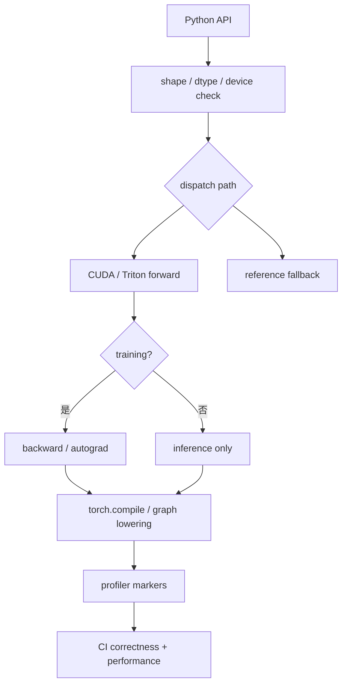

# 自定义算子与框架集成

很多人第一次写自定义 kernel 时，会把注意力放在“这个 kernel 跑得够不够快”。但在真实工程里，性能只是其中一部分。一个自定义算子想真正进入训练或推理系统，还必须解决框架调用、autograd、图编译、profiler、shape / dtype / device dispatch、fallback、测试和版本演进。

<!-- [补充] -->
| 读者 | 建议读法 | 工程落点 |
| --- | --- | --- |
| 初学者 | 先抓“自定义算子与框架集成”要解决的问题、关键术语和最小例子；公式只看变量方向。 | 能说清输入、输出和常见失败信号。 |
| 工程师 | 直接对照结构、指标、成本和边界条件，必要时回到前置页补概念。 | 落到数据、算力、延迟、显存、评测和回滚检查。 |

!!! note "读法定位"
    这页先回答“自定义算子与框架集成”在「算子与编译器」里的位置：它解决什么局部问题，依赖哪些前置，最后会影响哪类工程或研究判断。
    **前置**：先理解张量 shape、显存层次和 GEMM；系统指标卡住时回推理或训练专题。 必要时先回 [算子与编译器入口](index.md)、[基础知识](../foundations/index.md) 或 [术语表](../glossary/index.md)。
    **主线关系**：把模型里的矩阵乘、attention、通信和低精度路径落到 GPU 时间线上，看瓶颈如何被 kernel 与编译栈改变。

因此“自定义算子开发”其实更像一条完整集成链，而不是孤立的 kernel 编写。

!!! note "合并提示"
    **note · 初学者先抓住**

    一个 custom op 的工程价值不只在快，还在能不能被框架稳定调用、能不能反向传播、能不能 profile、能不能 fallback、能不能覆盖真实 shape。只写出一个 microbenchmark 很快的 CUDA kernel，还不算真正接入系统。

    **example · 有趣例子：赛车发动机装不上车**

    发动机单独测试很强，但如果接口、散热、变速箱和维护都不匹配，整车上路仍然失败。自定义算子也是：kernel 快只是零件好，框架集成才决定能不能上生产线。

<!-- [补充] -->
> **踩坑原因**：这类工程问题通常不是单点公式错，而是 shape、资源预算、并发路径和观测指标之间有一个假设没对齐；先把触发条件、监控信号和回滚边界拆开查。

## 为什么很多高性能 kernel 最终没被用起来

<!-- [融合：算法基础] 来源：llm-algo-leetcode《08. Programming Models CUDA Triton | 编程模型演进 (Programming Models: CUDA & Triton)》-->
> **算法视角**：算子优化先要还原成 GEMM、reduce 或 elementwise 的块级数据流；Triton/CUDA 章节里的 tile、mask、program id 和 autotune，都是在控制同一数学操作的访存复用和并行粒度。
>
> 延伸阅读：[08. Programming Models CUDA Triton | 编程模型演进 (Programming Models: CUDA & Triton)](https://datawhalechina.github.io/llm-algo-leetcode/01_Hardware_Math_and_Systems/08_Programming_Models_CUDA_Triton.html)

<!-- [融合：复杂度分析] 来源：llm-algo-leetcode《08. Programming Models CUDA Triton | 编程模型演进 (Programming Models: CUDA & Triton)》-->
| 操作 | 时间复杂度 | 空间复杂度 | 说明 |
|------|-----------|-----------|------|
| GEMM $C=A B$ | $O(MNK)$ | $O(MK+KN+MN)$ | tile 的意义是提高 SRAM / register 复用，减少 HBM 往返；参考：[对应章节](https://datawhalechina.github.io/llm-algo-leetcode/01_Hardware_Math_and_Systems/08_Programming_Models_CUDA_Triton.html) |
| reduce / norm / softmax | $O(N)$ | $O(N)$ 或一行工作集 | 这类算子常是 bandwidth-bound，融合可以减少读写次数。 |

常见原因不是它不够快，而是集成太难、只支持少量 shape、autograd 路径缺失、无法进入 graph compile、fallback 和错误处理太弱，或部署、打包和兼容成本太高。

也就是说，真正让一个 kernel 有工程价值的，不只是性能，而是可接入性。

## 自定义算子的典型组成

一个较完整的 custom op 通常包含前端 API、shape / dtype 检查、forward kernel、backward kernel 或 autograd 定义、dispatch 注册、测试与 benchmark，必要时还要补图编译兼容和 profiler 标记。

### 2.1 为什么这和“写个 CUDA 文件”不是一回事

因为一旦进入真实系统，你还要考虑 contiguous 和 non-contiguous 输入、CPU fallback 或 error path、多卡与 stream 语义、mixed precision、编译缓存和运行时加载。

## 集成链路图

自定义算子只写 kernel 等于只完成了中间一格。真正进入系统，需要 API、dispatch、fallback、autograd、compile、profile 和 CI 都接上。每缺一格，线上就可能出现“单测很快，真实路径没用上”的情况。

## 与 PyTorch 集成时要想清楚的几件事

### 3.1 接口边界

先判断这个 op 是完全替换现有算子、作为 fused op、只服务某些 shape，还是只服务训练/推理中的一条路径。不同定位会决定 API 如何设计、fallback 如何写，以及是否需要多个后端实现。

### 3.2 Autograd 边界

如果是训练路径，还必须考虑 backward 是否自己写、是否可由已有算子组合求导、中间缓存如何保存，以及 backward 是否也要高性能。

很多 kernel 的集成难点其实不在 forward，而在 backward。

## 与 `torch.compile` / 图编译的关系

自定义算子如果完全绕开图编译器，有时会导致断图、融合机会丢失、上层优化无法继续穿透，profiler 也只能看到一大片黑盒。这并不意味着不能写 custom op，但你需要清楚它是否值得成为黑盒边界，是否会阻断更大的图优化，以及是否只在真正热点处使用。

## Triton 自定义算子与 CUDA 自定义算子的差异

### 5.1 Triton

Triton 的优势是开发快、适合快速试 fusion、与 Python / PyTorch 路径更近；代价是某些极致优化、复杂同步和特化路径不如底层 CUDA 灵活。

### 5.2 CUDA

CUDA 的优势是底层控制更强、可做更极致特化、对复杂同步和特定硬件路径支持更充分；代价是集成与维护成本更高，开发调试更慢，对团队要求也更高。

## 什么时候值得做 custom op

通常需要同时满足多项条件才值得做：热点明显、默认实现慢、可融合收益明确、形状相对稳定，并且业务收益足以覆盖维护成本。

如果只是“理论上也许能快一点”，往往不值得。

## 测试与验收不能省

一个可上线的 custom op 至少要经过正确性对比、多 shape 测试、dtype 测试、contiguous / stride 测试、训练或推理端到端回归、profiler 对照和 fallback 验证。

否则一个快 kernel 很容易变成线上隐患。

## 版本演进与兼容

自定义算子不是“一次写完永远不动”的资产。  
它会持续受新 GPU 架构、新 PyTorch 版本、编译器后端变化、shape 分布变化和模型结构变化影响。因此一个工程上成熟的 custom op，必须有版本管理、持续 benchmark、fallback 和清晰的适用边界。

## 接口契约模板

| 契约项 | 要写清楚什么 |
| --- | --- |
| 输入 shape | 支持哪些维度、哪些 bucket、是否允许 dynamic shape |
| dtype | FP32/BF16/FP16/FP8/INT8 各自路径和误差阈值 |
| layout | contiguous、channels-last、stride、alignment 要求 |
| autograd | backward 是否自定义，保存哪些中间量 |
| compile | eager、`torch.compile`、ONNX/TensorRT 是否支持 |
| fallback | 不支持 shape/dtype/device 时走哪里，是否记录 |
| profile | kernel name、NVTX range、版本号如何显示 |

这个模板很朴素，但能显著降低维护风险。没有接口契约的 custom op，过几个月后通常没人敢改，也没人知道为什么某些 shape 被排除。

## 直觉例子

自定义算子就像为工厂定制一台专用设备。设备本身可能很快，但如果它接不上现有流水线、维护手册不全、只能处理一种规格的零件、坏了又没有备用流程，那么它的工程价值就会大打折扣。真正有价值的 custom op，不只是“局部最快”，而是能顺滑进入整条生产线。

## 本页结论

自定义算子开发的关键，不只是 kernel 写得快，而是把性能、集成、autograd、图编译、测试、fallback 和版本演进放在同一张设计图里。只有这样，一个自定义 kernel 才会从 demo 变成真正可维护、可部署、可复用的系统组件。

## 工程收束

自定义算子要从 API 语义、张量布局、autograd、打包发布和兼容矩阵开始设计。原型能跑不代表集成成本可接受；上线前应先定义接口契约，提供参考实现，把构建与测试自动化，并记录支持限制，尤其要同时覆盖 eager、compile 和 runtime 路径。

真正值得保留的 custom op，应该能被新同事理解、被 CI 复验、被框架升级压力测试，并且在不适用的 shape 或硬件上自动走回安全路径。

## 真实排查案例：自定义算子在 `torch.compile` 后悄悄失效

**输入症状**：Eager 模式下 custom RMSNorm 快 30%，接入 `torch.compile` 后端到端没有收益，某些 batch 还出现数值差异报警。

**关键指标**：Eager benchmark 命中 custom op；compile 模式下 kernel 名称消失，图里出现 framework fallback；数值误差集中在 BF16 和非 contiguous 输入；CI 只覆盖了 contiguous FP16。

**Nsight / trace 观察**：trace 显示 compile 路径没有调用自定义 kernel，而是图重写后走了默认实现；fallback 前多了一次 `contiguous` 拷贝；少数输入 stride 触发参考实现。

**判断**：自定义算子只集成了 eager API，没有把图编译、stride 契约和 dtype 边界写进接口。性能收益在真实运行路径里没有兑现。

**修复**：补充 custom op 的 meta function、decomposition / lowering 规则和 stride 检查；CI 覆盖 eager、compile、FP16/BF16、contiguous/non-contiguous；fallback 必须打日志并计入性能回归。

**反例**：如果目标系统永远只跑 eager 离线脚本，compile 集成可以延后；但只要进入生产训练或推理图，custom op 就必须以“完整框架路径”验收，而不是只验单函数。

!!! tip "下一站"
    - 回到本专题入口：[算子与编译器](index.md)，确认这页在整条路线中的位置。
    - 按导航顺序继续：[Runtime Dispatch](runtime-dispatch-and-kernel-selection.md)。
    - 概念或符号卡住时，先查 [术语表](../glossary/index.md)，再回到当前页。
