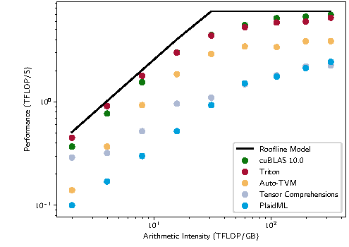

# CuTe 怎样把矩阵坐标映射到线程和存储

矩阵乘需要同时描述数学坐标、内存位置与线程负责的片段。CuTe用layout表达这些映射，CUTLASS再用组合好的复制、矩阵运算和流水组件构造kernel。读源码时先追映射，比先记住模板类型名称更容易。

## 从二维坐标算出线性地址

一个2×3的行优先矩阵，layout可写成shape(2,3)、stride(3,1)。坐标(i,j)映射到 $3i+j$，因此(1,2)位于偏移5。若stride为(1,2)，则同一坐标位于偏移5，但其他坐标顺序不同，(0,1)从偏移1变成2。

Shape描述有效坐标范围，stride描述地址增量。逻辑shape相同，不意味着连续维相同，也不意味着最合适的线程分工相同。

## local_tile先选出一个block负责的区域

CuTe的 `sgemm_1.cu`把全局A、B、C构造成tensor视图，用 `local_tile`按CTA坐标选出当前输出块及相关K块。随后为copy和计算分别建立线程分区。

负责搬A的线程布局与负责累加C的线程布局可以不同。一种布局优化全局读取，另一种优化计算与寄存器分配。二者在shared memory处对接，因此必须保证大家对数据坐标的解释一致。

<!-- systems-workflow-visual -->

搬运布局与计算布局可以不同，shared memory是它们交换数据的接口。

## 主循环沿K逐块推进

该入门实现先copy当前A/B块到shared memory，等待异步拷贝完成并做block同步，再调用 `gemm`把乘积加进寄存器片段。计算后再次同步，避免下一轮写shared memory时还有线程在读旧块。

最后的epilogue将累加器按 $\alpha AB+\beta C$ 写回。这里alpha/beta与深度学习里的量化scale没有相同含义，不能仅凭变量名关联。

这个教程展示清楚的数据流，不能把它的每个同步点当成最高性能流水设计。更高级实现会重叠搬运与计算，并使用具体架构的矩阵指令和存储能力。

## 图编译器与kernel库位于不同层

图编译器能看到算子之间的数据依赖，可能合并逐元素操作、选择layout或调用库GEMM。Kernel库专注一个或一组计算的设备执行。若图层在库调用前插入转置复制，单测GEMM速度就不足以解释完整层。

Triton也允许直接描述块、地址与归约；CuTe/CUTLASS暴露的布局与架构组件有不同组织方式。选择哪种工具，应看是否需要现成库覆盖、定制epilogue、特殊layout或硬件指令，而非给语言排固定性能顺序。

## 阅读一个新kernel的可执行顺序

先固定M/N/K和输入stride，手算一个输出坐标对应哪些输入。再找到tile坐标、线程分区和copy，确认数据在shared与register的存活区间。最后检查同步与epilogue，并把编译出的资源使用与profile对照。

如果某一步无法确定坐标含义，先缩成小矩阵打印或构造参考实现。模板能编译只说明类型组合合法，不证明它计算了预期矩阵方向。

{ width="760" }

<small>图源：[Triton: An Intermediate Language and Compiler for Tiled Neural Network Computations](https://doi.org/10.1145/3315508.3329973)，Figure 1。原论文图意：在矩阵乘 \(C=AB^T\) 上比较 cuBLAS、Triton、Auto-TVM、Tensor Comprehensions 和 PlaidML 相对 roofline model 的性能位置。</small>

## 对照源码与延伸阅读

- [CuTe sgemm_1 的layout、local_tile、copy与gemm](https://github.com/NVIDIA/cutlass/blob/e13f5cd4142c43efc37c2f6339923eb4a57afb99/examples/cute/tutorial/sgemm_1.cu)
