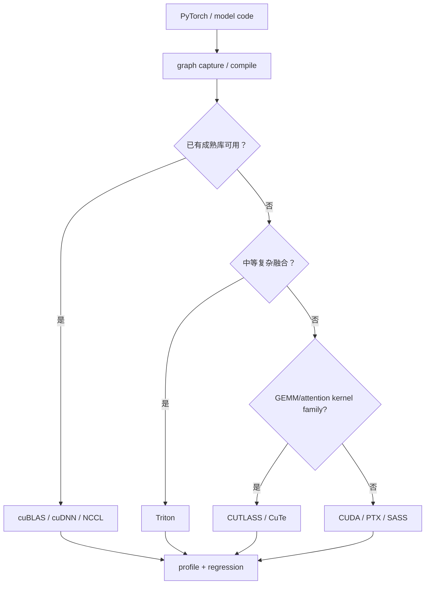
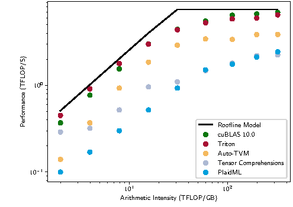

# CUTLASS / CuTe 与编译栈

AI kernel 工程里常见误解是：既然已有 `torch.compile`、Triton、cuBLAS、TensorRT，为什么还要理解 `CUTLASS`、`CuTe`、模板库、DSL 和图编译器？真正原因是，AI 系统不是单一抽象层能解决的。不同工具分别负责图级融合、库级高性能基元、模板级可组合 kernel，以及更低层的 layout、MMA、流水线和访存控制。

这页建立一张从模型图到 GPU 指令的中间栈地图。

> **踩坑原因**：这类工程问题通常不是单点公式错，而是 shape、资源预算、并发路径和观测指标之间有一个假设没对齐；先把触发条件、监控信号和回滚边界拆开查。

## 从模型图到硬件执行

一个训练或推理系统从上到下大致经过 Python / 框架前端、图捕获与图优化、中间表示与代码生成、库调用或自定义 kernel、PTX / SASS，最后落到 GPU 硬件执行。

不同工具大致落在不同位置：

| 层级 | 代表工具 | 主要职责 |
| --- | --- | --- |
| 前端 | PyTorch eager、框架 runtime | 执行模型逻辑和调度 |
| 图编译 | `torch.compile`、Inductor、TensorRT | 捕获子图、融合、layout 传播、调度 |
| DSL/codegen | Triton | 张量块级 kernel 编写与生成 |
| 库级基元 | cuBLAS、cuDNN、NCCL | 成熟高性能计算与通信 |
| 模板构件 | CUTLASS、CuTe | GEMM/attention 类 kernel 的可组合构件 |
| 底层实现 | CUDA、PTX、SASS | 极致特化和硬件控制 |

成熟系统不会只押一种抽象，而是在这些层之间混合搭建。

这张图不是工具排名，而是选型路径：先看现成库，库不覆盖再看 Triton，若需要一整个高性能 kernel 家族再看 CUTLASS/CuTe，极端特化才下到 CUDA/PTX。抽象层越低，控制越强，维护成本也越高。

{ width="490" }

<small>图源：[Triton: An Intermediate Language and Compiler for Tiled Neural Network Computations](https://doi.org/10.1145/3315508.3329973)，Figure 1。原论文图意：在矩阵乘 \(C=AB^T\) 上比较 cuBLAS、Triton、Auto-TVM、Tensor Comprehensions 和 PlaidML 相对 roofline model 的性能位置。</small>

!!! note "图解：Triton 的价值在 tile 级表达和编译优化"
    这张图不是说 Triton 永远比库更快，而是说明合适的 DSL 可以把自定义 kernel 拉近到成熟库的性能区间。对 AI kernel 来说，关键不是只把 Python 换成低层语言，而是让程序员直接表达 tile、block、memory access 和并行粒度，再由编译器做 layout、调度和代码生成。CUTLASS/CuTe 走的是模板化硬件构件路线，Triton 走的是块级张量 DSL 路线，二者都在解决“高层框架太粗、纯 CUDA 太重”的中间地带。

## 图编译器擅长什么

图编译器的核心不是“把 Python 变快”，而是识别稳定子图、消除 eager 开销、融合小算子、重写 layout，并把部分热点降到更高效的 kernel 后端。

它擅长 elementwise 链融合、layout 传播、消除中间张量、调度多个小算子，并对稳定 shape 做 codegen。

它困难的地方包括动态 shape、复杂控制流、稀疏和不规则访存、极致 GEMM/attention 模板优化，以及跨节点通信与计算的全局协同。这也是图编译器和手工内核不会彻底互相替代的原因。

在 PyTorch 生态里，常见路径是 `torch.compile` 捕获图，Inductor 做变换和调度，部分子图生成 Triton kernel，另外一些热点仍调用库。

## CUTLASS 是什么

`CUTLASS` 可以理解为 CUDA 高性能线性代数与相关 kernel 的模板工具箱。它把高性能 GEMM 常见复杂模式做成可组合构件，例如 tile decomposition、warp-level MMA、shared memory pipeline、数据布局与 iterator、epilogue fusion，以及不同 dtype 和 Tensor Core 路径。

cuBLAS 更像成熟通用库接口；CUTLASS 更像构建高性能 GEMM 变体的工具箱。当你需要特殊 layout、特殊 epilogue、融合额外逻辑、固定 shape family 或自己控制流水线时，CUTLASS 的价值会变高。

## CuTe 的价值

CuTe 可以看成 CUTLASS 中更强调 layout algebra 和 tensor / tile 组合表达的一层。它尝试把高性能 kernel 中很多原本写死的几何关系抽象出来：tile 如何映射到线程，layout 如何映射到 memory transaction，MMA pipeline 如何拼接，swizzle、ldmatrix、fragment 等概念如何统一表达，以及新硬件特性如何进入可组合 kernel。

CuTe 的价值不是“更高级”本身，而是让复杂 GEMM、attention 和 Hopper/Blackwell 以后更复杂的 pipeline 能以更系统的方式表达和复用。

## Triton 与 CUTLASS 的分工

<!-- [融合：算法基础] 来源：llm-algo-leetcode《04. Triton GEMM Tutorial | Triton 矩阵乘法 (GEMM) 与自动调优 (Autotune)》-->
> **算法视角**：算子优化先要还原成 GEMM、reduce 或 elementwise 的块级数据流；Triton/CUDA 章节里的 tile、mask、program id 和 autotune，都是在控制同一数学操作的访存复用和并行粒度。
>
> 延伸阅读：[04. Triton GEMM Tutorial | Triton 矩阵乘法 (GEMM) 与自动调优 (Autotune)](https://datawhalechina.github.io/llm-algo-leetcode/03_CUDA_and_Triton_Kernels/04_Triton_GEMM_Tutorial.html)

<!-- [融合：复杂度分析] 来源：llm-algo-leetcode《04. Triton GEMM Tutorial | Triton 矩阵乘法 (GEMM) 与自动调优 (Autotune)》-->
| 操作 | 时间复杂度 | 空间复杂度 | 说明 |
|------|-----------|-----------|------|
| GEMM $C=A B$ | $O(MNK)$ | $O(MK+KN+MN)$ | tile 的意义是提高 SRAM / register 复用，减少 HBM 往返；参考：[对应章节](https://datawhalechina.github.io/llm-algo-leetcode/03_CUDA_and_Triton_Kernels/04_Triton_GEMM_Tutorial.html) |
| reduce / norm / softmax | $O(N)$ | $O(N)$ 或一行工作集 | 这类算子常是 bandwidth-bound，融合可以减少读写次数。 |

| 维度 | Triton | CUTLASS / CuTe |
| --- | --- | --- |
| 抽象 | 块级张量 DSL | 模板化硬件构件 |
| 优势 | 开发快、易融合、适合原型和中高频自定义算子 | 极致 GEMM/attention、复杂 layout、可复用 kernel 家族 |
| 典型场景 | norm、softmax、elementwise fusion、专用小算子 | GEMM、FP8 GEMM、attention、epilogue-rich matmul |
| 代价 | 极限性能和硬件新特性不一定最先覆盖 | 学习曲线和模板复杂度高 |

实际工作里常见分工是：图优化交给编译器，大量自定义融合用 Triton，核心矩阵类热点参考或构建在 CUTLASS/CuTe 思路上，极端特化再回到 CUDA/PTX。

## 什么时候信任库，什么时候自己写

当 GEMM / conv / attention 形状常规、通用性要求高、性能已经够用，或者后续维护比极限性能更重要时，优先用现成库。只有默认实现明显慢、算子出现频率极高、有明确融合空间、目标 GPU 和 shape 相对固定，并且业务收益足以覆盖维护成本时，才值得写自定义 kernel；如果需要一整个 kernel 家族，而不是一个一次性特化点，再考虑模板库路线。

## 全栈约束

Kernel 设计不能脱离上层系统。一个很快的 kernel 也可能因为图编译器无法稳定捕获调用路径、runtime dynamic batching 让 shape 过于分散、layout 转换成本抵消收益、kernel 无法与通信或 KV 管理重叠、低精度数值路径没有通过回归、fallback 行为不稳定，而无法带来端到端收益。

这类问题要用 Nsight Systems 一类系统 trace 验收：确认图编译生成的 kernel 是否真的命中热路径，是否被前后的 cast、transpose、copy、fallback 和 host-side compile 开销抵消，CUDA Graph / runtime dispatch 是否减少了 launch 空洞，以及 kernel 与通信是否在同一条时间线上形成了真实重叠。

这就是为什么 AI system 需要全栈视角：硬件、编译器、框架、kernel、runtime 和服务形态必须一起看。

## 一个选型案例：FP8 GEMM + bias + gelu

假设线上热点是固定几组 `M/N/K` 的 FP8 GEMM，后面总是接 `bias + gelu + requant`。可以按下面判断：

| 选项 | 适合条件 | 风险 |
| --- | --- | --- |
| cuBLAS / cuBLASLt | 标准 GEMM 已足够快，epilogue 支持满足需求 | 特殊 layout 或 requant 不好融合 |
| Triton | shape 少、想快速验证 fused epilogue | 极限 Tensor Core pipeline 不一定最佳 |
| CUTLASS / CuTe | 需要稳定维护一组 FP8 GEMM 家族 | 模板复杂，开发周期长 |
| 手写 CUDA/PTX | 特殊硬件路径或极端固定 shape | 维护和移植成本最高 |

这类决策不能只看单点延迟。还要看图编译是否能稳定调用、scale metadata 如何传递、fallback 如何处理、不同 GPU 架构是否都支持，以及版本升级后性能是否可回归。

## 选型清单

做编译栈或 kernel 路线选择时，建议先回答：热点是否已由 profiling 证明，shape 是否集中且能否做 bucket，是否需要特殊 epilogue、layout 或 dtype，图编译器能否稳定捕获并调用，现成库是否已经足够快，Triton 能否以更低维护成本达到目标，CUTLASS / CuTe 是否能复用成 kernel 家族，以及正确性、数值稳定和性能回归是否可自动化。

编译栈的核心判断不是“哪个工具更高级”，而是把问题放在合适抽象层解决。抽象层太高，可能无法控制性能；抽象层太低，维护成本会吞掉收益。

## 读者自查

读完这页，应能把一个热点算子放到正确层级：

| 问题 | 如果答案是肯定 |
| --- | --- |
| 现成库已经接近 roofline 吗 | 不要急着自研 |
| 主要收益来自小算子融合吗 | 先看图编译或 Triton |
| 需要维护多个 GEMM/attention 变体吗 | 再看 CUTLASS / CuTe |
| 必须确认底层指令路径吗 | 下钻 PTX / SASS |
