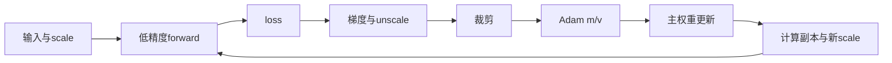

# 低精度前向之后，优化器怎样写回参数

低精度训练不仅要近似一次矩阵乘，还要把误差信号写回长期参数。FP8操作数、累加器、梯度、Adam历史状态和主权重可以使用不同精度。沿一次更新查看这些状态，比给整个模型贴一个dtype标签更准确。

## 梯度先进入历史统计

AdamW维护一阶矩m和二阶矩v。忽略weight decay，设首步梯度g=0.1、$\beta_1=0.9,\beta_2=0.999$，初始m=v=0。更新后m=0.01、v=0.00001，偏差校正得到 $\hat m=0.1,\hat v=0.01$。

于是更新量近似为 $\eta\hat m/(\sqrt{\hat v}+\epsilon)\approx\eta$。学习率0.001时，参数从1变到约0.999。m/v是跨步积累的状态，丢失它们后即使权重相同，下一步轨迹也会改变。

## 为什么低精度写回可能吞掉更新

BF16在1附近的相邻可表示值并不均匀跨越两侧；向下相邻值与1相差约0.00390625。直接把0.999舍入回BF16，仍可能得到1。因此许多混合精度方案保留更高精度主权重或更新状态，再生成较低精度计算副本。

FP8前向的scale同样要与对应操作数匹配。若使用历史范围估计，恢复时遗漏相关状态或改变更新顺序，后续数值路径可能变化。是否需要保存哪些scale历史，应依据具体实现，不能假定所有FP8方案完全一样。

<!-- systems-workflow-visual -->

低精度操作数只是闭环的一段。主权重、矩状态和尺度的保存精度可以不同。

## Fused optimizer省下哪些访问

对每个参数，简化FP32 Adam更新至少读参数、梯度、m、v四项，写参数、m、v三项，共28字节，尚未计主副本、weight decay细节和其他元数据。运算不多时，多个独立逐元素kernel反复读写这些状态，会产生额外流量和launch。

融合可在一次读取后完成矩估计、偏差校正与参数更新，再写回必要状态。收益来自减少中间tensor和调度；若状态跨CPU/GPU或分片在不同rank，还需把迁移与同步算入完整step。

## AMP顺序决定梯度是否被正确处理

若使用loss scaling，先放大loss反向传播，再在梯度裁剪前unscale，随后step并更新scaler。若先裁剪放大后的梯度，实际阈值就变了。nanoGPT的训练循环明确按unscale、clip、step、update的顺序组织。

溢出时是否跳过更新、学习率进度如何计数，也要与训练循环一致。一次forward数值接近，只能验证局部近似；还需比较多步loss、梯度与更新轨迹，判断误差是否随训练扩大。

## 测量应分别覆盖前向和状态更新

先测低精度GEMM包含转换的完整路径，再测optimizer段和整步。若主要时间已经在通信或数据等待，进一步压缩Adam kernel未必显著改善吞吐。检查有限值、短程恢复一致性与任务指标后，才能讨论更激进的状态精度。

{ width="860" }

<small>图源：[DeepSeek-V3 Technical Report](https://arxiv.org/abs/2412.19437)，Figure 6。原图表达 FP8 路径中哪些张量走低精、哪些路径保留高精和 scale；读图重点是 FP8 训练不是一个 dtype 开关，而是 kernel、scale metadata、累加和 checkpoint 状态的组合。它不能证明任意 FP8 recipe 都稳定。</small>

## 对照源码与延伸阅读

- [AMP、梯度裁剪与optimizer step顺序](https://github.com/karpathy/nanoGPT/blob/3adf61e154c3fe3fca428ad6bc3818b27a3b8291/train.py)
- [低精度GEMM数据和scale接口](https://github.com/deepseek-ai/DeepGEMM/blob/5081f8513af57e61696de4f4f04b0e707ffb503e/README.md)
