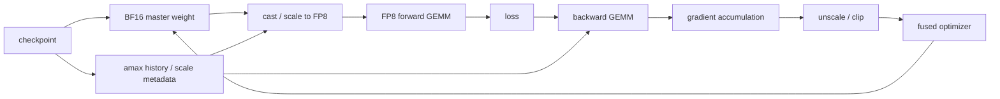

# FP8 训练与优化器 Kernel

低精度话题里，`FP8` 和优化器 kernel 值得单独拿出来讲，因为它们主要影响的是训练主路径，而不是单纯的推理压缩。权重量化更多关注部署态显存和带宽；而 `FP8` 训练与 fused optimizer kernel 关心的是：在大规模训练中，如何把前向、反向、梯度、主权重、优化器状态和数值缩放组织成一套既快又稳的执行路径。

这页建议和 [低比特训练与数值格式](../training/low-bit-training-and-numerics.md)、[分布式训练与 Checkpoint](../training/distributed-training-and-checkpointing.md)、[低精度与量化 Kernel](low-precision-and-quantized-kernels.md) 一起读。训练页解释数值格式和稳定性边界，分布式页解释状态切分与恢复，本页则关注这些约束落到 kernel、scale metadata 和 optimizer step 时会怎样影响吞吐。

{ width="860" }

<small>图源：[DeepSeek-V3 Technical Report](https://arxiv.org/abs/2412.19437)，Figure 6。原图表达 FP8 路径中哪些张量走低精、哪些路径保留高精和 scale；本站读法是说明 FP8 训练不是一个 dtype 开关，而是 kernel、scale metadata、累加和 checkpoint 状态的组合。它不能证明任意 FP8 recipe 都稳定。</small>

## 为什么 FP8 训练和推理量化不是一回事

推理量化更多是在“压缩已有模型”；
FP8 训练则是在“用更低精度直接完成学习过程”。
这意味着它要同时面对前向数值范围、反向梯度范围、累加精度、scale 更新和 optimizer state 的保存格式。

也就是说，FP8 训练不是只换一个 dtype，而是整条训练 pipeline 的重构。

## FP8 训练真正依赖什么

要让 FP8 训练可用，通常至少需要合适的 per-tensor 或更细粒度 scaling，某些路径保留更高精度累加，稳定的 cast / dequant / requant kernel，对异常值和 outlier 有合理处理，并让训练框架、kernel、optimizer 路径配套。

因此 FP8 更像系统级能力，而不是某个局部技巧。

## Scale 元数据为什么是训练的一部分

在 FP8 路径里，真正参与计算的并不只是张量本身，还包括 scale、history 或统计量、cast 策略、溢出检测或 guard。这些额外元数据会影响 kernel 输入输出格式、张量布局、fused path 设计和 checkpoint 状态。

所以 FP8 训练 kernel 的核心不只是低精度乘法，而是“低精度张量 + 缩放元数据”的联合管理。

## FP8 训练主路径图

这张图说明 FP8 训练要保存的不只是权重。`amax history`、scale、master weight、optimizer state 和梯度缩放都属于训练状态。如果 checkpoint 只保存模型权重，恢复后 scale 统计不同，后续 loss 曲线可能悄悄漂移。

### 4.1 一个 scale 失配事故

**症状**：FP8 训练从 checkpoint 恢复后没有立刻 `nan`，但 2k step 后 loss 比连续训练高 0.08，梯度极值更抖。

**排查**：权重和 optimizer state 恢复正常，但 FP8 amax history 没有恢复，scale 从默认值重新 warmup；前几百 step 的 cast 范围和连续训练不同，导致部分层 underflow / overflow 统计改变。

**修复**：checkpoint 中保存 FP8 scale metadata、amax history、loss scaler 和相关随机状态；恢复后跑固定 batch，对比连续训练路径的 loss、amax、grad norm 和参数 diff。

## 为什么优化器 kernel 也是主战场

在大模型训练里，优化器 step 的成本不容忽视，因为参数很多、optimizer state 很大、每步都要更新，还常与 ZeRO / FSDP 分片状态耦合。

如果优化器实现仍然是多次读写参数、动量和方差，并拆成分散的 elementwise kernel，训练吞吐就会被明显拖慢。

## Fused Optimizer 的意义

Fused optimizer kernel 的核心，是把原本分散的多步 elementwise 操作合并起来，例如读梯度、更新一阶矩和二阶矩、计算校正、应用权重衰减、更新参数。

### 5.1 为什么这比看起来更重要

因为这些步骤本质上都是内存带宽敏感的 elementwise 操作。
如果拆成多个 kernel，同一组参数和状态会被反复读写，launch 次数也会增加，大模型下总时间会很可观。

## FP8 与优化器之间的精度分层

**一个很现实的问题是**：
即使前向和反向更多地走 FP8，优化器状态也未必适合全面降到同样精度。

常见原因是 moment 累积对精度敏感，长时间训练误差会积累，不同参数组的动态范围差异也很大。

因此实际系统常采用更复杂的精度分层：前向低精度，累加更高精度，optimizer state 保留更稳定格式，最终参数更新路径再做折中。

## 训练态低精度 kernel 的常见热点

常见热点包括 FP8 GEMM、cast / scale 相关 kernel、gradient unscale / clip、optimizer step、master weight 更新，以及分布式梯度聚合前后的数据格式转换。这些路径如果彼此不协调，就会让理论上的 FP8 收益被大量格式转换吃掉。

## 优化器 kernel 的带宽账

AdamW 更新一个参数通常至少要读写：参数、梯度、一阶动量、二阶动量，很多实现还保留 master weight。若这些 elementwise 操作拆成多个 kernel，同一组张量会被反复读写。

| 路径 | 典型读写 | 风险 |
| --- | --- | --- |
| 非融合 AdamW | 多次读写 grad、m、v、param | launch 多，HBM 往返多 |
| fused optimizer | 一次 kernel 内完成多步更新 | 寄存器压力和数值边界更复杂 |
| ZeRO/FSDP 分片优化器 | 状态分片，减少单卡显存 | 通信、gather/scatter 和恢复更复杂 |
| FP8 + BF16 master | 主计算低精，更新保持高精 | scale 与 master weight 一致性要验收 |

验收 fused optimizer 时不要只看 step time，还要看长跑 loss、权重范数、moment 分布和恢复一致性。优化器 kernel 一旦数值错，通常不会立刻炸，而是慢慢改变训练轨迹。

## 直觉例子

如果把训练看成一条长期运转的工厂流水线，那么 FP8 训练不只是把原材料改成更轻的包装，而是要求整个仓储、计量、称重和装配流程都能适应更轻、更敏感的零件。优化器 kernel 则像最后的总装和校准工位，如果这一步仍然非常笨重，前面节省下来的吞吐也会被吃掉。

## 读完以后怎么判断

FP8 与优化器 kernel 的主题，核心不是“更低精度”，而是“训练主路径是否能以更低精度仍然稳定运行”。这要求 kernel、scale、优化器状态、mixed precision 策略和分布式训练框架一起工作。
因此它是训练系统能力的一部分，而不只是单个算子技巧。

## 发布前最小门禁

| 门禁 | 要求 |
| --- | --- |
| 数值 | 固定 batch 对齐 BF16 基线，loss、grad norm、amax 不异常 |
| 性能 | FP8 GEMM、cast、optimizer step 分别报告收益 |
| 恢复 | checkpoint 恢复后 scale / amax / optimizer state 连续 |
| 分布式 | 梯度聚合、ZeRO/FSDP、通信 dtype 与主路径一致 |
| 回退 | 敏感层和异常 bucket 可切回 BF16 |

## 工程收束

FP8 训练与优化器 kernel 要围绕 scale 管理、累加精度、统计同步、优化器状态和回退路径来验收。只看显存下降会漏掉 scale 漂移、训练/推理 FP8 路径不一致等问题；上线前应按层验证 FP8 可承受度，保留 BF16 回退，监控 scale 分布，并做长跑数值回归。

## 相关阅读与下一步

- 外部材料：[NVIDIA CUDA C++ Programming Guide](https://docs.nvidia.com/cuda/cuda-c-programming-guide/)。
- 外部材料：[Triton 文档](https://triton-lang.org/main/index.html)。
- 外部材料：[CUTLASS 文档](https://docs.nvidia.com/cutlass/)。
- 站内下一步：[算子与编译器专题](index.md)。
- 站内下一步：[CUDA 编程模型与内存层次](cuda-programming-model-and-memory.md)。
- 站内下一步：[Triton 编程模型与自动调优](triton-programming-model-and-autotuning.md)。
