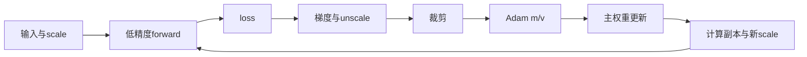

# 低精度前向之后，优化器怎样写回参数

低精度训练最容易被误解成把模型的 dtype 改成 FP8。真正的一次更新里，输入、权重、累加器、梯度、Adam 的历史状态和主权重可能走不同精度；每一处转换还有自己的 scale 和舍入。沿着一次参数更新追踪这些状态，比给整张模型表贴一个 dtype 更接近实际实现。

## 梯度先进入历史统计

AdamW维护一阶矩m和二阶矩v。忽略weight decay，设首步梯度g=0.1、$\beta_1=0.9,\beta_2=0.999$，初始m=v=0。更新后m=0.01、v=0.00001，偏差校正得到 $\hat m=0.1,\hat v=0.01$。

于是更新量近似为 $\eta\hat m/(\sqrt{\hat v}+\epsilon)\approx\eta$。学习率0.001时，参数从1变到约0.999。m/v是跨步积累的状态，丢失它们后即使权重相同，下一步轨迹也会改变。

## 为什么低精度写回可能吞掉更新

BF16在1附近的相邻可表示值并不均匀跨越两侧；向下相邻值与1相差约0.00390625。直接把0.999舍入回BF16，仍可能得到1。因此许多混合精度方案保留更高精度主权重或更新状态，再生成较低精度计算副本。

FP8前向的scale同样要与对应操作数匹配。若使用历史范围估计，恢复时遗漏相关状态或改变更新顺序，后续数值路径可能变化。是否需要保存哪些scale历史，应依据具体实现，不能假定所有FP8方案完全一样。

<!-- systems-workflow-visual -->


低精度操作数只是闭环的一段。主权重、矩状态和尺度的保存精度可以不同。

## Fused optimizer省下哪些访问

对每个参数，简化FP32 Adam更新至少读参数、梯度、m、v四项，写参数、m、v三项，共28字节，尚未计主副本、weight decay细节和其他元数据。运算不多时，多个独立逐元素kernel反复读写这些状态，会产生额外流量和launch。

融合可在一次读取后完成矩估计、偏差校正与参数更新，再写回必要状态。收益来自减少中间tensor和调度；若状态跨CPU/GPU或分片在不同rank，还需把迁移与同步算入完整step。

## AMP顺序决定梯度是否被正确处理

若使用loss scaling，先放大loss反向传播，再在梯度裁剪前unscale，随后step并更新scaler。若先裁剪放大后的梯度，实际阈值就变了。nanoGPT的训练循环明确按unscale、clip、step、update的顺序组织。

溢出时是否跳过更新、学习率进度如何计数，也要与训练循环一致。一次forward数值接近，只能验证局部近似；还需比较多步loss、梯度与更新轨迹，判断误差是否随训练扩大。

## 测量应分别覆盖前向和状态更新

先测低精度GEMM包含转换的完整路径，再测optimizer段和整步。若主要时间已经在通信或数据等待，进一步压缩Adam kernel未必显著改善吞吐。检查有限值、短程恢复一致性与任务指标后，才能讨论更激进的状态精度。

{ width="860" }

<small>图源：[DeepSeek-V3 Technical Report](https://arxiv.org/abs/2412.19437)，Figure 6。原图表达 FP8 路径中哪些张量走低精、哪些路径保留高精和 scale；读图重点是 FP8 训练不是一个 dtype 开关，而是 kernel、scale metadata、累加和 checkpoint 状态的组合。它不能证明任意 FP8 recipe 都稳定。</small>

## 继续读

低精度训练的数值选择可以接到[低精度与量化 kernel](low-precision-and-quantized-kernels.md)、[性能调试与数值稳定性](profiling-debugging-and-numerical-stability.md)和[测试、回归与维护](testing-regression-and-maintenance.md)。

## 对照源码与延伸阅读

- [AMP、梯度裁剪与optimizer step顺序](https://github.com/karpathy/nanoGPT/blob/3adf61e154c3fe3fca428ad6bc3818b27a3b8291/train.py)
- [低精度GEMM数据和scale接口](https://github.com/deepseek-ai/DeepGEMM/blob/5081f8513af57e61696de4f4f04b0e707ffb503e/README.md)

## FP8 checkpoint 要保存什么

一个可恢复的 FP8 训练 checkpoint 至少应能重建以下状态：

| 状态 | 例子 | 遗漏后的表现 |
| --- | --- | --- |
| 主权重 | FP32 或 BF16 master weights | 恢复后参数更新轨迹改变 |
| 优化器 | Adam 的 $m/v$、step、weight decay 相关状态 | loss 可能短期接近，长期漂移 |
| 数值元数据 | tensorwise/blockwise scale、amax 历史、更新计数 | 第一个恢复 step 的溢出或精度突变 |
| 训练进度 | data sampler、epoch、micro-batch、梯度累积 | 数据顺序和有效 batch 改变 |
| 随机状态 | Python、框架、CUDA、通信相关 RNG | dropout、采样和数据增强无法重现 |

具体 scale 项目取决于实现，不能把某个库的字段名当成通用标准。保存前后应打印状态树和 dtype/shape，恢复后执行短跑，与未中断基线比较下一步 loss、梯度范数、scale 更新和参数差异。

## fused optimizer 的验收分三层

先用小张量和固定输入，逐元素对照参考实现，覆盖零梯度、极大值、负值、权重衰减、step=1 与溢出跳过更新。再用随机张量做多步对照，检查相对误差和有限值。最后在真实分片、梯度累积和 AMP 流程中测量整步时间与峰值显存。

```text
reference_step -> fused_step
check: finite, max_abs_error, max_rel_error,
       parameter_checksum, optimizer_checksum
```

若 fused 版本更快但在第二层对照中出现误差累积，应先定位更新顺序、累加精度和 scale 时机，不能用最终任务分数掩盖数值错误。若数值一致却整步不快，检查读写流量、launch 数量、分片通信和同步点，优化器 kernel 可能根本不在关键路径。

## 把 FP8 结果写成可比较的报告

每次实验固定模型、数据配方、有效 token、硬件拓扑和训练步数，至少比较 BF16 基线、FP8 前向、FP8 前向加融合优化器三种配置。报告以下四组量：训练吞吐（tokens/s）、端到端 step p95、峰值显存、任务质量与异常步比例。单独报 GEMM TFLOP/s，无法说明训练系统获得了收益。

如果某个配置需要不同 loss scale、warmup 或梯度裁剪阈值，应把这些改变写入实验合同；否则“FP8 更稳定/更快”的结论混入了训练配方变化。

## 实现依据

FP8 的格式和数值范围参考 [FP8 Formats for Deep Learning](https://arxiv.org/abs/2209.05433)。混合精度训练的系统取舍对照 [DeepSeek-V3 Technical Report](https://arxiv.org/abs/2412.19437) 的 FP8 框架图；实际训练接口和 checkpoint 细节应回到 [NVIDIA Transformer Engine 文档](https://docs.nvidia.com/deeplearning/transformer-engine/) 和目标框架版本。AMP 的 unscale、裁剪和 step 顺序对照 [nanoGPT 的训练循环](https://github.com/karpathy/nanoGPT/blob/3adf61e154c3fe3fca428ad6bc3818b27a3b8291/train.py)。

本文中的 Adam 数字、28 字节流量和 checkpoint 字段是为了检查状态依赖而构造的算例，不能直接当作 Transformer Engine、DeepGEMM 或某张 GPU 的性能承诺。实测时还要记录 scale 更新、溢出跳过、通信和分片位置。

把同一小张量分别交给参考 Adam、未融合 kernel 和 fused optimizer，连续运行至少 10 个 step。除了最终参数，还比较每步的 `m`、`v`、scale、有限值状态和 checksum。若第一步一致、后面逐渐偏离，优先检查偏差校正、更新顺序和状态精度。
