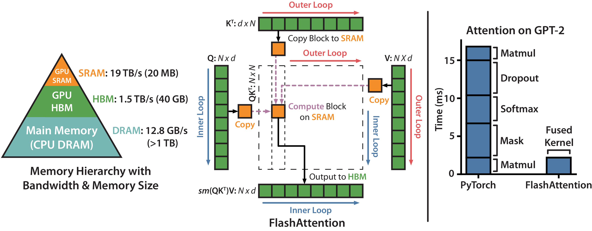

# 从矩阵乘的一个输出块理解融合

矩阵乘的公式只有一行 $C_{ij}=\sum_k A_{ik}B_{kj}$，实现却要决定哪些输出一起计算、输入搬到哪里复用、累加器活多久。先理解这三个决定，就能看懂GEMM、attention与epilogue fusion的共同点和差别。

## 四乘四矩阵里的两乘两输出块

设A、B都是4×4，当前program负责C的前两行、前两列。沿K每次走2个位置，先读A左上2×2和B左上2×2，得到部分和；再读A的前两行后两列与B的后两行前两列，加入同一累加器。

这块C有4个输出，各需要4次乘加，共16次乘加，按一次乘法和一次加法各计1FLOP，共32FLOPs。A的一个元素在块内参与两列输出，B的一个元素参与两行输出。Tile让这份复用在片上发生。

官方Triton矩阵乘教程按这一结构执行，输出块循环外创建FP32 accumulator，K循环中 `tl.dot` 累加，循环后才写回。它还通过调整program遍历顺序改善L2复用，但这不会改变数学上的元素对应关系。

## 用M的变化看计算强度

设BF16权重为4096×4096，主体32MiB。M=1时，主要计算约3355万FLOPs，若至少读一遍权重，算术强度约1FLOP/byte。M=128时，同一权重服务128行输入，计算约42.95亿FLOPs，忽略较小输入输出时强度约128FLOPs/byte。

实际字节还包括输入、输出、重复读取和缓存行为，这里只是理想复用估算。但它已经说明同一层在decode与prefill中可能有不同瓶颈，不能只看N和K相同就复用性能结论。

## Epilogue 可以省掉哪次写回

若需要 $Y=\operatorname{GELU}(AB+b)$，分开实现可能先把AB写到显存，再读出加bias和激活。若把bias和激活接在GEMM的最终累加器之后，便可直接写Y，减少中间结果的一次写入和一次读取。

对于 $M\times N$ 的BF16中间结果，理论上可省 $4MN$ 字节。收益还要扣除新增寄存器压力、特殊函数计算与对原GEMM调度的影响。若融合迫使高效库GEMM退回较差实现，节省的读写可能不足以补偿计算损失。

## Attention 多了归一化依赖

Attention先算 $S=QK^\top/\sqrt d$，再按行softmax，最后算PV。它不能把任意一个小score块独立softmax后直接相加，因为分母取决于整行所有key。

FlashAttention用在线最大值、分母和输出累积修正这一依赖，既保持全行归一化，又不把完整S与P写回。具体逐块计算见[FlashAttention](long-context-and-flashattention-evolution.md)。它仍执行dense attention的配对计算，节省主要来自中间矩阵I/O和执行组织。

## 比较实现时保留完整表达式

如果目标是 `GEMM+bias+GELU`，基准就应比较相同表达式、相同dtype和相同输入layout。单测裸GEMM后再把其速度宣称为完整层速度，会漏掉转换和后处理。先检查数值误差，再分别测kernel和完整层，才能判断融合究竟改变了哪项成本。

{ width="760" }

<small>图源：[FlashAttention: Fast and Memory-Efficient Exact Attention with IO-Awareness](https://arxiv.org/abs/2205.14135)，Figure 1。原论文图意：左侧展示 FlashAttention 如何按块把 Q/K/V 放入 SRAM，避免 materialize 完整 attention matrix；右侧展示在 GPT-2 attention 上相对 PyTorch 实现的加速效果。</small>

## 对照源码与延伸阅读

- [Triton GEMM 的块循环与融合入口](https://github.com/triton-lang/triton/blob/cd2e01c6686d6503802e6cdfac56d5a5dfdb27a1/python/tutorials/03-matrix-multiplication.py)
- [Attention 的在线归约](https://github.com/triton-lang/triton/blob/cd2e01c6686d6503802e6cdfac56d5a5dfdb27a1/python/tutorials/06-fused-attention.py)
