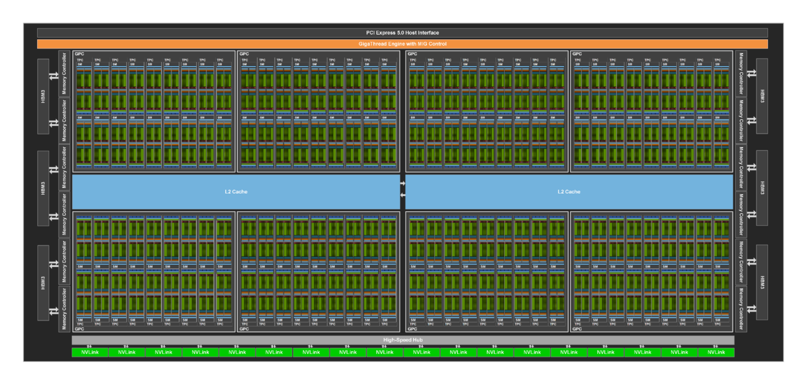

# 把并行组映射到实际GPU链路

设有两台机器，每台4张GPU。节点内与跨节点链路的带宽、延迟和共享程度不同。同一个8-rank配置，编号如何落到物理GPU，会改变频繁通信经过的路径。

## 先写计算组，再写物理位置

采用TP=2、DP=4，rank0/1、2/3、4/5、6/7各组成一个TP组，每组共同持有一份分片模型。对应TP位置的rank再组成DP组，例如0/2/4/6同步相同参数分片的梯度。

若rank0到3在节点A，4到7在节点B，上述TP组都在节点内。若按两台机器交替分配rank，0/1等组可能跨节点，每层TP通信都会经过跨机链路。逻辑world size相同，关键路径已经不同。

这种安排只是一种教学配置。实际GPU互联不一定节点内全对等，还需查看NVLink/NVSwitch、PCIe根、CPU NUMA与NIC邻接。

## 消息频率和大小决定映射价值

DP常在反向梯度就绪后按bucket归约；TP可能在每层前向与反向同步中间结果；PP主要在相邻stage传激活与梯度；EP按路由交换token。最值得放在低延迟链路上的通信，取决于调用频率、消息大小和是否处于下一步计算的依赖上。

一个假设例子中，每层同步额外增加20微秒，模型有40层，每个decode步就可能多约0.8毫秒串行等待。一次大消息则更依赖持续带宽。这个算式只展示延迟如何积累，没有给具体互联性能结论。

## 拓扑图还要和实际流量对上

设备编号不保证对应物理邻接顺序。启动记录应保留rank到device、GPU到NIC与NUMA映射，以及实际collective路径。只看到“节点内”或“NVLink可用”仍不足以证明该次通信走了预期路径。

多组通信还可能共享同一链路。单独测每对GPU都正常，同时运行时却拥塞，原因可能是共享出口或资源竞争。需要在实际并行组和消息尺寸下复测。

## 怎样区分慢链路与慢rank

先固定输入与配置，比较各rank计算段结束时间。若某rank在进入collective前就落后，其他卡在通信处等它，根因可能是数据、计算或频率。若进入时间接近而通信完成差异大，再检查链路与映射。

换用另一组物理设备、保持逻辑并行不变，是一种可反证的对照。若延迟随设备位置迁移，才有更强证据指向拓扑或节点状态。单卡基准正常有助于缩小范围，但不能单独证明网络有问题。

{ width="860" }

<small>图源：[NVIDIA Hopper Architecture In-Depth](https://developer.nvidia.com/blog/nvidia-hopper-architecture-in-depth/)。原图表达 GH100 内部 SM、L2、HBM、NVLink、PCIe 和控制模块的组织。这里的重点是：GPU 不是孤立算力块，节点内高速互联、共享缓存、HBM 控制器和外部网络共同决定多 GPU 系统上限。</small>

## 继续读

拓扑确认后，继续看[通信 kernel 与计算重叠](communication-kernels-and-overlap.md)、[runtime dispatch](runtime-dispatch-and-kernel-selection.md)和[kernel 成本模型](kernel-cost-models-and-selection-heuristics.md)。

## 对照源码与延伸阅读

- [DDP rank、设备与同步执行的最小实例](https://github.com/karpathy/nanoGPT/blob/3adf61e154c3fe3fca428ad6bc3818b27a3b8291/train.py)
- [专家并行通信与对称内存条件](https://github.com/deepseek-ai/DeepGEMM/blob/5081f8513af57e61696de4f4f04b0e707ffb503e/README.md)

## 先取得拓扑事实，再解释性能

在目标机器上，第一轮诊断应保存设备、PCIe、GPU-to-GPU 和 GPU-to-NIC 的映射。常见的只读入口包括：

```bash
nvidia-smi -L
nvidia-smi topo -m
nvidia-smi topo -p2p r
```

这些命令展示设备可见性与拓扑关系，但不等于一次 collective 已经使用了某条路径。还要把 rank、local rank、CUDA device、主机名和 NIC 记录到任务日志，避免只凭 `CUDA_VISIBLE_DEVICES` 的顺序推测物理邻接。

## 用 NCCL tests 测“链路上限”与“应用时间”

NCCL tests 的 `all_reduce_perf`、`all_gather_perf` 等可以在固定消息大小、rank 数和算法设置下测基础通信。它们适合回答链路和 collective 的上限问题，不能直接替代真实模型中的通信/计算重叠。

一个最小记录应包括：

```text
test: all_reduce_perf
hosts / ranks: <...>
message_range: <...>
NCCL version: <...>
CUDA / driver: <...>
topology snapshot: topo-<timestamp>.txt
algorithm / protocol: <...>
busbw / time: <raw output>
```

随后再用真实训练或 serving workload 记录 collective 前后的时间戳。如果 NCCL test 接近预期而应用仍慢，优先查慢 rank、shape、同步点和 overlap；如果基础通信也随设备位置变化，拓扑或节点状态才更可疑。

## 计算组映射的三个对照

| 对照 | 逻辑配置 | 物理变化 | 观察 |
| --- | --- | --- | --- |
| A | TP/DP 固定 | TP 尽量放节点内 | 每层同步和跨机 bytes |
| B | TP/DP 固定 | 交错 rank，使 TP 跨节点 | p95、通信时间和慢 rank |
| C | TP/DP 固定 | 同一拓扑更换 GPU/NIC 组合 | 设备状态与共享链路影响 |

只改变物理映射，才能把逻辑并行策略与拓扑因素分开。若同时改变 batch、kernel、通信算法和进程数，结果只能说明“整套配置不同”。

## NUMA 与 NIC 也属于拓扑

跨节点通信通常经过 NIC；GPU 到 NIC 的 PCIe 根、CPU NUMA 和网卡绑定会影响 host staging、网络注入和 GPUDirect 路径。启动日志应记录 GPU、NIC、NUMA 的关系，以及是否启用了目标 transport。单纯看到 NVLink 图标，不能证明跨节点的瓶颈已经解决。

## 来源与改编说明

- [NCCL 官方用户指南](https://docs.nvidia.com/deeplearning/nccl/user-guide/docs/overview.html)用于核对 collective、拓扑和环境变量的边界。
- [NCCL Tests](https://github.com/NVIDIA/nccl-tests)提供基础通信基准入口；基准结果不能直接当作模型端到端性能。
- [PyTorch Distributed 文档](https://pytorch.org/docs/stable/distributed.html)用于核对 rank、process group 和 collective 的接口语义。
- [NVIDIA Hopper Architecture](https://developer.nvidia.com/blog/nvidia-hopper-architecture-in-depth/)用于解释 SM、HBM、NVLink、PCIe 和控制模块的层次；图示不等于当前机器的实际拓扑。

## 自测

1. 为什么 `nvidia-smi topo -m` 显示 NVLink，不足以证明某个 all-reduce 走了最优路径？
2. 如何设计一个只改变 rank-to-device 映射的实验？
3. NCCL test 很快而训练很慢时，下一步应记录哪些应用级时间戳？
4. 请把 TP、DP、PP、EP 各自常见的消息对象和最敏感的链路条件写成表格。
