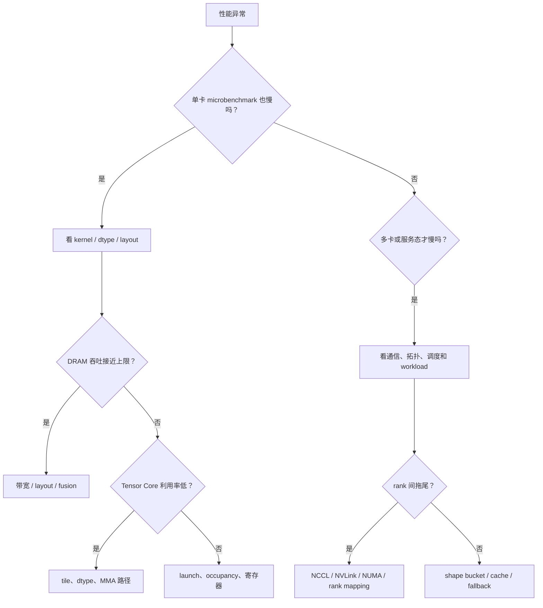

# 硬件感知排查清单

当一个 kernel 或训练/推理路径性能异常时，最容易犯的错误是只在软件层找原因。实际上很多问题只有带着硬件感知去排查，才能快速定位。

## 先问是不是带宽问题

如果：

1. DRAM 吞吐很高；
2. 算术强度不高；
3. Tensor Core 利用率也不高；

那就更应该先检查数据流、layout、fusion 和访问模式，而不是继续堆算力优化。

## 再问是不是寄存器和 occupancy 问题

如果：

1. register 使用过高；
2. occupancy 很低；
3. 出现 spill；

那么问题可能来自 tile 过大、融合过度或中间值管理不当。

## 再问是不是拓扑和通信问题

如果单卡 microbenchmark 很快，但多卡系统仍慢，就要怀疑：

1. TP/DP 分组不合理；
2. 高频通信跨了慢链路；
3. overlap 没有真正发生；
4. 某些 rank 成为拖尾点。

## 再问是不是 workload 分布问题

如果 benchmark 很好看，线上却收益一般，通常要回到：

1. shape bucket 是否真实；
2. 高频路径是否真被命中；
3. fallback 比例是否过高；
4. prefill 和 decode 是否被混在一起评估。

## 硬件排查流程图

这张图能避免一上来就改 kernel。很多线上退化并不是单个算子慢，而是多卡通信、拓扑映射、shape 迁移或 fallback 路径把端到端拖慢。先问“单卡是否也慢”，能把排查范围迅速缩小。

## 节点健康基线

硬件感知不是出事后才看 `nvidia-smi`。建议每类机器保留一组启动基线：

| 基线 | 记录什么 | 用途 |
| --- | --- | --- |
| 拓扑 | `nvidia-smi topo -m`、GPU ordinal、NUMA 亲和 | 避免 TP / EP 分组跨慢链路 |
| 带宽 | HBM copy、PCIe/NVLink P2P、NCCL all-reduce/all-to-all | 区分坏卡、拓扑和通信退化 |
| Kernel 探针 | GEMM、attention、norm、KV 读取 microbench | 判断底层 kernel 是否异常 |
| 系统状态 | 温度、功耗、ECC、时钟、驱动版本 | 解释慢节点和不稳定节点 |
| Runtime 路径 | dtype、quant kernel hit rate、fallback rate | 判断是否走到预期低精度路径 |

如果没有基线，值班时只能凭感觉判断“这台机器是不是怪”。有了基线，性能退化可以快速分成硬件异常、拓扑异常、runtime 异常和 workload 变化。

## 另一个案例：低精度服务没有变快

**输入症状**：把模型从 BF16 切到 FP8 权重后，显存下降 35%，但 TPOT 只提升 3%，P99 还略差。

**关键指标**：权重加载显存确实下降；trace 中部分 GEMM 命中 FP8 kernel，但 connector 和输出头频繁 dequant 回 BF16；decode 阶段 KV cache 仍是 BF16，长上下文请求占成本大头。

**判断**：硬件支持 FP8 不代表整条路径支持 FP8。瓶颈已经从权重常驻显存转移到 KV 读取、格式转换和部分 fallback。

**修复**：按 kernel hit rate 分桶统计；先保留敏感头高精，主干 matmul 确认 FP8 命中；对长上下文桶评估 KV cache 量化；把 dequant/requant 次数计入性能报告。

## 读完以后怎么判断

**硬件感知排查的核心是**：不要把所有问题都解释成算法或框架问题。很多性能瓶颈最终都要回到带宽、寄存器、拓扑和 workload 分布这些更底层也更真实的约束上。只要先从这些约束出发，定位通常会快很多。

## 最小排查记录模板

每次硬件相关性能事故，建议至少留下这几项：

| 字段 | 内容 |
| --- | --- |
| 机器与拓扑 | GPU 型号、驱动、拓扑、rank mapping |
| 症状范围 | 单卡、多卡、训练、推理、某个 bucket |
| 关键证据 | trace、NCCL wait、带宽、fallback、温度 |
| 修复动作 | 改 mapping、换节点、改 dispatch、回退 kernel |
| 复验方式 | 哪个探针或业务 bucket 证明恢复 |

## 工程收束

硬件感知排查要同时看频率、温度、ECC、PCIe / NVLink 和 NUMA 映射。拓扑退化容易被误判成 kernel 退化，坏卡也可能被误判成模型不稳；上线前应固定探针基准，保留故障前后硬件日志，做节点隔离与复验，并按机型建立健康基线。

## 真实排查案例：多卡吞吐突然掉一截

**输入症状**：同一份推理服务配置，在 8 卡机器上从约 1.0x 基线掉到 0.72x；单卡 microbenchmark 没有明显退化，业务侧表现为长上下文请求 P99 抖动。

**关键指标**：GPU util 仍高，但部分 rank 的 SM active 明显低；NVLink / PCIe counters 不均衡；decode 阶段每步耗时出现周期性尖峰；同一 batch 中尾部 rank 经常晚 10-20ms 完成。

**Nsight / trace 观察**：Nsight Systems 时间线上，计算 kernel 之间夹着不规则的 NCCL wait；慢 rank 的通信跨到 PCIe 路径，和预期 NVLink 邻接关系不一致；CPU 侧调度没有新增同步点。

**判断**：问题不在单个 attention 或 GEMM kernel，而在拓扑映射和并行分组。某次换机后 GPU ordinal 与物理拓扑不一致，TP 分组跨了慢链路，导致局部通信拖住全局 step。

**修复**：重新生成拓扑感知 rank mapping，把高频 TP 通信放回 NVLink 邻接组；启动时打印并保存 `nvidia-smi topo -m`、rank-to-device 映射和 NCCL 选路日志；灰度期按 rank 记录 step time 分布。

**反例**：如果单卡 kernel 也同步变慢、DRAM 吞吐接近上限、没有 rank 间拖尾，那么优先怀疑 kernel / layout / dtype 路径，而不是拓扑。拓扑问题的典型特征是“局部 rank 拖尾 + 通信 wait + 单卡基准正常”。
