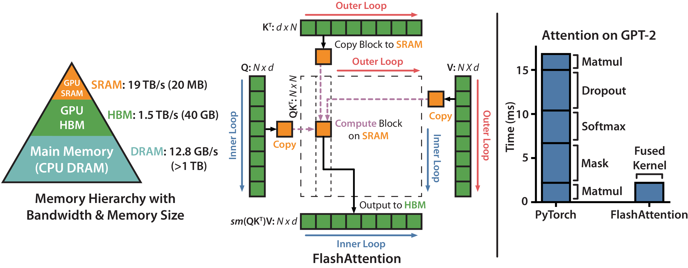

# 算子与编译器路线图

<div class="atlas-hero">
  <div class="atlas-kicker">Operators & Compilers</div>
  <p class="atlas-lead">这一专题把模型、框架、编译器、库、kernel 和 GPU 硬件连成一条完整链路，帮助你理解性能为什么会卡在 Attention、GEMM、KV、通信和布局变换上。</p>
  <div class="atlas-chip-row">
    <span class="atlas-chip">CUDA</span>
    <span class="atlas-chip">Triton</span>
    <span class="atlas-chip">Attention Kernel</span>
    <span class="atlas-chip">Profiling</span>
  </div>
</div>

## 专题定位

<div class="atlas-meta-grid">
  <div>
    <strong>核心问题</strong>
    <p>把“模型想做什么”和“硬件实际上能高效做什么”连接起来，解释性能、显存和数值稳定性问题。</p>
  </div>
  <div>
    <strong>适合读者</strong>
    <p>适合做训练基础设施、推理 runtime、kernel 优化、量化、长上下文和系统性能分析的人。</p>
  </div>
  <div>
    <strong>阅读方式</strong>
    <p>建议先建立 CUDA/Triton 编程模型，再看热点算子、编译栈、profiling 与硬件感知排查。</p>
  </div>
</div>

!!! note "在全站主线里的位置"
    算子与编译器专题是底层工程支撑。它不会直接解释“什么是世界模型”，但会决定视频世界模型、长上下文 VLA、实时 rollout 和大规模训练能不能跑得动。主线学习时不必先钻进所有 kernel；当你遇到显存、带宽、延迟、吞吐或数值稳定性问题，再回到这里定位瓶颈。

!!! tip "证据与全站矩阵"
    前沿 claim 先查 [全站证据标准](../references/evidence-and-reproducibility-standard.md) 和 [全站效率矩阵](../references/site-efficiency-coverage-matrix.md)。算子页里的 microbenchmark、roofline、kernel speedup 和端到端 trace 要分开写，不能把 kernel 变快直接外推成任务成功率提升。

!!! tip "本专题的读法"
    先看数据怎么搬，再看代码怎么写。算子优化的第一问题通常不是“用了什么黑科技”，而是这个计算在 HBM、L2、shared memory、register 和跨卡网络之间搬了什么，哪里被带宽、同步、布局或 launch 开销卡住。

<div class="atlas-meta-grid">
  <div>
    <strong>读前先知道</strong>
    <p>tensor shape、GEMM、attention、dtype、显存层级和 GPU 执行模型的基本词汇。</p>
  </div>
  <div>
    <strong>读中抓主线</strong>
    <p>执行模型、热点算子、通信重叠、低精度 kernel、profiling 和成本模型。</p>
  </div>
  <div>
    <strong>读完能判断</strong>
    <p>一个系统瓶颈到底是算力、带宽、通信、布局、数值还是调度抽象不对。</p>
  </div>
</div>

## 阅读分层与小地图

| 分层 | 推荐内容 | 读到什么程度 |
| --- | --- | --- |
| 主线必读 | CUDA/Triton、GEMM/Attention、低精度 Kernel、Profiling/Roofline | 能判断瓶颈是 FLOPs、HBM、layout、通信、launch 还是数值 |
| 工程查阅 | DeepGEMM、CUTLASS/CuTe、Runtime dispatch、测试回归 | 接 kernel、调 runtime 或做回归时查 |
| 论文扩展 | FlashAttention、MagiAttention、SLA、Attn-QAT、DeepSeek-V3/V4 | 把论文系统收益拆成数据流、通信和 kernel 命中率 |
| 基础补课 | 张量 shape、GEMM、显存与运行时 | 卡在线程、tile、dtype 或带宽时补 |
| 暂时可跳过 | 专项库源码细节 | 还没确认热点前不要先钻实现 |

本专题服务世界模型高效训练里的**算力、带宽、通信和端到端 rollout 延迟**。算子页的结论不能只写 kernel speedup，还要说明端到端 loop 是否变快、候选动作排序是否保持、risk false negative 是否没有新增。

## 阅读路径

### 先看分层：不要把案例和基础概念放同一层

算子章节现在按四层读：

| 层级 | 解决的问题 | 典型页面 |
| --- | --- | --- |
| 执行模型 | GPU 怎么执行、内存怎么搬、编译栈怎么把高层算子落到 kernel | CUDA、Triton、CUTLASS/CuTe、PTX/SASS |
| 热点算子 | 大模型最常见的计算和访存瓶颈是什么 | GEMM、Attention、Reduction/Norm、低精度 Kernel |
| 系统场景 | 训练、推理、长上下文、MoE、通信里算子如何组合 | KV Kernel、FP8 optimizer、通信重叠、拓扑、MoE |
| 案例与进阶 | 某个具体库或某类 shape 特化如何落地 | DeepGEMM、Kernel 成本模型、高级模式 |

!!! note "难点解释：DeepGEMM 不是 GEMM 的基础定义"
    `GEMM` 是 dense matrix-matrix multiplication 的通用计算形态；`DeepGEMM` 是围绕 FP8、JIT、Hopper/Blackwell、grouped GEMM 和 MoE serving 的特化库案例。把它们放同一层会误导初学者：应该先理解 MatMul/GEMM、tiling、layout、epilogue、dtype 和 dispatch，再读 DeepGEMM 这类工程化案例，才能看出它到底优化的是哪一段。

### 推荐入口

<div class="atlas-card-grid">
  <a class="atlas-card" href="cuda-programming-model-and-memory/">
    <strong>CUDA 编程模型与内存层次</strong>
    <p>先弄清线程、warp、shared memory、L2、HBM 这些最基础的执行概念。</p>
  </a>
  <a class="atlas-card" href="triton-programming-model-and-autotuning/">
    <strong>Triton 编程模型与自动调优</strong>
    <p>理解更高层的块级编程和自动调优思路，建立与手写 CUDA 的互补视角。</p>
  </a>
  <a class="atlas-card" href="deepgemm-fp8-gemm-and-mega-moe/">
    <strong>DeepGEMM 解读</strong>
    <p>从 FP8 GEMM、JIT、TMA、grouped GEMM 到 Mega MoE，读懂新一代大模型算子库在优化什么。</p>
  </a>
  <a class="atlas-card" href="deepgemm-source-and-integration/">
    <strong>DeepGEMM 源码与接入</strong>
    <p>补充源码阅读顺序、API 地图、调用路径和真实服务接入前的检查清单。</p>
  </a>
  <a class="atlas-card" href="profiling-debugging-and-numerical-stability/">
    <strong>Profiling、调试与数值稳定</strong>
    <p>把“会写 kernel”推进到“会验证、会定位、会判断性能问题到底卡在哪”。</p>
  </a>
</div>

### 从论文专题回填的算子与系统知识点

技术报告里的架构收益最终都要落到 kernel、通信、内存层级和 runtime。读算子章节时，可以把这些案例作为“为什么需要底层视角”的证据。

| 专题来源 | 算子 / 编译层面的补充 | 应接到本章哪里 |
| --- | --- | --- |
| [DeepSeek-V3](../paper-deep-dives/technical-reports/deepseek-v3.md) | FP8 GEMM、DualPipe 和通信重叠说明低成本训练不只是算法，核心在 GEMM dtype、pipeline bubble 和跨卡通信安排 | [FP8 训练与优化器 Kernel](fp8-training-and-optimizer-kernels.md)、[通信 Kernel 与 Overlap](communication-kernels-and-overlap.md) |
| [Nemotron 3 Super](../paper-deep-dives/technical-reports/nemotron-3-super.md) | LatentMoE 降低 expert 权重读取和 all-to-all payload，Mamba-heavy 结构改变长序列生成时的状态读写模式 | [MoE 路由与稀疏 Kernel](moe-routing-and-sparse-kernels.md)、[Serving Attention 与 KV Kernel](serving-attention-and-kv-kernels.md) |
| [DeepSeek-V4](../paper-deep-dives/technical-reports/deepseek-v4-pro.md)、[RingAttention](../paper-deep-dives/world-models/ringattention.md) | 百万上下文、blockwise attention、sequence parallel 和异构 KV cache 让 attention kernel、KV 管理和通信拓扑成为同一个问题 | [长上下文与 FlashAttention 演进](long-context-and-flashattention-evolution.md)、[GPU 互连与拓扑映射](gpu-interconnects-and-topology-mapping.md) |
| [SLA / SLA2](../paper-deep-dives/foundations/sla-sparse-linear-attention.md) | 视频 DiT attention 的 sparse-linear 分解和 QAT 提醒我们：算子优化可以改变 attention 数据流，而不是只换更快 GEMM | [GEMM、Attention 与融合 Kernel](gemm-attention-and-fused-kernels.md)、[低精度与量化 Kernel](low-precision-and-quantized-kernels.md) |

大模型系统讨论如果只停留在“模型结构”“训练配方”“服务框架”三个层面，迟早会撞到一堵墙：很多关键性能问题最终都会落到算子实现、编译路径和硬件执行模型上。你也许已经知道 `FlashAttention`、`PagedAttention`、`Fused RMSNorm`、`Int4 GEMM` 这些名字，但如果不知道它们到底在优化什么、为什么会快、又为什么有些场景并不会快，那么系统层判断就很容易失真。

这一组文档的目的，不是把每个人都训练成 GPU 内核工程师，而是帮助你建立一个足够清晰的算子视角：从模型层需求，一路下钻到编译器、中间表示、kernel、内存层次和硬件执行机制，理解哪些性能瓶颈来自算法，哪些来自实现，哪些来自错误的抽象边界。

FlashAttention 原论文图很适合作为算子专题的第一张“硬件视角”原图：它强调性能提升来自重写 attention 的数据流，而不是改变 attention 的数学定义。

{ width="760" }

<small>图源：[FlashAttention: Fast and Memory-Efficient Exact Attention with IO-Awareness](https://arxiv.org/abs/2205.14135)，Figure 1。原论文图意：FlashAttention 用 tiling 避免把完整 \(N \times N\) attention matrix 写入 HBM；Q/K/V 分块进入 SRAM，在线 softmax 和累积输出减少 HBM 读写。</small>

!!! note "图解：算子优化先看数据怎么搬"
    左图的虚线框是朴素 attention 会显式生成的大矩阵，它很贵不是因为 softmax 公式复杂，而是因为中间结果要在 HBM 里来回读写。FlashAttention 把 K/V 和 Q 分块搬到片上 SRAM，在块内做 softmax 与累积，最后只写回输出。这个例子说明：很多 kernel 优化的核心不是少算一点 FLOPs，而是少搬很多数据。

!!! tip "基础知识入口"
    算子专题默认你知道 tensor shape、dtype、显存、带宽和 kernel 的基本含义。如果不熟，先看 [张量、Shape 与计算图](../foundations/tensors-shapes-and-computation-graphs.md)、[线性层、MLP 与 GEMM](../foundations/linear-layers-mlp-and-gemm.md) 和 [数值、显存与运行时](../foundations/numerics-memory-and-runtime-basics.md)。

## 核心判断框架

### 为什么算子会成为主问题

在大模型时代，很多性能损失已经不是“模型太大”这么简单，而是访问模式不连续导致 HBM 带宽被打满，kernel 太碎带来 launch 开销和中间张量读写，跨卡通信和单卡 kernel 没有重叠，同样的数学公式因为布局不同性能差一个数量级，量化收益被反量化和布局变换吃掉，或者编译器没有抓住融合机会，系统一直在“搬数据而不是算数据”。

因此所谓“系统优化”，最后很大一部分其实是在重新安排计算与数据移动的关系。

### 从模型到硬件的六层栈

一个更完整的 AI 系统栈，至少包括模型层、框架层、图与编译层、库与模板层、kernel 层和硬件层。模型层决定 Transformer、MoE、Diffusion、World Model、VLA 等计算模式；PyTorch、JAX、OneFlow 提供张量和自动微分抽象；`torch.compile`、Inductor、XLA、TensorRT、TVM、MLIR 做图级重写和代码生成；cuBLAS、cuDNN、NCCL、CUTLASS、CuTe、FlashAttention 提供高性能基元；CUDA、Triton 或框架 codegen 生成具体 GPU 程序；最终这些程序落到 SM、Tensor Core、register、shared memory、L2、HBM、NVLink 上执行。

这六层并不是完全独立的。模型决定算子模式，算子模式决定编译器是否有融合空间，编译器决定 kernel 形态，kernel 决定是否真正利用到硬件能力。

### 为什么这条链必须连起来看

如果只看最上层，你会觉得 `FlashAttention` 只是“Attention 的更快实现”；  
如果只看最底层，你又会陷入“寄存器、warp、bank conflict”的局部细节。  
真正有用的视角，是把这两端接起来：为什么模型里会出现这个算子，它到底受什么硬件约束，编译器或手写 kernel 能否改变这些约束，以及这种优化对训练和推理的收益是否一致。

### 算子并不只有 GEMM

很多人入门时会把“算子优化”等同于 GEMM 优化，这只对了一半。GEMM 确实是核心，但现代大模型系统真正常见的热点还包括 Attention 及其变体、Softmax、Reduce、LayerNorm、RMSNorm、Embedding / gather / scatter、KV cache 读写与页面管理、量化与反量化、通信相关 kernel，以及布局变换、transpose、swizzle、packing。

其中很多算子并不是以 FLOPs 为主导，而是以带宽、布局和同步为主导。

### 训练与推理的算子画像并不一样

训练阶段更关心大 batch 下的高吞吐 GEMM、反向传播与 activation recompute、分布式通信与计算重叠、混合精度、loss scaling、optimizer kernel，以及长上下文训练中的 attention 和 activation 内存。推理阶段更关心 prefill 与 decode 的不同负载形态、小 batch 或 continuous batching 下的 kernel 粒度、KV cache 管理、量化 kernel 是否真正提速，以及 tail latency 与多租户隔离。

所以“训练里很快的 kernel”不一定等价于“服务里最好用的 kernel”。

### 为什么 Triton 和 CUDA 要单独成组

这两个工具之所以值得单独讲，不只是因为它们流行，而是因为它们分别代表两种常见思路：`CUDA` 更接近硬件与执行细节，让你直接控制线程层级、共享内存、warp 原语、异步拷贝和 Tensor Core 使用方式；`Triton` 更接近张量块级编程和 kernel 生成，让你用更高层的抽象表达 tile、mask、block pointer 和自动调优。

如果只懂 CUDA，容易高估手写 kernel 的必要性，低估编译器和模板库的价值；如果只懂 Triton，又容易忽略硬件实际限制，对寄存器压力、occupancy 和访存细节不够敏感。

### 这组文档会回答哪些问题

这组内容主要围绕六类问题组织：GPU 为什么适合 AI、CUDA 的执行模型是什么，Triton 的 block-level 编程和自动调优逻辑是什么，GEMM / Attention / Norm / Reduce 为什么是核心优化对象，CUTLASS、CuTe、编译器、模板库和手写 kernel 如何分工，怎样用 profiling、roofline、微基准和数值校验判断优化是否真实有效，以及训练系统、推理引擎和内核实现如何连成完整链路。

## 工程优化方法

### 一个算子工程师真正反复做的事情

现实里，算子优化工作通常不是“凭直觉写更快代码”，而是一套反复循环的过程：先确定热点算子，判断它是算力受限还是带宽受限，找到关键数据布局与访存模式，设计 tile、分块、流水线和 fusion，验证正确性与数值稳定性，再用 profile 结果根据寄存器压力、occupancy、stall reason 和带宽利用率继续迭代。

这和只盯着 benchmark 排行不同，它更像一门系统化实验科学。

### Roofline 思维为什么重要

很多算子优化讨论最终都会回到一个简单问题：这个 kernel 到底是算力受限，还是带宽受限？

**Roofline 的直觉表达为**：

$$
\text{Performance}
\le
\min(\text{Peak FLOPs}, \text{Bandwidth} \times \text{Arithmetic Intensity}).
$$

它并不是精确预测器，但非常适合做第一层判断：算术强度很低时，不要幻想纯靠 Tensor Core 获得巨大提升；算子已经逼近带宽上限时，应更多关注 fusion、layout 与访存合并；如果离 roofline 还很远，说明实现层面还有明显浪费。

### 从参考源可以借到什么视角

你给的几个参考源，刚好覆盖了三条互补主线：`AI System Docs` 更像全栈课程，提供从芯片、编译、框架到推理系统的纵深；`how-to-optim-algorithm-in-cuda` 更像算子与 kernel 优化实践仓库，覆盖 GEMM、Softmax、LayerNorm、FlashAttention、Triton、Cutlass、profiling 等技巧；`AwesomeWorldModels` 则提醒我们，世界模型一侧也越来越依赖生成式模拟、视频建模、长上下文和系统实现能力，最终也会回到训练与推理内核问题。

也就是说，算子专题不是一个孤立的低层补充，而是可以向上连接训练、推理、世界模型和具身系统的底盘。

### 一个更实用的抽象：算子优化四问

读任何 kernel 或框架实现时，都可以先问四个问题：这个算子主要搬了什么数据，这些数据在哪一级内存里移动，哪些操作本来可以融合但还没融合，它真正卡在什么地方，是带宽、寄存器、同步还是 launch 开销。

这四问比“它用了什么黑科技”更重要，因为它能帮助你把技巧还原成原理。

### 为什么系统工程师也应该懂算子

不是每个系统工程师都要手写 CUDA，但如果完全不懂算子，很容易在架构层做出错误决策。例如选了一个数学上看似更省、但在 kernel 层面很难高效实现的算法；引入过多布局变换，让 pipeline 在搬运数据上损失远大于节省的 FLOPs；把模型服务问题误判成调度问题，实际瓶颈却是 decode kernel；或者把训练不稳定归因于优化器，实际问题来自数值精度与 fused kernel 实现。

理解算子，不是为了替代上层系统设计，而是为了让上层系统设计不建立在错误假设上。

## 学习路径与阶段检查

### 推荐阅读顺序

建议先读 [CUDA 编程模型与内存层次](cuda-programming-model-and-memory.md) 和 [Triton 编程模型与自动调优](triton-programming-model-and-autotuning.md) 建立编程模型，再读 [GEMM、Attention 与融合 Kernel](gemm-attention-and-fused-kernels.md) 和 [CUTLASS / CuTe 与编译栈](cutlass-cute-and-compiler-stack.md) 建立热点算子直觉，最后用 [Profiling、调试与数值稳定](profiling-debugging-and-numerical-stability.md) 把“会写”推进到“会验证、会定位、会迭代”。

### 阶段检查与下一站

算子专题的学习目标不是背 CUDA API，而是能判断性能问题属于哪一级抽象。

| 阶段 | 先读 | 读完要能回答 |
| --- | --- | --- |
| 1. 执行模型 | [CUDA 编程模型与内存层次](cuda-programming-model-and-memory.md)、[Triton 编程模型与自动调优](triton-programming-model-and-autotuning.md) | thread/warp/block、shared memory、HBM、tile 和 mask 如何影响一个 kernel |
| 2. 热点算子 | [GEMM、Attention 与融合 Kernel](gemm-attention-and-fused-kernels.md)、[Reduction、Norm 与索引 Kernel](reduction-norm-layout-and-indexing.md)、[FlashAttention 与长上下文](long-context-and-flashattention-evolution.md) | 算子是算力受限、带宽受限、同步受限还是 launch 受限 |
| 3. 低精度与通信 | [低精度与量化 Kernel](low-precision-and-quantized-kernels.md)、[FP8 训练与优化器 Kernel](fp8-training-and-optimizer-kernels.md)、[通信算子与计算重叠](communication-kernels-and-overlap.md) | 量化、通信和 overlap 的收益是否被 layout、dequant 或拓扑吃掉 |
| 4. 工程化维护 | [Profiling、调试与数值稳定](profiling-debugging-and-numerical-stability.md)、[Runtime Dispatch 与 Kernel 选择](runtime-dispatch-and-kernel-selection.md)、[Kernel 测试、回归与维护](testing-regression-and-maintenance.md) | 一个优化是否正确、稳定、可回归，是否真的命中训练或推理热路径 |

读完后建议回到 [大模型训练路线图](../training/index.md) 和 [推理系统路线图](../inference/index.md)：算子优化只有被真实负载消费，才算完成闭环。

## 快速代码示例

```python
import torch
import triton
import triton.language as tl

@triton.jit
def add_kernel(x_ptr, y_ptr, out_ptr, n, BLOCK: tl.constexpr):
    pid = tl.program_id(0)
    offs = pid * BLOCK + tl.arange(0, BLOCK)
    mask = offs < n
    x = tl.load(x_ptr + offs, mask=mask)
    y = tl.load(y_ptr + offs, mask=mask)
    tl.store(out_ptr + offs, x + y, mask=mask)

def triton_add(x, y):
    out = torch.empty_like(x)
    n = x.numel()
    add_kernel[(triton.cdiv(n, 256),)](x, y, out, n, BLOCK=256)
    return out
```

这段代码是一个最小 Triton kernel：通过 `program_id` 映射线程块，`mask` 处理越界元素，再把结果写回输出。它适合作为模板扩展到 layernorm、激活融合等更复杂算子。

## 小结

算子、编译器和内核实现，不是 AI 系统里的边角知识，而是连接“模型想做什么”和“硬件实际上能做什么”的中间层。大模型训练、推理、量化、长上下文、世界模型和具身控制之所以越来越依赖系统工程，很大程度上就是因为这个中间层不再能被简单忽略。

理解这组内容的最终目标，不是掌握所有底层细节，而是形成一种判断力：当系统变慢、变贵、变不稳时，你能不能快速判断这是模型问题、框架问题、编译器问题，还是 kernel 问题。
## 深度标杆页

算子与编译器专题的标杆页要有“真实 workload -> profile -> 判断 -> kernel / runtime 选择 -> 回归”的闭环。其它短页后续应向这些页面补案例和反例。

| 标杆页 | 对齐标准 |
| --- | --- |
| [Workload 建模与 Shape Bucketing](workload-modeling-and-shape-buckets.md) | 先用真实流量决定优化对象，而不是先写 kernel |
| [Profiling、调试与数值稳定](profiling-debugging-and-numerical-stability.md) | 串起系统 trace、kernel profile 和数值问题 |
| [Roofline 建模与性能案例](roofline-benchmarking-and-case-studies.md) | 用算术强度、带宽和端到端指标解释瓶颈 |
| [性能反模式与失败案例](performance-anti-patterns-and-failure-modes.md) | 每个优化都要写适用边界和反例 |
| [Kernel 成本模型与选型](kernel-cost-models-and-selection-heuristics.md) | 把计算、访存、launch、layout 和维护成本一起算 |
