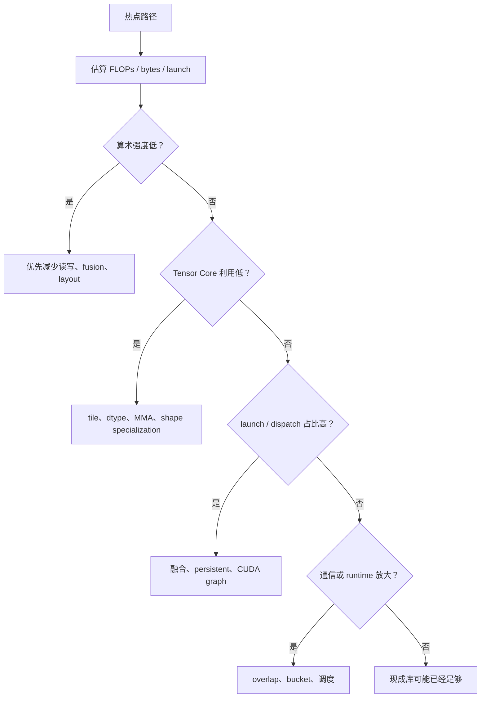

# Kernel 成本模型与选型

很多性能决策如果没有成本模型，就会变成“凭经验猜”。虽然完整精确建模很难，但在工程上仍然需要一个够用的启发式成本模型，帮助判断：

<!-- [补充] -->
| 读者 | 建议读法 | 工程落点 |
| --- | --- | --- |
| 初学者 | 先抓“Kernel 成本模型与选型”要解决的问题、关键术语和最小例子；公式只看变量方向。 | 能说清输入、输出和常见失败信号。 |
| 工程师 | 直接对照结构、指标、成本和边界条件，必要时回到前置页补概念。 | 落到数据、算力、延迟、显存、评测和回滚检查。 |

!!! note "读法定位"
    这页先回答“Kernel 成本模型与选型”在「算子与编译器」里的位置：它解决什么局部问题，依赖哪些前置，最后会影响哪类工程或研究判断。
    **前置**：先理解张量 shape、显存层次和 GEMM；系统指标卡住时回推理或训练专题。 必要时先回 [算子与编译器入口](index.md)、[基础知识](../foundations/index.md) 或 [术语表](../glossary/index.md)。
    **主线关系**：把模型里的矩阵乘、attention、通信和低精度路径落到 GPU 时间线上，看瓶颈如何被 kernel 与编译栈改变。

1. 该优先做 fusion，还是优先做 layout 优化；
2. 该写 Triton，还是直接调用现成库；
3. 某个 shape 值不值得特化；
4. 某条路径更可能受带宽、launch 还是通信主导。

!!! note "合并提示"
    **note · 初学者先抓住**

    成本模型不需要一开始就非常精确，它先帮你判断主导项：计算、内存、launch、通信还是调度。只要能避免把时间花在非瓶颈上，一个粗模型就已经很有价值。

    **note · 难点解释：为什么 microbenchmark 不够**

    单个 kernel 跑得快，不代表端到端路径快。真实系统还包括 layout 转换、数据搬运、dispatch、fallback、batching 和通信。选型时要把 kernel 放回完整请求或训练 step 里算账。

    **example · 有趣例子：最快短跑员不等于最快接力队**

    一个队员百米最快，但交接棒混乱，整队仍然会输。单个 kernel microbenchmark 很漂亮，也可能因为前后 layout、dispatch 和同步成本导致端到端路径不快。

<!-- [补充] -->
> **踩坑原因**：这类工程问题通常不是单点公式错，而是 shape、资源预算、并发路径和观测指标之间有一个假设没对齐；先把触发条件、监控信号和回滚边界拆开查。

## 一个够用的粗模型

很多 kernel 可以先粗略分成三类成本：

1. 计算成本；
2. 数据移动成本；
3. 调度与 launch 成本。

**直觉上可以写成**：

$$
T \approx T_{\text{compute}} + T_{\text{memory}} + T_{\text{overhead}}.
$$

<!-- [补充] -->
| 符号 | 含义 | 取值范围 |
| --- | --- | --- |
| \(T\) | 时间步、索引或计数 | 整数索引或归一化时间区间，见正文 |
| \(T_{}\) | 时间步、索引或计数 | 整数索引或归一化时间区间，见正文 |

虽然这不是精确公式，但足够指导很多工程判断。

## 成本模型决策图

成本模型不是为了精确预测毫秒数，而是为了决定第一刀切哪里。低算术强度优先看带宽，高算术强度但 Tensor Core 低再看 tile 和 dtype，launch 多则看融合，端到端不快则回到 runtime 和通信。

### 2.1 一个可复用模板

| 项 | 要填什么 | 例子 |
| --- | --- | --- |
| shape | `B/M/N/K/L/H/D` | decode attention: `B=8,H=32,T=8192,D=128` |
| FLOPs | 主计算量 | QK + PV 约 1.07 GFLOPs |
| bytes | 主要读写量 | KV 读取约 1.0 GiB |
| arithmetic intensity | FLOPs / bytes | 约 1 FLOP/byte |
| 真实耗时 | microbenchmark | 0.55 ms |
| 端到端占比 | 在请求或 step 中占多少 | 17.6/58 ms |
| 优先动作 | 该改哪里 | KV layout / quant / paging |

只要每个性能提案都先填这张表，团队就不容易为了一个漂亮 microbenchmark 投入过多维护成本。

## 什么时候优先考虑 fusion

如果一个路径包含很多小算子，且：

1. 每个算子计算量不大；
2. 中间张量需要反复写回；
3. launch 次数多；

那通常优先考虑 fusion。

## 什么时候优先考虑特化

**如果某些 shape**：

1. 出现频率很高；
2. 默认路径明显慢；
3. 对齐和向量化潜力明显；

那通常值得单独做 shape specialization。

## 什么时候不该急着写自定义 kernel

如果：

1. 热点占比不大；
2. 现成库已经接近上限；
3. workload 分布并不稳定；
4. 维护成本会明显高于收益；

那更应该先从调度、数据布局或系统级优化入手。

## 本页结论

Kernel 成本模型不需要一开始就非常精确，但需要足够实用。只要你能先把问题拆成计算、内存和调度三部分，再结合 workload 频率做判断，就比单纯凭直觉选技术路线要稳得多。

## 工程收束

Kernel 选型要按 shape family、算术强度、访存模式、launch 开销和布局变换建成本模型。只按单点 benchmark 选 kernel 很容易忽略边界 shape、runtime 和 cache 交互；上线前应按 workload 建族，区分训练与服务场景，记录回退条件，并把成本模型接进 dispatch。

## 真实排查案例：Fused kernel 单测更快，端到端反而更慢

**输入症状**：把 `bias + gelu + dropout` 合成一个 Triton kernel 后，单 kernel benchmark 快 18%，但训练 step time 只快 1%，某些 micro-batch 反而慢 6%。

**关键指标**：单 kernel latency 下降，端到端 kernel 数减少；但整步 HBM 读写没有明显下降，register 使用升高，低 batch bucket 的 occupancy 降低；fallback 命中率从 0 增到 9%。

**Nsight / trace 观察**：Nsight Compute 显示新 kernel 出现寄存器压力和局部 spill；Nsight Systems 里低频 shape 触发 fallback，前后多了一次 layout 转换；高频 bucket 受益，尾部 bucket 变慢。

**判断**：成本模型只算了 launch 和单 kernel 时间，没有把寄存器压力、layout 转换和 shape 分布放进去。这个 fusion 只适合高频对齐 shape，不适合全流量替换。

**修复**：把 dispatch 改成按 bucket 选择：高频对齐 shape 走 fused path，长尾 shape 走原始实现；把 layout 转换计入 benchmark；新增 “端到端 step time + bucket 覆盖率 + fallback 率” 验收项。

**反例**：如果多个小算子之间确实反复写回大中间张量，且 fused path 没有提高 register pressure、覆盖率又超过 80%，那 fusion 很可能是正确方向。不能因为一次融合失败就否定 fusion，本质是成本项漏算。

!!! tip "下一站"
    - 回到本专题入口：[算子与编译器](index.md)，确认这页在整条路线中的位置。
    - 按导航顺序继续：[index](../inference/index.md)。
    - 概念或符号卡住时，先查 [术语表](../glossary/index.md)，再回到当前页。
