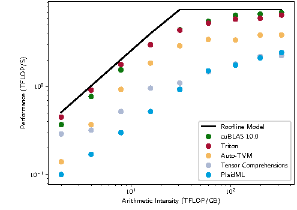

# 用读写量和计算量选择优化方向

一个 kernel 从 8 微秒变成 12 微秒，单看源码很难知道多出来的 4 微秒去了哪里。可能是读写字节增加了，可能是 tile 让计算单元吃不饱，也可能只是多了一次 launch 或同步。先算工作量和数据流量，再把它们与真实 trace 对照，才能知道下一步该改算法、layout，还是调度。

这一页只做一件事：给性能差异建立一笔能复算的账。公式提供下界，benchmark 提供实际时间，二者之间的差值才是需要继续调查的部分。

## 向量加先算多少字节

对N个FP32元素计算 `z=x+y`，读取x、y各4N字节，写z为4N字节，总逻辑流量12N字节，计算量N次加法。算术强度约为1/12 FLOP/byte。

设N为一百万，流量12MB。如果假想设备的有效可用带宽为1TB/s，单纯搬运下界为12微秒。这里的带宽是明确假设，不是任何机器实测。实际时间还包括launch、地址处理、内存事务和未达到带宽上限的损失。

Triton向量加教程也按三份tensor大小计算有效GB/s。若报告的带宽高于HBM峰值，先检查数据是否反复命中缓存，以及字节口径是否把缓存读取误称为HBM读取。

## 计算与访存通常有重叠

令运算量F、实际读写M、计算上限P、带宽上限B，则理想下界可写为

$$
T_{lower}=\max(F/P,M/B).
$$

直接把两项相加隐含完全串行，未必符合kernel流水。实际时间还可能包括未隐藏的launch、同步、转换与通信，但这些项目也可能彼此重叠，最终要看关键路径。

<!-- systems-workflow-visual -->

计算与搬运可能重叠，不能默认相加；完整路径还包含下界没有描述的开销。

## Fusion究竟减少哪项

设两步为 `u=x+y`、`z=relu(u)`，FP32且忽略缓存。分开执行共读写5N个元素，即20N字节；融合后读取x、y并写z，共12N字节，理论少8N字节，同时少一次launch。

若中间u还被另一个分支使用，就不能无条件消除它的写回。若融合使寄存器不足而spill，也会新增流量。模型必须反映完整计算图，而非只看两行源码。

## 优化价值还取决于出现频率

假设路径A每次100微秒、占调用90%，路径B每次2毫秒、占10%。每100次调用，A累计9毫秒，B累计20毫秒。B虽然少见，却占更多时间。

若把A提速两倍，总时间从29毫秒降到24.5毫秒；若把B提速两倍，则降到19毫秒。这个简单加权说明，应按累计关键路径时间筛热点，再讨论特化。

## 选择库、融合或自定义实现

当已有GEMM接近可用计算上限，换语言重写通常缺少明确收益来源；当中间张量反复写回，融合可能有可计算的流量优势；当只有少数shape明显落后，先检查layout和dispatch，再考虑特化。

每个提案先写明它要消除哪次读写、哪段等待或哪项浪费。若写不出这一步，继续profiling比直接改tile更有用。

## 把模型落到一次 benchmark

测一个 kernel 时，先固定 shape、dtype、batch 和 warmup 次数。记录端到端时间、纯 kernel 时间、实际读写字节、FLOPs、launch 次数和同步位置。向量加的有效带宽可以写成 (12N/t)，但这个数只在三次全局读写都确实发生时有意义；若输入已经留在片上缓存，报告里应把缓存命中和 HBM 流量分开。

融合 softmax 的例子更能说明边界。Triton 教程把“行能否放进 GPU SRAM”作为适用条件，满足时可以减少中间写回；行太长、寄存器压力过大或形状不规则时，同一个融合方案可能失去优势。教程里的 benchmark 是方法示范，不是对所有 GPU 和 workload 的性能承诺。

可以把一次测量整理成四列：理论下界、实际 kernel 时间、未解释差值、下一步验证。差值若随着 shape 增大而接近固定值，先查 launch 和同步；若随字节数变化，先查访存和 layout；若只在某些 shape 出现，优先查 dispatch、padding 和 tile 选择。

{ width="820" }

<small>图源：[Triton MAPL 2019 paper](https://www.eecs.harvard.edu/~htk/publication/2019-mapl-tillet-kung-cox.pdf)。原图表达实现结果相对 roofline 上限的位置；读图重点是把 kernel 选型先拆成 compute、memory 和 overhead 三张账。它不能替代真实 workload profile。</small>

## 继续读

成本估计需要真实 shape 支撑，可以接着看[workload 建模与 shape bucket](workload-modeling-and-shape-buckets.md)、[性能反模式](performance-anti-patterns-and-failure-modes.md)和[profiling 调试](profiling-debugging-and-numerical-stability.md)。

## 对照源码与延伸阅读

- [向量加的有效流量口径](https://github.com/triton-lang/triton/blob/cd2e01c6686d6503802e6cdfac56d5a5dfdb27a1/python/tutorials/01-vector-add.py)
- [融合softmax的读写分析](https://github.com/triton-lang/triton/blob/cd2e01c6686d6503802e6cdfac56d5a5dfdb27a1/python/tutorials/02-fused-softmax.py)

**来源与改编说明**：流量、带宽和融合例子参考 [Triton Vector Addition](https://triton-lang.org/main/getting-started/tutorials/01-vector-add.html) 与 [Fused Softmax](https://triton-lang.org/main/getting-started/tutorials/02-fused-softmax.html) 的教学口径。页面中的数值是可计算的教学例子，不代表某张 GPU 的实测结果。
