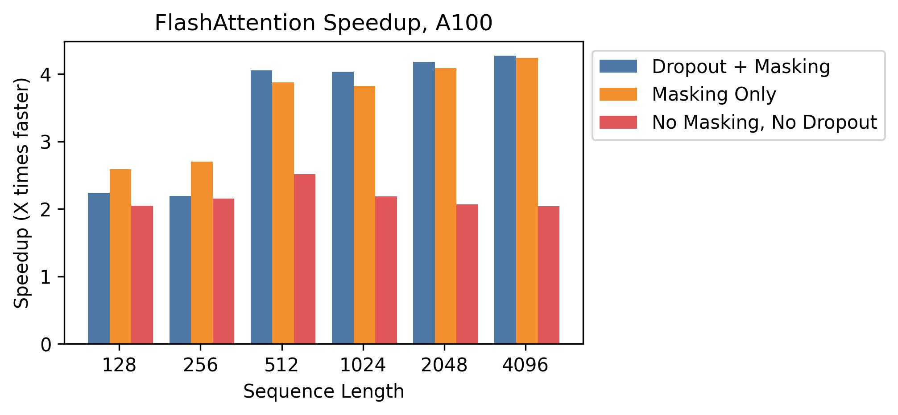

# FlashAttention 与长上下文：先分清三张账

FlashAttention 经常被讲成“新的 attention 机制”，但它没有改变 dense attention 的数学定义，也没有把二次配对计算变成线性。它真正改变的是数据路径：不要把完整的 \(QK^\top\) 分数矩阵和 softmax 概率矩阵写进 HBM，再读出来乘 \(V\)；而是在片上分块完成打分、归一化和输出累积。

长上下文系统至少有三张账。第一张是 attention kernel 的 I/O 账，FlashAttention 主要处理这里。第二张是 decode 阶段的 KV cache 账，PagedAttention、KV quantization、prefix cache 和 batching 主要处理这里。第三张是更长上下文训练或推理的并行账，RingAttention、Ulysses 和 context parallel 主要处理这里。把这三张账分开，才能知道一个方法到底省了什么。

## 标准 attention 的问题不只在 FLOPs

单个 attention head 通常写成：

\[
O=\operatorname{softmax}\left(\frac{QK^\top + M}{\sqrt{d_h}}\right)V
\]

这行式子里，\(Q\) 是当前 query，\(K,V\) 是可见历史或同段序列，\(M\) 是 causal mask、padding mask 或其他 bias，\(d_h\) 是单个 head 的维度。数学上它很短，但朴素实现会显式生成两张 \(L_q\times L_k\) 的中间矩阵：score 和 probability。

训练或 prefill 里常见 \(L_q=L_k=L\)。如果 \(L=16{,}384\)，单 head 的 score 元素数就是 \(L^2=268{,}435{,}456\)。只用 BF16 存一份 score 就约 512 MiB；多 head、多层、softmax 输出、dropout、反向保存状态和 workspace 叠起来，瓶颈很快从“算不算得动”变成“中间矩阵能不能别反复进出 HBM”。

{ width="920" }

<small>图源：[FlashAttention: Fast and Memory-Efficient Exact Attention with IO-Awareness](https://arxiv.org/abs/2205.14135)。原图展示 HBM 与片上 SRAM 的带宽/容量差异，以及 Q/K/V 如何按块进入片上内存。这里用它说明：FlashAttention 的对象不是 attention 公式，而是 attention 的数据流。</small>

## FlashAttention 的关键是 online softmax

如果不把完整 score 矩阵写到 HBM，softmax 会变难。普通 softmax 要知道整行最大值和指数和：

\[
\operatorname{softmax}(s)_j=
\frac{\exp(s_j-m)}{\sum_t \exp(s_t-m)},\qquad
m=\max_t s_t
\]

FlashAttention 每次只读取一块 \(K,V\)，因此要一边扫 block，一边维护每个 query 行的统计量。它维护三个状态：目前见过的最大值 \(m\)，以这个最大值为基准的指数和 \(l\)，以及还没有除以 \(l\) 的输出累积 \(o\)。

当新的一块 \(K_j,V_j\) 进入片上内存，产生当前分数块 \(S_j\)。新的最大值是：

\[
m'=\max(m,\max(S_j))
\]

旧的指数和要按新最大值重新缩放：

\[
l'=e^{m-m'}l+\sum_t e^{S_{j,t}-m'}
\]

输出累积也用同样的缩放接上新块贡献：

\[
o'=e^{m-m'}o+\sum_t e^{S_{j,t}-m'}V_{j,t}
\]

扫完整个 \(K,V\) 后，输出就是 \(O=o/l\)。这几行式子的意思很朴素：不必先把整行 probability 存下来，只要在分块过程中正确更新最大值、归一化项和输出累积，最终结果仍等价于完整 softmax attention。FlashAttention 是 exact dense attention 的 IO-aware 实现，不是丢 token，也不是近似 softmax。

反向传播也利用同一个思路。它保存较小的行级统计，backward 时重算需要的分块分数，用更多计算换更少激活常驻和 HBM 往返。

## 它省的是中间矩阵 I/O，不是所有长上下文成本

FlashAttention 减少 score/probability matrix 的 materialization，也减少 HBM 读写，但 dense attention 仍要覆盖所有 query-key 配对。对于完整 dense prefill，计算量仍随 \(L_qL_kd_h\) 增长。

| 技术问题 | FlashAttention 解决了什么 | 还没有解决什么 |
| --- | --- | --- |
| score/probability 是否完整落 HBM | 尽量不落，片上分块更新 softmax 和输出 | Q/K/V、输出和部分状态仍要读写 |
| attention 是否仍 exact | 原始设定下是 exact dense attention | 任意 mask、dropout、低精度和 backend 仍要验证 |
| 长上下文是否线性化 | 没有，dense attention 配对计算仍在 | 超长上下文总算力仍会增长 |
| 服务是否自动变快 | prefill attention 热路径更可能受益 | decode、KV cache、scheduler、tail latency 另算 |

因此读 benchmark 时要把条件写全：训练还是推理，prefill 还是 decode，GPU 架构、dtype、head dimension、mask、dropout、序列长度和 backend 是什么。FlashAttention 的收益真实存在，但不是一个可脱离 workload 的固定倍数。

## FlashAttention-2 和 3 是 GPU 工作分配继续演化

第一代 FlashAttention 先把 HBM 中间写回砍掉。砍掉之后，下一层瓶颈就会变成 GPU 内部工作分配：非 matmul FLOPs、warp 同步、shared memory 读写、block 间并行和 Tensor Core 喂数。

FlashAttention-2 的重点，是让更多时间落在 Tensor Core 友好的 matmul 上，并把同一个 attention head 更好地切给多个 thread block，避免 batch/head 数不足时 SM 吃不满。FlashAttention-3 进一步面向 Hopper，把 WGMMA、TMA、异步流水和低精度路径纳入 attention kernel 设计。

{ width="760" }

<small>图源：[FlashAttention](https://arxiv.org/abs/2205.14135) 实验图。原图对比不同设置下 FlashAttention 相对普通 attention 实现的速度变化；关键读法是：速度曲线来自具体 GPU、shape、mask、dropout 和实现路径，不能外推成所有 attention 的固定加速倍数。</small>

这条演化线说明：FlashAttention 不是一个静态技巧，而是一个随 GPU memory hierarchy、Tensor Core 指令、编译栈和低精度路径一起变化的 kernel family。

## Prefill 和 decode 是两类问题

LLM 服务里，prefill 和 decode 的 attention 形态不同。

```text
prefill: 长 prompt 一次进入，L_q 和 L_k 都大
decode: 每步只来一个或少量新 token，反复读取历史 KV
```

Prefill 更接近训练里的大块 dense attention，FlashAttention 的分块计算和 online softmax 很关键。Decode 则常见 \(L_q=1\)，但 \(L_k\) 等于历史上下文长度；每生成一个 token，都要读取越来越长的 KV cache。此时瓶颈更像“短 query 扫长历史”的显存带宽、page locality 和调度问题。

KV cache 的容量账可以粗略写成：

\[
M_{\text{KV}} = B\cdot T\cdot 2\cdot N_{\text{layer}}\cdot N_{\text{kv-head}}\cdot d_h\cdot b
\]

这里 \(B\) 是并发请求数，\(T\) 是缓存 token 数，2 表示 K 和 V，\(N_{\text{layer}}\) 是层数，\(N_{\text{kv-head}}\) 是 KV head 数，\(d_h\) 是 head 维度，\(b\) 是每个元素字节数。MQA/GQA 减少 \(N_{\text{kv-head}}\)，KV quantization 减少 \(b\)，PagedAttention 处理的是 KV cache 的页式分配、碎片和共享，prefix cache 处理的是重复前缀复用。

所以 Flash-Decoding、PagedAttention、chunked prefill、continuous batching、prefix cache、sliding window 和 KV quantization 不是同一种优化。它们分别落在 prefill 吞吐、decode 带宽、cache 分配、请求调度和上下文裁剪的不同位置。

## 更长上下文会走向并行和评测问题

当上下文从 32k 到 128k，再到百万级 token，单个 attention kernel 已经不够。长上下文系统至少还要处理五件事：位置编码能否外推；mask 或稀疏结构是否改变可见关系；KV cache 是否能承受长历史和动态请求；sequence dimension 是否需要跨设备切分；评测是否证明模型真的使用了长上下文。

RingAttention 代表的是第三张账：把序列块分到多张卡上，让 K/V block 沿设备环传递，以 blockwise attention 完成超长序列计算。

{ width="760" }

<small>图源：[Ring Attention with Blockwise Transformers for Near-Infinite Context](https://arxiv.org/abs/2310.01889)。原图表达序列分块分布在多个设备上，并让 K/V block 沿设备环传递。这里用它说明：当上下文继续变长，问题会从单 kernel 的片上复用扩展到跨设备通信和 sequence parallel。</small>

长上下文能力也不能只看最大 context length。真正有用的证据包括 retrieval、multi-hop reasoning、代码仓库理解、长视频/多图输入、工具调用、抗干扰、TTFT、TPOT、P95/P99、吞吐和成本。上下文能塞进去，不等于模型会稳定使用。

## 三种“快”不能混用

FlashAttention 的快，主要是 attention kernel 在给定 shape 上更少写 HBM、更好利用片上内存和 Tensor Core。PagedAttention 的快，主要是 serving runtime 在动态请求中更好管理 KV cache、碎片和 batching。RingAttention 的长，主要是把 sequence dimension 拆到多卡，突破单卡容量和序列长度限制。

它们可以叠加，但不能互相替代。一个线上 LLM 可以用 FlashAttention 做 prefill，用 PagedAttention 管 KV cache，用 prefix cache 复用系统提示词；一个超长上下文训练任务则可能还需要 sequence parallel、activation checkpointing、重算和通信重叠。把这些都叫“长上下文优化”，就看不清真实瓶颈。

## 最后的判断

FlashAttention 把 attention 从“显式矩阵流水线”改成“分块流式归一化”。它解决的是 dense attention 的中间矩阵 I/O 账。长上下文系统还要继续解决 decode KV cache、runtime 调度、跨设备 sequence parallel 和长上下文评测。读任何新方法时，先问它改的是 kernel、cache、runtime、并行，还是评测证据。

## 外部精读

- [FlashAttention](https://arxiv.org/abs/2205.14135)：理解 IO-aware tiling、online softmax、exact attention 和 backward 重算。
- [FlashAttention-2](https://arxiv.org/abs/2307.08691)：理解为什么减少 HBM 往返后，GPU 内部工作分配会成为下一层瓶颈。
- [FlashAttention-3](https://arxiv.org/abs/2407.08608)：理解 Hopper、WGMMA、TMA、异步流水和低精度路径如何继续改变 attention kernel。
- [Flash-Decoding for long-context inference](https://pytorch.org/blog/flash-decoding/)：理解 decode 阶段为什么是短 query、长 KV 的另一类问题。
- [vLLM / PagedAttention](https://vllm.ai/blog/vllm)：理解 KV cache page/block、碎片、sharing 和 continuous batching。
- [PagedAttention paper](https://arxiv.org/abs/2309.06180)：从论文证据看 high-throughput LLM serving 的内存管理。
- [Ring Attention](https://arxiv.org/abs/2310.01889)：理解 sequence blocks、ring pass K/V 和 blockwise attention。
- [DeepSpeed Ulysses](https://arxiv.org/abs/2309.14509)：理解 long-sequence training 中的 sequence parallel 与 all-to-all 通信。

## 相关阅读与下一步

- 外部材料：[NVIDIA CUDA C++ Programming Guide](https://docs.nvidia.com/cuda/cuda-c-programming-guide/)。
- 外部材料：[Triton 文档](https://triton-lang.org/main/index.html)。
- 外部材料：[CUTLASS 文档](https://docs.nvidia.com/cutlass/)。
- 站内下一步：[算子与编译器专题](index.md)。
- 站内下一步：[CUDA 编程模型与内存层次](cuda-programming-model-and-memory.md)。
- 站内下一步：[Triton 编程模型与自动调优](triton-programming-model-and-autotuning.md)。
