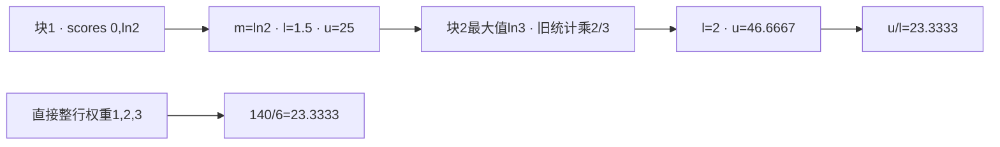
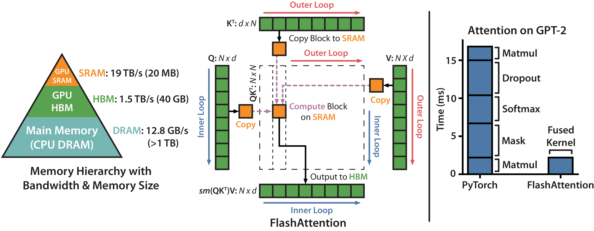
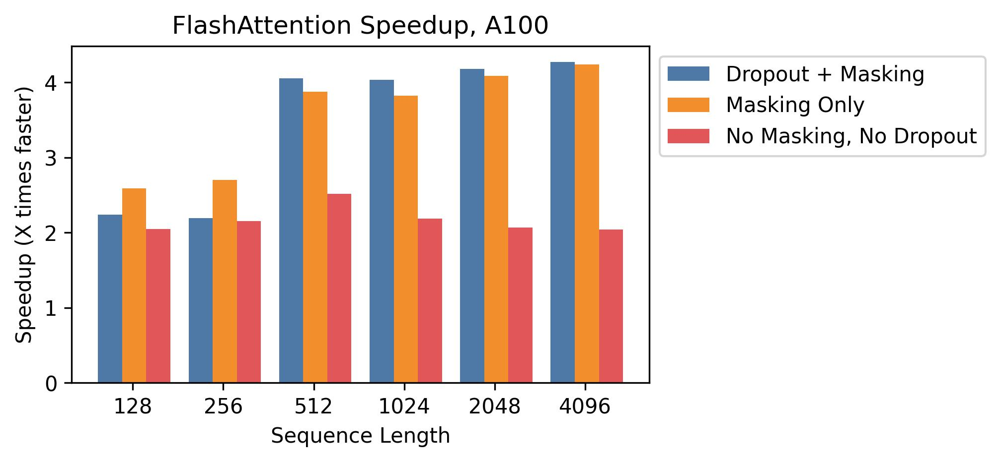
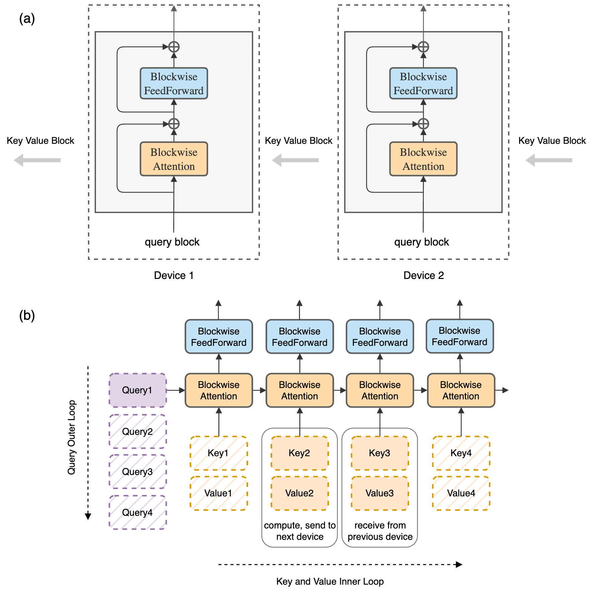

# FlashAttention 怎样不保存完整分数矩阵

长度为T的dense attention通常要计算T×T个query-key配对。若把分数矩阵S和概率矩阵P都写入显存，再读取P乘V，长序列会产生很大的中间读写。FlashAttention通过分块和在线softmax，在处理每块K/V时同时更新归一化统计与输出。

## 分块以后，分母还属于整行

先只看一条query。分数为 $s_i$、value为 $v_i$，目标输出为

$$
o=\frac{\sum_i e^{s_i}v_i}{\sum_i e^{s_i}}.
$$

如果把前半行和后半行分别softmax，每半行的权重各加起来都是1，直接相加会让整行权重变成2。正确分块需要把各块放回同一个分母。

为了避免指数溢出，维护已经看过分数的最大值m、缩放后分母l、未归一化输出u。新块最大值为b，取 $m'=\max(m,b)$，更新

$$
l'=e^{m-m'}l+\sum_{j\in block}e^{s_j-m'},
$$

$$
u'=e^{m-m'}u+\sum_{j\in block}e^{s_j-m'}v_j.
$$

最后返回u/l。最大值变化时，旧统计量必须同步缩放，否则新旧块的数不在同一尺度。

## 两块数据完整算一次

取分数 $[0,\ln2,\ln3]$，value为 `[10,20,30]`。直接算的指数权重为 `[1,2,3]`，输出为 $140/6\approx23.3333$。

先处理前两个位置，$m=\ln2$，$l=0.5+1=1.5$，$u=0.5\times10+1\times20=25$。新块只有第三个位置，$m'=\ln3$，旧统计乘 $e^{\ln2-\ln3}=2/3$，得到

$$
l'=1.5\times2/3+1=2,\qquad
u'=25\times2/3+30=46.6667.
$$

最后仍为23.3333。全过程只保存当前块及几个行统计量，无需保存完整概率行。

```python
import math
scores, values = [0.0, math.log(2), math.log(3)], [10.0, 20.0, 30.0]
m, total, weighted = -math.inf, 0.0, 0.0
for start, end in [(0, 2), (2, 3)]:
    new_m = max(m, max(scores[start:end]))
    factor = math.exp(m - new_m)
    probs = [math.exp(s - new_m) for s in scores[start:end]]
    total = factor * total + sum(probs)
    weighted = factor * weighted + sum(p * v for p, v in zip(probs, values[start:end]))
    m = new_m
print(weighted / total)
```

<!-- systems-workflow-visual -->


图中的重标定让两个块使用同一尺度，最终与整行归一化一致。

## 对应到GPU，哪些数据留在片上

一个query块留在片上，kernel沿K/V块循环，计算局部分数、更新m/l/u，再进入下一块。输出块完成后才写回。Triton fused-attention教程里的 `m_i`、`l_i`、`acc`正对应这三个状态；实现使用exp2并调整分数尺度，数学关系相同。

反向传播也要处理不保存P的选择。可以保存必要的归一化统计，在反向时重算局部分数和概率，用额外计算减少大中间张量存储。具体舍入、归约顺序与参考实现可能不同，数学等价不保证逐bit相等。

{ width="920" }

<small>图源：[FlashAttention: Fast and Memory-Efficient Exact Attention with IO-Awareness](https://arxiv.org/abs/2205.14135)。原图展示 HBM 与片上 SRAM 的带宽/容量差异，以及 Q/K/V 如何按块进入片上内存。这里用它说明：FlashAttention 的对象不是 attention 公式，而是 attention 的数据流。</small>

## 长上下文仍有哪些成本

Dense配对运算仍随T平方增长；输入输出和训练激活仍占空间；自回归服务的KV仍随历史长度增长。FlashAttention改善中间矩阵I/O，不能自动解决所有长上下文资源问题。

Prefill的query数量通常较多，适合块矩阵计算；decode常只有每请求一个query，需要扫历史KV，此时分页布局、GQA复用和split-K并行可能更重要。二者应按不同shape测试。

后续FlashAttention版本继续改进工作分配、流水与特定硬件指令利用。阅读版本性能时要固定GPU、dtype、head dimension、因果mask和序列长度，不能把某个实验的倍数当成在线softmax公式本身保证的加速。


{ width="760" }

<small>图源：[FlashAttention](https://arxiv.org/abs/2205.14135) 实验图。原图对比不同设置下 FlashAttention 相对普通 attention 实现的速度变化；关键读法是：速度曲线来自具体 GPU、shape、mask、dropout 和实现路径，不能外推成所有 attention 的固定加速倍数。</small>

{ width="760" }

<small>图源：[Ring Attention with Blockwise Transformers for Near-Infinite Context](https://arxiv.org/abs/2310.01889)。原图表达序列分块分布在多个设备上，并让 K/V block 沿设备环传递。这里用它说明：当上下文继续变长，问题会从单 kernel 的片上复用扩展到跨设备通信和 sequence parallel。</small>

## 对照源码与延伸阅读

- [固定版本的 FlashAttention v2 教程实现](https://github.com/triton-lang/triton/blob/cd2e01c6686d6503802e6cdfac56d5a5dfdb27a1/python/tutorials/06-fused-attention.py)
