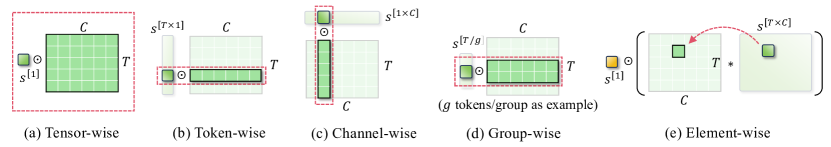

# 低比特权重从打包字节到矩阵乘

W4A16通常意味着权重以4-bit表示、激活保持16-bit路径。Kernel需要先找到packed码值，恢复对应权重，再与激活相乘。只把文件压小，却让每次前向在显存里展开一份完整BF16矩阵，可能增加额外读写。

## 解开一个字节

用教学布局把两个无符号4-bit码值3和12存为195。低四位是3，高四位是12。若scale=0.2、zero point=5，则还原为-0.4和1.4。

```python
byte = 195
q0, q1 = byte & 15, (byte >> 4) & 15
w0, w1 = 0.2 * (q0 - 5), 0.2 * (q1 - 5)
x0, x1 = 2.0, 3.0
print(x0 * w0 + x1 * w1)  # 3.4
```

真实packing常按矩阵指令和访存粒度交错多行。Kernel必须知道位顺序、group映射与scale轴。两个文件同为4-bit，并不能直接共享解包代码。

## 先展开整矩阵还是在tile里恢复

设权重有N个元素。忽略元数据，4-bit码值约N/2字节，BF16约2N字节。如果每次先反量化写出BF16，再由GEMM读取，额外写入与读入合计4N字节，可能抵消压缩读取的收益。

融合路径读取当前tile的packed权重，局部解包并反量化，直接进入乘加。它省下全矩阵中间写回，但增加整数位操作、scale读取和寄存器占用。若weight-only kernel最后使用浮点乘法，其收益主要可能来自权重带宽，而非INT4运算峰值。

## Group size也决定地址和元数据流

每128个权重一个FP16 scale，码值64字节、scale2字节，共66字节。每32个一组时，同样128个权重需要8字节scale，变成72字节。更细分组可能减少量化误差，同时增加scale加载与索引。

若分组沿K方向，输出是各组部分乘积恢复尺度后的和。不同组scale不能在K归约结束后任取一个乘回。设计kernel时要把scale的生命周期和部分累加器一起考虑。

{ width="820" }

<small>图源：[A Survey of Low-bit Large Language Models: Basics, Systems, and Algorithms](https://arxiv.org/abs/2409.16694)，Figure 2。原图表达不同量化粒度会改变 scale、group 和张量布局；读图重点是把 group size、scale 读取和 dequant fusion 放回 kernel 路径。它不能证明某个粒度一定最快，因为 runtime、tile shape 和硬件支持会改变结论。</small>

## 激活和KV带来动态转换

权重通常可离线准备，激活要随每批输入量化，新增范围归约与转换。KV则每步写入新位置、读取历史页，scale既要和页或通道对应，也要在释放与复用时保持一致。

K误差改变attention分数，V误差改变加权值。低精度attention的数值检查需要覆盖两条路径，不能只检查最终平均误差。长上下文还会改变读取量和误差传播。

## 按执行边界验证

先用小张量比较浮点参考、模拟量化与真实packed kernel，确认位序、zero point和scale一致。再测已打包权重的纯kernel、包含转换的完整层及完整请求。

若低batch decode受权重读取限制，压缩可能有明显收益；若大batch矩阵乘主要受计算限制或转换占比高，结果会不同。每个速度结论都应绑定shape、dtype、layout、设备和计时范围。


## 对照源码与延伸阅读

- [AWQ模拟量化与实际量化层构造](https://github.com/mit-han-lab/llm-awq/blob/d6e797a42b9ef7778de8ee2352116e0f48a78d61/awq/quantize/quantizer.py)
- [低精度矩阵乘要求的scale布局](https://github.com/deepseek-ai/DeepGEMM/blob/5081f8513af57e61696de4f4f04b0e707ffb503e/README.md)
