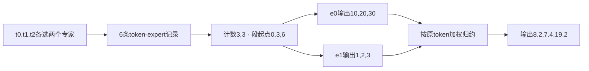
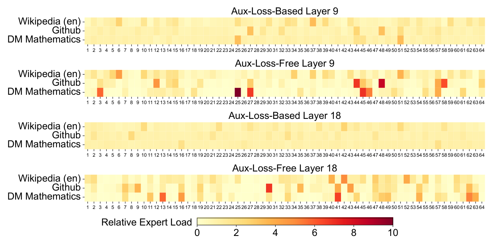

# 三个 token 怎样被送到两个专家

MoE先为每个token选专家，再把属于同一专家的token凑成矩阵，执行专家网络，最后恢复原位置并加权合并。模型只激活部分专家，执行系统仍需完成这些索引和数据搬运。

## 把路由结果写成可检查的表

设三个token为t0、t1、t2，两个专家为e0、e1。为展示top-2路径，三条token都送给两个专家，但组合权重不同。

| token | e0权重 | e1权重 |
| --- | --- | --- |
| t0 | 0.8 | 0.2 |
| t1 | 0.3 | 0.7 |
| t2 | 0.6 | 0.4 |

总共产生6条token-expert记录。更大模型里top-k小于专家总数时，记录数仍是约T×k，而非T×全部专家数。选中概率是否重新归一化由模型定义，本例已让每行加起来为1。

## 计数和前缀和决定写入位置

先按专家统计记录数，本例为 `[3,3]`；前缀和给出段起点 `[0,3,6]`。把记录按专家排列，就得到e0的 `[t0,t1,t2]` 和e1的 `[t0,t1,t2]` 两段，同时保存原token编号与对应权重。

若路由不同，每段长度也不同。例如top-1分配为e0接t0、t2，e1接t1，计数变成 `[2,1]`。按段连续摆放可以让每个专家执行规则矩阵乘，但permutation本身需要读写激活。

Triton grouped-GEMM教程把多个矩阵问题的shape和指针放在设备端，由固定数量CTA轮流处理各问题的输出tile。它示范的是如何调度多组GEMM，不替模型完成路由、数据交换或输出加权。

<!-- systems-workflow-visual -->

专家顺序中的输出必须恢复token身份，并汇总每条路线的贡献。

## 专家输出怎样回到原token

设两个专家在本例对三条token的标量输出分别为 `[10,20,30]` 和 `[1,2,3]`。加权合并得到

$$
y_0=0.8\times10+0.2\times1=8.2,\quad
y_1=7.4,\quad y_2=19.2.
$$

若只按专家顺序拼接输出，没有反置换和加权归约，就得不到模型定义的结果。并行写回同一token时还需避免覆盖竞争，可用原子累加或先存各路线输出再归约等实现。

## 专家并行增加一次跨设备交换

专家分布在不同GPU时，token记录要按目标rank打包并传输，返回时再反向交换。消息量取决于token数、top-k、隐藏维度、dtype及路由分布。热门专家会同时增加计算和通信拖尾。

固定capacity实现可能截断、丢弃或回退超额token；dropless实现则接受全部记录，可能支付动态shape、padding和更不均匀的执行时间。不能看到“capacity factor”就假定所有实现都会丢token。

## 稀疏FLOPs何时没有变成低延迟

小batch decode可能让每个专家只有很少的行，GEMM利用率低，重排与通信却仍要执行。Grouped GEMM减少分散调度开销，但无法消除真实数据移动。

评估时把router、permute、dispatch、专家计算、combine放进同一时间线，统计每专家token数而非只看平均数。只有这样，才能分清慢在矩阵乘、网络还是少数专家拥塞。

{ width="760" }

<small>图源：[DeepSeek-V3 Technical Report](https://arxiv.org/abs/2412.19437)。原图表达 expert load 的均衡状态；读图重点是把 sparse kernel 性能先放回 token-to-expert 分布、grouped GEMM 和 all-to-all 账本。它不能证明路由天然均衡，也不能替代线上 expert 热点监控。</small>

## 对照源码与延伸阅读

- [Grouped GEMM 的设备端tile调度](https://github.com/triton-lang/triton/blob/cd2e01c6686d6503802e6cdfac56d5a5dfdb27a1/python/tutorials/08-grouped-gemm.py)
- [MoE contiguous/masked与MegaMoE接口边界](https://github.com/deepseek-ai/DeepGEMM/blob/5081f8513af57e61696de4f4f04b0e707ffb503e/README.md)
